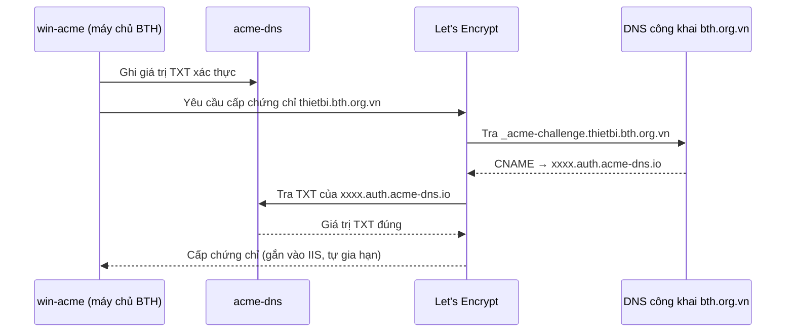

# CHỨNG CHỈ HTTPS CHO `thietbi.bth.org.vn`
## Let's Encrypt miễn phí, tự gia hạn — máy chủ KHÔNG cần mở ra Internet

| | |
|---|---|
| Áp dụng | Bệnh viện chưa có chứng chỉ `*.bth.org.vn`; máy chủ chỉ phục vụ mạng nội bộ |
| Công cụ | **win-acme** (`wacs.exe`) – ACME client miễn phí cho Windows/IIS |
| Xác thực | **DNS-01 qua acme-dns** (uỷ quyền bằng 1 bản ghi CNAME, làm **một lần**) |
| Kết quả | Chứng chỉ tin cậy sẵn trên mọi máy tính/điện thoại, **tự gia hạn**, tự gắn vào IIS |

---

### 1. Vì sao chọn cách này

- **Không tốn phí**, không phải nhớ ngày hết hạn. Từ 15/03/2026, chứng chỉ công khai chỉ có hiệu lực tối đa **200 ngày**, và theo lộ trình của CA/Browser Forum sẽ còn rút ngắn tiếp. Kể cả mua chứng chỉ thương mại thì vẫn phải thay nhiều lần mỗi năm, nên **tự động gia hạn** là cách bền vững.
- Máy chủ **không cần mở cổng 80/443 ra Internet**. Let's Encrypt kiểm tra quyền sở hữu tên miền qua một bản ghi DNS TXT, không truy cập vào máy chủ.
- Bản ghi TXT phải đổi mỗi lần gia hạn. Thông thường việc này cần API của nhà cung cấp DNS (đa số nhà đăng ký tên miền `.vn` không có). Cách xử lý: **uỷ quyền một lần bằng CNAME** sang dịch vụ **acme-dns**. Từ đó win-acme tự cập nhật TXT bên acme-dns, không động vào DNS của bệnh viện nữa.



### 2. Điều kiện

| Điều kiện | Ghi chú |
|---|---|
| Quyền thêm **1 bản ghi CNAME** trên DNS **công khai** của `bth.org.vn` | Qua trang quản trị của nhà cung cấp tên miền (đơn vị đăng ký `.vn`), hoặc nhờ đơn vị đó thêm hộ |
| Máy chủ web **ra được Internet** (chiều đi, HTTPS 443) tới `acme-v02.api.letsencrypt.org` và máy chủ acme-dns | Chỉ cần chiều đi; không mở cổng chiều vào |
| Website `ThietBiCNTT` đã cài trên IIS (chạy `caidat-iis.ps1` **không** kèm `-CertThumbprint`) | Binding HTTP có host `thietbi.bth.org.vn` |
| Bản ghi DNS **nội bộ** `thietbi.bth.org.vn → <IP máy chủ>` | Để người dùng trong viện truy cập; **không** cần bản ghi A công khai |

> **Về máy chủ acme-dns:** mặc định dùng dịch vụ công cộng `https://auth.acme-dns.io`, miễn phí. Dịch vụ này chỉ giữ giá trị TXT xác thực, không giữ khoá riêng hay chứng chỉ. Bệnh viện có thể tự dựng acme-dns riêng nếu chính sách bảo mật yêu cầu (xem mục 6).

### 3. Cài win-acme

1. Tải bản **win-acme x64 (pluggable, .NET)** từ trang phát hành chính thức của dự án win-acme (GitHub `win-acme/win-acme` → *Releases*).
2. Giải nén vào `C:\Program Files\win-acme\` (thư mục cố định, **không** để ở Downloads: tác vụ gia hạn chạy từ thư mục này).
3. Mở PowerShell **Run as Administrator**, chạy `C:\Program Files\win-acme\wacs.exe`.

### 4. Tạo chứng chỉ (chế độ menu, làm một lần ~10 phút)

Trong menu của `wacs.exe`, chọn lần lượt (tên mục có thể khác đôi chút giữa các phiên bản):

| Bước | Chọn / nhập |
|---|---|
| Menu chính | **M**: *Create certificate (full options)* |
| Nguồn tên miền | *Read bindings from IIS* → chọn site **ThietBiCNTT** → chọn host **thietbi.bth.org.vn** |
| Cách tách chứng chỉ | Mặc định (1 chứng chỉ cho site) |
| **Cách xác thực** | *[dns] Create verification records with **acme-dns*** |
| Máy chủ acme-dns | `https://auth.acme-dns.io` (Enter để dùng mặc định) |
| ➜ win-acme hiển thị | **Bản ghi CNAME cần tạo**, dạng:<br>`_acme-challenge.thietbi.bth.org.vn  CNAME  1a2b3c4d-....auth.acme-dns.io` |
| **Tạm dừng ở đây** | Vào trang quản trị DNS của `bth.org.vn`, thêm đúng bản ghi CNAME trên (TTL 300–3600), đợi 5–30 phút cho DNS cập nhật, rồi bấm Enter để win-acme kiểm tra |
| Loại khoá | RSA (mặc định) |
| Nơi lưu chứng chỉ | *Windows Certificate Store* (Local Computer) |
| Cài đặt | *Create or update **https bindings in IIS*** → site **ThietBiCNTT** (port 443, SNI) |
| Email | Email nhóm CNTT (nhận cảnh báo nếu gia hạn lỗi), đồng ý điều khoản |

Kiểm tra CNAME trước khi bấm Enter (từ máy có Internet):
```powershell
Resolve-DnsName _acme-challenge.thietbi.bth.org.vn -Type CNAME -Server 8.8.8.8
```

Khi thành công:
- Chứng chỉ có trong *Local Computer → Personal* và đã gắn vào binding 443 của site `ThietBiCNTT`.
- Có tác vụ Task Scheduler **win-acme renew** chạy hằng ngày, tự gia hạn trước hạn khoảng 30 ngày và tự cập nhật binding IIS.
- Thông tin acme-dns được win-acme lưu lại, **lần gia hạn sau không cần làm gì với DNS nữa**.

> **Không xoá bản ghi CNAME** `_acme-challenge.thietbi` sau khi cấp xong: mỗi lần gia hạn đều cần nó.

### 5. Kiểm tra

```powershell
# Chứng chỉ trên máy chủ
Get-ChildItem Cert:\LocalMachine\My | Where-Object Subject -like "*thietbi.bth.org.vn*" |
    Format-List Subject, Issuer, NotAfter, Thumbprint
# Tác vụ gia hạn
Get-ScheduledTask | Where-Object TaskName -like "win-acme*"
# Chạy thử gia hạn (không cấp mới nếu chưa đến hạn)
& "C:\Program Files\win-acme\wacs.exe" --renew
```
- Mở `https://thietbi.bth.org.vn` trên máy trong viện và trên điện thoại (Wi-Fi nội bộ): ổ khoá xanh, không cảnh báo.
- Mở `http://thietbi.bth.org.vn`: tự chuyển sang HTTPS.
- Đưa vào giám sát: cảnh báo nếu chứng chỉ còn dưới 14 ngày (`NotAfter`), phòng khi tác vụ gia hạn lỗi.

### 6. Phương án khác

| Phương án | Khi nào | Lưu ý |
|---|---|---|
| **TXT thủ công** (win-acme chọn *Create verification records manually*) | Không thêm được CNAME | Mỗi lần gia hạn phải thêm TXT bằng tay: **không khuyến nghị** khi chứng chỉ ngắn hạn |
| **Plugin DNS của nhà cung cấp** (Cloudflare, Azure DNS, Route 53…) | Nếu chuyển DNS công khai của `bth.org.vn` sang nhà cung cấp có API | Tự động hoàn toàn, không cần acme-dns |
| **Tự dựng acme-dns** trong DMZ | Chính sách không cho dùng dịch vụ bên ngoài | Cần 1 máy chủ có IP công khai, mở cổng 53 UDP/TCP |
| **Mua chứng chỉ thương mại** `*.bth.org.vn` | Muốn dùng chung cho nhiều hệ thống của viện | Vẫn phải thay theo thời hạn mới (≤ 200 ngày); import `.pfx` vào máy chủ, chạy `caidat-iis.ps1 -CertThumbprint <thumbprint>` |
| **CA nội bộ (AD CS)** | Viện có hạ tầng PKI | Điện thoại và máy ngoài domain phải cài chứng chỉ CA gốc |

### 7. Trong khi chờ chứng chỉ

Vẫn có thể cài và chạy thử bằng HTTP (`http://thietbi.bth.org.vn`, chạy `caidat-iis.ps1` không kèm `-CertThumbprint`) để nhập danh mục, đào tạo. **Không đưa vào sử dụng chính thức khi chưa có HTTPS**, vì mật khẩu sẽ truyền dạng rõ trong mạng nội bộ. Khi có chứng chỉ, chỉ cần làm mục 4, không phải cài lại ứng dụng.
