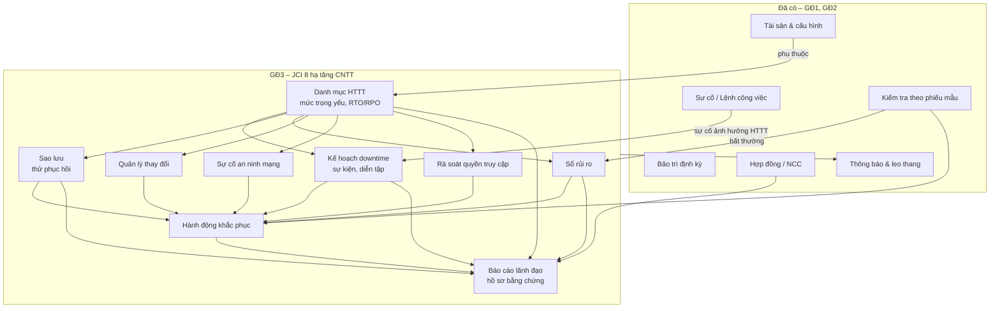
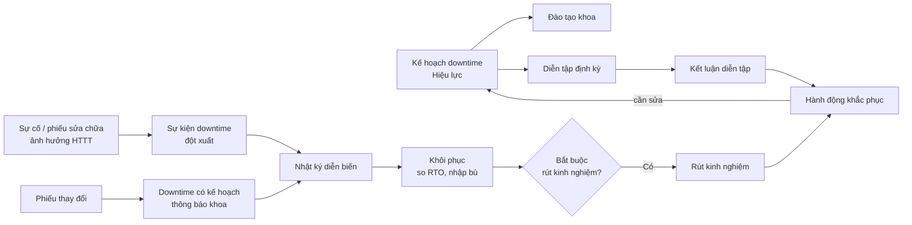
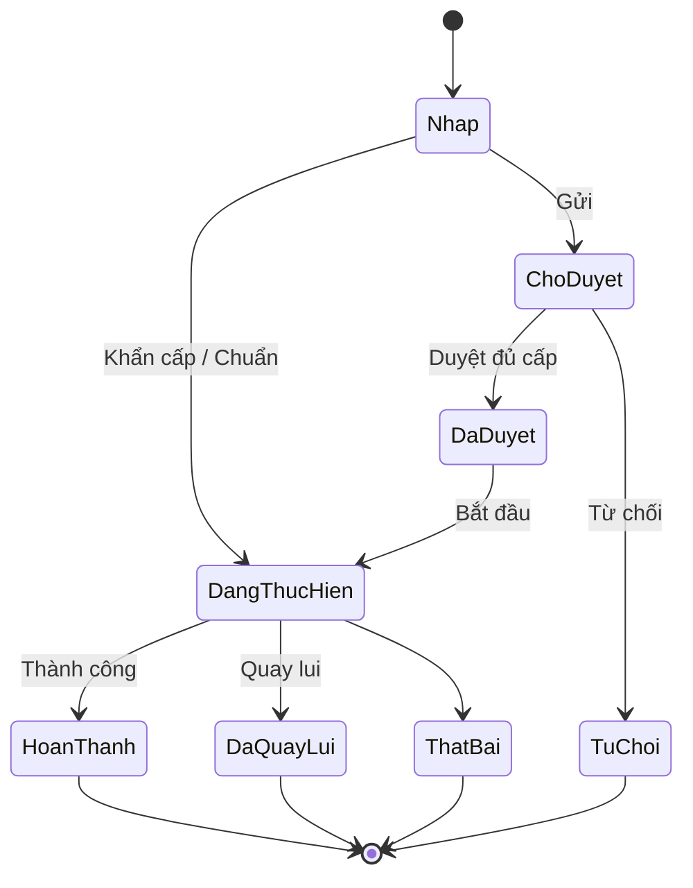

# TÀI LIỆU ĐẶC TẢ YÊU CẦU – GIAI ĐOẠN 3

## QUẢN LÝ HẠ TẦNG CNTT THEO TIÊU CHUẨN JCI PHIÊN BẢN 8

| Thông tin | Nội dung |
|---|---|
| Hệ thống | QLTB-CNTT (mở rộng, xem [SRS.md](SRS.md)) |
| Phạm vi | **Chỉ hạ tầng CNTT**: hệ thống thông tin, máy chủ, lưu trữ, mạng, thiết bị đầu cuối, tiện ích phục vụ CNTT (UPS, điều hoà phòng máy chủ). Không bao gồm thiết bị y tế. |
| Loại tài liệu | Đặc tả yêu cầu phần mềm bổ sung (SRS – Phụ lục GĐ3) |
| Phiên bản | 0.1 (Dự thảo để thống nhất trước khi phát triển) |
| Ngày lập | 24/11/2026 |
| Đơn vị chủ trì | Phòng Công nghệ thông tin |
| Đơn vị phối hợp | Phòng Quản lý chất lượng (đầu mối JCI), Phòng Hành chính quản trị (điện, điều hoà) |

### Lịch sử phiên bản

| Phiên bản | Ngày | Người thực hiện | Nội dung thay đổi |
|---|---|---|---|
| 0.1 | 24/11/2026 | Phòng CNTT | Khởi tạo dự thảo: phân tích khoảng trống so với JCI 8, đặc tả 8 phân hệ mới |

### Phê duyệt

| Vai trò | Họ tên | Chữ ký | Ngày |
|---|---|---|---|
| Lãnh đạo Bệnh viện (phê duyệt) | | | |
| Trưởng phòng CNTT (chủ trì) | | | |
| Trưởng phòng Quản lý chất lượng | | | |

---

## MỤC LỤC

1. [Giới thiệu](#1-giới-thiệu)
2. [Yêu cầu JCI 8 và phân tích khoảng trống](#2-yêu-cầu-jci-8-và-phân-tích-khoảng-trống)
3. [Tổng quan giải pháp](#3-tổng-quan-giải-pháp)
4. [Yêu cầu chức năng theo phân hệ](#4-yêu-cầu-chức-năng-theo-phân-hệ)
   - 4.1 [Danh mục hệ thống thông tin & mức trọng yếu (HTT)](#41-phân-hệ-danh-mục-hệ-thống-thông-tin--mức-trọng-yếu-htt)
   - 4.2 [Kế hoạch ngừng hệ thống – Downtime (DT)](#42-phân-hệ-kế-hoạch-ngừng-hệ-thống--downtime-dt)
   - 4.3 [Sao lưu & thử phục hồi (SL)](#43-phân-hệ-sao-lưu--thử-phục-hồi-sl)
   - 4.4 [Đánh giá & quản lý rủi ro CNTT (RR)](#44-phân-hệ-đánh-giá--quản-lý-rủi-ro-cntt-rr)
   - 4.5 [Quản lý thay đổi (TD)](#45-phân-hệ-quản-lý-thay-đổi-td)
   - 4.6 [Sự cố an ninh mạng (AN)](#46-phân-hệ-sự-cố-an-ninh-mạng-an)
   - 4.7 [Rà soát quyền truy cập (TC)](#47-phân-hệ-rà-soát-quyền-truy-cập-tc)
   - 4.8 [Báo cáo lãnh đạo & hồ sơ bằng chứng JCI (JC)](#48-phân-hệ-báo-cáo-lãnh-đạo--hồ-sơ-bằng-chứng-jci-jc)
5. [Hành động khắc phục dùng chung (HD)](#5-hành-động-khắc-phục-dùng-chung)
6. [Phân quyền](#6-phân-quyền)
7. [Mô hình dữ liệu](#7-mô-hình-dữ-liệu)
8. [Yêu cầu phi chức năng](#8-yêu-cầu-phi-chức-năng)
9. [Ma trận truy vết JCI 8 ↔ chức năng](#9-ma-trận-truy-vết-jci-8--chức-năng)
10. [Lộ trình & tiêu chí nghiệm thu](#10-lộ-trình--tiêu-chí-nghiệm-thu)
11. [Giả định & vấn đề còn mở](#11-giả-định--vấn-đề-còn-mở)

---

## 1. GIỚI THIỆU

### 1.1. Mục đích

Bổ sung cho hệ thống QLTB-CNTT các chức năng giúp Phòng CNTT **thực hiện và chứng minh** việc tuân thủ các tiêu chuẩn JCI phiên bản 8 về hạ tầng CNTT. Mục tiêu trọng tâm: mỗi hoạt động mà đoàn đánh giá có thể hỏi (kế hoạch downtime, diễn tập, sao lưu, thử phục hồi, đánh giá rủi ro, báo cáo lãnh đạo) đều có **bản ghi trên hệ thống, có người chịu trách nhiệm, thời điểm, kết quả và hành động cải tiến**, xuất được thành hồ sơ bằng chứng.

### 1.2. Phạm vi

**Trong phạm vi:**
- Hệ thống thông tin của Bệnh viện (HIS, LIS, PACS/RIS, EMR, kế toán, cổng thông tin, email…) và hạ tầng mà chúng phụ thuộc (máy chủ, ảo hoá, lưu trữ, CSDL, mạng lõi/biên, Internet, tường lửa, UPS, điều hoà phòng máy chủ).
- Các tài sản CNTT đã quản lý trong phân hệ Tài sản (SRS 4.1).

**Ngoài phạm vi:**
- Thiết bị y tế (do phòng Vật tư – TTB quản lý). Riêng thiết bị y tế **kết nối** hệ thống thông tin (máy xét nghiệm gửi kết quả vào LIS, máy chụp gửi ảnh vào PACS) chỉ được ghi nhận như một "điểm tích hợp" của hệ thống thông tin, không quản lý vòng đời.
- Nội dung quy trình chuyên môn trong kế hoạch downtime (cách khoa lâm sàng ghi chép bằng giấy): hệ thống chỉ lưu và phân phối tài liệu, không soạn thay.
- Giám sát hạ tầng thời gian thực (Zabbix/PRTG…): ngoài phạm vi; chỉ tiếp nhận cảnh báo qua API ở mức C.

### 1.3. Thuật ngữ

| Thuật ngữ | Giải thích |
|---|---|
| JCI | Joint Commission International – tổ chức kiểm định chất lượng bệnh viện quốc tế |
| MOI | Chương *Management of Information* – Quản lý thông tin |
| FMS | Chương *Facility Management and Safety* – Quản lý cơ sở vật chất và an toàn |
| GLD | Chương *Governance, Leadership, and Direction* – Quản trị, lãnh đạo và điều hành |
| QPS | Chương *Quality Improvement and Patient Safety* – Cải tiến chất lượng và an toàn người bệnh |
| SQE | Chương *Staff Qualifications and Education* – Trình độ và đào tạo nhân viên |
| ME | *Measurable Element* – yếu tố đo lường của một tiêu chuẩn |
| HTTT | Hệ thống thông tin (một ứng dụng/dịch vụ phục vụ nghiệp vụ, ví dụ HIS) |
| Downtime | Thời gian hệ thống không sẵn sàng: **có kế hoạch** (bảo trì, nâng cấp) hoặc **đột xuất** (sự cố) |
| RTO | *Recovery Time Objective* – thời gian tối đa được phép để khôi phục hệ thống |
| RPO | *Recovery Point Objective* – lượng dữ liệu tối đa được phép mất, tính theo thời gian |
| BCP/DRP | Kế hoạch duy trì hoạt động / kế hoạch khôi phục sau thảm hoạ |
| Diễn tập | Thực hành kế hoạch downtime/khôi phục theo kịch bản, có đánh giá |
| CAPA | Hành động khắc phục và phòng ngừa (*Corrective and Preventive Action*) |
| Cấp độ ATTT | Cấp độ an toàn hệ thống thông tin (1–5) theo Nghị định 85/2016/NĐ-CP |

### 1.4. Tài liệu tham chiếu

- Joint Commission International Accreditation Standards for Hospitals, **8th Edition** (bản chính thức Bệnh viện mua bản quyền – Phòng QLCL lưu giữ).
- Nghị định 85/2016/NĐ-CP về bảo đảm an toàn hệ thống thông tin theo cấp độ; Thông tư 12/2022/TT-BTTTT hướng dẫn chi tiết.
- Nghị định 13/2023/NĐ-CP về bảo vệ dữ liệu cá nhân.
- Luật An ninh mạng 2018 và các văn bản hướng dẫn về ứng cứu sự cố.
- Các quy định của Bộ Y tế về hồ sơ bệnh án điện tử, ứng dụng CNTT trong khám chữa bệnh.
- [SRS.md](SRS.md) v1.1, [ThietKeHeThong.md](ThietKeHeThong.md), [QuyetDinhNghiepVu.md](QuyetDinhNghiepVu.md).

### 1.5. Quy ước

- Theo quy ước SRS 1.5: `FR-<Phân hệ>-<STT>`, `BR-<Phân hệ>-<STT>`, `NFR-<Nhóm>-<STT>`; ưu tiên **M/S/C**.
- Mã phân hệ mới: **HTT** (Hệ thống thông tin), **DT** (Downtime), **SL** (Sao lưu), **RR** (Rủi ro), **TD** (Thay đổi), **AN** (An ninh mạng), **TC** (Rà soát truy cập), **JC** (Báo cáo & hồ sơ JCI), **HD** (Hành động khắc phục dùng chung).
- **Về mã tiêu chuẩn JCI:** tài liệu này truy vết theo **chương** và **nội dung yêu cầu**. Mã tiêu chuẩn/ME cụ thể của bản 8 được điền vào cột "Mã JCI" của mục 9 khi Phòng QLCL đối chiếu với bản chính thức; hệ thống lưu mã này dưới dạng **danh mục cấu hình được** (FR-JC-01) để không phải sửa phần mềm khi JCI cập nhật.

---

## 2. YÊU CẦU JCI 8 VÀ PHÂN TÍCH KHOẢNG TRỐNG

### 2.1. Yêu cầu JCI 8 liên quan hạ tầng CNTT

| Chương | Nội dung yêu cầu đối với hạ tầng CNTT | Bằng chứng đoàn đánh giá thường yêu cầu |
|---|---|---|
| MOI | Bảo mật, toàn vẹn, sẵn sàng của thông tin; phân quyền truy cập theo nhu cầu công việc | Chính sách; danh sách quyền; biên bản rà soát quyền; nhật ký truy cập |
| MOI | Sao lưu dữ liệu và khả năng phục hồi | Lịch sao lưu; nhật ký kết quả; biên bản thử phục hồi |
| MOI | Kế hoạch cho thời gian hệ thống ngừng hoạt động (có kế hoạch và đột xuất), nhân viên được đào tạo, kế hoạch được diễn tập | Kế hoạch downtime từng hệ thống; biểu mẫu thay thế; biên bản diễn tập; danh sách đào tạo |
| MOI | Lựa chọn, đánh giá, triển khai hệ thống CNTT mới/nâng cấp có kiểm soát | Hồ sơ đánh giá trước triển khai; phê duyệt thay đổi; kiểm thử |
| MOI | Phòng chống, phát hiện, ứng phó sự cố an ninh mạng | Quy trình ứng phó; sổ sự cố; báo cáo xử lý |
| FMS | Hệ thống tiện ích (điện, UPS, điều hoà, mạng phục vụ hệ thống trọng yếu) được kiểm kê, kiểm tra, bảo trì, có phương án khi hỏng | Danh mục; lịch và kết quả kiểm tra/bảo trì; hồ sơ sự cố |
| FMS | Đánh giá rủi ro hằng năm về cơ sở vật chất/tiện ích và chương trình quản lý | Sổ rủi ro; báo cáo đánh giá hằng năm |
| GLD | Lãnh đạo phê duyệt kế hoạch, cấp nguồn lực; nhận báo cáo định kỳ; giám sát hợp đồng dịch vụ | Biên bản họp; báo cáo định kỳ; đánh giá nhà cung cấp |
| QPS | Đo lường chỉ số, phân tích dữ liệu, cải tiến | Chỉ số, xu hướng, hành động cải tiến |
| SQE | Nhân viên CNTT có năng lực; nhân viên lâm sàng được đào tạo quy trình downtime | Hồ sơ đào tạo, đánh giá năng lực |

### 2.2. Đối chiếu với hệ thống hiện có (sau GĐ2.4)

| # | Nội dung | Hiện trạng | Kết luận | Xử lý trong GĐ3 |
|---|---|---|---|---|
| 1 | Kiểm kê tài sản CNTT, QR, lịch sử | Có (4.1, 4.9) | ✅ Đạt | Bổ sung liên kết TS ↔ HTTT |
| 2 | Kiểm tra định kỳ phòng máy chủ, UPS, điều hoà | Có (4.12, phiếu mẫu) | ✅ Đạt | Gắn mẫu kiểm tra vào HTTT trọng yếu |
| 3 | Bảo trì phòng ngừa | Có (4.4) | ✅ Đạt | – |
| 4 | Sự cố, SLA, downtime theo thiết bị, MTTR/MTBF | Có (4.3, 4.10) | ✅ Đạt một phần | Downtime theo **hệ thống thông tin** (4.2) |
| 5 | Hợp đồng, nhà cung cấp, bản quyền | Có (4.6) | ⚠️ Thiếu đánh giá NCC định kỳ | FR-JC-07 |
| 6 | Nhật ký hệ thống, phân quyền | Có (4.11) | ⚠️ Thiếu rà soát định kỳ | Phân hệ TC (4.7) |
| 7 | Sao lưu | Chỉ có yêu cầu FR-HT-12 cho CSDL của chính QLTB-CNTT | ❌ Chưa quản lý sao lưu các HTTT | Phân hệ SL (4.3) |
| 8 | Danh mục HTTT, mức trọng yếu, phụ thuộc | Không có | ❌ | Phân hệ HTT (4.1) |
| 9 | Kế hoạch downtime, diễn tập, rút kinh nghiệm | Không có | ❌ **Khoảng trống lớn nhất** | Phân hệ DT (4.2) |
| 10 | Đánh giá rủi ro CNTT hằng năm | Không có | ❌ | Phân hệ RR (4.4) |
| 11 | Quản lý thay đổi | Không có | ❌ | Phân hệ TD (4.5) |
| 12 | Sự cố an ninh mạng | Lẫn trong phiếu sửa chữa | ❌ | Phân hệ AN (4.6) |
| 13 | Báo cáo lãnh đạo, hồ sơ bằng chứng | KPI rời rạc | ⚠️ | Phân hệ JC (4.8) |
| 14 | Đào tạo nhân viên về downtime | Không có | ❌ | Ghi nhận đào tạo gắn kế hoạch downtime (FR-DT-09) |

---

## 3. TỔNG QUAN GIẢI PHÁP

### 3.1. Nguyên tắc thiết kế

1. **Lấy hệ thống thông tin làm trung tâm.** JCI đánh giá theo khả năng phục vụ người bệnh ("HIS có sẵn sàng không"), không theo từng thiết bị. Mọi phân hệ mới gắn với HTTT; HTTT gắn xuống tài sản hạ tầng đã có.
2. **Dùng lại khung sẵn có**: phiếu mẫu kiểm tra (4.12), lịch sinh việc tự động (job nền PM), thông báo/leo thang (GĐ2.2), tệp đính kèm, xuất Excel, nhật ký.
3. **Mọi hoạt động sinh bằng chứng**: có người thực hiện, thời điểm, kết quả, tệp đính kèm, người duyệt; không cho sửa/xoá bản ghi đã chốt (chỉ bổ sung có ghi vết).
4. **Vòng PDCA khép kín**: phát hiện (kiểm tra, diễn tập, sự cố, rủi ro) → hành động khắc phục (CAPA dùng chung, mục 5) → theo dõi đến khi đóng → báo cáo lãnh đạo.
5. **Không cứng hoá tiêu chuẩn**: mã tiêu chuẩn JCI, chu kỳ, ngưỡng đều là danh mục/tham số cấu hình.

### 3.2. Mô hình tổng thể

---

## 4. YÊU CẦU CHỨC NĂNG THEO PHÂN HỆ

### 4.1. PHÂN HỆ DANH MỤC HỆ THỐNG THÔNG TIN & MỨC TRỌNG YẾU (HTT)

**Mục đích:** Biết Bệnh viện có những HTTT nào, hệ thống nào quan trọng đến đâu, ai chịu trách nhiệm, phụ thuộc hạ tầng gì, và khi một thành phần hạ tầng hỏng thì hệ thống và khoa nào bị ảnh hưởng.

**Đối tượng:** Quản trị/Trưởng phòng CNTT (quản lý), Cán bộ CNTT (xem, cập nhật phụ thuộc), Lãnh đạo/Trưởng khoa (xem).

#### 4.1.1. Chức năng chi tiết

| Mã | Chức năng | Mô tả | Ưu tiên |
|---|---|---|---|
| FR-HTT-01 | Danh mục HTTT | Mã, tên, mô tả nghiệp vụ, loại (lâm sàng / cận lâm sàng / hành chính – tài chính / hạ tầng dùng chung như AD, email, mạng), nhà cung cấp phần mềm, hợp đồng hỗ trợ (liên kết 4.6), phiên bản hiện hành, ngày đưa vào sử dụng, trạng thái (Đang triển khai / Vận hành / Ngừng sử dụng) | M |
| FR-HTT-02 | Người chịu trách nhiệm | Chủ sở hữu nghiệp vụ (trưởng khoa/phòng sử dụng chính), người phụ trách kỹ thuật chính và dự phòng (cán bộ CNTT), đầu mối hỗ trợ của nhà cung cấp (tên, điện thoại, giờ hỗ trợ) | M |
| FR-HTT-03 | Mức trọng yếu | 4 mức: **Tối quan trọng** (ngừng ảnh hưởng trực tiếp an toàn người bệnh: HIS, LIS, PACS, EMR), **Cao**, **Trung bình**, **Thấp**. Mỗi mức có RTO/RPO mặc định (tham số, mục 4.1.3), cho phép ghi đè theo hệ thống | M |
| FR-HTT-04 | Cấp độ an toàn thông tin | Cấp độ 1–5 theo NĐ 85/2016; số và ngày quyết định phê duyệt hồ sơ đề xuất cấp độ; tệp đính kèm; ngày đánh giá lại | S |
| FR-HTT-05 | Khoa/phòng sử dụng | Danh sách khoa/phòng phụ thuộc hệ thống, mức độ phụ thuộc (bắt buộc / hỗ trợ); dùng để xác định đối tượng cần thông báo khi ngừng và cần đào tạo downtime | M |
| FR-HTT-06 | Sơ đồ phụ thuộc | Gắn HTTT với tài sản hạ tầng (máy chủ, máy ảo, SAN/NAS, CSDL, switch lõi, tường lửa, đường truyền, UPS, điều hoà) và với HTTT khác (ví dụ HIS phụ thuộc AD, LIS gửi kết quả vào HIS). Hiển thị sơ đồ dạng cây/đồ thị | M |
| FR-HTT-07 | Phân tích ảnh hưởng | Từ một tài sản: liệt kê HTTT và khoa bị ảnh hưởng nếu tài sản ngừng (đi theo chuỗi phụ thuộc). Từ một HTTT: liệt kê điểm lỗi đơn (thành phần không có dự phòng) | M |
| FR-HTT-08 | Thành phần dự phòng | Đánh dấu phụ thuộc có dự phòng hay không (ví dụ 2 nguồn điện, cụm máy chủ, đường truyền dự phòng); thành phần không dự phòng của HTTT tối quan trọng tự đề xuất vào sổ rủi ro (FR-RR-03) | S |
| FR-HTT-09 | Điểm tích hợp | Danh sách giao diện kết nối (HL7/API/tệp) với hệ thống khác và thiết bị y tế kết nối; dùng trong phân tích ảnh hưởng | C |
| FR-HTT-10 | Hồ sơ HTTT | Trang tổng hợp: thông tin chung, phụ thuộc, kế hoạch downtime hiện hành, lịch sử downtime & khả dụng, sao lưu gần nhất & lần thử phục hồi gần nhất, rủi ro đang mở, thay đổi gần đây, sự cố an ninh, tài liệu (hướng dẫn vận hành, sơ đồ) | M |
| FR-HTT-11 | Cảnh báo khi xử lý phiếu | Khi lập phiếu sửa chữa/lệnh công việc cho tài sản thuộc chuỗi phụ thuộc của HTTT tối quan trọng: hiển thị nhãn "Ảnh hưởng HIS…", đề xuất ưu tiên Khẩn cấp và gợi ý mở sự kiện downtime (FR-DT-04) | M |

#### 4.1.2. Quy tắc nghiệp vụ

| Mã | Quy tắc |
|---|---|
| BR-HTT-01 | Mỗi HTTT ở trạng thái Vận hành phải có tối thiểu: chủ sở hữu nghiệp vụ, người phụ trách kỹ thuật, mức trọng yếu, RTO/RPO. Thiếu một trong các trường này → hệ thống đánh dấu "Hồ sơ chưa đầy đủ" trên danh sách và trên báo cáo JC. |
| BR-HTT-02 | HTTT mức Tối quan trọng hoặc Cao bắt buộc có kế hoạch downtime hiệu lực (4.2) và cấu hình sao lưu (4.3); thiếu → cảnh báo trên dashboard. |
| BR-HTT-03 | Không cho tạo phụ thuộc vòng (A phụ thuộc B, B phụ thuộc A trực tiếp hoặc gián tiếp). |
| BR-HTT-04 | Tài sản đang là phụ thuộc của HTTT Vận hành thì khi đề xuất thanh lý/điều chuyển phải hiển thị cảnh báo và yêu cầu xác nhận đã có thành phần thay thế. |
| BR-HTT-05 | Chuyển HTTT sang Ngừng sử dụng không xoá dữ liệu lịch sử; các kế hoạch/lịch liên quan chuyển hết hiệu lực. |

#### 4.1.3. Tham số mặc định (cấu hình trong Tham số hệ thống)

| Mức trọng yếu | RTO mặc định | RPO mặc định | Chu kỳ diễn tập downtime | Chu kỳ thử phục hồi |
|---|---|---|---|---|
| Tối quan trọng | 4 giờ | 15 phút | 6 tháng | 6 tháng |
| Cao | 8 giờ | 1 giờ | 12 tháng | 12 tháng |
| Trung bình | 24 giờ | 24 giờ | Không bắt buộc | 12 tháng |
| Thấp | 72 giờ | 24 giờ | Không bắt buộc | Không bắt buộc |

> Các giá trị trên là **giả định khởi tạo**, Bệnh viện điều chỉnh khi phê duyệt (xem mục 11).

#### 4.1.4. Màn hình chính

- **MH-HTT-01** Danh sách HTTT (lọc theo mức trọng yếu, trạng thái, khoa; cột cảnh báo hồ sơ thiếu).
- **MH-HTT-02** Hồ sơ HTTT (các tab theo FR-HTT-10).
- **MH-HTT-03** Sơ đồ phụ thuộc & phân tích ảnh hưởng.
- Bổ sung vào **hồ sơ tài sản** hiện có: tab "Hệ thống phụ thuộc vào tài sản này".

---

### 4.2. PHÂN HỆ KẾ HOẠCH NGỪNG HỆ THỐNG – DOWNTIME (DT)

**Mục đích:** Đảm bảo khi một HTTT ngừng (có kế hoạch hoặc đột xuất), các khoa có quy trình thay thế đã được phê duyệt, đã được đào tạo, đã được diễn tập; mỗi lần ngừng được ghi nhận đầy đủ và rút kinh nghiệm.

**Đối tượng:** Cán bộ CNTT (lập kế hoạch, ghi sự kiện), Trưởng phòng CNTT (duyệt), Chủ sở hữu nghiệp vụ / Trưởng khoa (góp ý, xác nhận đào tạo), Lãnh đạo (phê duyệt kế hoạch HTTT tối quan trọng, xem báo cáo), Nhân viên (xem hướng dẫn downtime của khoa mình).

#### 4.2.1. Chức năng chi tiết

**a) Kế hoạch downtime**

| Mã | Chức năng | Mô tả | Ưu tiên |
|---|---|---|---|
| FR-DT-01 | Lập kế hoạch downtime theo HTTT | Nội dung có cấu trúc: phạm vi; tiêu chí kích hoạt (ví dụ hệ thống không truy cập được quá 15 phút); vai trò & danh bạ liên lạc (CNTT, nhà cung cấp, đầu mối khoa); các bước khi bắt đầu downtime, trong downtime, khi khôi phục; quy trình thay thế cho từng khoa (đính kèm); **biểu mẫu giấy thay thế** (đính kèm, in được); quy trình **nhập bù dữ liệu** sau khôi phục và người chịu trách nhiệm đối chiếu; tiêu chí kết thúc downtime | M |
| FR-DT-02 | Phiên bản & phê duyệt | Kế hoạch có phiên bản; luồng Nháp → Chờ duyệt → Hiệu lực → Hết hiệu lực. Người duyệt: Trưởng phòng CNTT; HTTT Tối quan trọng cần thêm Lãnh đạo. Ngày rà soát lại (mặc định 12 tháng) – đến hạn tự nhắc | M |
| FR-DT-03 | Bộ tài liệu downtime cho khoa | Mỗi khoa xem/tải được "bộ downtime" của khoa mình: danh sách HTTT khoa phụ thuộc, hướng dẫn ngắn, biểu mẫu giấy, số điện thoại. Xuất PDF một trang để dán tại khoa và lưu offline (vì khi downtime có thể không truy cập được hệ thống) | M |

**b) Sự kiện downtime**

| Mã | Chức năng | Mô tả | Ưu tiên |
|---|---|---|---|
| FR-DT-04 | Ghi nhận downtime đột xuất | Tạo sự kiện: HTTT bị ảnh hưởng (một hoặc nhiều), thời điểm bắt đầu, mức độ (ngừng hoàn toàn / suy giảm), khoa bị ảnh hưởng (gợi ý từ FR-HTT-05), có kích hoạt kế hoạch downtime không. Có thể tạo từ phiếu sửa chữa/lệnh công việc (liên kết hai chiều) hoặc tạo trực tiếp | M |
| FR-DT-05 | Downtime có kế hoạch | Đăng ký trước: HTTT, khung giờ dự kiến, lý do (liên kết phiếu thay đổi 4.5 nếu có), khoa bị ảnh hưởng. Hệ thống gửi thông báo tới Trưởng khoa bị ảnh hưởng trước N giờ (tham số, mặc định 48 giờ) và nhắc lại trước 1 giờ | M |
| FR-DT-06 | Nhật ký diễn biến | Dòng thời gian trong sự kiện: thông báo khoa, kích hoạt quy trình giấy, liên hệ nhà cung cấp, khôi phục từng phần, kết thúc; mỗi dòng có người ghi và thời điểm | M |
| FR-DT-07 | Kết thúc & nhập bù | Ghi thời điểm khôi phục; hệ thống tính thời lượng và so với RTO (đạt/vượt); checklist nhập bù dữ liệu theo khoa, mỗi khoa xác nhận đã nhập bù xong | M |
| FR-DT-08 | Rút kinh nghiệm | Bắt buộc với downtime đột xuất của HTTT Tối quan trọng/Cao hoặc vượt RTO: nguyên nhân gốc, điều làm tốt, điều cần cải thiện, hành động khắc phục (tạo CAPA – mục 5), có cần sửa kế hoạch downtime không | M |

**c) Đào tạo & diễn tập**

| Mã | Chức năng | Mô tả | Ưu tiên |
|---|---|---|---|
| FR-DT-09 | Ghi nhận đào tạo downtime | Buổi đào tạo: kế hoạch/HTTT liên quan, khoa, ngày, người giảng, danh sách người tham dự (nhập tay hoặc nhập Excel), tài liệu. Báo cáo tỷ lệ khoa đã được đào tạo trên số khoa phụ thuộc | S |
| FR-DT-10 | Lịch diễn tập | Tự sinh đợt diễn tập theo chu kỳ của mức trọng yếu (4.1.3); nhắc trước 30 ngày và khi quá hạn | M |
| FR-DT-11 | Thực hiện diễn tập | Hình thức: thảo luận trên bàn (*tabletop*) / mô phỏng tại khoa / ngừng thật có kế hoạch. Ghi kịch bản, khoa tham gia, người quan sát, thời gian từng bước, kết quả đánh giá theo phiếu mẫu (dùng lại khung phiếu kiểm tra 4.12), ảnh, biên bản ký | M |
| FR-DT-12 | Kết luận diễn tập | Đạt / Đạt có khuyến nghị / Không đạt; phát hiện → CAPA; nếu Không đạt → lịch diễn tập lại trong 90 ngày (tham số). Một downtime đột xuất thực tế có rút kinh nghiệm đầy đủ được phép ghi nhận thay cho một đợt diễn tập (người duyệt xác nhận) | M |

#### 4.2.2. Luồng nghiệp vụ

#### 4.2.3. Quy tắc nghiệp vụ

| Mã | Quy tắc |
|---|---|
| BR-DT-01 | Chỉ có một phiên bản kế hoạch Hiệu lực cho mỗi HTTT tại một thời điểm; duyệt phiên bản mới tự chuyển phiên bản cũ sang Hết hiệu lực. |
| BR-DT-02 | Downtime tính từ thời điểm bắt đầu đến thời điểm khôi phục, **không** áp dụng tạm dừng như SLA (khác với BR-WO-05 chỉ ở chỗ tính theo HTTT; một sự kiện có thể gồm nhiều phiếu sửa chữa). |
| BR-DT-03 | Sự kiện downtime đột xuất không được đóng khi: chưa có thời điểm khôi phục; chưa đủ xác nhận nhập bù của các khoa đã kích hoạt quy trình giấy; hoặc thuộc diện bắt buộc rút kinh nghiệm mà chưa có. |
| BR-DT-04 | Downtime có kế hoạch vượt quá khung giờ đã đăng ký được xử lý như đột xuất cho phần vượt (tính vào chỉ số khả dụng đột xuất). |
| BR-DT-05 | Tỷ lệ khả dụng HTTT = (thời gian kỳ − tổng downtime đột xuất) / thời gian kỳ. Báo cáo hiển thị riêng khả dụng có tính downtime có kế hoạch. |
| BR-DT-06 | Đợt diễn tập quá hạn → cảnh báo người phụ trách kỹ thuật, leo thang Trưởng phòng CNTT sau 7 ngày, Lãnh đạo sau 30 ngày (dùng cơ chế leo thang GĐ2.2). |

#### 4.2.4. Màn hình chính

- **MH-DT-01** Kế hoạch downtime (danh sách, chi tiết theo phiên bản, so sánh phiên bản).
- **MH-DT-02** Sự kiện downtime (danh sách, đang diễn ra hiển thị nổi bật trên trang chủ; chi tiết với nhật ký dạng dòng thời gian).
- **MH-DT-03** Lịch diễn tập & đào tạo.
- **MH-DT-04** Bộ downtime của khoa (trang đọc cho Trưởng khoa/Nhân viên, nút in PDF).

---

### 4.3. PHÂN HỆ SAO LƯU & THỬ PHỤC HỒI (SL)

**Mục đích:** Chứng minh dữ liệu của các HTTT được sao lưu đúng lịch, lỗi sao lưu được phát hiện và xử lý, và bản sao lưu **thực sự phục hồi được** trong RTO/RPO.

**Đối tượng:** Cán bộ CNTT phụ trách sao lưu, Trưởng phòng CNTT.

#### 4.3.1. Chức năng chi tiết

| Mã | Chức năng | Mô tả | Ưu tiên |
|---|---|---|---|
| FR-SL-01 | Chính sách sao lưu theo HTTT | Mỗi HTTT khai báo một hoặc nhiều tác vụ sao lưu: đối tượng (CSDL, máy ảo, thư mục tệp, cấu hình thiết bị mạng), loại (full / differential / log / snapshot), lịch, phần mềm sao lưu, nơi lưu (nội bộ / tách biệt / ngoại tuyến / ngoài cơ sở), thời gian lưu giữ, mã hoá (có/không). Kiểm tra đạt quy tắc **3-2-1** (3 bản, 2 loại phương tiện, 1 bản ngoài cơ sở hoặc ngoại tuyến) và RPO khai báo | M |
| FR-SL-02 | Nhật ký kết quả sao lưu – nhập tay | Cán bộ CNTT ghi kết quả từng lần hoặc theo ngày: thành công / có cảnh báo / lỗi, dung lượng, thời lượng, ghi chú; có thể dùng phiếu kiểm tra hằng ngày hiện có (4.12) với mục "kết quả sao lưu" gắn tác vụ | M |
| FR-SL-03 | Nhật ký kết quả sao lưu – tự động | API nhận kết quả (JSON) từ phần mềm sao lưu/script (SQL Server Agent, Veeam, Windows Server Backup…) với khoá API; hoặc đọc email báo cáo từ hộp thư cấu hình sẵn | S |
| FR-SL-04 | Phát hiện thiếu / lỗi | Job nền so lịch với nhật ký: thiếu kết quả sau thời điểm dự kiến + khoảng chờ (tham số) → coi như **không rõ**; lỗi hoặc thiếu → cảnh báo người phụ trách; lỗi liên tiếp ≥ 2 lần với HTTT Tối quan trọng → tự tạo phiếu sửa chữa ưu tiên Cao | M |
| FR-SL-05 | Lịch thử phục hồi | Tự sinh đợt thử phục hồi theo chu kỳ (4.1.3) cho từng HTTT; nhắc trước 14 ngày, cảnh báo quá hạn | M |
| FR-SL-06 | Biên bản thử phục hồi | Ghi: bản sao lưu được chọn (ngày, loại, nơi lưu), môi trường phục hồi (máy thử / môi trường dự phòng), thời điểm bắt đầu/kết thúc → **RTO đạt được**, thời điểm dữ liệu của bản phục hồi → **RPO đạt được**, kiểm tra toàn vẹn (ứng dụng mở được, đối chiếu số bản ghi mẫu, người dùng nghiệp vụ xác nhận), kết quả Đạt/Không đạt, tệp minh chứng (ảnh chụp, log) | M |
| FR-SL-07 | Xử lý thử phục hồi không đạt | Không đạt hoặc vượt RTO/RPO → bắt buộc tạo CAPA; lịch thử lại trong 30 ngày (tham số) | M |
| FR-SL-08 | Bảng theo dõi sao lưu | Ma trận HTTT × ngày (30 ngày gần nhất) màu theo kết quả; tỷ lệ sao lưu thành công theo HTTT; ngày thử phục hồi gần nhất & kết quả; cột "đạt 3-2-1" | M |

#### 4.3.2. Quy tắc nghiệp vụ

| Mã | Quy tắc |
|---|---|
| BR-SL-01 | Tỷ lệ sao lưu thành công = số lần thành công (kể cả có cảnh báo) / số lần dự kiến theo lịch trong kỳ. Lần "không rõ" tính là không thành công. |
| BR-SL-02 | HTTT Tối quan trọng/Cao không có lần thử phục hồi Đạt trong chu kỳ quy định → trạng thái "Chưa chứng minh phục hồi được" trên hồ sơ HTTT và báo cáo JC. |
| BR-SL-03 | Biên bản thử phục hồi sau khi chốt không sửa được; sai sót được ghi bằng phụ lục bổ sung có ghi vết. |
| BR-SL-04 | Cơ chế sao lưu của chính CSDL QLTB-CNTT (FR-HT-12, NFR-SL-01..05) được khai báo như một HTTT mức Trung bình để quản lý cùng cách. |

#### 4.3.3. Màn hình chính

- **MH-SL-01** Chính sách sao lưu theo HTTT.
- **MH-SL-02** Bảng theo dõi sao lưu (ma trận).
- **MH-SL-03** Thử phục hồi (lịch, biên bản).

---

### 4.4. PHÂN HỆ ĐÁNH GIÁ & QUẢN LÝ RỦI RO CNTT (RR)

**Mục đích:** Có sổ rủi ro hạ tầng CNTT được đánh giá ít nhất hằng năm, ưu tiên theo mức rủi ro, có biện pháp và người chịu trách nhiệm, được theo dõi đến khi xử lý xong và báo cáo lãnh đạo.

**Đối tượng:** Trưởng phòng CNTT (chủ trì đánh giá), Cán bộ CNTT (đề xuất, thực hiện biện pháp), Phòng QLCL (xem), Lãnh đạo (phê duyệt rủi ro chấp nhận, xem báo cáo).

#### 4.4.1. Chức năng chi tiết

| Mã | Chức năng | Mô tả | Ưu tiên |
|---|---|---|---|
| FR-RR-01 | Sổ rủi ro | Mỗi rủi ro: mã, mô tả (nguyên nhân → sự kiện → hậu quả), nhóm (hạ tầng vật lý, điện/điều hoà, phần cứng, phần mềm, mạng, an ninh mạng, dữ liệu, nhà cung cấp, nhân lực, quy trình), HTTT/tài sản liên quan, biện pháp kiểm soát hiện có, người chịu trách nhiệm | M |
| FR-RR-02 | Chấm điểm | Ma trận 5×5: khả năng xảy ra (1–5) × mức độ hậu quả (1–5) = điểm rủi ro; phân mức Thấp (1–4) / Trung bình (5–9) / Cao (10–16) / Rất cao (20–25); chấm **trước** và **sau** biện pháp (rủi ro tồn dư). Thang mô tả từng mức cấu hình được | M |
| FR-RR-03 | Gợi ý rủi ro từ dữ liệu | Job nền đề xuất (người dùng chấp nhận/bỏ qua): tài sản là phụ thuộc HTTT trọng yếu đã hết bảo hành hoặc vượt vòng đời khấu hao; điểm lỗi đơn (FR-HTT-08); MTBF thấp / hỏng lặp lại; bản quyền sắp hết hạn; hợp đồng hỗ trợ HTTT sắp hết hạn; kiểm tra phòng máy chủ bất thường lặp lại; sao lưu lỗi lặp lại; thử phục hồi không đạt; ắc quy UPS quá tuổi (tham số) | S |
| FR-RR-04 | Xử lý rủi ro | Phương án: Giảm thiểu / Chuyển giao / Tránh / Chấp nhận. Giảm thiểu → các hành động (CAPA, mục 5) có hạn và người làm. Chấp nhận rủi ro mức Cao trở lên → cần Lãnh đạo phê duyệt, ghi lý do và ngày xem xét lại | M |
| FR-RR-05 | Đợt đánh giá rủi ro hằng năm | Tạo đợt đánh giá (năm, thành phần tham gia); sao chép sổ rủi ro đang mở để chấm lại; bổ sung rủi ro mới; chốt đợt → sinh **báo cáo đánh giá rủi ro hằng năm** (danh sách theo mức, thay đổi so với năm trước, 10 rủi ro hàng đầu, kế hoạch hành động) có ký duyệt | M |
| FR-RR-06 | Bản đồ nhiệt | Biểu đồ ma trận 5×5 số rủi ro theo ô, trước/sau biện pháp; lọc theo nhóm/HTTT | S |
| FR-RR-07 | Xem xét định kỳ | Rủi ro mức Cao/Rất cao phải xem xét lại mỗi quý (tham số); đến hạn nhắc người chịu trách nhiệm | S |

#### 4.4.2. Quy tắc nghiệp vụ

| Mã | Quy tắc |
|---|---|
| BR-RR-01 | Trạng thái rủi ro: Mở → Đang xử lý → Đã kiểm soát (rủi ro tồn dư ở mức chấp nhận) → Đóng (không còn tồn tại, ví dụ tài sản đã thay). Rủi ro "Chấp nhận" giữ trạng thái Đã kiểm soát kèm ngày xem xét lại. |
| BR-RR-02 | Không được chuyển Đã kiểm soát khi còn hành động khắc phục chưa hoàn thành, trừ khi người duyệt xác nhận. |
| BR-RR-03 | Mọi thay đổi điểm số lưu lịch sử (người, ngày, lý do) để hiển thị xu hướng. |
| BR-RR-04 | Mỗi năm phải có một đợt đánh giá đã chốt; chưa có đến ngày 31/12 → cảnh báo Trưởng phòng CNTT từ 01/11. |

#### 4.4.3. Màn hình chính

- **MH-RR-01** Sổ rủi ro (danh sách, lọc, bản đồ nhiệt).
- **MH-RR-02** Chi tiết rủi ro (chấm điểm, lịch sử, hành động).
- **MH-RR-03** Đợt đánh giá hằng năm & báo cáo.

---

### 4.5. PHÂN HỆ QUẢN LÝ THAY ĐỔI (TD)

**Mục đích:** Mọi thay đổi có thể ảnh hưởng HTTT (nâng cấp phần mềm, vá lỗi, đổi cấu hình mạng/tường lửa, thay phần cứng máy chủ, triển khai hệ thống mới) được đánh giá ảnh hưởng, phê duyệt, có phương án quay lui, và được ghi nhận kết quả.

**Đối tượng:** Cán bộ CNTT (đề xuất, thực hiện), Trưởng phòng CNTT (duyệt), Chủ sở hữu nghiệp vụ (xác nhận với thay đổi lớn), Lãnh đạo (duyệt triển khai hệ thống mới).

#### 4.5.1. Chức năng chi tiết

| Mã | Chức năng | Mô tả | Ưu tiên |
|---|---|---|---|
| FR-TD-01 | Phiếu đề nghị thay đổi | HTTT/tài sản bị tác động, loại (**Chuẩn** – lặp lại, rủi ro thấp, được duyệt sẵn theo danh mục; **Thường**; **Khẩn cấp**; **Triển khai mới**), mô tả, lý do, đánh giá ảnh hưởng (tự gợi ý HTTT/khoa từ FR-HTT-07), mức rủi ro, kế hoạch thực hiện, kế hoạch kiểm thử, **phương án quay lui**, có cần downtime không, khung giờ đề xuất | M |
| FR-TD-02 | Phê duyệt | Chuẩn: không cần duyệt. Thường: Trưởng phòng CNTT. Thường ảnh hưởng HTTT Tối quan trọng: thêm chủ sở hữu nghiệp vụ. Khẩn cấp: thực hiện trước, duyệt bổ sung trong 2 ngày làm việc. Triển khai mới: Lãnh đạo | M |
| FR-TD-03 | Liên kết downtime | Thay đổi cần downtime → tự tạo downtime có kế hoạch (FR-DT-05) và gửi thông báo khoa | M |
| FR-TD-04 | Lịch thay đổi | Lịch dạng tháng của các thay đổi đã duyệt; cảnh báo trùng giờ trên cùng HTTT/chuỗi phụ thuộc | S |
| FR-TD-05 | Kết quả thực hiện | Thành công / Thành công có vấn đề / Đã quay lui / Thất bại; kiểm thử sau thay đổi; người dùng nghiệp vụ xác nhận (với thay đổi lớn). Thất bại hoặc quay lui → gợi ý tạo CAPA | M |
| FR-TD-06 | Đánh giá trước triển khai hệ thống mới | Với loại Triển khai mới: checklist cấu hình được (yêu cầu bảo mật, phân quyền, sao lưu, tích hợp, đào tạo người dùng, kế hoạch downtime, đánh giá của chủ sở hữu nghiệp vụ, đánh giá an toàn thông tin); khi hoàn tất → tạo bản ghi HTTT mới trạng thái Đang triển khai | S |
| FR-TD-07 | Cập nhật hồ sơ | Thay đổi thành công trên tài sản → ghi vào lịch sử tài sản (cơ chế hiện có); thay đổi phiên bản HTTT → cập nhật phiên bản trên hồ sơ HTTT | M |

#### 4.5.2. Luồng trạng thái

#### 4.5.3. Quy tắc nghiệp vụ

| Mã | Quy tắc |
|---|---|
| BR-TD-01 | Thay đổi loại Thường/Triển khai mới không được chuyển Đang thực hiện khi chưa duyệt đủ cấp. |
| BR-TD-02 | Thay đổi Khẩn cấp chưa được duyệt bổ sung sau 2 ngày làm việc → leo thang Trưởng phòng CNTT. |
| BR-TD-03 | Phương án quay lui là trường bắt buộc với mọi loại trừ Chuẩn. |
| BR-TD-04 | Danh mục thay đổi Chuẩn do Trưởng phòng CNTT duyệt; mỗi mục có hướng dẫn thực hiện. |

---

### 4.6. PHÂN HỆ SỰ CỐ AN NINH MẠNG (AN)

**Mục đích:** Tách riêng, phân loại và xử lý sự cố an ninh mạng theo quy trình ứng phó, đáp ứng yêu cầu bảo vệ thông tin người bệnh và nghĩa vụ báo cáo theo quy định.

**Đối tượng:** Cán bộ CNTT (an toàn thông tin), Trưởng phòng CNTT, Lãnh đạo (sự cố nghiêm trọng).

#### 4.6.1. Chức năng chi tiết

| Mã | Chức năng | Mô tả | Ưu tiên |
|---|---|---|---|
| FR-AN-01 | Ghi nhận sự cố | Nguồn phát hiện (người dùng báo, cảnh báo hệ thống, cơ quan chức năng thông báo), loại (mã độc / mã hoá tống tiền, lừa đảo – phishing, truy cập trái phép, rò rỉ dữ liệu, từ chối dịch vụ, lỗ hổng nghiêm trọng, khác), HTTT/tài sản bị ảnh hưởng, thời điểm phát hiện. Người dùng cuối báo qua form báo hỏng hiện có với lựa chọn "Nghi ngờ mất an toàn thông tin" → chuyển vào phân hệ này | M |
| FR-AN-02 | Phân mức | Thông thường / Nghiêm trọng / Rất nghiêm trọng (tiêu chí cấu hình được, gợi ý theo quy định ứng cứu sự cố). Có liên quan dữ liệu cá nhân / thông tin người bệnh không (cờ bắt buộc chọn) | M |
| FR-AN-03 | Quy trình ứng phó | Các bước theo mẫu: Phát hiện → Ngăn chặn → Loại bỏ → Khôi phục → Rút kinh nghiệm; mỗi bước có checklist, người thực hiện, thời điểm; tệp minh chứng (log, ảnh) | M |
| FR-AN-04 | Thông báo & leo thang | Nghiêm trọng trở lên → thông báo ngay Trưởng phòng CNTT và Lãnh đạo; nhắc thời hạn báo cáo cơ quan chức năng (thời hạn là tham số); ghi nhận đã báo cáo (ngày, cơ quan, số văn bản) | M |
| FR-AN-05 | Liên kết | Sự cố gây ngừng HTTT → mở sự kiện downtime (4.2); cần khôi phục từ sao lưu → liên kết lần phục hồi; hành động sau sự cố → CAPA; rủi ro mới → sổ rủi ro | M |
| FR-AN-06 | Quyền xem hạn chế | Chi tiết sự cố an ninh chỉ nhóm CNTT được phân quyền và Lãnh đạo xem; người báo chỉ thấy trạng thái tiếp nhận | M |
| FR-AN-07 | Theo dõi lỗ hổng | Ghi nhận lỗ hổng/khuyến cáo (nguồn, mức CVSS, tài sản/HTTT bị ảnh hưởng, hạn vá theo mức) và trạng thái vá; quá hạn → cảnh báo | C |

---

### 4.7. PHÂN HỆ RÀ SOÁT QUYỀN TRUY CẬP (TC)

**Mục đích:** Định kỳ chứng minh rằng tài khoản và quyền trên các HTTT trọng yếu đúng với nhu cầu công việc, tài khoản của người nghỉ việc/chuyển công tác đã được thu hồi.

**Phạm vi:** Hệ thống **không kết nối trực tiếp** vào HIS/LIS/AD để đọc quyền (giai đoạn này); danh sách tài khoản được nhập từ tệp Excel/CSV xuất ra từ từng HTTT. Kết nối AD/LDAP để đọc tự động là mức C.

#### 4.7.1. Chức năng chi tiết

| Mã | Chức năng | Mô tả | Ưu tiên |
|---|---|---|---|
| FR-TC-01 | Lịch rà soát | Theo HTTT, chu kỳ (mặc định 6 tháng với Tối quan trọng, 12 tháng với Cao); tự sinh đợt và nhắc | M |
| FR-TC-02 | Nhập danh sách tài khoản | Nhập tệp (tên đăng nhập, họ tên, khoa, nhóm quyền, lần đăng nhập cuối, trạng thái) theo khuôn mẫu; xem trước, kiểm tra từng dòng (dùng lại cơ chế nhập Excel GĐ2.1) | M |
| FR-TC-03 | Phân công xác nhận | Tự chia danh sách theo khoa → Trưởng khoa xác nhận từng tài khoản: Giữ / Thu hồi / Đổi quyền (ghi quyền mới) | M |
| FR-TC-04 | Phát hiện tự động | Đánh dấu: tài khoản không đăng nhập quá N ngày (tham số, mặc định 90), tài khoản dùng chung/không gắn người, tài khoản quyền quản trị, tài khoản không thuộc khoa nào | S |
| FR-TC-05 | Thực hiện & đóng đợt | Yêu cầu thu hồi/đổi quyền tạo thành danh sách việc cho cán bộ CNTT; cán bộ CNTT xác nhận đã thực hiện trên HTTT; đóng đợt → biên bản rà soát (số tài khoản, số thu hồi, số đổi quyền, người xác nhận) | M |
| FR-TC-06 | Thu hồi khi nghỉ việc | Ghi nhận thông báo nghỉ việc/chuyển khoa (nhập tay hoặc từ phòng Tổ chức cán bộ) → tạo việc thu hồi trên tất cả HTTT người đó có tài khoản theo đợt rà soát gần nhất; theo dõi hạn hoàn thành (tham số, mặc định 1 ngày làm việc) | S |

---

### 4.8. PHÂN HỆ BÁO CÁO LÃNH ĐẠO & HỒ SƠ BẰNG CHỨNG JCI (JC)

**Mục đích:** Tổng hợp chỉ số và hồ sơ của các phân hệ trên thành báo cáo định kỳ cho Lãnh đạo/Hội đồng, và thành bộ hồ sơ bằng chứng theo tiêu chuẩn JCI để chuẩn bị đánh giá.

**Đối tượng:** Trưởng phòng CNTT (lập, gửi), Lãnh đạo, Phòng QLCL (xem, kiểm tra).

#### 4.8.1. Chức năng chi tiết

| Mã | Chức năng | Mô tả | Ưu tiên |
|---|---|---|---|
| FR-JC-01 | Danh mục tiêu chuẩn JCI | Danh mục cấu hình được: chương, mã tiêu chuẩn, mã ME, nội dung tóm tắt (do Phòng QLCL nhập theo bản chính thức); mỗi ME liên kết với một hoặc nhiều "nguồn bằng chứng" của hệ thống (ví dụ: biên bản thử phục hồi, kế hoạch downtime hiệu lực) và tài liệu chính sách tải lên | M |
| FR-JC-02 | Tự đánh giá mức đáp ứng | Mỗi ME: hệ thống tính trạng thái bằng chứng tự động theo quy tắc (ví dụ "100% HTTT Tối quan trọng có thử phục hồi Đạt trong 6 tháng") → Đủ / Một phần / Thiếu; người phụ trách đánh giá bổ sung (Đạt / Đạt một phần / Không đạt) và ghi chú | M |
| FR-JC-03 | Bộ chỉ số hạ tầng CNTT | Xem bảng 4.8.2; xu hướng theo tháng, so với mục tiêu (tham số) | M |
| FR-JC-04 | Báo cáo định kỳ cho Lãnh đạo | Báo cáo tháng/quý (tham số) tự sinh: chỉ số, sự kiện downtime lớn, sự cố an ninh, rủi ro Cao/Rất cao, CAPA quá hạn, hạng mục cần Lãnh đạo quyết định (chấp nhận rủi ro, nguồn lực). Trưởng phòng CNTT bổ sung nhận xét → gửi (email + chuông) → Lãnh đạo xác nhận đã xem / ghi ý kiến chỉ đạo; ý kiến chỉ đạo có thể chuyển thành CAPA | M |
| FR-JC-05 | Xuất hồ sơ bằng chứng | Chọn chương/tiêu chuẩn và khoảng thời gian → xuất gói (ZIP): mục lục theo ME, các biên bản/báo cáo xuất PDF/Excel, tệp đính kèm gốc | S |
| FR-JC-06 | Chế độ truy vết (tracer) | Từ một HTTT, xem toàn bộ chuỗi bằng chứng trên một trang: kế hoạch downtime → đào tạo → diễn tập → sự kiện → sao lưu → thử phục hồi → rủi ro → thay đổi → rà soát quyền; dùng khi đoàn đánh giá phỏng vấn | M |
| FR-JC-07 | Đánh giá nhà cung cấp hằng năm | Với hợp đồng hỗ trợ HTTT (4.6): phiếu đánh giá (thời gian phản hồi, chất lượng xử lý, tuân thủ hợp đồng, bảo mật), dữ liệu gợi ý từ phiếu "gửi hãng" và SLA; kết luận tiếp tục / cảnh báo / thay thế | S |

#### 4.8.2. Bộ chỉ số

| Chỉ số | Công thức | Mục tiêu gợi ý |
|---|---|---|
| Khả dụng HTTT Tối quan trọng | BR-DT-05, theo từng HTTT | ≥ 99,5%/tháng |
| Số downtime đột xuất vượt RTO | Đếm trong kỳ | 0 |
| Tỷ lệ sao lưu thành công | BR-SL-01 | ≥ 98% |
| Tỷ lệ HTTT trọng yếu có thử phục hồi Đạt trong chu kỳ | Số HTTT đạt / số HTTT Tối quan trọng + Cao | 100% |
| Tỷ lệ diễn tập downtime đúng hạn | Đợt hoàn thành đúng hạn / đợt đến hạn | 100% |
| Tỷ lệ khoa phụ thuộc HTTT tối quan trọng đã đào tạo downtime | FR-DT-09 | ≥ 90% |
| Số rủi ro Cao/Rất cao đang mở | Đếm tại cuối kỳ | Giảm theo quý |
| Tỷ lệ CAPA hoàn thành đúng hạn | Mục 5 | ≥ 90% |
| Tỷ lệ thay đổi thất bại / quay lui | (Thất bại + Quay lui) / tổng thay đổi hoàn tất | ≤ 5% |
| Tỷ lệ rà soát quyền đúng hạn | Đợt đóng đúng hạn / đợt đến hạn | 100% |
| Thời gian thu hồi tài khoản nghỉ việc (trung vị) | FR-TC-06 | ≤ 1 ngày làm việc |
| Tỷ lệ hoàn thành kiểm tra phòng máy chủ | Dữ liệu 4.12 | 100% |

---

## 5. HÀNH ĐỘNG KHẮC PHỤC DÙNG CHUNG

Thay vì mỗi phân hệ một danh sách việc riêng, GĐ3 dùng một thực thể **Hành động khắc phục (CAPA)** chung.

| Mã | Chức năng | Mô tả | Ưu tiên |
|---|---|---|---|
| FR-HD-01 | Tạo hành động | Từ: rút kinh nghiệm downtime, kết luận diễn tập, thử phục hồi không đạt, rủi ro, thay đổi thất bại, sự cố an ninh, kiểm tra bất thường, ý kiến chỉ đạo của Lãnh đạo, hoặc tạo tay. Lưu nguồn gốc (liên kết ngược) | M |
| FR-HD-02 | Nội dung | Mô tả, loại (khắc phục / phòng ngừa / cải tiến), người chịu trách nhiệm, hạn, mức ưu tiên, HTTT liên quan | M |
| FR-HD-03 | Theo dõi | Trạng thái Mở → Đang làm → Chờ kiểm chứng → Đóng; nhắc trước hạn, leo thang khi quá hạn (cơ chế GĐ2.2); gia hạn cần lý do và người duyệt | M |
| FR-HD-04 | Kiểm chứng hiệu quả | Khi đóng: người khác người thực hiện xác nhận hiệu quả, ghi bằng chứng (ví dụ "diễn tập lại Đạt ngày…") | M |
| FR-HD-05 | Danh sách tổng hợp | Lọc theo nguồn, HTTT, người, trạng thái, quá hạn; xuất Excel | M |

---

## 6. PHÂN QUYỀN

Dùng lại 5 vai trò hiện có (`QuanTri`, `CanBoCNTT`, `TruongKhoa`, `LanhDao`, `NhanVien`) và bổ sung **2 vai trò**:
- `QuanLyChatLuong` – Phòng QLCL: xem toàn bộ phân hệ GĐ3 (trừ chi tiết sự cố an ninh), quản lý danh mục tiêu chuẩn JCI, đánh giá ME.
- Quyền bổ sung (claim) `AnToanThongTin` gán cho một số cán bộ CNTT: xem/xử lý chi tiết sự cố an ninh.

Ký hiệu: **F** toàn quyền, **D** duyệt, **E** thêm/sửa, **R** xem, **K** xem phạm vi khoa mình, – không có quyền.

| Chức năng | Quản trị | Cán bộ CNTT | Trưởng khoa | Lãnh đạo | QLCL | Nhân viên |
|---|---|---|---|---|---|---|
| Danh mục HTTT, phụ thuộc | F | E | K | R | R | – |
| Kế hoạch downtime | F (D) | E | K, góp ý | D (Tối quan trọng) | R | – |
| Bộ downtime của khoa | F | R | K | R | R | K |
| Sự kiện downtime | F | E | K, xác nhận nhập bù | R | R | – |
| Diễn tập, đào tạo | F | E | K, xác nhận tham dự | R | R | – |
| Sao lưu, thử phục hồi | F | E | – | R | R | – |
| Sổ rủi ro | F | E | – | D (chấp nhận rủi ro) | R | – |
| Quản lý thay đổi | F (D) | E | K, xác nhận | D (triển khai mới) | R | – |
| Sự cố an ninh mạng | F | E nếu có `AnToanThongTin` | – | R | – | Báo, xem trạng thái |
| Rà soát quyền truy cập | F | E | K, xác nhận | R | R | – |
| CAPA | F | E | K | R, giao việc | R | – |
| Danh mục tiêu chuẩn JCI, đánh giá ME | F | R | – | R | F | – |
| Báo cáo lãnh đạo | F | E | – | R, ý kiến chỉ đạo | R | – |

> "Quản trị (D)" nghĩa là tài khoản Quản trị được cấu hình là Trưởng phòng CNTT thực hiện bước duyệt; quyền duyệt được gán theo người (tham số), không cứng theo vai trò.

---

## 7. MÔ HÌNH DỮ LIỆU

Đặt tên theo quy ước tiếng Việt không dấu đang dùng trong `ThietBiCNTT.Domain` (kế thừa `BaseEntity` – có ngày tạo/sửa, người tạo/sửa).

| Nhóm | Thực thể | Thuộc tính chính |
|---|---|---|
| HTT | `HeThongThongTin` | Ma, Ten, MoTa, Loai, MucTrongYeu, RtoPhut, RpoPhut, CapDoAttt, SoQdCapDo, NgayQdCapDo, TrangThai, PhienBan, NhaCungCapId, HopDongId, ChuSoHuuKhoaPhongId, ChuSoHuuNguoiId, PhuTrachChinhId, PhuTrachDuPhongId |
| | `HeThongKhoaPhong` | HeThongId, KhoaPhongId, MucPhuThuoc |
| | `PhuThuocHeThong` | HeThongId, TaiSanId *hoặc* HeThongPhuThuocId, VaiTro (máy chủ ứng dụng, CSDL, mạng…), CoDuPhong, GhiChu |
| DT | `KeHoachDowntime` | HeThongId, PhienBan, TrangThai, TieuChiKichHoat, NoiDung (các mục có cấu trúc), NgayHieuLuc, NgayRaSoat, NguoiDuyetIds |
| | `SuKienDowntime` | Loai (CoKeHoach/DotXuat), MucDo, BatDau, KetThuc, DuKienBatDau/KetThuc, KichHoatKeHoach, VuotRto (tính), PhieuSuaChuaId, PhieuThayDoiId, SuCoAnNinhId, TrangThai |
| | `SuKienDowntimeHeThong`, `SuKienDowntimeKhoa` | Liên kết nhiều HTTT/khoa; khoa có cờ DaNhapBu, NguoiXacNhan, ThoiDiem |
| | `NhatKyDowntime` | SuKienId, ThoiDiem, NoiDung, NguoiGhi |
| | `RutKinhNghiem` | Nguồn (sự kiện/diễn tập/sự cố an ninh), NguyenNhanGoc, DiemTot, DiemCanCaiThien, CanSuaKeHoach |
| | `DotDienTap` | HeThongId, KeHoachId, HanThucHien, NgayThucHien, HinhThuc, KichBan, LanKiemTraId (phiếu mẫu 4.12), KetLuan, ThayBangSuKienId |
| | `BuoiDaoTao`, `ThamDuDaoTao` | KeHoachId/HeThongId, KhoaPhongId, Ngay, NguoiGiang; người tham dự |
| SL | `TacVuSaoLuu` | HeThongId, DoiTuong, Loai, LichCron, PhanMem, NoiLuu, LuuGiuNgay, MaHoa, MaTichHop (khoá API) |
| | `KetQuaSaoLuu` | TacVuId, ThoiDiemDuKien, ThoiDiemThucTe, KetQua, DungLuong, ThoiLuong, Nguon (tay/API/email), GhiChu |
| | `LanThuPhucHoi` | HeThongId, HanThucHien, BanSaoLuuNgay, MoiTruong, BatDau, KetThuc, RtoDatPhut, RpoDatPhut, KiemTraToanVen, KetQua, DaChot |
| RR | `RuiRo` | Ma, MoTa, Nhom, HeThongId, TaiSanId, KiemSoatHienCo, KhaNang, HauQua, KhaNangTonDu, HauQuaTonDu, PhuongAn, TrangThai, NguoiChiuTrachNhiemId, NgayXemXetLai, NguonGoiY |
| | `LichSuDiemRuiRo` | RuiRoId, NgayDanhGia, KhaNang, HauQua, LyDo, DotDanhGiaId |
| | `DotDanhGiaRuiRo` | Nam, ThanhPhan, NgayChot, NguoiDuyet, TepBaoCao |
| TD | `PhieuThayDoi` | Ma, Loai, HeThongId, MoTa, LyDo, DanhGiaAnhHuong, MucRuiRo, KeHoachThucHien, KeHoachKiemThu, PhuongAnQuayLui, CanDowntime, DuKienBatDau/KetThuc, TrangThai, KetQua |
| | `BuocDuyetThayDoi` | Dùng mẫu của `BuocDuyetDieuChuyen` hiện có |
| | `MauThayDoiChuan` | Danh mục thay đổi chuẩn, hướng dẫn |
| AN | `SuCoAnNinh` | Ma, Nguon, Loai, MucDo, LienQuanDuLieuCaNhan, PhatHien, NganChan, KhoiPhuc, TrangThai, DaBaoCaoCoQuan, NgayBaoCao, SoVanBan |
| | `BuocUngPho` | SuCoId, Buoc, Checklist, NguoiThucHien, ThoiDiem |
| TC | `DotRaSoatQuyen` | HeThongId, Han, TrangThai, NgayDong |
| | `TaiKhoanRaSoat` | DotId, TenDangNhap, HoTen, KhoaPhongId, NhomQuyen, LanDangNhapCuoi, CoCanhBao, QuyetDinh, QuyenMoi, NguoiXacNhan, DaThucHien |
| HD | `HanhDongKhacPhuc` | Ma, NguonLoai, NguonId, MoTa, Loai, HeThongId, NguoiChiuTrachNhiemId, Han, TrangThai, BangChungHieuQua, NguoiKiemChung |
| JC | `TieuChuanJci` | Chuong, MaTieuChuan, MaMe, NoiDung, PhienBanBoTieuChuan |
| | `NguonBangChung` | TieuChuanId, LoaiNguon, QuyTacTinh (mã quy tắc), TepChinhSach |
| | `DanhGiaMe` | TieuChuanId, Ky, TrangThaiTuDong, DanhGiaNguoi, GhiChu |
| | `BaoCaoLanhDao` | Ky, NoiDungSnapshot (JSON), NhanXet, NgayGui, NguoiXem, YKienChiDao |
| | `DanhGiaNhaCungCap` | HopDongId, Nam, Diem từng tiêu chí, KetLuan |

**Mở rộng thực thể hiện có:**
- `PhieuSuaChua`: thêm `SuKienDowntimeId` (null), cờ `NghiNgoMatAnToan`.
- `TaiSan`: không đổi cấu trúc; quan hệ qua `PhuThuocHeThong`.
- `LoaiSuKien` (lịch sử tài sản): thêm giá trị "Thay đổi có phê duyệt".
- Tham số hệ thống: nhóm mới `Jci.*` (RTO/RPO mặc định, chu kỳ, thời hạn thông báo, ngưỡng).

---

## 8. YÊU CẦU PHI CHỨC NĂNG

| Mã | Yêu cầu |
|---|---|
| NFR-JC-01 | **Không phụ thuộc chính mình khi downtime:** bộ downtime của khoa (FR-DT-03) xuất được PDF; hệ thống gửi bản PDF mới nhất qua email cho Trưởng khoa mỗi khi kế hoạch thay đổi, để luôn có bản ngoại tuyến. Bản thân QLTB-CNTT có kế hoạch downtime riêng. |
| NFR-JC-02 | **Tính bất biến của bằng chứng:** biên bản đã chốt (diễn tập, thử phục hồi, rà soát quyền, đợt đánh giá rủi ro, báo cáo lãnh đạo) không sửa/xoá; chỉ bổ sung phụ lục; mọi thao tác ghi nhật ký hệ thống hiện có. |
| NFR-JC-03 | **Lưu giữ:** dữ liệu GĐ3 lưu tối thiểu 5 năm (tham số), đủ bao phủ các chu kỳ đánh giá JCI (3 năm) và chu kỳ trước đó. |
| NFR-JC-04 | **Bảo mật:** dữ liệu sự cố an ninh và danh sách tài khoản rà soát là dữ liệu nhạy cảm – giới hạn quyền (FR-AN-06), không gửi chi tiết qua Telegram (chỉ gửi "có sự cố mới, mở hệ thống để xem"); tệp danh sách tài khoản nhập vào không lưu mật khẩu (từ chối tệp có cột mật khẩu). |
| NFR-JC-05 | **API nhận kết quả sao lưu:** xác thực bằng khoá API riêng từng tác vụ, chỉ chấp nhận từ dải IP cấu hình; giới hạn tần suất. |
| NFR-JC-06 | **Hiệu năng:** phân tích ảnh hưởng (FR-HTT-07) trả kết quả < 2 giây với 500 HTTT/5.000 phụ thuộc; báo cáo quý sinh < 30 giây. |
| NFR-JC-07 | **Ngôn ngữ:** giao diện tiếng Việt; tên tiêu chuẩn JCI giữ nguyên tiếng Anh kèm diễn giải tiếng Việt. |
| NFR-JC-08 | **Kiểm thử:** quy tắc BR-* có unit test trong `tests/ThietBiCNTT.Tests`; luồng chính mỗi phân hệ có kịch bản e2e trong `tests/e2e`. |

---

## 9. MA TRẬN TRUY VẾT JCI 8 ↔ CHỨC NĂNG

> Cột **Mã JCI** để trống có chủ đích: Phòng QLCL điền theo bản tiêu chuẩn chính thức và nhập vào danh mục FR-JC-01.

| Chương | Nội dung yêu cầu | Mã JCI | Chức năng đáp ứng | Bằng chứng hệ thống sinh ra |
|---|---|---|---|---|
| MOI | Bảo mật, phân quyền theo nhu cầu | | FR-TC-01..06 | Biên bản rà soát quyền; danh sách thu hồi |
| MOI | Toàn vẹn & sẵn sàng; sao lưu | | FR-SL-01..04, 08 | Chính sách sao lưu; ma trận kết quả; tỷ lệ thành công |
| MOI | Phục hồi dữ liệu | | FR-SL-05..07 | Biên bản thử phục hồi với RTO/RPO đạt được |
| MOI | Kế hoạch downtime có kế hoạch & đột xuất | | FR-DT-01..08 | Kế hoạch có phê duyệt; bộ downtime khoa; sổ sự kiện; rút kinh nghiệm |
| MOI | Đào tạo & diễn tập downtime | | FR-DT-09..12 | Danh sách đào tạo; biên bản diễn tập |
| MOI | Đánh giá, triển khai hệ thống mới / thay đổi có kiểm soát | | FR-TD-01..07 | Phiếu thay đổi có duyệt; checklist trước triển khai |
| MOI | An ninh mạng | | FR-AN-01..07, FR-RR (nhóm an ninh mạng) | Sổ sự cố; quy trình ứng phó; báo cáo cơ quan chức năng |
| FMS | Kiểm kê, kiểm tra, bảo trì hệ thống tiện ích phục vụ CNTT | | Đã có: SRS 4.1, 4.4, 4.12; bổ sung FR-HTT-06..08 | Danh mục tài sản; kết quả kiểm tra phòng máy chủ; lịch sử PM |
| FMS | Phương án khi tiện ích hỏng | | FR-DT-01, FR-HTT-07/08 | Kế hoạch downtime; phân tích điểm lỗi đơn |
| FMS | Đánh giá rủi ro hằng năm | | FR-RR-01..07 | Báo cáo đánh giá rủi ro hằng năm có ký duyệt |
| GLD | Lãnh đạo nhận báo cáo, phê duyệt, cấp nguồn lực | | FR-JC-04, FR-RR-04, FR-DT-02 | Báo cáo định kỳ; ý kiến chỉ đạo; phê duyệt chấp nhận rủi ro |
| GLD | Giám sát hợp đồng/nhà cung cấp | | Đã có: SRS 4.6; bổ sung FR-JC-07 | Phiếu đánh giá nhà cung cấp hằng năm |
| QPS | Đo lường, phân tích, cải tiến | | FR-JC-03, mục 5 (CAPA) | Bộ chỉ số, xu hướng; CAPA có kiểm chứng hiệu quả |
| SQE | Đào tạo nhân viên | | FR-DT-09 | Danh sách đào tạo downtime theo khoa |

---

## 10. LỘ TRÌNH & TIÊU CHÍ NGHIỆM THU

### 10.1. Lộ trình

| Đợt | Nội dung | Phụ thuộc | Ghi chú |
|---|---|---|---|
| **GĐ3.1** | HTT (FR-HTT-01..07, 10, 11) · CAPA (mục 5) · DT (FR-DT-01..08, 10..12) · SL (FR-SL-01, 02, 04..08) | – | Ưu tiên cao nhất: đây là những bằng chứng hay bị hỏi và đang thiếu |
| **GĐ3.2** | RR (FR-RR-01, 02, 04, 05, 06) · JC (FR-JC-01..04, 06) · FR-DT-09 · FR-HTT-08 | GĐ3.1 | Khép vòng đo lường → cải tiến → báo cáo |
| **GĐ3.3** | TD · AN · TC · FR-RR-03, 07 · FR-SL-03 · FR-JC-05, 07 · FR-HTT-04 | GĐ3.1 | Hoàn thiện quản trị vận hành |
| Sau GĐ3 (C) | FR-HTT-09, FR-AN-07, đọc quyền từ AD/LDAP, nhận cảnh báo từ hệ thống giám sát | – | Tuỳ nhu cầu |

### 10.2. Tiêu chí nghiệm thu GĐ3.1

1. Khai báo được tối thiểu các HTTT Tối quan trọng thực tế của Bệnh viện (HIS, LIS, PACS, EMR) với đầy đủ phụ thuộc; chọn một máy chủ → thấy đúng HTTT và khoa bị ảnh hưởng.
2. Mỗi HTTT Tối quan trọng có kế hoạch downtime được duyệt; Trưởng khoa in được bộ downtime PDF của khoa.
3. Mô phỏng một sự cố máy chủ: từ phiếu sửa chữa mở sự kiện downtime → ghi nhật ký → khôi phục → các khoa xác nhận nhập bù → rút kinh nghiệm → CAPA; hệ thống không cho đóng khi thiếu bước (BR-DT-03).
4. Thực hiện một đợt diễn tập theo phiếu mẫu và một lần thử phục hồi; biên bản chốt không sửa được.
5. Bảng theo dõi sao lưu hiển thị đúng kết quả 30 ngày; bỏ trống một lần sao lưu → hệ thống báo "không rõ" và gửi cảnh báo.
6. Unit test cho BR-HTT-03, BR-DT-02..05, BR-SL-01..02 chạy đạt; kịch bản e2e cho luồng 3.

---

## 11. GIẢ ĐỊNH & VẤN ĐỀ CÒN MỞ

| # | Nội dung | Giả định hiện tại trong tài liệu | Người quyết định |
|---|---|---|---|
| 1 | Danh sách HTTT trọng yếu và RTO/RPO từng hệ thống | Bảng 4.1.3 (Tối quan trọng: RTO 4 giờ, RPO 15 phút) – cấu hình được | Lãnh đạo + Trưởng phòng CNTT |
| 2 | Kết quả sao lưu nhập tay hay tự động; phần mềm sao lưu đang dùng | GĐ3.1 nhập tay (và qua phiếu kiểm tra hằng ngày); API tự động ở GĐ3.3 | Phòng CNTT |
| 3 | Nơi nhận báo cáo định kỳ (Ban Giám đốc / Hội đồng QLCL) và chu kỳ | Báo cáo quý gửi Ban Giám đốc, đồng gửi Phòng QLCL | Lãnh đạo |
| 4 | Mã tiêu chuẩn/ME JCI 8 chính thức | Truy vết theo chương; danh mục mã do QLCL nhập (FR-JC-01) | Phòng QLCL |
| 5 | Ai duyệt kế hoạch downtime HTTT Tối quan trọng | Trưởng phòng CNTT + một Phó Giám đốc phụ trách | Lãnh đạo |
| 6 | Thời hạn báo cáo sự cố an ninh mạng cho cơ quan chức năng | Tham số, Phòng CNTT nhập theo văn bản hiện hành | Phòng CNTT (pháp chế góp ý) |
| 7 | Nguồn thông tin nghỉ việc/chuyển khoa cho FR-TC-06 | Nhập tay; tích hợp phần mềm nhân sự để sau | Phòng Tổ chức cán bộ |
| 8 | Có thêm vai trò `QuanLyChatLuong` hay dùng vai trò Lãnh đạo chỉ xem | Thêm vai trò mới (mục 6) | Phòng CNTT |
