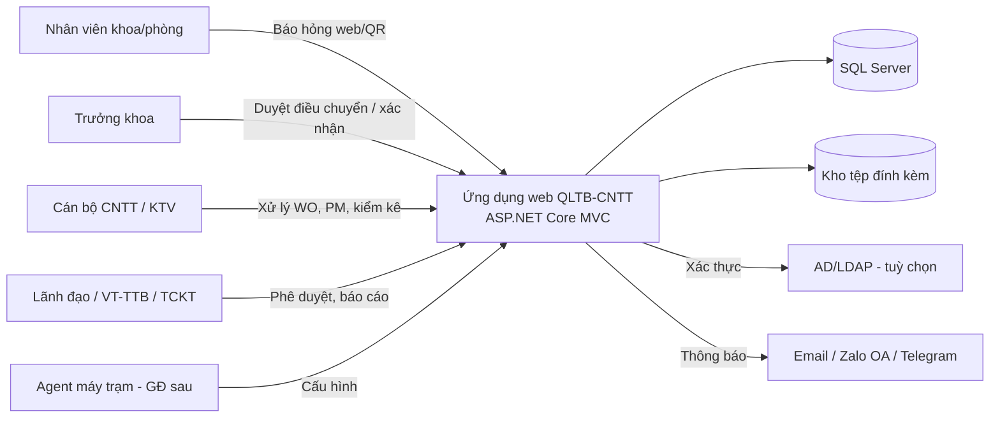
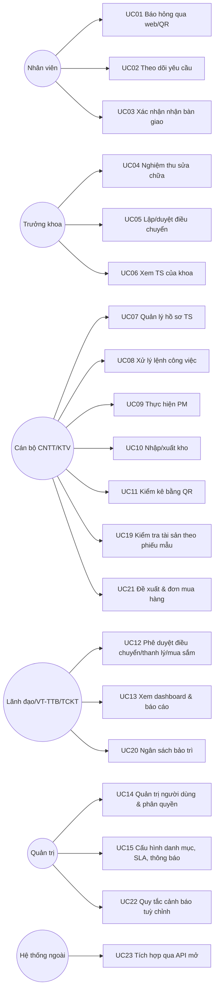
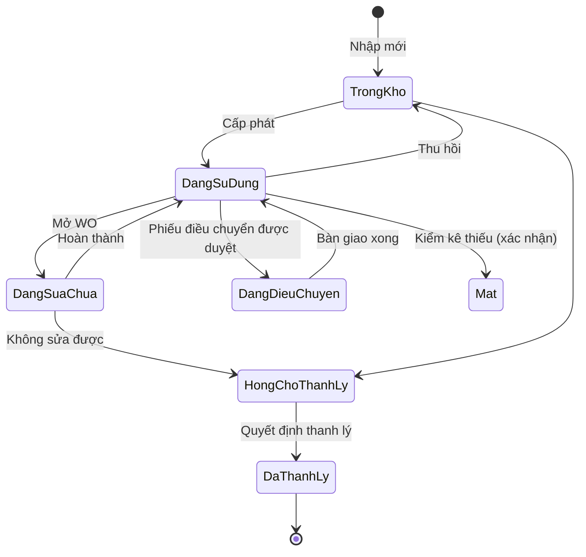
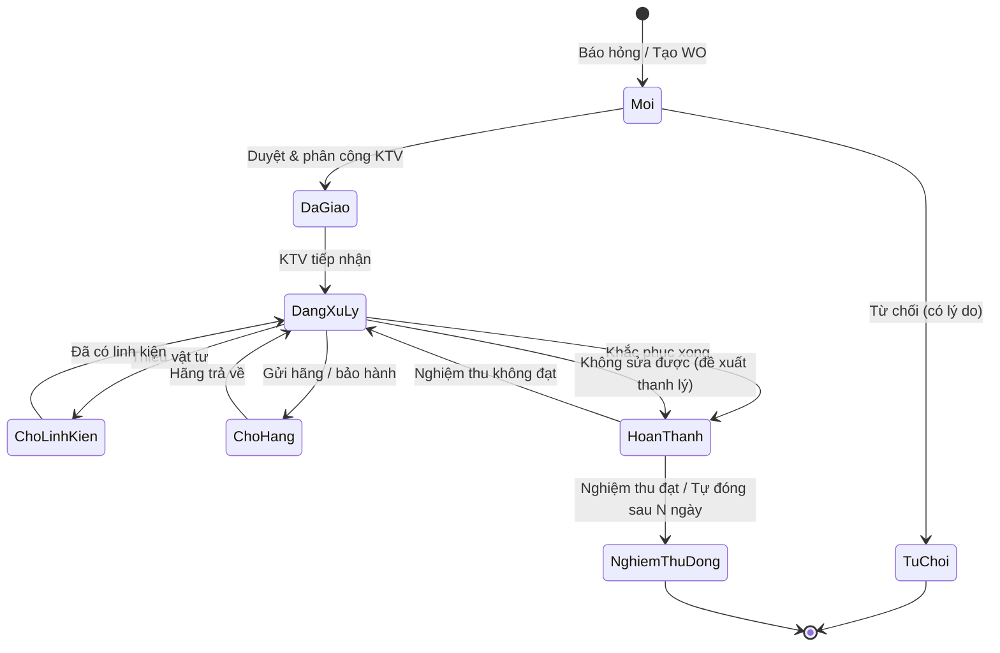
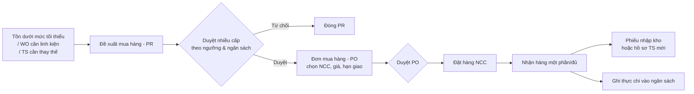
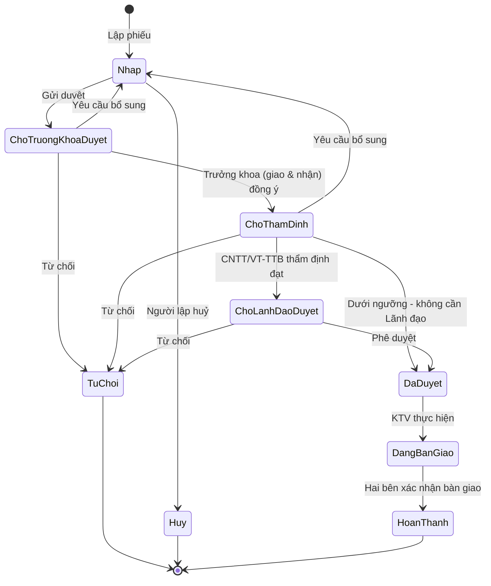
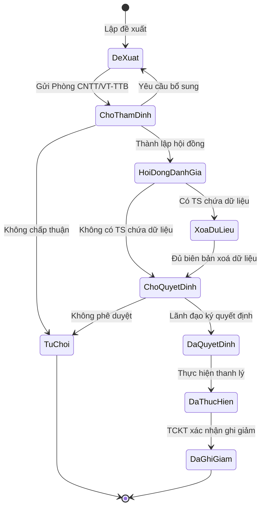
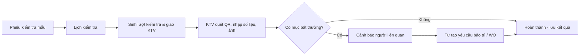
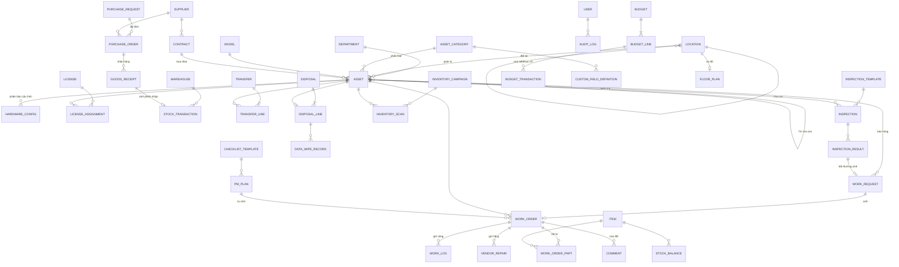
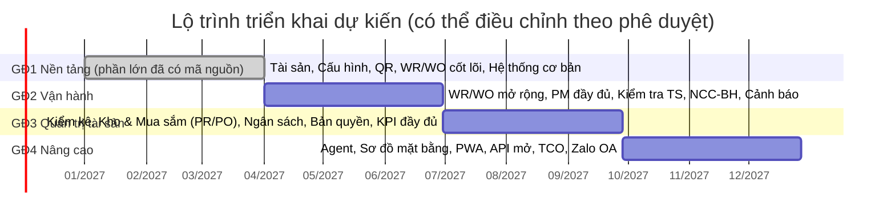

# TÀI LIỆU ĐẶC TẢ YÊU CẦU PHẦN MỀM (SRS)

## HỆ THỐNG QUẢN LÝ TRANG THIẾT BỊ CÔNG NGHỆ THÔNG TIN BỆNH VIỆN

| Thông tin | Nội dung |
|---|---|
| Tên dự án | Hệ thống Quản lý Trang thiết bị CNTT (tên viết tắt: **QLTB-CNTT**) |
| Đơn vị sử dụng | Bệnh viện – Phòng Công nghệ thông tin (chủ trì), các Khoa/Phòng |
| Loại tài liệu | Đặc tả yêu cầu phần mềm (Software Requirements Specification) |
| Phiên bản | 1.0 (Dự thảo trình Lãnh đạo Bệnh viện) |
| Ngày lập | 21/11/2026 |
| Nền tảng | ASP.NET Core (.NET 10) MVC, Entity Framework Core, SQL Server, ASP.NET Identity (tuỳ chọn tích hợp AD/LDAP) |
| Môi trường | Mạng nội bộ (LAN) Bệnh viện |

### Lịch sử phiên bản

| Phiên bản | Ngày | Người thực hiện | Nội dung thay đổi |
|---|---|---|---|
| 0.9 | 11/2026 | Phòng CNTT | Khởi tạo dự thảo |
| 1.0 | 21/11/2026 | Phòng CNTT | Hoàn thiện để trình Lãnh đạo và bàn giao nhóm phát triển |
| 1.1 | 21/11/2026 | Phòng CNTT | Bổ sung đối chiếu SpeedMaint CMMS; thêm phân hệ Kiểm tra tài sản, Ngân sách bảo trì; mở rộng Kho & Mua sắm (đơn mua hàng), WR/WO, PM, Tài sản, Cảnh báo tuỳ chỉnh, API mở; đánh dấu hiện trạng mã nguồn giai đoạn 1 |

### Phê duyệt

| Vai trò | Họ tên | Chữ ký | Ngày |
|---|---|---|---|
| Lãnh đạo Bệnh viện (phê duyệt) | | | |
| Trưởng phòng CNTT (chủ trì) | | | |
| Trưởng phòng Vật tư – TTB | | | |
| Trưởng phòng Tài chính – Kế toán | | | |

---

## MỤC LỤC

1. [Giới thiệu](#1-giới-thiệu)
   - 1.6 Đối chiếu với SpeedMaint CMMS
2. [Mô tả tổng quan](#2-mô-tả-tổng-quan)
3. [Tổng hợp tác nhân và Use-case](#3-tổng-hợp-tác-nhân-và-use-case)
4. [Yêu cầu chức năng theo phân hệ](#4-yêu-cầu-chức-năng-theo-phân-hệ)
   - 4.1 Tài sản & Vị trí
   - 4.2 Cấu hình & Phần mềm
   - 4.3 Yêu cầu sửa chữa & Lệnh công việc
   - 4.4 Bảo trì phòng ngừa (PM)
   - 4.5 Kho & Mua sắm (đề xuất mua hàng, đơn mua hàng)
   - 4.6 Nhà cung cấp, Hợp đồng & Bảo hành
   - 4.7 Điều chuyển
   - 4.8 Thanh lý
   - 4.9 Kiểm kê
   - 4.10 Báo cáo & KPI
   - 4.11 Hệ thống (gồm Quy tắc cảnh báo tuỳ chỉnh)
   - 4.12 Kiểm tra tài sản (Inspection)
   - 4.13 Ngân sách bảo trì
5. [Yêu cầu phi chức năng](#5-yêu-cầu-phi-chức-năng)
6. [Mô hình dữ liệu khái niệm](#6-mô-hình-dữ-liệu-khái-niệm)
7. [Yêu cầu giao diện & tích hợp](#7-yêu-cầu-giao-diện--tích-hợp)
8. [Lộ trình triển khai](#8-lộ-trình-triển-khai)
   - 8.1 Hiện trạng mã nguồn giai đoạn 1
9. [Tiêu chí nghiệm thu](#9-tiêu-chí-nghiệm-thu)
10. [Phụ lục](#10-phụ-lục)

---

## 1. GIỚI THIỆU

### 1.1. Mục đích tài liệu

Tài liệu này mô tả đầy đủ các yêu cầu chức năng và phi chức năng của Hệ thống Quản lý Trang thiết bị CNTT nhằm:

- Trình Lãnh đạo Bệnh viện xem xét, phê duyệt phạm vi và lộ trình đầu tư.
- Làm căn cứ thống nhất giữa Phòng CNTT, Phòng Vật tư – Trang thiết bị (VT-TTB), Phòng Tài chính – Kế toán (TCKT) và các Khoa/Phòng về quy trình nghiệp vụ.
- Làm đầu vào cho nhóm phát triển phần mềm thiết kế, lập trình, kiểm thử và nghiệm thu.

### 1.2. Phạm vi hệ thống

Hệ thống là ứng dụng web nội bộ, quản lý toàn bộ vòng đời trang thiết bị CNTT của Bệnh viện theo mô hình CMMS (Computerized Maintenance Management System) — tương tự các sản phẩm thương mại như SpeedMaint — gồm:

- **Trong phạm vi (chức năng):** hồ sơ tài sản, cấu hình, sửa chữa, bảo trì định kỳ, kiểm tra tài sản, kho & mua sắm, ngân sách bảo trì, NCC – hợp đồng – bảo hành, điều chuyển, thanh lý, kiểm kê, báo cáo, cảnh báo, API tích hợp.
- **Trong phạm vi (đối tượng):** máy tính để bàn, máy tính xách tay, máy chủ, thiết bị mạng (switch, router, firewall, access point), máy in/máy scan/máy photocopy, màn hình, UPS, camera, thiết bị ngoại vi (đầu đọc mã vạch, máy in nhãn, đầu đọc thẻ BHYT, ki-ốt xếp hàng), thiết bị lưu trữ, bản quyền phần mềm, vật tư/linh kiện thay thế CNTT.
- **Ngoài phạm vi:** trang thiết bị y tế chuyên dụng (máy thở, monitor, máy siêu âm…) — tuy nhiên kiến trúc dữ liệu cho phép mở rộng sau này; phần mềm kế toán tài sản (hệ thống chỉ xuất dữ liệu ghi tăng/ghi giảm để đối chiếu); quản lý mạng thời gian thực (giám sát SNMP chuyên sâu).

**Lợi ích kỳ vọng:**

- Nắm chính xác số lượng, vị trí, tình trạng, giá trị của toàn bộ thiết bị CNTT.
- Giảm thời gian ngừng hoạt động của thiết bị tại khoa trọng yếu (Cấp cứu, ICU, Phòng mổ) thông qua SLA và bảo trì phòng ngừa.
- Minh bạch chi phí sửa chữa, mua sắm; có số liệu khách quan để lập kế hoạch thay thế, đầu tư.
- Chuẩn hoá hồ sơ điều chuyển, thanh lý, kiểm kê theo quy định hiện hành về quản lý tài sản công.

### 1.3. Thuật ngữ và chữ viết tắt

| Thuật ngữ / Viết tắt | Giải thích |
|---|---|
| TTB | Trang thiết bị |
| CNTT | Công nghệ thông tin |
| TS | Tài sản (một đơn vị thiết bị được quản lý có mã riêng) |
| CMMS | Hệ thống quản lý bảo trì có máy tính hỗ trợ |
| WR (Work Request) | Yêu cầu sửa chữa / phiếu báo hỏng do người dùng gửi |
| WO (Work Order) | Lệnh công việc giao cho Kỹ thuật viên thực hiện |
| PM (Preventive Maintenance) | Bảo trì phòng ngừa (định kỳ) |
| CM (Corrective Maintenance) | Bảo trì khắc phục (sửa chữa khi hỏng) |
| KTV | Kỹ thuật viên CNTT |
| SLA | Cam kết mức dịch vụ (thời gian phản hồi, thời gian khắc phục) |
| MTBF | Thời gian trung bình giữa hai lần hỏng (Mean Time Between Failures) |
| MTTR | Thời gian trung bình để sửa chữa (Mean Time To Repair) |
| TCO | Tổng chi phí sở hữu (Total Cost of Ownership) |
| Downtime | Thời gian thiết bị ngừng hoạt động |
| NCC | Nhà cung cấp |
| VT-TTB | Phòng Vật tư – Trang thiết bị |
| TCKT | Phòng Tài chính – Kế toán |
| QR code | Mã vạch hai chiều dán trên thiết bị, chứa liên kết tới hồ sơ TS |
| AD/LDAP | Active Directory / giao thức thư mục dùng xác thực tập trung |
| Zalo OA | Tài khoản Zalo Official Account dùng gửi thông báo |
| Agent | Phần mềm nhỏ cài trên máy trạm tự thu thập cấu hình |
| Nguyên giá | Giá trị ghi sổ ban đầu của tài sản |
| Ghi giảm | Nghiệp vụ giảm tài sản khỏi sổ sách sau thanh lý/điều chuyển ra ngoài |
| Soft delete | Xoá mềm – đánh dấu ngừng sử dụng, không xoá vật lý khỏi CSDL |
| EAM | Quản lý tài sản doanh nghiệp (Enterprise Asset Management) |
| Kiểm tra tài sản (Inspection) | Hoạt động kiểm tra/ghi số liệu định kỳ theo phiếu mẫu, khác với PM (có tác động bảo dưỡng) |
| PR / PO | Đề xuất mua hàng (Purchase Request) / Đơn mua hàng (Purchase Order) |
| API / Webhook | Giao diện lập trình cho hệ thống khác gọi vào / cơ chế hệ thống chủ động gửi sự kiện ra ngoài |
| PWA | Ứng dụng web có thể "cài" lên màn hình điện thoại (Progressive Web App) |

### 1.4. Tài liệu tham chiếu

- Quy định hiện hành của Nhà nước về quản lý, sử dụng tài sản công tại đơn vị sự nghiệp công lập.
- Quy định hiện hành về an toàn thông tin mạng, bảo vệ dữ liệu cá nhân và bảo mật thông tin người bệnh trong lĩnh vực y tế.
- Quy chế quản lý tài sản, quy chế CNTT nội bộ của Bệnh viện.
- Tài liệu tham khảo sản phẩm CMMS trên thị trường (SpeedMaint và tương đương).

### 1.5. Quy ước trong tài liệu

- Mã yêu cầu chức năng: `FR-<Phân hệ>-<STT>`; phi chức năng: `NFR-<Nhóm>-<STT>`; quy tắc nghiệp vụ: `BR-<Phân hệ>-<STT>`.
- Mức ưu tiên: **M** (Must – bắt buộc), **S** (Should – nên có), **C** (Could – có thể có, giai đoạn sau).
- Mã phân hệ: TS (Tài sản), VT (Vị trí), CH (Cấu hình), WR/WO (Yêu cầu/Lệnh công việc), PM (Bảo trì phòng ngừa), KHO (Kho), MS (Mua sắm), HD (NCC/Hợp đồng/Bảo hành), DC (Điều chuyển), TL (Thanh lý), KK (Kiểm kê), BC (Báo cáo), HT (Hệ thống), KT (Kiểm tra tài sản), NS (Ngân sách); IF (Giao diện/Tích hợp).

### 1.6. Đối chiếu với SpeedMaint CMMS

> **Nguồn:** các trang giới thiệu tính năng công khai của SpeedMaint tại speedmaint.com (mục *Tính năng* và các trang con), đọc ngày 21/11/2026. Nội dung dưới đây là tóm tắt tính năng được công bố, dùng làm chuẩn tham chiếu thị trường; không phải tài liệu kỹ thuật của sản phẩm. SRS này không sao chép sản phẩm mà điều chỉnh cho đặc thù trang thiết bị CNTT tại bệnh viện.

| Phân hệ SpeedMaint | Tính năng chính (theo trang công bố) | Phân hệ / mã FR tương ứng trong SRS | Giai đoạn | Ghi chú (đặc thù CNTT bệnh viện) |
|---|---|---|---|---|
| Quản lý tài sản (EAM) | Cây đơn vị theo loại/địa điểm/phòng ban; trường thông tin tuỳ chỉnh không giới hạn; đính kèm tài liệu, HDSD, hình ảnh, chỉ số vận hành; QR tại hiện trường; chi phí – tần suất hỏng – phụ tùng – thời gian bảo trì theo tài sản; định vị trên bản đồ/sơ đồ mặt bằng; kết nối sensor | 4.1 (FR-TS-01..17, FR-VT-01..05); 4.2 (FR-CH-01..09) | GĐ1 (sơ đồ mặt bằng: GĐ4) | Bổ sung cấu hình phần cứng, IP/MAC/hostname, bản quyền phần mềm. Kết nối sensor thay bằng agent thu thập cấu hình (FR-CH-08) và chỉ số nhập tay/import (FR-PM-02) |
| Quản lý kiểm tra tài sản/thiết bị | Phiếu kiểm tra tuỳ chỉnh (template); kiểm tra bằng điện thoại; ghi số liệu, hình ảnh, thời gian; cảnh báo bất thường đến người liên quan; tổng hợp kết quả toàn hệ thống; thông số bất thường tự tạo yêu cầu bảo trì | 4.12 (FR-KT-01..10) | GĐ2–GĐ3 | Áp dụng: kiểm tra phòng máy chủ (nhiệt độ, độ ẩm, UPS, điều hoà), kiểm tra hằng ca thiết bị CNTT khoa trọng yếu, kiểm tra sao lưu |
| Quản lý yêu cầu bảo trì | Phê duyệt yêu cầu; tự nhận diện yêu cầu trùng lặp cho cùng tài sản; phản hồi tức thì trạng thái cho người báo; tạo yêu cầu bằng QR, upload ảnh; tạo công việc/thêm tài sản từ yêu cầu; tự cập nhật hồ sơ tài sản | 4.3 (FR-WR-01..09, FR-WO-01) | GĐ1 (đã có phần lớn) | Ưu tiên tự động theo khoa trọng yếu (Cấp cứu, ICU, Phòng mổ); không nhập thông tin người bệnh vào mô tả |
| Quản lý công việc bảo trì | Lịch, Kanban, timeline tài sản; hướng dẫn chi tiết từng nhiệm vụ; trao đổi giữa các bộ phận trong công việc; thông báo mobile + email khi được giao; đính kèm; tự ghi thời gian bảo trì và dừng máy; việc tôi giao/liên quan/phụ trách; lịch cá nhân và nhóm | 4.3 (FR-WO-02..22) | GĐ1–GĐ2 | Bổ sung SLA, escalation 3 cấp, nghiệm thu bởi khoa |
| Quản lý sự cố & thời gian dừng máy | Phiếu sự cố tuỳ chỉnh; tự tính thời gian dừng máy; ảnh hiện trường; lịch sử để chẩn đoán | 4.3 (FR-WO-05, FR-WO-08, FR-WO-23, BR-WO-05); 4.10 (FR-BC-05) | GĐ2 | Downtime khoa trọng yếu là chỉ số báo cáo Lãnh đạo |
| Quản lý bảo trì định kỳ | Kế hoạch không giới hạn theo Ngày/Tháng/Quý/Năm, có bắt đầu – kết thúc; người thẩm định, người xét duyệt kế hoạch; thống kê vật tư, nhân sự, chi phí, người phụ trách; dự trù chi phí; tự lập lịch theo thời gian hoặc chỉ số; thông báo khi tạo/đến hạn; lịch nhóm theo tài sản hoặc nhiệm vụ | 4.4 (FR-PM-01..15) | GĐ1 (tự sinh lệnh: đã có), GĐ2 (phần còn lại) | Chỉ số điển hình: số trang in, giờ chạy UPS/máy chủ; chu kỳ theo khuyến cáo nhà sản xuất |
| Quản lý kho vật tư/phụ tùng | Danh mục kho và vật tư không giới hạn; cảnh báo tồn tối thiểu, tự gửi đề xuất mua; tồn cập nhật tức thì khi dùng trong công việc, biết ai dùng khi nào | 4.5 (FR-KHO-01..09) | GĐ1 (cơ bản), GĐ3 | Linh kiện chứa dữ liệu (ổ cứng tháo ra) quản lý riêng (BR-KHO-04) |
| Quản lý mua sắm | Đề xuất mua hàng và đơn mua hàng | 4.5 (FR-MS-01..08) | GĐ3 | Hệ thống chỉ quản lý đề xuất/đơn và theo dõi; thủ tục mua sắm theo quy định hiện hành về mua sắm công |
| Quản lý ngân sách | Kiểm soát ngân sách bảo trì theo tháng/quý/năm, so sánh thực chi | 4.13 (FR-NS-01..07) | GĐ3 | Số liệu chính thức thuộc Phòng TCKT; hệ thống dùng để kiểm soát và cảnh báo |
| Thống kê báo cáo | Báo cáo, dashboard | 4.10 (FR-BC-01..13) | GĐ1 (dashboard KPI: đã có), GĐ3 | Bổ sung KPI MTBF, MTTR, SLA, TCO, tuổi thiết bị |
| Ứng dụng di động | Android & iOS; dashboard; cấu hình mobile theo đối tượng người dùng | NFR-SD-02, NFR-SD-03, NFR-SD-07; FR-HT-16 | GĐ1 (responsive), GĐ4 (PWA) | Dùng web responsive/PWA trong LAN thay ứng dụng native; ứng dụng native là tuỳ chọn sau |
| Cảnh báo | Quy tắc cảnh báo tuỳ chỉnh hoàn toàn cho nhiều quy trình; đồng bộ đa thiết bị | 4.11 (FR-HT-08..11, FR-HT-15) | GĐ2–GĐ3 | Kênh: trong ứng dụng, email, Zalo OA, Telegram; không gửi dữ liệu người bệnh |
| Tích hợp | API mở; kết nối Kế toán, ERP… | Mục 7 (IF-01..10) | GĐ4 | Ưu tiên: phần mềm kế toán tài sản, HIS, AD |
| Giải pháp cho Bệnh viện | Chuẩn hoá danh mục trường thông tin; đánh mã thông minh từng thiết bị; kế hoạch kiểm tra định kỳ theo tình trạng máy và tần suất NSX khuyến cáo; kiểm định thiết bị | FR-TS-12, FR-TS-15, FR-TS-16; FR-PM-15; FR-KT-01..10 | GĐ1–GĐ3 | "Kiểm định" chủ yếu áp dụng TTB y tế (ngoài phạm vi); với CNTT tương ứng là kiểm tra an toàn điện/UPS, đánh giá kỹ thuật khi thanh lý |
| *(Không có trên trang SpeedMaint)* | — | 4.2 bản quyền phần mềm; 4.7 Điều chuyển; 4.8 Thanh lý & xoá dữ liệu; 4.9 Kiểm kê | GĐ1–GĐ3 | Đặc thù quản lý tài sản công và bảo mật dữ liệu người bệnh của bệnh viện |

---

## 2. MÔ TẢ TỔNG QUAN

### 2.1. Bối cảnh hiện trạng

- Bệnh viện có hàng nghìn thiết bị CNTT phân bố tại nhiều tòa nhà, khoa/phòng; việc quản lý hiện chủ yếu bằng Excel, sổ sách và trao đổi qua điện thoại/Zalo cá nhân.
- Báo hỏng không được ghi nhận tập trung, khó theo dõi tiến độ, không đo được thời gian khắc phục; các khoa trọng yếu chưa được ưu tiên một cách có hệ thống.
- Thông tin bảo hành, hợp đồng, bản quyền phần mềm phân tán, thường bị bỏ lỡ hạn.
- Hồ sơ điều chuyển, thanh lý, kiểm kê lập thủ công, mất nhiều thời gian đối chiếu với sổ kế toán.
- Chưa có số liệu để đánh giá hiệu quả sử dụng, chi phí vòng đời, phục vụ lập kế hoạch đầu tư.

### 2.2. Mô hình tổng thể



### 2.3. Đối tượng người dùng

| Nhóm người dùng | Mô tả | Mức độ sử dụng |
|---|---|---|
| Quản trị hệ thống | Cán bộ Phòng CNTT phụ trách cấu hình, phân quyền, danh mục, sao lưu | Thường xuyên |
| Cán bộ CNTT / KTV | Tiếp nhận, xử lý sự cố, bảo trì, kiểm kê, cập nhật cấu hình | Hằng ngày, cường độ cao |
| Trưởng khoa/phòng | Theo dõi thiết bị của khoa, duyệt điều chuyển/đề xuất, nghiệm thu sửa chữa | Hằng tuần |
| Lãnh đạo BV / VT-TTB / TCKT | Phê duyệt điều chuyển, thanh lý, mua sắm; xem báo cáo, dashboard; đối chiếu sổ tài sản | Định kỳ |
| Nhân viên (người dùng cuối) | Báo hỏng, theo dõi yêu cầu, xác nhận nhận bàn giao | Không thường xuyên, cần thao tác cực đơn giản |

### 2.4. Ràng buộc

- **C-01:** Công nghệ bắt buộc: ASP.NET Core (.NET 10) MVC, Entity Framework Core (Code-First, migration), SQL Server (2019 trở lên), ASP.NET Identity.
- **C-02:** Triển khai tại máy chủ nội bộ Bệnh viện (IIS hoặc Kestrel sau reverse proxy), chỉ truy cập trong LAN/VPN; không lưu dữ liệu trên đám mây công cộng.
- **C-03:** Giao diện tiếng Việt (Unicode), định dạng ngày dd/MM/yyyy, tiền tệ VNĐ.
- **C-04:** Thông báo ra ngoài (Zalo OA, Telegram) chỉ chứa thông tin tối thiểu, không chứa dữ liệu người bệnh; cần mở cổng outbound có kiểm soát.
- **C-05:** Hồ sơ, mẫu biểu phải phù hợp quy định hiện hành về quản lý tài sản công và quy chế nội bộ.
- **C-06:** Ngân sách và nhân lực triển khai theo kế hoạch được phê duyệt; ưu tiên công nghệ không phát sinh phí bản quyền ngoài SQL Server/Windows Server sẵn có.

### 2.5. Giả định và phụ thuộc

- **A-01:** Bệnh viện có sẵn máy chủ ảo hoá đủ tài nguyên và bản quyền SQL Server.
- **A-02:** Có danh sách tài sản hiện có (Excel) để nhập liệu ban đầu; Phòng VT-TTB/TCKT cung cấp số liệu nguyên giá, nguồn vốn.
- **A-03:** Hạ tầng Wi-Fi nội bộ cho phép điện thoại của KTV truy cập ứng dụng để quét QR.
- **A-04:** Bệnh viện trang bị máy in nhãn để in tem QR (chống nước, chống bong).
- **A-05:** Nếu dùng AD/LDAP, Phòng CNTT cung cấp tài khoản dịch vụ đọc thư mục.
- **A-06:** Cơ cấu tổ chức (khoa/phòng) được cung cấp và cập nhật khi có thay đổi.

---

## 3. TỔNG HỢP TÁC NHÂN VÀ USE-CASE

### 3.1. Sơ đồ use-case tổng quát



### 3.2. Danh sách use-case

| Mã UC | Tên use-case | Tác nhân chính | Phân hệ | Ưu tiên |
|---|---|---|---|---|
| UC01 | Báo hỏng thiết bị qua web hoặc quét QR | Nhân viên | WR | M |
| UC02 | Theo dõi trạng thái yêu cầu của mình | Nhân viên | WR | M |
| UC03 | Xác nhận nhận bàn giao thiết bị | Nhân viên, Trưởng khoa | DC | M |
| UC04 | Nghiệm thu kết quả sửa chữa | Trưởng khoa / người báo hỏng | WO | M |
| UC05 | Lập và duyệt phiếu điều chuyển | Trưởng khoa | DC | M |
| UC06 | Tra cứu tài sản của khoa | Trưởng khoa | TS | M |
| UC07 | Thêm/sửa/ngừng sử dụng hồ sơ tài sản, in QR, import Excel | KTV | TS | M |
| UC08 | Tiếp nhận, phân công, xử lý, đóng lệnh công việc | KTV, Trưởng nhóm CNTT | WO | M |
| UC09 | Lập kế hoạch và thực hiện bảo trì phòng ngừa | KTV | PM | M |
| UC10 | Nhập, xuất, chuyển kho vật tư | KTV / Thủ kho | KHO | S |
| UC11 | Thực hiện kiểm kê bằng điện thoại | KTV, Tổ kiểm kê | KK | M |
| UC12 | Phê duyệt điều chuyển/thanh lý/đề xuất mua sắm | Lãnh đạo, VT-TTB | DC/TL/MS | M |
| UC13 | Xem dashboard, báo cáo KPI | Lãnh đạo, Trưởng phòng CNTT | BC | M |
| UC14 | Quản lý người dùng, vai trò, phân quyền | Quản trị | HT | M |
| UC15 | Cấu hình danh mục, SLA, mẫu thông báo, sao lưu | Quản trị | HT | M |
| UC16 | Quản lý NCC, hợp đồng, bảo hành; theo dõi gửi hãng | KTV, VT-TTB | HD | M |
| UC17 | Quản lý cấu hình phần cứng, bản quyền phần mềm | KTV | CH | S |
| UC18 | Lập hồ sơ thanh lý, xoá dữ liệu ổ cứng | KTV, Hội đồng | TL | M |
| UC19 | Thực hiện kiểm tra tài sản theo phiếu mẫu (điện thoại), xử lý cảnh báo bất thường | KTV | KT | S |
| UC20 | Lập, phân bổ, theo dõi ngân sách bảo trì; so sánh thực chi | Trưởng phòng CNTT, TCKT, Lãnh đạo | NS | S |
| UC21 | Lập đề xuất mua hàng, đơn mua hàng, nhận hàng vào kho | Thủ kho/CNTT, VT-TTB | MS | S |
| UC22 | Cấu hình quy tắc cảnh báo tuỳ chỉnh | Quản trị | HT | S |
| UC23 | Tích hợp hệ thống ngoài qua API mở | Hệ thống ngoài (Kế toán, HIS, Agent) | IF | C |
| UC24 | Xem "Việc của tôi", Kanban, lịch; trao đổi trong phiếu | KTV, Trưởng khoa, Nhân viên | WO | M |

---

## 4. YÊU CẦU CHỨC NĂNG THEO PHÂN HỆ

### 4.1. PHÂN HỆ TÀI SẢN & VỊ TRÍ

**Mục đích:** Xây dựng cơ sở dữ liệu tập trung, chính xác về toàn bộ tài sản CNTT và vị trí lắp đặt, làm nền tảng cho mọi phân hệ khác.

**Đối tượng sử dụng:** KTV/Cán bộ CNTT (cập nhật), Quản trị (danh mục), Trưởng khoa (xem TS của khoa), Lãnh đạo/VT-TTB/TCKT (tra cứu, báo cáo), Nhân viên (xem thông tin TS qua QR).

#### 4.1.1. Chức năng chi tiết

| Mã | Chức năng | Mô tả | Ưu tiên |
|---|---|---|---|
| FR-TS-01 | Tạo hồ sơ tài sản | Nhập: mã TS (tự sinh theo quy tắc, cho phép sửa trước khi lưu), tên, loại TS, hãng, model, số serial, nguồn vốn (NSNN, sự nghiệp, viện trợ, xã hội hoá…), nguyên giá, ngày mua, ngày đưa vào sử dụng, NCC, số hợp đồng, hạn bảo hành, khoa/phòng quản lý, vị trí, người sử dụng, trạng thái, ghi chú | M |
| FR-TS-02 | Sửa hồ sơ tài sản | Cập nhật thông tin; mọi thay đổi ghi lịch sử (trường, giá trị cũ, giá trị mới, người, thời điểm) | M |
| FR-TS-03 | Ngừng sử dụng / xoá mềm | Không cho phép xoá cứng; chỉ đánh dấu "Ngừng theo dõi" kèm lý do; TS vẫn hiển thị trong báo cáo lịch sử | M |
| FR-TS-04 | Tìm kiếm, lọc nâng cao | Theo mã, serial, tên, loại, hãng, khoa, vị trí, trạng thái, nguồn vốn, năm mua, còn/hết bảo hành; tìm kiếm toàn văn nhanh | M |
| FR-TS-05 | Sinh và in tem QR | Sinh QR chứa URL hồ sơ TS (`/ts/{mã}`); in hàng loạt theo khổ tem cấu hình được (kèm mã TS, tên, khoa) | M |
| FR-TS-06 | Trang thông tin TS qua QR | Quét QR hiển thị trang rút gọn: thông tin cơ bản, trạng thái, nút "Báo hỏng"; người có quyền thấy đầy đủ lịch sử | M |
| FR-TS-07 | Quan hệ cha – con | Gắn TS con vào TS cha (vd: bộ máy tính gồm CPU, màn hình, UPS; máy chủ gồm ổ đĩa); điều chuyển/thanh lý cha có tuỳ chọn áp dụng cho con | M |
| FR-TS-08 | Đính kèm tài liệu | Upload ảnh, hợp đồng, hoá đơn, CO/CQ, biên bản, hướng dẫn sử dụng (PDF, ảnh, Office; giới hạn dung lượng cấu hình được) | M |
| FR-TS-09 | Import Excel | Nhập hàng loạt từ mẫu Excel chuẩn; kiểm tra hợp lệ, báo lỗi theo dòng, cho phép xem trước trước khi ghi; chống trùng serial/mã | M |
| FR-TS-10 | Export Excel/PDF | Xuất danh sách theo bộ lọc hiện hành | M |
| FR-TS-11 | Lịch sử vòng đời | Dòng thời gian: tạo, cấp phát, điều chuyển, sửa chữa, PM, nâng cấp cấu hình, kiểm kê, thanh lý | M |
| FR-TS-12 | Quản lý danh mục loại TS | Cây loại TS (vd: Máy tính → Máy tính để bàn/Laptop/All-in-one) với bộ thuộc tính mở rộng riêng theo loại | M |
| FR-TS-13 | Cấp phát / thu hồi cho người dùng | Gán người sử dụng, in biên bản bàn giao nội bộ | S |
| FR-TS-14 | Tính khấu hao tham khảo | Tính giá trị còn lại theo thời gian sử dụng cấu hình theo loại TS (chỉ tham khảo, sổ chính thức thuộc TCKT) | C |
| FR-TS-15 | Trường thông tin tuỳ chỉnh | Quản trị định nghĩa thêm không giới hạn trường bổ sung theo loại TS (kiểu: văn bản, số, ngày, danh sách chọn, có/không; bắt buộc/không; thứ tự hiển thị); trường tuỳ chỉnh dùng được trong lọc, import/export, báo cáo | M |
| FR-TS-16 | Quy tắc đánh mã thông minh | Cấu hình mẫu mã theo thành phần: tiền tố loại TS, mã khoa/tòa nhà, năm, số thứ tự tự tăng (vd `PC-CC-2026-00012`); kiểm tra duy nhất; xem trước mã khi tạo | M |
| FR-TS-17 | Hồ sơ vận hành theo tài sản | Tổng hợp trên hồ sơ TS: tổng chi phí sửa chữa/bảo trì, tần suất hỏng, phụ tùng đã dùng, tổng giờ bảo trì, downtime, chỉ số vận hành gần nhất; timeline sự kiện | M |
| FR-VT-01 | Quản lý cây vị trí | Cây phân cấp: Bệnh viện → Tòa nhà → Tầng → Khoa → Phòng; thêm/sửa/ngừng dùng/di chuyển nút | M |
| FR-VT-02 | Gắn khoa trọng yếu | Đánh dấu vị trí/khoa thuộc nhóm trọng yếu (Cấp cứu, ICU, Phòng mổ…) để áp SLA ưu tiên | M |
| FR-VT-03 | QR vị trí | Sinh QR cho phòng/khu vực, dùng khi kiểm kê và báo hỏng không gắn TS cụ thể | S |
| FR-VT-04 | Xem TS theo vị trí | Chọn nút cây, hiển thị TS thuộc nút đó và các nút con, có tổng hợp số lượng | M |
| FR-VT-05 | Sơ đồ mặt bằng | (Giai đoạn 4) Tải ảnh sơ đồ mặt bằng tầng/khoa; đặt biểu tượng TS (máy chủ, switch, access point, máy in) lên sơ đồ; chạm/nhấp vào biểu tượng xem chi tiết và trạng thái (màu theo trạng thái, nhấp nháy khi có WO mở) | C |

#### 4.1.2. Trạng thái tài sản



Danh mục trạng thái: *Trong kho, Đang sử dụng, Đang sửa chữa, Đang gửi hãng, Đang điều chuyển, Hỏng – chờ thanh lý, Đã thanh lý, Mất/Thất lạc, Ngừng theo dõi*.

#### 4.1.3. Quy tắc nghiệp vụ

| Mã | Quy tắc |
|---|---|
| BR-TS-01 | Mã TS là duy nhất, không thay đổi sau khi đã in tem QR (trừ Quản trị, có ghi log). Mã sinh theo quy tắc đánh mã thông minh (FR-TS-16); định dạng mặc định: `<Mã loại>-<Năm>-<STT 5 số>`, vd `PC-2026-00123`. Thay đổi quy tắc chỉ áp dụng cho TS tạo mới. |
| BR-TS-07 | Trường tuỳ chỉnh đã có dữ liệu không được xoá, chỉ ẩn; đổi kiểu dữ liệu phải kiểm tra tương thích dữ liệu hiện có. |
| BR-TS-02 | Serial là duy nhất trong cùng hãng; cho phép để trống với thiết bị không có serial, nhưng phải có cảnh báo. |
| BR-TS-03 | Không xoá cứng TS đã phát sinh giao dịch (WO, điều chuyển, kiểm kê…). Chỉ Quản trị được xoá cứng bản ghi nhập nhầm chưa phát sinh giao dịch, có ghi audit log. |
| BR-TS-04 | Thay đổi khoa/phòng hoặc vị trí của TS chỉ được thực hiện qua phiếu điều chuyển (trừ di chuyển trong cùng khoa do KTV cập nhật, có ghi lịch sử). |
| BR-TS-05 | Trạng thái TS do hệ thống tự cập nhật theo nghiệp vụ (WO, điều chuyển, thanh lý); không sửa tay trừ Quản trị. |
| BR-TS-06 | Nguyên giá, nguồn vốn chỉ được sửa bởi người có quyền VT-TTB/TCKT. |
| BR-VT-01 | Không ngừng dùng nút vị trí khi còn TS đang gắn tại nút đó hoặc nút con. |

#### 4.1.4. Màn hình chính

- **MH-TS-01** Danh sách tài sản (lưới, bộ lọc bên trái, tìm kiếm nhanh, chọn nhiều để in QR/xuất Excel).
- **MH-TS-02** Chi tiết tài sản dạng tab: Thông tin chung | Cấu hình | Phần mềm | TS con | Tài liệu | Lịch sử sửa chữa | PM | Lịch sử vòng đời.
- **MH-TS-03** Import Excel (tải mẫu, upload, xem trước, báo lỗi).
- **MH-TS-04** In tem QR hàng loạt.
- **MH-VT-01** Cây vị trí (treeview kéo thả) + danh sách TS theo nút.
- **MH-TS-05** Trang QR rút gọn (tối ưu điện thoại).
- **MH-TS-06** Cấu hình trường tuỳ chỉnh & quy tắc đánh mã.
- **MH-VT-02** Sơ đồ mặt bằng tương tác (GĐ4).

#### 4.1.5. Báo cáo/biểu mẫu liên quan

- Sổ theo dõi TS CNTT theo khoa/phòng; danh sách TS theo vị trí; danh sách TS theo nguồn vốn; tem QR; biên bản cấp phát/bàn giao nội bộ (BM-01).

---

### 4.2. PHÂN HỆ CẤU HÌNH & PHẦN MỀM

**Mục đích:** Quản lý thông số kỹ thuật, địa chỉ mạng, phần mềm và bản quyền của các thiết bị tính toán, phục vụ hỗ trợ kỹ thuật, an toàn thông tin và tuân thủ bản quyền.

**Đối tượng sử dụng:** KTV/Cán bộ CNTT, Quản trị; Lãnh đạo xem báo cáo bản quyền.

#### 4.2.1. Chức năng chi tiết

| Mã | Chức năng | Mô tả | Ưu tiên |
|---|---|---|---|
| FR-CH-01 | Hồ sơ cấu hình phần cứng | CPU, RAM (dung lượng, số khe), ổ cứng (loại HDD/SSD, dung lượng, serial), card đồ hoạ, mainboard, hệ điều hành & phiên bản, hostname, địa chỉ IP, MAC, domain/workgroup | M |
| FR-CH-02 | Quản lý địa chỉ IP | Kiểm tra trùng IP/MAC/hostname; tra cứu ngược từ IP ra TS và vị trí | M |
| FR-CH-03 | Lịch sử thay đổi cấu hình | Mỗi lần nâng cấp/thay thế linh kiện ghi lại phiên bản cấu hình, liên kết WO/phiếu xuất kho | M |
| FR-CH-04 | Danh mục phần mềm | Tên, nhà phát hành, phiên bản, loại (HĐH, văn phòng, diệt virus, HIS/LIS/PACS client, tiện ích), loại bản quyền (vĩnh viễn, thuê bao, OEM, mã nguồn mở, miễn phí) | M |
| FR-CH-05 | Quản lý bản quyền | Số lượng license, key (lưu mã hoá, chỉ người có quyền xem), ngày hết hạn, hợp đồng, NCC; gán license cho TS/người dùng | M |
| FR-CH-06 | Cảnh báo bản quyền | Cảnh báo sắp hết hạn (mặc định 60/30/7 ngày), vượt số lượng cài đặt | M |
| FR-CH-07 | Phần mềm cài đặt trên TS | Danh sách phần mềm trên từng máy; tra cứu máy nào cài phần mềm X | S |
| FR-CH-08 | Agent tự thu thập cấu hình | (Giai đoạn 4) Agent Windows chạy định kỳ gửi cấu hình, phần mềm, IP/MAC về API; tự phát hiện thay đổi và tạo thông báo | C |
| FR-CH-09 | So sánh cấu hình | So sánh cấu hình hiện tại với lần trước / với chuẩn cấu hình tối thiểu cho phần mềm HIS | C |

#### 4.2.2. Luồng nghiệp vụ

1. KTV nhập cấu hình khi tiếp nhận thiết bị mới (hoặc agent gửi lên ở GĐ4).
2. Khi thay RAM/ổ cứng trong WO → hệ thống đề xuất cập nhật cấu hình, tạo phiên bản cấu hình mới liên kết WO.
3. Agent phát hiện sai khác với cấu hình đã duyệt → tạo thông báo cho KTV xác nhận (chấp nhận/điều tra).

#### 4.2.3. Quy tắc nghiệp vụ

| Mã | Quy tắc |
|---|---|
| BR-CH-01 | IP tĩnh và hostname không được trùng giữa các TS đang sử dụng. |
| BR-CH-02 | License key được mã hoá khi lưu, chỉ hiển thị cho vai trò được cấp quyền "Xem key bản quyền", mỗi lần xem ghi audit log. |
| BR-CH-03 | Số license đã gán không vượt quá số được mua (cho phép vượt có cảnh báo đỏ). |
| BR-CH-04 | Khi TS thanh lý, các license gán cho TS được tự động thu hồi về kho license. |

#### 4.2.4. Màn hình chính

- **MH-CH-01** Tab Cấu hình trong chi tiết TS (hiện tại + lịch sử phiên bản).
- **MH-CH-02** Danh mục phần mềm & bản quyền (số mua/đã gán/còn lại).
- **MH-CH-03** Tra cứu IP/MAC/hostname.

#### 4.2.5. Báo cáo liên quan

- Báo cáo bản quyền phần mềm (sử dụng/còn lại/hết hạn); thống kê cấu hình máy trạm (theo HĐH, theo RAM — phục vụ kế hoạch nâng cấp); danh sách máy dưới chuẩn cấu hình tối thiểu.

---

### 4.3. PHÂN HỆ YÊU CẦU SỬA CHỮA & LỆNH CÔNG VIỆC (WR/WO)

**Mục đích:** Tiếp nhận tập trung mọi báo hỏng, phân công và theo dõi xử lý đến khi nghiệm thu; đo lường SLA, chi phí, nguyên nhân hỏng.

**Đối tượng sử dụng:** Nhân viên (báo hỏng), Trưởng nhóm/Cán bộ CNTT (duyệt, phân công), KTV (xử lý), Trưởng khoa/người báo (nghiệm thu), Lãnh đạo (theo dõi).

#### 4.3.1. Chức năng chi tiết

| Mã | Chức năng | Mô tả | Ưu tiên |
|---|---|---|---|
| FR-WR-01 | Báo hỏng qua web | Chọn TS (tìm theo mã/tên hoặc chọn từ danh sách TS của khoa), mô tả sự cố, loại sự cố, mức độ ảnh hưởng, số điện thoại liên hệ, đính kèm ảnh/video ngắn | M |
| FR-WR-02 | Báo hỏng qua QR | Quét QR trên thiết bị → form báo hỏng đã điền sẵn TS, vị trí; chụp ảnh trực tiếp từ camera điện thoại | M |
| FR-WR-03 | Báo sự cố không gắn TS | Sự cố mạng, phần mềm, tài khoản… gắn theo vị trí/phòng | M |
| FR-WR-04 | Theo dõi yêu cầu | Người báo xem trạng thái, KTV phụ trách, thời gian dự kiến; nhận thông báo khi đổi trạng thái | M |
| FR-WR-05 | Tự động nhận diện yêu cầu trùng lặp | Khi gửi yêu cầu, hệ thống kiểm tra các yêu cầu/WO đang mở (và đã gửi trong N giờ gần nhất, cấu hình được) cho cùng TS hoặc cùng phòng + loại sự cố; hiển thị danh sách trùng, cho phép người báo "Theo dõi cùng" (bổ sung thông tin, ảnh) thay vì tạo mới; người tiếp nhận gộp được yêu cầu trùng | M |
| FR-WR-06 | Quy trình phê duyệt yêu cầu | Cấu hình theo loại yêu cầu/khoa: yêu cầu sửa chữa thông thường đi thẳng tới CNTT; yêu cầu nâng cấp, cấp mới, cài phần mềm cần Trưởng khoa xác nhận trước khi CNTT tiếp nhận; ghi ý kiến từng bước | M |
| FR-WR-07 | Phản hồi trạng thái tức thì | Mọi thay đổi trạng thái (tiếp nhận, từ chối, giao KTV, chờ linh kiện, hoàn thành) được thông báo ngay cho người báo qua trong ứng dụng/email/Zalo; trang theo dõi hiển thị dòng thời gian xử lý | M |
| FR-WR-08 | Tạo công việc / thêm TS từ yêu cầu | Từ yêu cầu, người tiếp nhận tạo WO (một hoặc nhiều) bằng một thao tác, kế thừa mô tả, ảnh, TS; nếu thiết bị chưa có hồ sơ, tạo nhanh hồ sơ TS từ yêu cầu (trạng thái "Chờ hoàn thiện hồ sơ") | M |
| FR-WR-09 | Tự cập nhật hồ sơ TS | Kết quả xử lý (nguyên nhân, linh kiện thay, cấu hình thay đổi, chi phí) tự ghi vào lịch sử và hồ sơ vận hành của TS (FR-TS-11, FR-TS-17) | M |
| FR-WO-01 | Duyệt yêu cầu | Cán bộ CNTT tiếp nhận: chấp nhận (chuyển thành WO), từ chối (nêu lý do), gộp, hoặc xử lý nhanh (hướng dẫn từ xa → đóng) | M |
| FR-WO-02 | Tạo WO trực tiếp | KTV tạo WO khi tự phát hiện sự cố hoặc nhận qua điện thoại | M |
| FR-WO-03 | Phân công KTV | Giao một hoặc nhiều KTV (một người chính); xem khối lượng việc hiện tại của từng KTV để cân đối | M |
| FR-WO-04 | Mức ưu tiên & SLA | Ưu tiên: Khẩn cấp / Cao / Trung bình / Thấp; tự xác định theo khoa trọng yếu + mức ảnh hưởng; tự tính hạn phản hồi và hạn hoàn thành theo bảng SLA | M |
| FR-WO-05 | Cập nhật tiến độ | Chuyển trạng thái, ghi nhật ký xử lý, ảnh trước/sau | M |
| FR-WO-06 | Ghi giờ công | Ghi thời gian bắt đầu/kết thúc theo từng KTV; tính tổng giờ công | M |
| FR-WO-07 | Linh kiện sử dụng | Chọn vật tư từ kho → tự sinh phiếu xuất kho liên kết WO; hoặc ghi linh kiện mua ngoài | M |
| FR-WO-08 | Nguyên nhân & cách khắc phục | Chọn từ danh mục mã lỗi/nguyên nhân (phần cứng, phần mềm, người dùng, nguồn điện, mạng, virus…) và hành động khắc phục | M |
| FR-WO-09 | Chi phí | Tổng hợp chi phí: linh kiện + nhân công nội bộ (theo đơn giá giờ cấu hình) + dịch vụ ngoài | M |
| FR-WO-10 | Gửi hãng/bảo hành | Chuyển trạng thái "Chờ hãng", tạo phiếu gửi hãng (liên kết phân hệ 4.6) | M |
| FR-WO-11 | Thiết bị thay thế tạm | Ghi nhận cho mượn thiết bị dự phòng trong thời gian sửa chữa, nhắc thu hồi | S |
| FR-WO-12 | Nghiệm thu | Người báo/Trưởng khoa xác nhận đạt/không đạt, đánh giá mức hài lòng 1–5 sao; không đạt → mở lại WO | M |
| FR-WO-13 | Tự động đóng | Nếu không nghiệm thu sau N ngày (mặc định 3 ngày làm việc) → tự động đóng, ghi "Tự nghiệm thu" | M |
| FR-WO-14 | Escalation | Quá hạn phản hồi/hoàn thành → nhắc KTV; quá tiếp ngưỡng → báo Trưởng phòng CNTT; khoa trọng yếu quá hạn → báo Lãnh đạo | M |
| FR-WO-15 | Bảng Kanban | Cột theo trạng thái, kéo thả để chuyển trạng thái (kiểm tra quy tắc BR-WO-03), thẻ hiển thị ưu tiên, đồng hồ SLA, KTV; lọc theo khoa/KTV/loại | M |
| FR-WO-16 | In phiếu công việc | In phiếu sửa chữa/biên bản nghiệm thu sửa chữa (BM-05) | M |
| FR-WO-17 | Giao diện lịch | Lịch ngày/tuần/tháng cho WO và PM; xem lịch cá nhân và lịch nhóm; kéo thả để dời lịch, phân công lại | M |
| FR-WO-18 | Timeline tài sản | Dòng thời gian mọi WO, PM, kiểm tra, sự cố của một TS phục vụ chẩn đoán lỗi lặp lại | M |
| FR-WO-19 | Trao đổi (bình luận) trong phiếu | Bình luận dạng hội thoại trên WR/WO giữa người báo, KTV, Trưởng khoa, VT-TTB; nhắc tên (@người dùng) để gửi thông báo; đính kèm ảnh/tệp; phân biệt bình luận nội bộ CNTT và bình luận hiển thị cho người báo | M |
| FR-WO-20 | Việc của tôi | Danh sách theo 3 nhóm: *Tôi phụ trách* (được giao chính), *Tôi giao* (do tôi tạo/phân công), *Tôi liên quan* (người hỗ trợ, được nhắc tên, theo dõi); đếm việc quá hạn | M |
| FR-WO-21 | Hướng dẫn công việc | Gắn hướng dẫn chi tiết từng bước (văn bản, ảnh, tài liệu HDSD từ hồ sơ TS) cho loại công việc; KTV tích hoàn thành từng bước | S |
| FR-WO-22 | Thông báo khi được giao | Gửi ngay thông báo trong ứng dụng, mobile (Zalo/Telegram) và email khi được giao/đổi người phụ trách/thay đổi hạn | M |
| FR-WO-23 | Phiếu sự cố & thời gian dừng máy | Mẫu phiếu sự cố tuỳ chỉnh theo loại thiết bị (trường bổ sung, ảnh hiện trường); ghi thời điểm dừng máy và thời điểm hoạt động trở lại (tự gợi ý từ thời điểm báo hỏng và hoàn thành), tự tính downtime; sự cố diện rộng (mạng, máy chủ) gắn nhiều TS bị ảnh hưởng | M |

#### 4.3.2. Bảng SLA mặc định (cấu hình được)

| Ưu tiên | Điều kiện điển hình | Phản hồi tối đa | Hoàn thành mục tiêu |
|---|---|---|---|
| Khẩn cấp | Khoa trọng yếu (Cấp cứu, ICU, Phòng mổ) và thiết bị ngừng hoạt động ảnh hưởng trực tiếp khám chữa bệnh; sự cố máy chủ/mạng diện rộng | 15 phút | 4 giờ (hoặc có thiết bị thay thế tạm) |
| Cao | Khoa lâm sàng, thiết bị không dùng được, không có thiết bị thay thế | 1 giờ | 8 giờ làm việc |
| Trung bình | Thiết bị hoạt động kém, có phương án thay thế | 4 giờ làm việc | 3 ngày làm việc |
| Thấp | Yêu cầu hỗ trợ, cài đặt, nâng cấp không gấp | 1 ngày làm việc | 5 ngày làm việc |

> Thời gian ở trạng thái "Chờ linh kiện" và "Chờ hãng" được tạm dừng đồng hồ SLA (có thể cấu hình), nhưng vẫn tính vào downtime của thiết bị.

#### 4.3.3. Luồng trạng thái lệnh công việc



#### 4.3.4. Quy tắc nghiệp vụ

| Mã | Quy tắc |
|---|---|
| BR-WO-01 | Mỗi WO có mã duy nhất `WO-yyMM-#####`; mỗi WR được chấp nhận sinh đúng một WO (hoặc gộp vào WO có sẵn). |
| BR-WO-02 | WO gắn TS thuộc khoa trọng yếu tự động có ưu tiên tối thiểu là "Cao"; nếu người báo chọn "thiết bị ngừng hoạt động" → "Khẩn cấp". |
| BR-WO-03 | Chỉ chuyển "Hoàn thành" khi đã nhập nguyên nhân, cách khắc phục và giờ công. |
| BR-WO-04 | Khi WO chuyển "Đang xử lý", TS chuyển "Đang sửa chữa"; khi "Chờ hãng", TS chuyển "Đang gửi hãng"; khi đóng, TS trở về trạng thái trước đó. |
| BR-WO-05 | Downtime tính từ thời điểm báo hỏng (nếu thiết bị ngừng hoạt động) đến khi Hoàn thành. |
| BR-WO-06 | Escalation 3 cấp: Cấp 1 – 80% thời hạn: nhắc KTV; Cấp 2 – quá hạn: báo Trưởng nhóm/Trưởng phòng CNTT; Cấp 3 – quá hạn 2 lần thời gian hoặc khoa trọng yếu quá hạn: báo Lãnh đạo phụ trách. |
| BR-WO-07 | TS có từ 3 WO trở lên trong 90 ngày (cấu hình được) được gắn cờ "Hỏng lặp lại" để xem xét thay thế. |
| BR-WO-08 | Chi phí sửa chữa lũy kế vượt 50% nguyên giá (cấu hình được) → cảnh báo đề xuất thanh lý/thay thế. |
| BR-WO-09 | WO đã đóng không được sửa; mọi điều chỉnh phải mở lại có lý do và ghi log. |
| BR-WO-10 | Bình luận không được sửa sau 15 phút và không được xoá (chỉ ẩn bởi Quản trị, có log); bình luận nội bộ không hiển thị cho người báo. |
| BR-WO-11 | Yêu cầu bị đánh dấu trùng được đóng với trạng thái "Đã gộp" và liên kết tới WO gốc; người báo yêu cầu trùng vẫn nhận thông báo trạng thái của WO gốc. |

#### 4.3.5. Màn hình chính

- **MH-WR-01** Form báo hỏng (tối ưu điện thoại, tối đa 3 bước).
- **MH-WR-02** "Yêu cầu của tôi".
- **MH-WO-01** Hàng đợi tiếp nhận (WR mới, sắp xếp theo ưu tiên/thời gian).
- **MH-WO-02** Chi tiết WO: thông tin, tiến độ, nhật ký, giờ công, vật tư, chi phí, đính kèm, đồng hồ SLA.
- **MH-WO-03** Bảng Kanban; **MH-WO-05** Lịch công việc cá nhân/nhóm; **MH-WO-06** Timeline tài sản.
- **MH-WO-04** Màn hình nghiệm thu (cho người báo/Trưởng khoa).
- **MH-WO-07** Việc của tôi (3 tab: Tôi phụ trách / Tôi giao / Tôi liên quan).
- Khung trao đổi (bình luận) nhúng trong MH-WO-02 và MH-WR-02.

#### 4.3.6. Báo cáo/biểu mẫu liên quan

- Phiếu yêu cầu sửa chữa; phiếu công việc/biên bản nghiệm thu sửa chữa (BM-05); báo cáo tuân thủ SLA; thống kê sự cố theo khoa/loại/nguyên nhân; năng suất KTV; chi phí sửa chữa theo TS/khoa; danh sách TS hỏng lặp lại.

---

### 4.4. PHÂN HỆ BẢO TRÌ PHÒNG NGỪA (PM)

**Mục đích:** Chủ động bảo dưỡng định kỳ để giảm sự cố, kéo dài tuổi thọ thiết bị, đặc biệt máy chủ, thiết bị mạng, UPS, máy in tại khoa trọng yếu.

**Đối tượng sử dụng:** Cán bộ CNTT (lập kế hoạch), KTV (thực hiện), Trưởng phòng CNTT (theo dõi), Trưởng khoa (xem lịch).

#### 4.4.1. Chức năng chi tiết

| Mã | Chức năng | Mô tả | Ưu tiên |
|---|---|---|---|
| FR-PM-01 | Kế hoạch PM theo thời gian | Không giới hạn số kế hoạch; chu kỳ Ngày/Tuần/Tháng/Quý/Năm (kèm hệ số, vd "mỗi 2 tháng", ngày cố định trong tháng); có ngày bắt đầu – ngày kết thúc hiệu lực kế hoạch; áp dụng cho một TS, nhóm TS, loại TS hoặc vị trí | M |
| FR-PM-02 | Kế hoạch PM theo chỉ số | Theo bộ đếm: số trang in (máy in), giờ chạy (UPS, máy chủ), số lần sử dụng; nhập chỉ số thủ công hoặc import | M |
| FR-PM-03 | Kết hợp thời gian/chỉ số | "Điều kiện nào đến trước" (vd: 6 tháng hoặc 20.000 trang) | S |
| FR-PM-04 | Checklist theo loại thiết bị | Mẫu checklist (vd: Máy tính: vệ sinh, kiểm tra quạt, cập nhật Windows, quét virus, kiểm tra SMART ổ cứng; UPS: kiểm tra ắc quy, test xả…), mỗi mục kiểu Đạt/Không đạt, số đo, ghi chú | M |
| FR-PM-05 | Tự sinh WO PM | Hệ thống (job chạy nền hằng ngày) sinh WO loại PM trước ngày đến hạn N ngày, tự gán KTV phụ trách theo khu vực | M |
| FR-PM-06 | Lịch PM | Xem dạng lịch tháng/tuần, lọc theo KTV/khoa; kéo thả dời lịch (có lý do) | M |
| FR-PM-07 | Thực hiện PM trên điện thoại | Quét QR TS → mở WO PM → tích checklist, chụp ảnh, ký xác nhận | M |
| FR-PM-08 | Phát sinh CM từ PM | Mục checklist "Không đạt" có tuỳ chọn tạo ngay WO sửa chữa liên kết | M |
| FR-PM-09 | Kế hoạch PM năm | Lập, phê duyệt, xuất kế hoạch bảo trì năm (Excel/PDF) | S |
| FR-PM-10 | Gợi ý vật tư PM | Gắn vật tư tiêu hao chuẩn cho mẫu PM (mực, drum, ắc quy) để dự trù kho | S |
| FR-PM-11 | Thẩm định & xét duyệt kế hoạch | Mỗi kế hoạch chọn người thẩm định (vd Trưởng nhóm hạ tầng) và người xét duyệt (Trưởng phòng CNTT); trạng thái kế hoạch: Nháp → Chờ thẩm định → Chờ duyệt → Hiệu lực → Hết hiệu lực/Tạm dừng; chỉ kế hoạch Hiệu lực mới sinh WO | M |
| FR-PM-12 | Dự trù & thống kê kế hoạch | Ước tính theo kỳ: số lượt PM, vật tư (từ FR-PM-10), giờ công/nhân sự, chi phí; thống kê theo người phụ trách; liên kết dự toán ngân sách (FR-NS-02) | S |
| FR-PM-13 | Lịch nhóm theo tài sản/nhiệm vụ | Xem lịch PM nhóm theo TS (mọi nhiệm vụ của một TS) hoặc theo nhiệm vụ (mọi TS cùng một loại công việc, vd "Vệ sinh máy in quý I") để giao theo lô | S |
| FR-PM-14 | Thông báo kế hoạch | Thông báo khi kế hoạch được tạo/duyệt, khi WO PM được sinh và trước ngày đến hạn N ngày, khi quá hạn | M |
| FR-PM-15 | Chu kỳ theo khuyến cáo NSX & tình trạng | Lưu chu kỳ bảo trì khuyến cáo của nhà sản xuất theo model làm giá trị mặc định khi tạo kế hoạch; cho phép rút ngắn chu kỳ với TS tình trạng kém/hỏng lặp lại hoặc ở khoa trọng yếu | S |

#### 4.4.2. Luồng nghiệp vụ

1. Cán bộ CNTT tạo mẫu checklist theo loại thiết bị → tạo kế hoạch PM (đối tượng, chu kỳ, thời gian hiệu lực, KTV mặc định, dự trù vật tư/chi phí) → trình người thẩm định → người xét duyệt phê duyệt → kế hoạch Hiệu lực.
2. Job nền tính ngày đến hạn kế tiếp; trước N ngày sinh WO PM trạng thái "Đã giao", gửi thông báo KTV.
3. KTV thực hiện, cập nhật checklist, giờ công, vật tư → Hoàn thành.
4. Trưởng khoa/ người phụ trách xác nhận (tuỳ chọn) → Đóng. Hệ thống tính ngày đến hạn tiếp theo (từ ngày hoàn thành hoặc từ ngày kế hoạch – cấu hình theo kế hoạch).

#### 4.4.3. Quy tắc nghiệp vụ

| Mã | Quy tắc |
|---|---|
| BR-PM-01 | Không sinh WO PM trùng khi WO PM kỳ trước của cùng kế hoạch – TS chưa đóng; thay vào đó cảnh báo "PM quá hạn". |
| BR-PM-02 | TS ở trạng thái Đã thanh lý/Ngừng theo dõi/Trong kho (tuỳ cấu hình) không sinh PM. |
| BR-PM-03 | WO PM chỉ hoàn thành khi tất cả mục checklist bắt buộc có kết quả. |
| BR-PM-04 | Tỷ lệ tuân thủ PM = số PM hoàn thành đúng hạn (± dung sai cấu hình) / số PM đến hạn trong kỳ. |
| BR-PM-05 | Người thẩm định và người xét duyệt không được là người lập kế hoạch; sửa kế hoạch đang Hiệu lực (chu kỳ, đối tượng) phải duyệt lại, WO đã sinh không bị ảnh hưởng. |
| BR-PM-06 | Không sinh WO ngoài khoảng ngày bắt đầu – kết thúc của kế hoạch. |

#### 4.4.4. Màn hình chính

- **MH-PM-01** Danh sách kế hoạch PM (trạng thái thẩm định/duyệt); **MH-PM-02** Thiết kế mẫu checklist; **MH-PM-03** Lịch PM (chế độ nhóm theo TS / theo nhiệm vụ); **MH-PM-04** Thực hiện PM (mobile); **MH-PM-05** Nhập chỉ số bộ đếm; **MH-PM-06** Dự trù & thống kê kế hoạch.

#### 4.4.5. Báo cáo liên quan

- Kế hoạch bảo trì năm; báo cáo tuân thủ PM; biên bản bảo trì định kỳ (kết quả checklist); danh sách PM quá hạn.

---

### 4.5. PHÂN HỆ KHO & MUA SẮM

**Mục đích:** Quản lý linh kiện, vật tư tiêu hao CNTT (RAM, ổ cứng, chuột, bàn phím, mực in, dây mạng…); đảm bảo đủ vật tư cho sửa chữa; quản lý luồng đề xuất mua hàng → đơn mua hàng → nhận hàng nhập kho có căn cứ và kiểm soát ngân sách.

**Đối tượng sử dụng:** Thủ kho/Cán bộ CNTT, KTV (lĩnh vật tư), Phòng VT-TTB và Lãnh đạo (duyệt đề xuất).

#### 4.5.1. Chức năng chi tiết

| Mã | Chức năng | Mô tả | Ưu tiên |
|---|---|---|---|
| FR-KHO-01 | Danh mục vật tư | Mã, tên, nhóm, đơn vị tính, quy cách, model tương thích, tồn tối thiểu, tồn tối đa, đơn giá tham khảo | M |
| FR-KHO-02 | Nhiều kho | Kho chính Phòng CNTT, kho tại tòa nhà, kho thiết bị chờ thanh lý; phân quyền thủ kho theo kho | M |
| FR-KHO-03 | Phiếu nhập kho | Nhập từ mua sắm, từ hãng trả, thu hồi tháo máy (linh kiện cũ còn dùng được); số lô, serial (với vật tư quản lý serial) | M |
| FR-KHO-04 | Phiếu xuất kho | Xuất cho WO (tự liên kết), xuất cấp cho khoa, xuất hủy; tính giá xuất theo bình quân gia quyền | M |
| FR-KHO-05 | Chuyển kho | Phiếu chuyển giữa các kho, xác nhận nhận hàng | S |
| FR-KHO-06 | Tồn kho | Tồn theo kho/vật tư theo thời gian thực; thẻ kho; nhập-xuất-tồn theo kỳ | M |
| FR-KHO-07 | Cảnh báo tồn tối thiểu | Tồn ≤ mức tối thiểu → thông báo thủ kho, gợi ý đưa vào đề xuất mua sắm | M |
| FR-KHO-08 | Kiểm kê kho | Nhập số thực tế, tính chênh lệch, lập phiếu điều chỉnh có duyệt | S |
| FR-KHO-09 | Truy vết sử dụng vật tư | Tồn cập nhật tức thì khi xuất cho WO; tra cứu mỗi đơn vị/lô vật tư: ai lĩnh, khi nào, dùng cho WO/TS nào | M |
| FR-MS-01 | Đề xuất mua hàng (PR) | Lập đề xuất (vật tư hoặc TS mới) với lý do, số lượng, dự toán, căn cứ (WO liên quan, tồn thấp, TS cần thay thế), khoản mục ngân sách | M |
| FR-MS-02 | Duyệt đề xuất | Duyệt nhiều cấp: Trưởng phòng CNTT → Phòng VT-TTB → Lãnh đạo (cấu hình theo ngưỡng giá trị); hiển thị ngân sách còn lại của khoản mục khi duyệt | M |
| FR-MS-03 | Theo dõi đề xuất | Trạng thái PR: Nháp → Chờ duyệt → Đã duyệt → Đã lập đơn (một phần/toàn bộ) → Đóng / Từ chối | M |
| FR-MS-04 | Tự sinh đề xuất từ tồn tối thiểu | Job nền gom các vật tư dưới tồn tối thiểu thành PR nháp (số lượng gợi ý = tồn tối đa − tồn hiện tại − số đang đặt), gửi thủ kho rà soát và trình duyệt | S |
| FR-MS-05 | Đơn mua hàng (PO) | Lập PO từ một hoặc nhiều dòng PR đã duyệt: NCC, hợp đồng/căn cứ, đơn giá, thuế, thời hạn giao, điều khoản bảo hành; duyệt PO theo ngưỡng; in đơn hàng (BM-13) | S |
| FR-MS-06 | Nhận hàng theo PO | Nhận hàng một phần/đủ → tự sinh phiếu nhập kho (vật tư) hoặc hồ sơ TS mới ở trạng thái "Trong kho" (thiết bị, kèm serial, hạn bảo hành từ PO); ghi biên bản nghiệm thu nhận hàng | S |
| FR-MS-07 | Theo dõi PO | Trạng thái PO: Nháp → Chờ duyệt → Đã đặt hàng → Đã nhận một phần → Đã nhận đủ → Đóng / Huỷ; cảnh báo quá hạn giao | S |
| FR-MS-08 | Liên kết ngân sách | PR ghi nhận số cam kết dự kiến, PO ghi nhận số cam kết, nhận hàng ghi nhận thực chi vào khoản mục ngân sách (FR-NS-04) | S |

#### 4.5.2. Quy tắc nghiệp vụ

| Mã | Quy tắc |
|---|---|
| BR-KHO-01 | Không cho xuất vượt tồn (tồn âm bị chặn). |
| BR-KHO-02 | Phiếu đã ghi sổ không sửa; điều chỉnh bằng phiếu điều chỉnh/phiếu hủy có lý do. |
| BR-KHO-03 | Linh kiện xuất cho WO được tính vào chi phí WO và chi phí vòng đời TS. |
| BR-KHO-04 | Linh kiện thay ra từ máy (ổ cứng cũ) phải nhập về kho "Chờ xử lý" để quản lý dữ liệu, không được bỏ ngoài. |
| BR-MS-01 | Việc mua sắm thực tế thực hiện theo quy định hiện hành về đấu thầu/mua sắm công; hệ thống chỉ quản lý đề xuất, đơn hàng và theo dõi, không thay thế hồ sơ đấu thầu. |
| BR-MS-02 | Chỉ lập PO từ dòng PR đã duyệt; tổng số lượng trên các PO không vượt số lượng PR đã duyệt (vượt phải lập PR bổ sung). |
| BR-MS-03 | Số lượng nhận không vượt số lượng đặt trên PO; PO đã nhận hàng không huỷ được, chỉ đóng. |
| BR-MS-04 | PR/PO vượt ngân sách còn lại của khoản mục bị cảnh báo; cấu hình chặn hoặc yêu cầu thêm cấp Lãnh đạo duyệt. |

#### 4.5.3. Luồng mua sắm



#### 4.5.4. Màn hình chính

- **MH-KHO-01** Danh mục vật tư; **MH-KHO-02** Lập phiếu nhập/xuất/chuyển; **MH-KHO-03** Tồn kho, thẻ kho & truy vết sử dụng; **MH-MS-01** Đề xuất mua hàng & duyệt; **MH-MS-02** Đơn mua hàng; **MH-MS-03** Nhận hàng theo PO.

#### 4.5.5. Báo cáo/biểu mẫu liên quan

- Phiếu nhập kho, phiếu xuất kho; báo cáo nhập-xuất-tồn; vật tư dưới tồn tối thiểu; vật tư tiêu thụ theo khoa/theo TS/theo người lĩnh; phiếu đề xuất mua sắm (BM-09); đơn mua hàng (BM-13); báo cáo tình hình thực hiện PR/PO.

---

### 4.6. PHÂN HỆ NHÀ CUNG CẤP, HỢP ĐỒNG & BẢO HÀNH

**Mục đích:** Quản lý thông tin NCC, hợp đồng mua sắm/bảo trì/thuê dịch vụ, thời hạn bảo hành; cảnh báo kịp thời; theo dõi thiết bị gửi hãng.

**Đối tượng sử dụng:** Cán bộ CNTT, Phòng VT-TTB, TCKT (tra cứu), Lãnh đạo (báo cáo).

#### 4.6.1. Chức năng chi tiết

| Mã | Chức năng | Mô tả | Ưu tiên |
|---|---|---|---|
| FR-HD-01 | Danh mục NCC | Tên, mã số thuế, địa chỉ, người liên hệ, điện thoại, email, lĩnh vực, hotline bảo hành; đánh giá NCC | M |
| FR-HD-02 | Hợp đồng | Số HĐ, loại (mua sắm, bảo trì, thuê bao, bản quyền, dịch vụ), NCC, giá trị, ngày ký, hiệu lực từ–đến, điều khoản SLA của NCC, file scan; danh sách TS/license thuộc HĐ | M |
| FR-HD-03 | Bảo hành | Hạn bảo hành theo TS (mặc định lấy từ HĐ, có thể ghi đè), loại bảo hành (tại chỗ, gửi về hãng), điều kiện | M |
| FR-HD-04 | Cảnh báo hết hạn | Cảnh báo hết hạn bảo hành, hợp đồng, bản quyền theo các mốc cấu hình (vd 90/60/30/7 ngày); hiển thị trên dashboard và gửi thông báo | M |
| FR-HD-05 | Kiểm tra bảo hành khi báo hỏng | Khi tạo WO, hiển thị nổi bật "Còn bảo hành đến…" và gợi ý quy trình gửi hãng | M |
| FR-HD-06 | Phiếu gửi hãng | Ngày gửi, đơn vị nhận, tình trạng, phụ kiện kèm theo, người giao/nhận, dự kiến trả, ngày trả, kết quả (sửa/đổi mới/từ chối bảo hành), chi phí (nếu có) | M |
| FR-HD-07 | Theo dõi gửi hãng | Danh sách thiết bị đang ở hãng, quá hạn trả → cảnh báo | M |
| FR-HD-08 | Đánh giá NCC | Tổng hợp số lần bảo hành, thời gian xử lý trung bình, tỷ lệ đúng hẹn, chấm điểm định kỳ | S |

#### 4.6.2. Quy tắc nghiệp vụ

| Mã | Quy tắc |
|---|---|
| BR-HD-01 | Gửi hãng thiết bị có ổ cứng chứa dữ liệu phải tháo ổ cứng hoặc có cam kết bảo mật/xoá dữ liệu; hệ thống bắt buộc tích xác nhận "Đã xử lý dữ liệu" trước khi lưu phiếu. |
| BR-HD-02 | Khi đổi thiết bị mới từ hãng, serial mới được cập nhật vào hồ sơ TS, serial cũ lưu lịch sử. |
| BR-HD-03 | Hợp đồng hết hạn tự chuyển trạng thái "Hết hiệu lực"; không xoá. |

#### 4.6.3. Màn hình chính

- **MH-HD-01** Danh sách NCC; **MH-HD-02** Hợp đồng & TS thuộc HĐ; **MH-HD-03** Bảng cảnh báo hết hạn; **MH-HD-04** Phiếu & theo dõi gửi hãng.

#### 4.6.4. Báo cáo/biểu mẫu liên quan

- Danh sách TS sắp/đã hết bảo hành; hợp đồng sắp hết hạn; phiếu gửi bảo hành (BM-08); báo cáo đánh giá NCC.

---

### 4.7. PHÂN HỆ ĐIỀU CHUYỂN

**Mục đích:** Chuẩn hoá và số hoá việc điều chuyển TS giữa các khoa/phòng/vị trí, đảm bảo phê duyệt đúng thẩm quyền, có biên bản bàn giao và dữ liệu TS luôn đúng vị trí thực tế.

**Đối tượng sử dụng:** Trưởng khoa (đề xuất/duyệt), Phòng CNTT và Phòng VT-TTB (thẩm định), Lãnh đạo (phê duyệt), KTV (thực hiện bàn giao), Nhân viên khoa nhận (xác nhận).

#### 4.7.1. Chức năng chi tiết

| Mã | Chức năng | Mô tả | Ưu tiên |
|---|---|---|---|
| FR-DC-01 | Lập phiếu điều chuyển | Chọn một hoặc nhiều TS (kèm TS con), đơn vị/vị trí đi, đơn vị/vị trí đến, người nhận, lý do, ngày dự kiến | M |
| FR-DC-02 | Quy trình duyệt nhiều cấp | Trưởng khoa giao → (Trưởng khoa nhận xác nhận đồng ý tiếp nhận) → Phòng CNTT/VT-TTB thẩm định → Lãnh đạo phê duyệt; cấu hình bỏ qua cấp Lãnh đạo cho điều chuyển nội bộ trong khoa hoặc dưới ngưỡng giá trị | M |
| FR-DC-03 | Duyệt/từ chối/yêu cầu bổ sung | Mỗi cấp có ý kiến; từ chối kết thúc phiếu; yêu cầu bổ sung trả về người lập | M |
| FR-DC-04 | Thực hiện bàn giao | KTV ghi nhận tình trạng thiết bị khi bàn giao, ảnh; bên giao, bên nhận xác nhận điện tử | M |
| FR-DC-05 | Cập nhật tự động | Sau bàn giao hoàn tất: cập nhật khoa/phòng, vị trí, người sử dụng của TS; ghi lịch sử | M |
| FR-DC-06 | In biên bản bàn giao | In phiếu điều chuyển (BM-02) và biên bản bàn giao (BM-01) có đủ chữ ký | M |
| FR-DC-07 | Điều chuyển ra ngoài BV | Điều chuyển cho đơn vị khác → kèm số quyết định, sinh dữ liệu ghi giảm gửi TCKT | S |
| FR-DC-08 | Tra cứu phiếu | Theo trạng thái, khoa, thời gian; "Phiếu chờ tôi duyệt" | M |

#### 4.7.2. Luồng trạng thái điều chuyển



#### 4.7.3. Quy tắc nghiệp vụ

| Mã | Quy tắc |
|---|---|
| BR-DC-01 | Một TS chỉ được nằm trong một phiếu điều chuyển đang hiệu lực. |
| BR-DC-02 | Không điều chuyển TS đang có WO mở (trừ khi điều chuyển về kho CNTT để sửa chữa), TS đang trong đợt kiểm kê đang mở hoặc đang trong hồ sơ thanh lý. |
| BR-DC-03 | Người duyệt không được duyệt phiếu do chính mình lập ở cấp cao hơn (tách bạch nhiệm vụ), trừ khi Quản trị cấu hình ngoại lệ. |
| BR-DC-04 | Phiếu quá N ngày (mặc định 7) chưa được xử lý ở một cấp → nhắc người duyệt và báo người lập. |
| BR-DC-05 | Trạng thái TS chuyển "Đang điều chuyển" khi phiếu Đã duyệt, trở về "Đang sử dụng" khi Hoàn thành. |

#### 4.7.4. Màn hình chính

- **MH-DC-01** Danh sách phiếu; **MH-DC-02** Lập/chi tiết phiếu (dòng thời gian duyệt); **MH-DC-03** Phiếu chờ tôi duyệt; **MH-DC-04** Xác nhận bàn giao (mobile).

#### 4.7.5. Báo cáo/biểu mẫu liên quan

- Phiếu điều chuyển (BM-02), biên bản bàn giao (BM-01), sổ theo dõi điều chuyển theo kỳ.

---

### 4.8. PHÂN HỆ THANH LÝ

**Mục đích:** Quản lý quy trình thanh lý TS CNTT hư hỏng, lạc hậu đúng quy định hiện hành về quản lý tài sản công; đảm bảo xoá an toàn dữ liệu (đặc biệt dữ liệu người bệnh) trước khi thanh lý; ghi giảm chính xác.

**Đối tượng sử dụng:** Cán bộ CNTT (đề xuất, xoá dữ liệu), Trưởng khoa (đề xuất), Hội đồng thanh lý (đánh giá), Phòng VT-TTB/TCKT (hồ sơ, ghi giảm), Lãnh đạo (quyết định).

#### 4.8.1. Chức năng chi tiết

| Mã | Chức năng | Mô tả | Ưu tiên |
|---|---|---|---|
| FR-TL-01 | Đề xuất thanh lý | Lập danh sách TS đề xuất (từ WO "không sửa được", cảnh báo hết khấu hao, hỏng lặp lại, hoặc chọn tay); lý do, tình trạng, nguyên giá, giá trị còn lại tham khảo | M |
| FR-TL-02 | Gợi ý TS cần thanh lý | Danh sách gợi ý: tuổi vượt ngưỡng, chi phí sửa chữa lũy kế cao, trạng thái "Hỏng – chờ thanh lý" | S |
| FR-TL-03 | Thành lập hội đồng | Ghi nhận thành phần hội đồng (chủ tịch, thư ký, thành viên), số quyết định thành lập | M |
| FR-TL-04 | Đánh giá kỹ thuật | Hội đồng ghi kết quả đánh giá từng TS: tình trạng, đề xuất (thanh lý/ tận dụng linh kiện/ sửa chữa tiếp), giá trị thu hồi ước tính | M |
| FR-TL-05 | Xoá dữ liệu lưu trữ | Với TS có thiết bị lưu trữ (máy tính, máy chủ, máy in có ổ cứng, điện thoại, USB): ghi nhận phương pháp (ghi đè nhiều lượt bằng phần mềm chuyên dụng, khử từ, phá huỷ vật lý), người thực hiện, người chứng kiến, ngày, serial ổ, ảnh bằng chứng; in biên bản xoá dữ liệu (BM-07) | M |
| FR-TL-06 | Biên bản kiểm định/ đánh giá thanh lý | Sinh biên bản đánh giá của hội đồng (BM-03) từ dữ liệu đã nhập | M |
| FR-TL-07 | Quyết định thanh lý | Nhập số, ngày quyết định, đính kèm bản scan; hình thức thanh lý (bán, tiêu huỷ, chuyển giao…) | M |
| FR-TL-08 | Ghi nhận kết quả | Ngày thực hiện, đơn vị mua/tiếp nhận, giá trị thu, biên bản thực hiện | M |
| FR-TL-09 | Ghi giảm | Chuyển TS sang "Đã thanh lý", thu hồi license, đóng kế hoạch PM; xuất danh sách ghi giảm cho TCKT (Excel) | M |
| FR-TL-10 | Tận dụng linh kiện | Linh kiện còn dùng được (RAM, nguồn) được nhập về kho trước khi thanh lý vỏ máy | S |

#### 4.8.2. Luồng trạng thái thanh lý



#### 4.8.3. Quy tắc nghiệp vụ

| Mã | Quy tắc |
|---|---|
| BR-TL-01 | Không cho chuyển hồ sơ sang "Chờ quyết định" nếu còn TS có thiết bị lưu trữ chưa có biên bản xoá dữ liệu được xác nhận bởi người chứng kiến. |
| BR-TL-02 | TS trong hồ sơ thanh lý bị khoá: không điều chuyển, không cấp phát, không tạo WO mới. |
| BR-TL-03 | Hồ sơ thanh lý và biên bản lưu vĩnh viễn trên hệ thống, không xoá. |
| BR-TL-04 | Thẩm quyền quyết định và hình thức thanh lý theo quy định hiện hành về quản lý tài sản công và quy chế của Bệnh viện; hệ thống cấu hình được ngưỡng giá trị/ cấp phê duyệt. |
| BR-TL-05 | Chỉ TCKT được xác nhận "Đã ghi giảm". |

#### 4.8.4. Màn hình chính

- **MH-TL-01** Danh sách hồ sơ thanh lý; **MH-TL-02** Chi tiết hồ sơ (tab: Danh sách TS | Hội đồng | Đánh giá | Xoá dữ liệu | Quyết định | Kết quả); **MH-TL-03** Ghi nhận xoá dữ liệu (mobile, chụp ảnh).

#### 4.8.5. Báo cáo/biểu mẫu liên quan

- Tờ trình đề xuất thanh lý; biên bản kiểm định/đánh giá thanh lý (BM-03); biên bản xoá dữ liệu (BM-07); danh sách TS ghi giảm; báo cáo thanh lý theo năm.

---

### 4.9. PHÂN HỆ KIỂM KÊ

**Mục đích:** Thực hiện kiểm kê định kỳ/đột xuất nhanh, chính xác bằng quét QR trên điện thoại; tự động đối chiếu sổ sách và phát hiện thừa/thiếu/sai vị trí.

**Đối tượng sử dụng:** Tổ kiểm kê (KTV, đại diện VT-TTB, TCKT), Trưởng khoa (xác nhận), Lãnh đạo (xem kết quả).

#### 4.9.1. Chức năng chi tiết

| Mã | Chức năng | Mô tả | Ưu tiên |
|---|---|---|---|
| FR-KK-01 | Tạo đợt kiểm kê | Tên đợt, loại (định kỳ năm, đột xuất), phạm vi (toàn viện/tòa nhà/khoa/loại TS), thời gian, quyết định thành lập tổ kiểm kê | M |
| FR-KK-02 | Chốt danh sách sổ sách | Khi mở đợt, hệ thống chụp (snapshot) danh sách TS trong phạm vi làm cơ sở đối chiếu | M |
| FR-KK-03 | Phân công | Chia phạm vi cho từng tổ/người kiểm kê theo vị trí | S |
| FR-KK-04 | Quét QR bằng điện thoại | Dùng camera điện thoại trên trình duyệt (không cần cài app) quét tem TS; chọn vị trí hiện tại (quét QR phòng); ghi tình trạng (tốt, hỏng, không sử dụng), ảnh | M |
| FR-KK-05 | Ghi nhận thủ công | Tìm theo mã/serial khi tem mất/hỏng; đánh dấu "Cần in lại tem" | M |
| FR-KK-06 | Ghi nhận TS thừa | TS thực tế có nhưng không có trên sổ/không thuộc phạm vi → tạo bản ghi "Thừa" với mô tả, ảnh | M |
| FR-KK-07 | Chế độ chập chờn mạng | Lưu tạm kết quả trên trình duyệt khi mất Wi-Fi, đồng bộ lại khi có mạng | S |
| FR-KK-08 | Theo dõi tiến độ | % đã kiểm theo khoa/vị trí, theo người kiểm | M |
| FR-KK-09 | Đối chiếu & báo cáo | Kết quả: Khớp; Thiếu (có trên sổ, không tìm thấy); Thừa; Sai vị trí; Sai tình trạng | M |
| FR-KK-10 | Xử lý chênh lệch | Đề xuất xử lý: cập nhật vị trí, tạo phiếu điều chuyển hợp thức, đánh dấu Mất (cần duyệt), tạo hồ sơ TS mới cho TS thừa | M |
| FR-KK-11 | Khoá sổ đợt kiểm kê | Trưởng khoa xác nhận kết quả khoa mình; tổ trưởng khoá đợt; sau khoá không sửa | M |

#### 4.9.2. Luồng nghiệp vụ

`Lập đợt → Mở (snapshot) → Kiểm kê (quét QR) → Đối chiếu → Trưởng khoa xác nhận → Xử lý chênh lệch → Khoá sổ → In biên bản`

#### 4.9.3. Quy tắc nghiệp vụ

| Mã | Quy tắc |
|---|---|
| BR-KK-01 | Một TS chỉ được ghi nhận một lần trong đợt; quét lại sẽ cập nhật kết quả mới nhất kèm cảnh báo. |
| BR-KK-02 | Trong thời gian đợt kiểm kê mở, điều chuyển TS thuộc phạm vi phải có cảnh báo/khóa (cấu hình). |
| BR-KK-03 | Đánh dấu "Mất" phải có phê duyệt của Lãnh đạo/VT-TTB; kết quả kiểm kê không tự động thay đổi sổ TS khi chưa xử lý chênh lệch. |

#### 4.9.4. Màn hình chính

- **MH-KK-01** Danh sách đợt; **MH-KK-02** Màn hình quét (mobile, camera toàn màn hình, phản hồi âm thanh/rung); **MH-KK-03** Tiến độ; **MH-KK-04** Đối chiếu & xử lý chênh lệch.

#### 4.9.5. Báo cáo/biểu mẫu liên quan

- Phiếu kiểm kê theo khoa (BM-04); biên bản kiểm kê; báo cáo thừa/thiếu; danh sách TS cần in lại tem.

---

### 4.10. PHÂN HỆ BÁO CÁO & KPI

**Mục đích:** Cung cấp thông tin tổng hợp, chỉ số hiệu quả phục vụ điều hành và lập kế hoạch đầu tư.

**Đối tượng sử dụng:** Lãnh đạo BV, Trưởng phòng CNTT, VT-TTB, TCKT, Trưởng khoa (phạm vi khoa mình).

#### 4.10.1. Chức năng chi tiết

| Mã | Chức năng | Mô tả | Ưu tiên |
|---|---|---|---|
| FR-BC-01 | Dashboard điều hành | Thẻ chỉ số: tổng TS, giá trị, TS đang hỏng, WO mở/quá hạn, SLA tháng, PM tuân thủ, cảnh báo hết hạn; biểu đồ xu hướng; lọc theo kỳ, khoa | M |
| FR-BC-02 | Dashboard KTV | Việc của tôi, việc quá hạn, PM tuần này | M |
| FR-BC-03 | MTBF | Theo TS/loại/hãng/model: tổng thời gian hoạt động / số lần hỏng trong kỳ | M |
| FR-BC-04 | MTTR | Tổng thời gian sửa chữa / số lần sửa chữa (theo TS, loại, KTV, khoa) | M |
| FR-BC-05 | Downtime | Tổng thời gian ngừng hoạt động; tỷ lệ khả dụng = (thời gian kỳ − downtime)/thời gian kỳ; nhấn mạnh khoa trọng yếu | M |
| FR-BC-06 | TCO | Nguyên giá + chi phí sửa chữa + vật tư + PM + hợp đồng bảo trì phân bổ, theo TS/loại/model | S |
| FR-BC-07 | Tỷ lệ PM/CM | Số giờ công (hoặc số WO) PM so với CM theo kỳ | M |
| FR-BC-08 | Tuân thủ SLA | % WO phản hồi đúng hạn, hoàn thành đúng hạn theo ưu tiên/khoa/KTV | M |
| FR-BC-09 | Tuổi thiết bị | Phân bố tuổi TS theo loại/khoa; danh sách vượt tuổi đời khuyến nghị (cấu hình theo loại, vd máy tính 5 năm) | M |
| FR-BC-10 | Cảnh báo thay thế | Tổng hợp TS đề nghị thay thế theo tiêu chí: tuổi, hỏng lặp lại, chi phí sửa > ngưỡng, dưới chuẩn cấu hình, hết hỗ trợ HĐH | S |
| FR-BC-11 | Báo cáo chuẩn | Danh mục báo cáo cố định, xuất Excel/PDF có tiêu đề, quốc hiệu, chữ ký theo mẫu Bệnh viện | M |
| FR-BC-12 | Báo cáo tuỳ biến | Chọn trường, bộ lọc, nhóm; lưu mẫu báo cáo cá nhân | C |
| FR-BC-13 | Gửi báo cáo định kỳ | Tự gửi email báo cáo tuần/tháng cho Lãnh đạo | C |

#### 4.10.2. Công thức KPI

| KPI | Công thức | Ghi chú |
|---|---|---|
| MTBF | (Tổng thời gian vận hành trong kỳ − Tổng downtime) / Số sự cố | Tính cho WO loại CM, thiết bị có trạng thái ngừng hoạt động |
| MTTR | Σ(Thời điểm hoàn thành − Thời điểm bắt đầu xử lý) / Số WO CM hoàn thành | Có thể trừ thời gian chờ hãng (tuỳ chọn) |
| Tỷ lệ khả dụng | (Thời gian kỳ − Downtime) / Thời gian kỳ × 100% | |
| Tuân thủ SLA | Số WO đúng hạn / Tổng WO đến hạn × 100% | Tách phản hồi và hoàn thành |
| Tỷ lệ PM/CM | Giờ công PM / Giờ công CM | Mục tiêu tham khảo ≥ 1 với thiết bị trọng yếu |
| Tuân thủ PM | PM hoàn thành đúng hạn / PM đến hạn × 100% | |
| TCO | Nguyên giá + Σ chi phí WO + Σ chi phí PM + chi phí HĐ bảo trì phân bổ | |

#### 4.10.3. Quy tắc nghiệp vụ

| Mã | Quy tắc |
|---|---|
| BR-BC-01 | Trưởng khoa chỉ xem số liệu thuộc khoa mình; Lãnh đạo/VT-TTB/TCKT xem toàn viện. |
| BR-BC-02 | Số liệu dashboard có độ trễ tối đa 15 phút (cho phép dùng bảng tổng hợp cập nhật định kỳ). |
| BR-BC-03 | Báo cáo xuất ra ghi rõ thời điểm trích xuất và người trích xuất. |

#### 4.10.4. Màn hình chính

- **MH-BC-01** Dashboard Lãnh đạo; **MH-BC-02** Dashboard CNTT; **MH-BC-03** Trung tâm báo cáo (danh sách báo cáo + bộ lọc + xuất).

---

### 4.11. PHÂN HỆ HỆ THỐNG

**Mục đích:** Quản trị người dùng, phân quyền, danh mục dùng chung, thông báo, nhật ký và sao lưu đảm bảo hệ thống vận hành an toàn.

**Đối tượng sử dụng:** Quản trị hệ thống; mọi người dùng (hồ sơ cá nhân, thông báo).

#### 4.11.1. Chức năng chi tiết

| Mã | Chức năng | Mô tả | Ưu tiên |
|---|---|---|---|
| FR-HT-01 | Quản lý người dùng | Tạo/khoá/mở tài khoản, gán khoa/phòng, chức danh, số điện thoại, email; đặt lại mật khẩu | M |
| FR-HT-02 | Xác thực | ASP.NET Identity (mật khẩu băm, chính sách độ mạnh, khoá khi sai nhiều lần); tuỳ chọn đăng nhập bằng tài khoản AD/LDAP, đồng bộ người dùng theo OU/nhóm | M |
| FR-HT-03 | Xác thực hai lớp | OTP (ứng dụng xác thực) bắt buộc cho Quản trị, tuỳ chọn cho vai trò khác | S |
| FR-HT-04 | Vai trò & phân quyền | Vai trò mặc định + vai trò tuỳ biến; quyền theo chức năng (xem/thêm/sửa/xoá/duyệt/xuất) và theo phạm vi dữ liệu (toàn viện/khoa/của tôi) | M |
| FR-HT-05 | Cấu hình quy trình duyệt | Cấu hình cấp duyệt, người duyệt, ngưỡng giá trị cho điều chuyển, thanh lý, mua sắm; ủy quyền duyệt khi vắng mặt | M |
| FR-HT-06 | Danh mục dùng chung | Khoa/phòng, loại TS, hãng, model, nguồn vốn, nguyên nhân hỏng, mức ưu tiên, bảng SLA, lịch làm việc & ngày nghỉ lễ (để tính SLA giờ làm việc) | M |
| FR-HT-07 | Audit log | Ghi mọi thao tác thêm/sửa/xoá/duyệt/đăng nhập/xuất dữ liệu/xem thông tin nhạy cảm: người, thời điểm, IP, đối tượng, giá trị trước/sau; tra cứu, xuất; không ai được sửa/xoá log | M |
| FR-HT-08 | Thông báo trong ứng dụng | Chuông thông báo, đánh dấu đã đọc | M |
| FR-HT-09 | Thông báo email | Qua SMTP nội bộ; mẫu nội dung cấu hình được | M |
| FR-HT-10 | Thông báo Zalo OA / Telegram | Gửi qua Zalo OA (người dùng liên kết tài khoản) hoặc Telegram Bot (nhóm KTV); người dùng chọn kênh nhận; nội dung tối giản, không chứa dữ liệu người bệnh, kèm liên kết nội bộ | S |
| FR-HT-11 | Quy tắc thông báo | Cấu hình sự kiện → người nhận → kênh (WO mới, phân công, quá hạn, chờ duyệt, hết hạn bảo hành…); giờ yên lặng | S |
| FR-HT-12 | Sao lưu & phục hồi | Lập lịch sao lưu CSDL (full/differential/log) và thư mục tệp đính kèm; xem lịch sử sao lưu; hướng dẫn phục hồi | M |
| FR-HT-13 | Tham số hệ thống | Quy tắc sinh mã, mốc cảnh báo, ngưỡng hỏng lặp lại, dung lượng tệp, logo/tiêu đề biểu mẫu | M |
| FR-HT-14 | Giám sát job nền | Xem trạng thái các tác vụ định kỳ (sinh PM, cảnh báo, escalation, gửi thông báo), chạy lại thủ công | S |
| FR-HT-15 | Quy tắc cảnh báo tuỳ chỉnh | Bộ quy tắc cảnh báo cấu hình được cho mọi phân hệ, không cần sửa mã: **Đối tượng** (TS, WO, PM, kiểm tra, kho, hợp đồng, ngân sách, phiếu duyệt) → **Điều kiện** (sự kiện xảy ra, trường so với ngưỡng, số ngày trước/sau mốc, vd "kết quả kiểm tra nhiệt độ > 27°C", "ngân sách đã dùng > 80%") → **Phạm vi** (khoa, loại TS, ưu tiên) → **Người nhận** (người cụ thể, vai trò, người phụ trách, Trưởng khoa của TS) → **Kênh** → **Lặp lại/nhắc lại** và **Hành động tự động** (tạo yêu cầu bảo trì, nâng ưu tiên); bật/tắt từng quy tắc, chạy thử; trạng thái đã đọc đồng bộ trên mọi thiết bị của người dùng | S |
| FR-HT-16 | Cấu hình giao diện mobile theo vai trò | Chọn trang chủ, menu rút gọn, thẻ dashboard hiển thị trên điện thoại theo vai trò (vd Nhân viên: Báo hỏng + Yêu cầu của tôi; KTV: Việc của tôi + Quét QR + Kiểm tra) | S |
| FR-HT-17 | Quản lý khoá API | Tạo/thu hồi khoá API cho hệ thống ngoài, gán phạm vi quyền (đọc TS, ghi cấu hình, đọc báo cáo…), giới hạn IP; nhật ký gọi API | C |

#### 4.11.2. Vai trò mặc định

| Mã vai trò | Tên vai trò | Mô tả |
|---|---|---|
| R-QT | Quản trị hệ thống | Toàn quyền cấu hình, người dùng, danh mục; xem audit log |
| R-CNTT | Cán bộ CNTT / KTV | Quản lý TS, cấu hình, WO, PM, kho, kiểm kê; thẩm định điều chuyển/thanh lý (Trưởng phòng CNTT có thêm quyền duyệt cấp phòng) |
| R-TK | Trưởng khoa/phòng | Xem TS & số liệu khoa mình; duyệt điều chuyển cấp khoa; nghiệm thu WO; đề xuất thanh lý/mua sắm |
| R-LD | Lãnh đạo / VT-TTB / TCKT | Phê duyệt cấp cao; xem báo cáo toàn viện; VT-TTB/TCKT sửa nguyên giá, nguồn vốn, xác nhận ghi giảm (phân quyền con theo đơn vị) |
| R-NV | Nhân viên | Báo hỏng, theo dõi yêu cầu, xác nhận bàn giao, xem TS mình sử dụng |

#### 4.11.3. Ma trận phân quyền (mặc định)

Ký hiệu: **F** = toàn quyền; **C** = tạo; **R** = xem; **U** = sửa; **A** = duyệt; **K** = chỉ phạm vi khoa mình; **O** = chỉ dữ liệu của mình; **–** = không có quyền.

| Chức năng | Quản trị | CNTT/KTV | Trưởng khoa | LĐ/VT-TTB/TCKT | Nhân viên |
|---|---|---|---|---|---|
| Hồ sơ tài sản | F | C R U | R (K) | R; U nguyên giá/nguồn vốn | R (O) |
| Cây vị trí, danh mục | F | R U | R | R | – |
| In tem QR, import Excel | F | C | – | – | – |
| Cấu hình & phần mềm | F | C R U | R (K) | R | – |
| Xem license key | F | R (được cấp riêng) | – | – | – |
| Báo hỏng (WR) | F | C R | C R (K) | C R | C R (O) |
| Duyệt WR, phân công WO | F | A (Trưởng nhóm) | – | – | – |
| Xử lý WO | F | C R U | R (K) | R | R (O) |
| Nghiệm thu WO | F | – | A (K) | – | A (O) |
| Bảo trì phòng ngừa | F | C R U | R (K) | R | – |
| Bình luận trong phiếu WR/WO | F | C R | C R (K) | C R | C R (O) |
| Kiểm tra tài sản (phiếu mẫu, thực hiện) | F | C R U | R (K) | R | – |
| Kho vật tư | F | C R U | – | R | – |
| Đề xuất mua hàng (PR) | F | C R; A (Trưởng phòng) | C R (K) | A | – |
| Đơn mua hàng (PO), nhận hàng | F | C R U (thủ kho/CNTT) | – | A (VT-TTB, Lãnh đạo) | – |
| Ngân sách bảo trì | F | C R (Trưởng phòng CNTT lập dự toán) | R (K) | A; TCKT C R U thực chi | – |
| NCC, hợp đồng, bảo hành | F | C R U | R (K) | C R U | – |
| Điều chuyển | F | C R; A (thẩm định) | C R A (K) | A | R (O) xác nhận nhận |
| Thanh lý | F | C R U; xoá dữ liệu | C (K) | A; TCKT xác nhận ghi giảm | – |
| Kiểm kê | F | C R U | R; xác nhận (K) | R; A xử lý chênh lệch | – |
| Báo cáo & dashboard | F | R | R (K) | R | – |
| Người dùng, phân quyền | F | – | – | – | – |
| Audit log | R | – | – | R (Lãnh đạo, theo yêu cầu) | – |
| Sao lưu, tham số hệ thống | F | – | – | – | – |
| Quy tắc cảnh báo tuỳ chỉnh | F | R; C U (quy tắc cá nhân) | – | – | – |
| Trường tuỳ chỉnh, quy tắc đánh mã | F | R | – | – | – |
| Khoá API / tích hợp | F | – | – | – | – |

#### 4.11.4. Quy tắc nghiệp vụ

| Mã | Quy tắc |
|---|---|
| BR-HT-01 | Mỗi người dùng có thể có nhiều vai trò; quyền hiệu lực là hợp các quyền. |
| BR-HT-02 | Tài khoản không đăng nhập quá 90 ngày tự khoá (cấu hình được); nhân sự nghỉ việc phải khoá trong ngày (đồng bộ AD nếu có). |
| BR-HT-03 | Audit log lưu tối thiểu 5 năm (hoặc theo quy định hiện hành), chỉ cho phép ghi thêm. |
| BR-HT-04 | Ủy quyền duyệt có thời hạn, ghi rõ "duyệt thay" trên chứng từ. |

#### 4.11.5. Màn hình chính

- **MH-HT-01** Người dùng; **MH-HT-02** Vai trò & ma trận quyền (dạng lưới tích chọn); **MH-HT-03** Cấu hình quy trình duyệt; **MH-HT-04** Danh mục; **MH-HT-05** Cấu hình thông báo; **MH-HT-06** Audit log; **MH-HT-07** Sao lưu & job nền; **MH-HT-08** Quy tắc cảnh báo (trình tạo quy tắc dạng biểu mẫu); **MH-HT-09** Khoá API & nhật ký tích hợp.

---

### 4.12. PHÂN HỆ KIỂM TRA TÀI SẢN (INSPECTION)

**Mục đích:** Chuẩn hoá các lần kiểm tra định kỳ/đột xuất tình trạng thiết bị và môi trường vận hành theo phiếu mẫu; ghi số liệu, hình ảnh, thời gian tại hiện trường bằng điện thoại; phát hiện sớm bất thường và tự động chuyển thành yêu cầu bảo trì. Khác với PM (4.4) ở chỗ kiểm tra chủ yếu là quan sát/đo đạc, không nhất thiết có tác động bảo dưỡng.

**Đối tượng sử dụng:** KTV (thực hiện), Trưởng nhóm/Trưởng phòng CNTT (lập phiếu mẫu, kế hoạch, xem kết quả), Trưởng khoa (xem kết quả khoa mình), Lãnh đạo (tổng hợp).

**Ví dụ áp dụng:** kiểm tra hằng ngày phòng máy chủ (nhiệt độ, độ ẩm, đèn cảnh báo, tải UPS, điều hoà); kiểm tra đầu ca thiết bị CNTT tại Cấp cứu/ICU/Phòng mổ (máy trạm HIS, máy in nhãn, đầu đọc thẻ); kiểm tra hằng tuần kết quả sao lưu, dung lượng lưu trữ; kiểm tra ắc quy UPS hằng tháng.

#### 4.12.1. Chức năng chi tiết

| Mã | Chức năng | Mô tả | Ưu tiên |
|---|---|---|---|
| FR-KT-01 | Thiết kế phiếu kiểm tra mẫu | Tạo template phiếu kiểm tra theo loại TS/vị trí: nhóm mục, mỗi mục có kiểu (Đạt/Không đạt, số đo kèm đơn vị, lựa chọn, văn bản, ảnh bắt buộc, chữ ký), ngưỡng bình thường (min/max), hướng dẫn; quản lý phiên bản template | M |
| FR-KT-02 | Lịch kiểm tra | Lập lịch kiểm tra theo ca/ngày/tuần/tháng cho TS, nhóm TS hoặc vị trí; tự sinh lượt kiểm tra và giao người thực hiện; dùng chung cơ chế lập lịch với PM | M |
| FR-KT-03 | Kiểm tra bằng điện thoại | Quét QR TS/phòng → mở lượt kiểm tra; nhập số liệu, chụp ảnh; hệ thống tự ghi thời gian bắt đầu/kết thúc, người thực hiện | M |
| FR-KT-04 | Kiểm tra đột xuất | Tạo lượt kiểm tra ngoài lịch từ template bất kỳ | S |
| FR-KT-05 | Đánh giá bất thường tự động | So sánh giá trị nhập với ngưỡng của mục; đánh dấu Bình thường/Cảnh báo/Nguy hiểm ngay trên màn hình nhập | M |
| FR-KT-06 | Cảnh báo bất thường | Mục bất thường gửi cảnh báo tức thì tới người liên quan theo quy tắc cảnh báo (FR-HT-15): người phụ trách TS, Trưởng nhóm, Trưởng khoa | M |
| FR-KT-07 | Tự tạo yêu cầu bảo trì | Mục bất thường được cấu hình "tạo yêu cầu" sẽ tự sinh WR (hoặc WO trực tiếp) gắn TS, kèm số liệu, ảnh và liên kết lượt kiểm tra; áp dụng chống trùng (FR-WR-05) | M |
| FR-KT-08 | Lượt kiểm tra bị bỏ lỡ | Lượt quá hạn không thực hiện → cảnh báo người được giao và Trưởng nhóm | M |
| FR-KT-09 | Tổng hợp kết quả | Bảng tổng hợp toàn hệ thống: tỷ lệ hoàn thành lượt kiểm tra, số mục bất thường theo TS/khoa/loại; biểu đồ xu hướng số đo (vd nhiệt độ phòng máy chủ theo thời gian) | M |
| FR-KT-10 | Lịch sử kiểm tra theo TS | Kết quả kiểm tra hiển thị trong timeline TS (FR-WO-18) và hồ sơ vận hành (FR-TS-17) | M |

#### 4.12.2. Luồng nghiệp vụ



#### 4.12.3. Quy tắc nghiệp vụ

| Mã | Quy tắc |
|---|---|
| BR-KT-01 | Lượt kiểm tra chỉ hoàn thành khi mọi mục bắt buộc có giá trị; mục yêu cầu ảnh phải có ít nhất 1 ảnh. |
| BR-KT-02 | Lượt kiểm tra đã hoàn thành không được sửa; sửa sai bằng lượt kiểm tra bổ sung có ghi chú. |
| BR-KT-03 | Template đã được dùng không sửa trực tiếp; thay đổi tạo phiên bản mới, lượt cũ giữ phiên bản cũ. |
| BR-KT-04 | Một mục bất thường lặp lại trên cùng TS khi đã có WR/WO đang mở thì không tạo yêu cầu mới, chỉ bổ sung số liệu vào phiếu đang mở. |

#### 4.12.4. Màn hình chính

- **MH-KT-01** Danh sách & thiết kế phiếu mẫu (kéo thả mục); **MH-KT-02** Lịch kiểm tra; **MH-KT-03** Thực hiện kiểm tra (mobile); **MH-KT-04** Tổng hợp kết quả & bất thường.

#### 4.12.5. Báo cáo/biểu mẫu liên quan

- Phiếu kiểm tra (BM-12); báo cáo tỷ lệ hoàn thành kiểm tra; danh sách bất thường và yêu cầu đã sinh; nhật ký kiểm tra phòng máy chủ.

---

### 4.13. PHÂN HỆ NGÂN SÁCH BẢO TRÌ

**Mục đích:** Lập và kiểm soát ngân sách cho hoạt động sửa chữa, bảo trì, vật tư, hợp đồng dịch vụ CNTT theo tháng/quý/năm; so sánh dự toán với thực chi để cảnh báo sớm và làm căn cứ lập kế hoạch năm sau.

**Đối tượng sử dụng:** Trưởng phòng CNTT (lập dự toán, theo dõi), Phòng TCKT (xác nhận dự toán được giao, thực chi), Lãnh đạo (phê duyệt, xem báo cáo), Trưởng khoa (xem chi phí khoa mình).

#### 4.13.1. Chức năng chi tiết

| Mã | Chức năng | Mô tả | Ưu tiên |
|---|---|---|---|
| FR-NS-01 | Khoản mục ngân sách | Danh mục khoản mục: sửa chữa thuê ngoài, vật tư linh kiện, vật tư tiêu hao (mực in), hợp đồng bảo trì, bản quyền phần mềm, mua sắm thay thế; gắn nguồn vốn | M |
| FR-NS-02 | Lập dự toán | Dự toán theo năm, phân bổ theo quý/tháng và theo khoản mục, khoa (tuỳ chọn); gợi ý từ dự trù kế hoạch PM (FR-PM-12), hợp đồng sẽ gia hạn, bản quyền hết hạn, thực chi năm trước | M |
| FR-NS-03 | Phê duyệt & điều chỉnh | Trình duyệt dự toán (Trưởng phòng CNTT → TCKT → Lãnh đạo); điều chỉnh/bổ sung ngân sách có lý do, lưu phiên bản | M |
| FR-NS-04 | Ghi nhận cam kết & thực chi | Tự động: cam kết từ PR/PO đã duyệt (FR-MS-08), thực chi từ nhận hàng, chi phí WO dịch vụ ngoài, thanh toán hợp đồng; TCKT ghi nhận/điều chỉnh thực chi | M |
| FR-NS-05 | So sánh dự toán – thực chi | Bảng và biểu đồ theo tháng/quý/năm, theo khoản mục/khoa: dự toán, cam kết, thực chi, còn lại, % sử dụng | M |
| FR-NS-06 | Cảnh báo ngân sách | Cảnh báo khi % sử dụng vượt ngưỡng (mặc định 80%, 100%) qua quy tắc cảnh báo (FR-HT-15); hiển thị ngân sách còn lại khi duyệt PR/PO | M |
| FR-NS-07 | Báo cáo ngân sách | Xuất báo cáo tình hình sử dụng ngân sách bảo trì (BM-14); dữ liệu tham khảo cho lập kế hoạch năm sau | S |

#### 4.13.2. Quy tắc nghiệp vụ

| Mã | Quy tắc |
|---|---|
| BR-NS-01 | Số liệu ngân sách trong hệ thống phục vụ quản trị nội bộ; số liệu kế toán chính thức thuộc Phòng TCKT theo quy định hiện hành về tài chính đơn vị sự nghiệp công lập. |
| BR-NS-02 | Còn lại = Dự toán (sau điều chỉnh) − Cam kết chưa thực hiện − Thực chi. |
| BR-NS-03 | Dự toán đã duyệt không sửa trực tiếp; mọi thay đổi qua phiếu điều chỉnh có duyệt. |
| BR-NS-04 | Mỗi khoản chi phát sinh từ WO, PO, hợp đồng phải gắn đúng một khoản mục ngân sách và kỳ. |

#### 4.13.3. Màn hình chính

- **MH-NS-01** Danh mục khoản mục; **MH-NS-02** Lập/duyệt dự toán (lưới tháng × khoản mục); **MH-NS-03** Theo dõi dự toán – thực chi (dashboard); **MH-NS-04** Phiếu điều chỉnh ngân sách.

#### 4.13.4. Báo cáo liên quan

- Báo cáo tình hình sử dụng ngân sách bảo trì (BM-14); chi phí theo khoa/khoản mục; so sánh cùng kỳ năm trước.

---

### 4.14. PHÂN HỆ VĂN THƯ PHÒNG CNTT (VĂN BẢN ĐẾN/ĐI, TỜ TRÌNH)

**Mục tiêu:** quản lý tập trung văn bản đến, văn bản đi và tờ trình của Phòng CNTT; soạn theo mẫu, trình duyệt nhiều bước, cấp số theo sổ, phân công xử lý và theo dõi tiến độ đến khi hoàn thành.

| Mã | Chức năng | Mức |
|---|---|---|
| FR-VB-01 | Vào sổ văn bản đến: số đến tự tăng liên tục theo năm, nơi gửi, số ký hiệu, ngày văn bản/ngày đến, trích yếu, độ khẩn, đính kèm bản quét (PDF/ảnh/Word/Excel) | M |
| FR-VB-02 | Phân công xử lý văn bản đến: chủ trì, phối hợp, hạn xử lý (gợi ý theo độ khẩn), ý kiến chỉ đạo; giao lại / điều chỉnh hạn | M |
| FR-VB-03 | Cập nhật tiến độ (%) và diễn biến xử lý; hoàn thành có kết quả, gắn văn bản đi trả lời; lưu hồ sơ văn bản không cần xử lý | M |
| FR-VB-04 | Soạn văn bản đi / tờ trình từ mẫu (trường thay thế ngày, đơn vị, người soạn, bảng hàng hoá của đề xuất mua sắm); soạn công văn trả lời từ văn bản đến | M |
| FR-VB-05 | Trình duyệt tuần tự tối đa 6 bước (mặc định theo tham số, người soạn chỉnh được); trả lại bắt buộc ý kiến; trình lại lưu lịch sử từng lần | M |
| FR-VB-06 | Văn thư cấp số đi liên tục trong năm, ký hiệu theo Nghị định 30/2020/NĐ-CP ("12/CNTT", "12/TTr-CNTT"), phát hành; tờ trình chuyển sang theo dõi thực hiện | M |
| FR-VB-07 | Bản in theo thể thức NĐ 30 (quốc hiệu, tiêu ngữ, số ký hiệu, địa danh ngày, tên loại, nơi nhận, chức vụ người ký; dấu DỰ THẢO khi chưa cấp số) | S |
| FR-VB-08 | Việc của tôi, tìm kiếm (số, ký hiệu, trích yếu, nơi gửi/nhận, nội dung), lọc loại/trạng thái/năm/người xử lý/quá hạn | M |
| FR-VB-09 | Nhắc hạn mỗi ngày một lần (sắp đến hạn N ngày, quá hạn) tới người đang phải xử lý/duyệt/cấp số; dòng tổng hợp trong bản tin ngày | M |
| FR-VB-10 | Sổ đăng ký văn bản đến/đi theo năm, xuất Excel; quản lý mẫu văn bản | S |

**Quy tắc:** chỉ văn thư (tham số `VanThu.NguoiVanThu`) vào sổ đến và cấp số; chỉ người phân công (`VanThu.NguoiPhanCong`) giao việc văn bản đến; người chủ trì/phối hợp cập nhật tiến độ, chỉ chủ trì (hoặc người phân công) hoàn thành; văn bản đã cấp số không huỷ được; chỉ giao/trình cho tài khoản Quản trị, CNTT, Lãnh đạo đang hoạt động. Nhân viên/Trưởng khoa không truy cập phân hệ.

## 5. YÊU CẦU PHI CHỨC NĂNG

### 5.1. Hiệu năng

| Mã | Yêu cầu |
|---|---|
| NFR-HN-01 | Hỗ trợ tối thiểu 300 người dùng đồng thời, 50.000 TS, 100.000 WO/5 năm mà không suy giảm đáng kể. |
| NFR-HN-02 | 95% thao tác mở trang/lưu dữ liệu phản hồi ≤ 2 giây trong LAN; tìm kiếm TS ≤ 1 giây; báo cáo tổng hợp năm ≤ 10 giây. |
| NFR-HN-03 | Trang QR/báo hỏng trên điện thoại tải ≤ 3 giây qua Wi-Fi nội bộ. |
| NFR-HN-04 | Danh sách lớn dùng phân trang phía máy chủ; import 5.000 dòng Excel ≤ 2 phút. |
| NFR-HN-05 | Job nền (sinh PM, cảnh báo) chạy ngoài giờ cao điểm, không khoá bảng giao dịch. |

### 5.2. Bảo mật và an toàn thông tin

Hệ thống phải tuân thủ quy định hiện hành về an toàn thông tin mạng, bảo vệ dữ liệu cá nhân và bảo mật thông tin y tế; phương án bảo đảm an toàn hệ thống thông tin theo cấp độ do Bệnh viện xác định.

| Mã | Yêu cầu |
|---|---|
| NFR-BM-01 | Toàn bộ truy cập qua HTTPS (chứng chỉ nội bộ hoặc chứng chỉ hợp lệ); bật HSTS. |
| NFR-BM-02 | Mật khẩu băm bằng thuật toán mặc định của ASP.NET Identity; chính sách tối thiểu 8 ký tự, có chữ hoa, chữ thường, số; khoá 15 phút sau 5 lần sai. |
| NFR-BM-03 | Phân quyền kiểm tra ở phía máy chủ cho mọi request (policy-based authorization), bao gồm phạm vi dữ liệu khoa; không chỉ ẩn nút trên giao diện. |
| NFR-BM-04 | Chống các lỗ hổng phổ biến (OWASP Top 10): SQL Injection (dùng EF Core/tham số hoá), XSS (encode đầu ra, CSP), CSRF (anti-forgery token), kiểm tra loại & dung lượng tệp upload, quét mã độc tệp đính kèm nếu có giải pháp. |
| NFR-BM-05 | Dữ liệu nhạy cảm (license key, thông tin kết nối, token Zalo/Telegram) mã hoá khi lưu (Data Protection API / Always Encrypted); chuỗi kết nối không để dạng rõ trong mã nguồn. |
| NFR-BM-06 | Hệ thống **không lưu dữ liệu người bệnh**; trường mô tả sự cố có cảnh báo không nhập thông tin người bệnh; thông báo ra kênh bên ngoài chỉ chứa mã phiếu, tên thiết bị, khoa và liên kết nội bộ. |
| NFR-BM-07 | Quy trình bắt buộc xoá an toàn dữ liệu trên thiết bị lưu trữ trước khi gửi hãng/điều chuyển ra ngoài/thanh lý (xem BR-HD-01, BR-TL-01). |
| NFR-BM-08 | Phiên làm việc hết hạn sau 30 phút không thao tác (cấu hình được); cookie HttpOnly, Secure, SameSite. |
| NFR-BM-09 | Audit log đầy đủ (FR-HT-07), đồng bộ thời gian máy chủ với NTP nội bộ. |
| NFR-BM-10 | Máy chủ ứng dụng và CSDL đặt trong vùng mạng máy chủ, CSDL không mở ra mạng người dùng; tài khoản CSDL của ứng dụng theo nguyên tắc quyền tối thiểu. |
| NFR-BM-11 | Kiểm thử bảo mật (quét lỗ hổng) trước khi đưa vào vận hành chính thức. |

### 5.3. Sao lưu và phục hồi

| Mã | Yêu cầu |
|---|---|
| NFR-SL-01 | Sao lưu CSDL đầy đủ hằng ngày, differential mỗi 6 giờ, transaction log mỗi 30 phút (RPO ≤ 30 phút). |
| NFR-SL-02 | Sao lưu thư mục tệp đính kèm hằng ngày. |
| NFR-SL-03 | Lưu bản sao lưu tại ít nhất 2 nơi (máy chủ sao lưu nội bộ + thiết bị lưu trữ tách biệt/ngoại tuyến); giữ tối thiểu 30 bản hằng ngày, 12 bản hằng tháng. |
| NFR-SL-04 | Diễn tập phục hồi tối thiểu 6 tháng/lần; thời gian phục hồi RTO ≤ 4 giờ. |
| NFR-SL-05 | Bản sao lưu được mã hoá. |

### 5.4. Tính khả dụng và tin cậy

| Mã | Yêu cầu |
|---|---|
| NFR-KD-01 | Khả dụng ≥ 99% thời gian trong giờ hành chính; hệ thống vận hành 24/7 (khoa trực vẫn báo hỏng được). |
| NFR-KD-02 | Bảo trì hệ thống có kế hoạch ngoài giờ hành chính, thông báo trước. |
| NFR-KD-03 | Lỗi được ghi log tập trung (Serilog hoặc tương đương), có health check endpoint phục vụ giám sát. |
| NFR-KD-04 | Lỗi kênh thông báo bên ngoài không ảnh hưởng nghiệp vụ chính (hàng đợi, gửi lại). |

### 5.5. Khả năng sử dụng, trình duyệt và thiết bị

| Mã | Yêu cầu |
|---|---|
| NFR-SD-01 | Hỗ trợ trình duyệt Chrome, Edge, Firefox, Cốc Cốc phiên bản hiện hành (2 phiên bản gần nhất); Safari trên iOS. |
| NFR-SD-02 | Giao diện responsive: các màn hình báo hỏng, trang QR, xử lý WO, PM, kiểm kê, xác nhận bàn giao, phê duyệt hoạt động tốt trên điện thoại màn hình từ 360px. |
| NFR-SD-03 | Quét QR bằng camera điện thoại qua trình duyệt (không bắt buộc cài app); hỗ trợ cả ứng dụng camera mặc định mở URL. |
| NFR-SD-04 | Nhân viên không chuyên báo hỏng thành công trong ≤ 1 phút, không cần đào tạo. |
| NFR-SD-05 | Giao diện tiếng Việt thống nhất, thông báo lỗi rõ ràng; có hướng dẫn sử dụng trực tuyến theo vai trò. |
| NFR-SD-06 | Tuân thủ nguyên tắc tiếp cận cơ bản (tương phản màu, cỡ chữ, nhãn trường). |
| NFR-SD-07 | (GĐ4) Đóng gói dạng PWA cài được lên màn hình chính Android/iOS, có dashboard rút gọn và giao diện theo vai trò (FR-HT-16); ứng dụng native là tuỳ chọn sau khi đánh giá nhu cầu. |

### 5.6. Khả năng bảo trì và mở rộng

| Mã | Yêu cầu |
|---|---|
| NFR-BT-01 | Kiến trúc phân lớp (Web/MVC – Application/Services – Domain – Infrastructure/EF Core); dependency injection; mã nguồn bàn giao đầy đủ kèm tài liệu. |
| NFR-BT-02 | Quản lý schema bằng EF Core Migrations; script triển khai lặp lại được. |
| NFR-BT-03 | Cung cấp REST API nội bộ (có xác thực) cho agent và tích hợp sau này (HIS, phần mềm kế toán). |
| NFR-BT-04 | Unit test cho quy tắc nghiệp vụ cốt lõi (SLA, trạng thái, sinh PM, tồn kho) đạt độ bao phủ ≥ 60%. |
| NFR-BT-05 | Thiết kế mở rộng được cho trang thiết bị y tế (loại TS, thuộc tính động, checklist) không thay đổi kiến trúc. |

---

## 6. MÔ HÌNH DỮ LIỆU KHÁI NIỆM

### 6.1. Danh sách thực thể chính

| Nhóm | Thực thể | Mô tả / Thuộc tính chính |
|---|---|---|
| Tổ chức | `Location` (Vị trí) | Id, Mã, Tên, Cấp (BV/Tòa/Tầng/Khoa/Phòng), ParentId, Là khu trọng yếu |
| | `Department` (Khoa/Phòng) | Id, Mã, Tên, Trưởng khoa, Là khoa trọng yếu, LocationId |
| | `User` / `Role` / `Permission` | Người dùng (Identity), vai trò, quyền; UserDepartment |
| Tài sản | `AssetCategory` (Loại TS) | Id, Mã, Tên, ParentId, Tuổi đời khuyến nghị, Có thiết bị lưu trữ |
| | `Manufacturer`, `Model` | Hãng; Model (thuộc hãng, loại) |
| | `Asset` (Tài sản) | Mã TS, Tên, CategoryId, ModelId, Serial, FundingSource, Nguyên giá, Ngày mua, SupplierId, ContractId, Hạn BH, DepartmentId, LocationId, UserId, ParentAssetId, Trạng thái, IsDeleted |
| | `CustomFieldDefinition`, `AssetAttributeValue` | Định nghĩa trường tuỳ chỉnh theo loại TS (kiểu, bắt buộc, thứ tự) và giá trị |
| | `CodeRule` | Quy tắc đánh mã thông minh (mẫu, thành phần, bộ đếm) |
| | `FloorPlan`, `FloorPlanMarker` | (GĐ4) Sơ đồ mặt bằng theo Location và vị trí biểu tượng TS trên sơ đồ |
| | `AssetHistory` | Lịch sử thay đổi/vòng đời |
| | `Attachment` | Tệp đính kèm (đa hình: TS, WO, HĐ, phiếu…) |
| Cấu hình | `HardwareConfig` | AssetId, phiên bản, CPU, RAM, ổ cứng, OS, Hostname, IP, MAC, Ngày hiệu lực, Nguồn (tay/agent) |
| | `Software`, `License`, `LicenseAssignment`, `InstalledSoftware` | Phần mềm, bản quyền, gán bản quyền cho TS/người, phần mềm cài trên TS |
| Sửa chữa | `WorkRequest` | Mã, AssetId/LocationId, Người báo, Mô tả, Mức ảnh hưởng, Ảnh, Trạng thái |
| | `WorkOrder` | Mã, Loại (CM/PM), WorkRequestId, AssetId, Ưu tiên, SLA phản hồi/hoàn thành, Trạng thái, Nguyên nhân, Khắc phục, Chi phí, Downtime, Đánh giá |
| | `WorkOrderAssignment`, `WorkLog` (giờ công), `WorkOrderPart`, `WorkOrderStatusHistory`, `EscalationLog` | Phân công, giờ công, vật tư, lịch sử trạng thái, nhật ký leo thang |
| | `SlaPolicy`, `FailureCode` | Bảng SLA, danh mục nguyên nhân |
| | `Comment` | Bình luận đa hình (WR, WO, phiếu duyệt): nội dung, người viết, nội bộ/công khai, người được nhắc tên, đính kèm |
| | `WorkInstruction`, `IncidentFormTemplate`, `DowntimeRecord` | Hướng dẫn công việc theo bước; mẫu phiếu sự cố; bản ghi dừng máy (bắt đầu, kết thúc, TS bị ảnh hưởng) |
| Kiểm tra | `InspectionTemplate` (+ `InspectionTemplateItem`), `InspectionSchedule`, `Inspection`, `InspectionResult` | Phiếu mẫu & mục (ngưỡng min/max), lịch, lượt kiểm tra, kết quả từng mục (giá trị, ảnh, mức bất thường, WR sinh ra) |
| PM | `PmPlan`, `PmPlanTarget`, `ChecklistTemplate`, `ChecklistItem`, `MeterReading`, `PmResult`, `PmPlanEstimate` | Kế hoạch (chu kỳ, hiệu lực từ–đến, người thẩm định, người xét duyệt, trạng thái), đối tượng áp dụng, mẫu checklist, chỉ số, kết quả từng mục, dự trù vật tư/giờ công/chi phí |
| Kho | `Warehouse`, `Item`, `StockTransaction` (+ `StockTransactionLine`), `StockBalance` | Kho, vật tư, phiếu nhập/xuất/chuyển, tồn |
| Mua sắm | `PurchaseRequest` (+ Line), `PurchaseOrder` (+ Line), `GoodsReceipt` (+ Line) | Đề xuất mua hàng, đơn mua hàng, phiếu nhận hàng (sinh phiếu nhập kho/TS mới) |
| Ngân sách | `BudgetCategory`, `Budget`, `BudgetLine`, `BudgetAdjustment`, `BudgetTransaction` | Khoản mục, dự toán theo năm, phân bổ theo kỳ/khoản mục/khoa, điều chỉnh, ghi nhận cam kết/thực chi (nguồn: PR, PO, WO, HĐ) |
| NCC – HĐ | `Supplier`, `Contract`, `Warranty`, `VendorRepair` (phiếu gửi hãng) | |
| Điều chuyển | `Transfer`, `TransferLine`, `ApprovalStep` | Phiếu, dòng TS, các bước duyệt (dùng chung cho mọi quy trình) |
| Thanh lý | `Disposal`, `DisposalLine`, `DisposalCommitteeMember`, `DataWipeRecord` | Hồ sơ, TS, hội đồng, biên bản xoá dữ liệu |
| Kiểm kê | `InventoryCampaign`, `InventorySnapshot`, `InventoryScan`, `InventoryDiscrepancy` | Đợt, danh sách sổ sách, kết quả quét, chênh lệch |
| Hệ thống | `AuditLog`, `Notification`, `NotificationRule`, `AlertRule` (+ `AlertRuleCondition`, `AlertRuleRecipient`), `SystemSetting`, `ApprovalWorkflowConfig`, `Holiday`, `MobileLayoutConfig` | Quy tắc cảnh báo tuỳ chỉnh: đối tượng, điều kiện, phạm vi, người nhận, kênh, hành động |
| Tích hợp | `ApiClient`, `ApiKey`, `WebhookSubscription`, `IntegrationLog` | Hệ thống ngoài, khoá API & phạm vi, đăng ký webhook, nhật ký gọi |

### 6.2. Sơ đồ quan hệ chính



### 6.3. Nguyên tắc thiết kế dữ liệu

- Mọi bảng nghiệp vụ có trường kiểm soát: `CreatedAt`, `CreatedBy`, `UpdatedAt`, `UpdatedBy`, `IsDeleted` (xoá mềm, áp global query filter EF Core), `RowVersion` (chống ghi đè đồng thời).
- Bảng duyệt `ApprovalStep` dùng chung cho điều chuyển, thanh lý, mua sắm (EntityType, EntityId, Cấp, Người duyệt, Kết quả, Ý kiến, Thời điểm, Ủy quyền).
- Tệp đính kèm lưu trên file server/thư mục ngoài CSDL, CSDL lưu metadata và đường dẫn; tên tệp lưu trữ là GUID.
- Tiền tệ kiểu `decimal(18,0)` VNĐ; thời gian lưu UTC hoặc thống nhất múi giờ +07:00.

---

## 7. YÊU CẦU GIAO DIỆN & TÍCH HỢP

| Mã | Yêu cầu |
|---|---|
| IF-01 | **AD/LDAP:** xác thực LDAPS, đồng bộ thông tin người dùng (tên, email, phòng ban) theo lịch; ánh xạ nhóm AD → vai trò (tuỳ chọn). |
| IF-02 | **Email:** SMTP nội bộ của Bệnh viện (TLS). |
| IF-03 | **Zalo OA:** gọi API Zalo OA để gửi tin nhắn cho người dùng đã quan tâm/liên kết OA; cần OA của Bệnh viện và cấu hình cổng outbound. |
| IF-04 | **Telegram Bot:** gửi thông báo vào nhóm KTV; token lưu mã hoá. |
| IF-05 | **Excel:** import/export định dạng .xlsx (thư viện mã nguồn mở như ClosedXML/EPPlus theo giấy phép phù hợp). |
| IF-06 | **In ấn:** sinh PDF biểu mẫu (khổ A4, có logo, quốc hiệu khi cần), in tem QR theo khổ máy in nhãn. |
| IF-07 | **Agent (GĐ4):** REST API nhận dữ liệu cấu hình, xác thực bằng khoá thiết bị; agent cài qua GPO. |
| IF-08 | **Kế toán / ERP / HIS:** xuất dữ liệu ghi tăng/ghi giảm, thực chi cho phần mềm kế toán tài sản (file chuẩn hoặc qua API IF-09); liên kết HIS (tra cứu máy trạm HIS theo khoa). |
| IF-09 | **API mở (REST):** API phiên bản hoá (`/api/v1/...`), tài liệu OpenAPI/Swagger, định dạng JSON; xác thực bằng khoá API hoặc OAuth2 client credentials theo phạm vi quyền (FR-HT-17); các nhóm endpoint: tài sản & vị trí (đọc/ghi có kiểm soát), cấu hình (agent ghi), yêu cầu bảo trì (tạo từ hệ thống khác), WO/PM (đọc), kho & PO (đọc), báo cáo KPI (đọc); phân trang, giới hạn tần suất gọi; mọi lời gọi ghi `IntegrationLog`; chỉ mở trong LAN/VPN. |
| IF-10 | **Webhook:** đăng ký nhận sự kiện (WO tạo/đóng, TS đổi trạng thái, ghi giảm, PO nhận hàng) gửi tới URL nội bộ, có chữ ký HMAC và gửi lại khi lỗi. |

---

## 8. LỘ TRÌNH TRIỂN KHAI



> Ký hiệu trạng thái mã nguồn: **[Đã có]** = đã triển khai trong mã nguồn giai đoạn 1 (cần kiểm thử chấp nhận); **[Một phần]** = đã có phần cốt lõi, còn hạng mục mở rộng; **[Chưa]** = chưa triển khai. Hiện trạng theo thông tin nhóm phát triển cung cấp ngày 21/11/2026.

| Giai đoạn | Thời gian (dự kiến) | Phạm vi | Kết quả bàn giao |
|---|---|---|---|
| **GĐ1 – Nền tảng dữ liệu & vận hành cốt lõi** | Tháng 1–3 | **[Đã có]** Tài sản & cấu hình, lịch sử thay đổi cấu hình, QR (FR-TS-01..08, FR-TS-11..12, FR-CH-01..03); **[Đã có]** Danh mục dùng chung (FR-HT-06), phân quyền 5 vai trò (FR-HT-04), nhật ký thao tác (FR-HT-07); **[Đã có]** Phiếu sửa chữa: báo hỏng → tiếp nhận → xử lý → hoàn thành → nghiệm thu, SLA theo ưu tiên & khoa trọng yếu, chống trùng yêu cầu, bình luận trong phiếu, Kanban (FR-WR-01..05, FR-WO-01..05, FR-WO-12, FR-WO-15, FR-WO-19); **[Đã có]** Kế hoạch bảo trì tự sinh lệnh (FR-PM-01, FR-PM-05); **[Đã có]** Kho vật tư cơ bản – xuất kho theo phiếu (FR-KHO-01, FR-KHO-04, FR-KHO-06); **[Đã có]** Dashboard KPI: MTTR, % đúng SLA, sắp hết bảo hành, quá tuổi thọ (FR-BC-01, FR-BC-04, FR-BC-08, FR-BC-09); **[Chưa]** import Excel (FR-TS-09), trường tuỳ chỉnh & đánh mã thông minh (FR-TS-15, FR-TS-16), sao lưu tự động (FR-HT-12) | Toàn bộ TS hiện có được nhập và dán tem QR; mọi báo hỏng đi qua hệ thống; Lãnh đạo xem dashboard KPI cơ bản |
| **GĐ2 – Vận hành sửa chữa, bảo trì & kiểm tra** | Tháng 4–6 | WR/WO mở rộng: phê duyệt yêu cầu, thông báo trạng thái, tạo TS từ yêu cầu (FR-WR-06..09), lịch, timeline, việc của tôi, hướng dẫn công việc, phiếu sự cố & dừng máy, escalation (FR-WO-06..11, 13, 14, 17, 18, 20..23); PM đầy đủ: chỉ số, checklist, thẩm định/xét duyệt, dự trù, lịch nhóm (FR-PM-02..04, 06..15); **Kiểm tra tài sản** (FR-KT-01..10); NCC, hợp đồng, bảo hành, gửi hãng (FR-HD); thông báo email + Telegram; **Quy tắc cảnh báo tuỳ chỉnh** (FR-HT-15) | Báo cáo SLA tháng đầu tiên; kế hoạch PM và lịch kiểm tra cho thiết bị trọng yếu, phòng máy chủ |
| **GĐ3 – Quản trị vòng đời & tài chính** | Tháng 7–9 | **[Đã có]** Điều chuyển có duyệt + bàn giao (FR-DC-01..06, FR-DC-08); **[Đã có]** Thanh lý có hội đồng + quyết định + bắt buộc xoá dữ liệu (FR-TL-01, 03..09) — cần nghiệm thu và bổ sung FR-DC-07, FR-TL-02, FR-TL-10; Kiểm kê bằng QR (FR-KK); **Kho & Mua sắm** đầy đủ: nhập/chuyển/kiểm kê kho, PR, PO, nhận hàng (FR-KHO-02..03, 05, 07..09, FR-MS-01..08); **Ngân sách bảo trì** (FR-NS-01..07); bản quyền phần mềm (FR-CH-04..07); KPI đầy đủ: MTBF, downtime, PM/CM (FR-BC-03, 05, 07, 10, 11) | Đợt kiểm kê cuối năm trên hệ thống; hồ sơ điều chuyển/thanh lý in từ hệ thống; báo cáo dự toán – thực chi |
| **GĐ4 – Nâng cao & tích hợp** | Tháng 10–12 | Agent thu thập cấu hình (FR-CH-08, 09); sơ đồ mặt bằng (FR-VT-05); PWA & giao diện mobile theo vai trò (NFR-SD-07, FR-HT-16); **API mở & webhook** (IF-09, IF-10, FR-HT-17); tích hợp kế toán/HIS (IF-08); TCO, báo cáo tuỳ biến (FR-BC-06, 12, 13); Zalo OA; xác thực 2 lớp, đồng bộ AD; offline kiểm kê (FR-KK-07) | Tự động cập nhật cấu hình máy trạm; báo cáo phục vụ lập kế hoạch đầu tư năm sau |

### 8.1. Hiện trạng mã nguồn giai đoạn 1

| Hạng mục | Mã yêu cầu chính | Trạng thái | Việc còn lại |
|---|---|---|---|
| Hồ sơ tài sản, cấu hình, lịch sử thay đổi cấu hình, QR, import Excel, agent cấu hình, trường tuỳ chỉnh, mã thông minh, hồ sơ vận hành | FR-TS-01..09, 11, 12, 15..17; FR-CH-01..09 | [Đã có] | — |
| Phiếu sửa chữa (báo hỏng → tiếp nhận → xử lý → hoàn thành → nghiệm thu) | FR-WR-01..04, FR-WO-01..05, FR-WO-12 | [Đã có] | Giờ công, linh kiện, chi phí chi tiết, gửi hãng, tự đóng (FR-WO-06..11, 13) |
| SLA theo ưu tiên & khoa trọng yếu, tạm dừng khi chờ, escalation 3 cấp | FR-WO-04, FR-WO-14, BR-WO-02 | [Đã có] | — |
| Chống trùng yêu cầu, bình luận trong phiếu, Kanban | FR-WR-05, FR-WO-19, FR-WO-15 | [Đã có] | Nhắc tên @, bình luận nội bộ/công khai (nếu chưa có) |
| Bảo trì định kỳ: kế hoạch thẩm định/duyệt, thời gian/chỉ số/kết hợp, checklist, phát sinh CM, lịch, dự trù, gợi ý chu kỳ | FR-PM-01..15 | [Đã có] | Ký xác nhận điện tử khi hoàn thành PM trên điện thoại (hiện dùng bước nghiệm thu của khoa) |
| Điều chuyển có duyệt + bàn giao | FR-DC-01..06, 08 | [Đã có] | Điều chuyển ra ngoài BV (FR-DC-07) |
| Thanh lý có hội đồng + quyết định + bắt buộc xoá dữ liệu | FR-TL-01, 03..09; BR-TL-01 | [Đã có] | Gợi ý TS cần thanh lý, tận dụng linh kiện (FR-TL-02, 10) |
| Danh mục dùng chung | FR-HT-06 | [Đã có] | Lịch làm việc/ngày lễ phục vụ SLA giờ làm việc (nếu chưa có) |
| Kho vật tư (nhiều kho, nhập/xuất/chuyển, thẻ kho, kiểm kê kho) và Mua sắm (PR → PO → nhận hàng) | FR-KHO-01..09, FR-MS-01..08 | [Đã có] | — |
| Dashboard & báo cáo: KPI, MTBF, dừng máy, TCO, báo cáo tuỳ biến, gửi định kỳ, xuất Excel | FR-BC-01..13 (trừ PDF) | [Đã có] | Xuất PDF báo cáo chuẩn |
| Phân quyền 5 vai trò | FR-HT-04, mục 4.11.3 | [Đã có] | Rà soát theo ma trận cập nhật (thêm Kiểm tra, PO, Ngân sách, Cảnh báo, API) |
| Nhật ký thao tác | FR-HT-07 | [Đã có] | Ghi log xem thông tin nhạy cảm, xuất log |
| Kiểm tra tài sản, Ngân sách, API mở + webhook, Sơ đồ mặt bằng, Kiểm kê QR (cả ngoại tuyến), NCC-HĐ-BH, PWA, 2FA, AD, Zalo OA, số liệu kế toán | 4.12, 4.13, IF-07..10, FR-VT-05, 4.9, 4.6, NFR-SD-07, FR-HT-16, FR-HT-17 | [Đã có] | Kiểm thử trên hạ tầng thật (SQL Server, AD, Zalo OA, IIS) |
| Văn thư Phòng CNTT: sổ văn bản đến/đi, tờ trình, trình duyệt nhiều bước, cấp số NĐ 30, phân công, tiến độ, nhắc hạn | FR-VB-01..10 | [Đã có] | Ký số (chữ ký số) văn bản điện tử; liên thông văn bản với hệ thống quản lý văn bản của bệnh viện |
| Quy tắc cảnh báo tuỳ chỉnh; liên kết HIS | FR-HT-15; IF-08 (phần HIS) | [Chưa] | Hiện cảnh báo theo bộ quy tắc cố định + tham số; HIS cần đặc tả giao tiếp từ nhà cung cấp |

**Công việc xuyên suốt:** khảo sát chi tiết & thiết kế (trước GĐ1), chuẩn hoá dữ liệu Excel hiện có, in và dán tem QR, đào tạo theo vai trò (KTV, Trưởng khoa, Nhân viên), vận hành thử song song, hỗ trợ sau triển khai, hoàn thiện quy chế sử dụng hệ thống ban hành kèm.

**Rủi ro chính và biện pháp:**

| Rủi ro | Biện pháp |
|---|---|
| Dữ liệu TS ban đầu thiếu/không chính xác | Kết hợp nhập liệu với đợt kiểm kê dán tem QR; mẫu Excel chuẩn có kiểm tra hợp lệ |
| Người dùng khoa không quen báo hỏng qua hệ thống | Form cực đơn giản, QR trên thiết bị, truyền thông nội bộ, Trưởng khoa chỉ đạo; giai đoạn đầu KTV nhập hộ cuộc gọi |
| Thiếu nhân lực phát triển/vận hành | Ưu tiên chức năng mức M; triển khai cuốn chiếu theo giai đoạn |
| Quy trình duyệt chưa thống nhất giữa các phòng | Chốt quy trình bằng văn bản trước GĐ3; cấu hình linh hoạt cấp duyệt |

---

## 9. TIÊU CHÍ NGHIỆM THU

### 9.1. Tiêu chí chung

| Mã | Tiêu chí |
|---|---|
| AC-01 | 100% yêu cầu mức **M** của giai đoạn được triển khai và vượt qua kiểm thử chấp nhận (UAT) theo kịch bản được hai bên thống nhất. |
| AC-02 | Không còn lỗi mức nghiêm trọng (Critical/High); lỗi mức trung bình ≤ 5 và có kế hoạch khắc phục. |
| AC-03 | Đáp ứng chỉ tiêu hiệu năng NFR-HN-01..03 qua kiểm thử tải với dữ liệu mô phỏng 50.000 TS. |
| AC-04 | Kết quả quét lỗ hổng bảo mật không còn lỗ hổng mức cao; phân quyền được kiểm thử theo ma trận mục 4.11.3. |
| AC-05 | Diễn tập sao lưu – phục hồi thành công, đạt RPO/RTO mục 5.3. |
| AC-06 | Các biểu mẫu in (Phụ lục) đúng định dạng được Phòng VT-TTB/TCKT xác nhận. |
| AC-07 | Bàn giao đầy đủ: mã nguồn, script CSDL/migrations, tài liệu thiết kế, hướng dẫn cài đặt – vận hành, hướng dẫn sử dụng theo vai trò, biên bản đào tạo. |

### 9.2. Tiêu chí nghiệp vụ theo phân hệ (kịch bản tiêu biểu)

| Phân hệ | Kịch bản nghiệm thu |
|---|---|
| Tài sản & Vị trí | Import 1.000 TS từ Excel, dòng lỗi được báo đúng; in tem QR; quét QR bằng điện thoại mở đúng hồ sơ; không thể xoá cứng TS đã có WO; thêm trường tuỳ chỉnh cho loại "Máy in" và lọc được theo trường đó; mã TS sinh đúng quy tắc đánh mã đã cấu hình |
| Cấu hình & Phần mềm | Phát hiện trùng IP; cảnh báo license sắp hết hạn; xem key được ghi audit log |
| WR/WO | Nhân viên báo hỏng qua QR kèm ảnh < 1 phút; báo lần hai cho cùng TS hiển thị yêu cầu trùng và cho "Theo dõi cùng"; người báo nhận thông báo ở mỗi lần đổi trạng thái; WO khoa Cấp cứu tự gán "Khẩn cấp" và tính hạn SLA đúng; quá hạn gửi escalation đúng 3 cấp; vật tư xuất kho tự trừ tồn và cộng chi phí WO; nghiệm thu không đạt mở lại WO; kéo thả Kanban tuân thủ quy tắc chuyển trạng thái; bình luận có @nhắc tên gửi thông báo; "Việc của tôi" hiển thị đúng 3 nhóm |
| PM | Kế hoạch 6 tháng/20.000 trang sinh WO đúng điều kiện đến trước; kế hoạch chưa qua thẩm định/xét duyệt không sinh WO; không sinh WO ngoài khoảng hiệu lực; dự trù chi phí kế hoạch khớp tính tay; checklist "Không đạt" tạo WO sửa chữa |
| Kho & Mua sắm | Không xuất vượt tồn; xuất cho WO trừ tồn tức thì và truy vết được người lĩnh; tồn dưới mức tối thiểu tự sinh PR nháp; PR qua đủ cấp duyệt theo ngưỡng; lập PO từ PR đã duyệt (không vượt số lượng); nhận hàng một phần sinh đúng phiếu nhập kho/hồ sơ TS mới |
| Kiểm tra tài sản | Tạo phiếu mẫu có ngưỡng; KTV kiểm tra phòng máy chủ bằng điện thoại kèm ảnh; giá trị vượt ngưỡng gửi cảnh báo trong ≤ 1 phút và tự tạo yêu cầu bảo trì; lần bất thường thứ hai không tạo yêu cầu trùng; lượt bỏ lỡ được cảnh báo |
| Ngân sách bảo trì | Lập và duyệt dự toán năm phân bổ theo tháng; PO duyệt ghi cam kết, nhận hàng ghi thực chi; báo cáo dự toán – thực chi đúng; cảnh báo khi vượt 80% |
| Cảnh báo tuỳ chỉnh | Quản trị tạo quy tắc mới (vd hợp đồng hết hạn trong 45 ngày → Trưởng phòng CNTT qua email) không cần sửa mã; chạy thử và bật/tắt được |
| Tích hợp API | Gọi API đọc danh sách TS và tạo yêu cầu bảo trì bằng khoá API hợp lệ; khoá bị thu hồi bị từ chối; mọi lời gọi có trong nhật ký; tài liệu Swagger truy cập được |
| NCC – HĐ – BH | Cảnh báo hết hạn bảo hành ở các mốc cấu hình; phiếu gửi hãng bắt buộc xác nhận xử lý dữ liệu |
| Điều chuyển | Phiếu đi qua đủ cấp duyệt; sau bàn giao TS đổi khoa/vị trí; in biên bản đúng mẫu |
| Thanh lý | Không thể trình quyết định khi thiếu biên bản xoá dữ liệu; sau ghi giảm TS ở trạng thái "Đã thanh lý" và license bị thu hồi |
| Kiểm kê | Quét 200 TS bằng 2 điện thoại song song; báo cáo thừa/thiếu/sai vị trí chính xác so với snapshot |
| Báo cáo & KPI | MTBF, MTTR, SLA, PM/CM tính đúng trên bộ dữ liệu mẫu đối chiếu tính tay |
| Hệ thống | Đăng nhập AD (nếu triển khai); Trưởng khoa chỉ thấy dữ liệu khoa mình; thông báo email/Telegram gửi đúng người |

### 9.3. Chỉ số hiệu quả sau 6 tháng vận hành (mục tiêu tham khảo)

- ≥ 95% TS CNTT có hồ sơ và tem QR; sai lệch kiểm kê ≤ 2%.
- ≥ 90% sự cố được ghi nhận qua hệ thống.
- Tuân thủ SLA khoa trọng yếu ≥ 90%; tuân thủ PM ≥ 85%.
- 100% hồ sơ điều chuyển, thanh lý lập trên hệ thống.

---

## 10. PHỤ LỤC

### 10.1. Phụ lục A – Danh mục mẫu biểu

| Mã | Tên biểu mẫu | Phân hệ | Nội dung chính |
|---|---|---|---|
| BM-01 | Biên bản bàn giao thiết bị | TS / Điều chuyển | Thời gian, địa điểm; bên giao, bên nhận (họ tên, chức vụ, khoa); danh sách TS (mã, tên, model, serial, cấu hình tóm tắt, tình trạng, phụ kiện kèm theo); cam kết; chữ ký các bên + đại diện Phòng CNTT |
| BM-02 | Phiếu đề nghị điều chuyển tài sản | Điều chuyển | Số phiếu, ngày; đơn vị giao, đơn vị nhận; lý do; danh sách TS (mã, tên, serial, nguyên giá, tình trạng); ý kiến và chữ ký: Trưởng khoa giao, Trưởng khoa nhận, Phòng CNTT, Phòng VT-TTB, Lãnh đạo |
| BM-03 | Biên bản kiểm định/đánh giá tình trạng tài sản đề nghị thanh lý | Thanh lý | Căn cứ quyết định thành lập hội đồng; thành phần hội đồng; danh sách TS (mã, tên, năm sử dụng, nguyên giá, giá trị còn lại, tình trạng kỹ thuật, kết luận, đề xuất hình thức xử lý); xác nhận đã xoá dữ liệu; chữ ký hội đồng |
| BM-04 | Phiếu kiểm kê tài sản CNTT | Kiểm kê | Đợt kiểm kê, khoa/phòng, thời điểm; bảng: STT, mã TS, tên, serial, vị trí sổ sách, vị trí thực tế, số lượng sổ sách/thực tế, chênh lệch, tình trạng, ghi chú; tổng hợp thừa/thiếu; chữ ký tổ kiểm kê và Trưởng khoa |
| BM-05 | Phiếu công việc / Biên bản nghiệm thu sửa chữa | WO | Mã WO, TS, khoa; mô tả sự cố; nguyên nhân; nội dung xử lý; vật tư thay thế; giờ công; chi phí; kết quả; ý kiến nghiệm thu; chữ ký KTV và người nghiệm thu |
| BM-06 | Biên bản bảo trì định kỳ | PM | Kế hoạch, kỳ; TS; kết quả từng mục checklist; kiến nghị; chữ ký |
| BM-07 | Biên bản xoá/huỷ dữ liệu thiết bị lưu trữ | Thanh lý / Gửi hãng | TS, loại và serial thiết bị lưu trữ, phương pháp xoá/huỷ, công cụ sử dụng, kết quả kiểm tra, ảnh bằng chứng, người thực hiện, người chứng kiến |
| BM-08 | Phiếu gửi bảo hành/sửa chữa ngoài | NCC – BH | TS, serial, tình trạng hỏng, phụ kiện kèm, đơn vị nhận, ngày gửi, ngày hẹn trả, xác nhận xử lý dữ liệu, chữ ký bên giao/nhận |
| BM-09 | Phiếu đề xuất mua sắm vật tư/thiết bị CNTT | Mua sắm | Đơn vị đề xuất; danh mục (tên, thông số, ĐVT, số lượng, đơn giá dự kiến, thành tiền); lý do, căn cứ; ý kiến các cấp |
| BM-10 | Phiếu nhập kho / Phiếu xuất kho | Kho | Số phiếu, ngày, kho, đối tượng, danh sách vật tư, số lượng, đơn giá, thành tiền, chữ ký |
| BM-11 | Tem nhãn QR tài sản | TS | Logo BV, mã QR, mã TS, tên rút gọn, khoa; kích thước mặc định 50×30 mm |
| BM-12 | Phiếu kiểm tra tài sản/thiết bị | Kiểm tra TS | Template, TS/vị trí, thời gian bắt đầu–kết thúc, người kiểm tra; bảng mục kiểm tra (giá trị, ngưỡng, đánh giá), ảnh, bất thường và yêu cầu bảo trì đã sinh; chữ ký |
| BM-13 | Đơn mua hàng | Mua sắm | Số PO, ngày, NCC, căn cứ (PR, hợp đồng), danh mục (tên, thông số, ĐVT, số lượng, đơn giá, thuế, thành tiền), thời hạn giao, bảo hành; chữ ký duyệt |
| BM-14 | Báo cáo tình hình sử dụng ngân sách bảo trì | Ngân sách | Kỳ báo cáo; theo khoản mục: dự toán, điều chỉnh, cam kết, thực chi, còn lại, % sử dụng; giải trình chênh lệch; chữ ký |

> Mẫu chi tiết (bố cục, tiêu đề, quốc hiệu, chữ ký) sẽ được Phòng VT-TTB và TCKT cung cấp/xác nhận trong giai đoạn thiết kế để phù hợp quy định hiện hành về quản lý tài sản công và quy chế nội bộ của Bệnh viện.

### 10.2. Phụ lục B – Mẫu bố cục Biên bản bàn giao (BM-01)

```
                 [TÊN CƠ QUAN CHỦ QUẢN]            CỘNG HÒA XÃ HỘI CHỦ NGHĨA VIỆT NAM
                     BỆNH VIỆN .......                 Độc lập - Tự do - Hạnh phúc
                   Số: ..../BB-CNTT                    ......, ngày ... tháng ... năm ...

                         BIÊN BẢN BÀN GIAO TRANG THIẾT BỊ CNTT

Căn cứ phiếu điều chuyển số: .......... (nếu có)
Hôm nay, vào lúc ...giờ... ngày ......, tại ................................., chúng tôi gồm:
BÊN GIAO: Ông/Bà ............ Chức vụ ........ Khoa/Phòng ..........
BÊN NHẬN: Ông/Bà ............ Chức vụ ........ Khoa/Phòng ..........
ĐẠI DIỆN PHÒNG CNTT: Ông/Bà ............

Thống nhất bàn giao các thiết bị sau:
| STT | Mã TS | Tên thiết bị | Model | Serial | Tình trạng | Phụ kiện kèm theo | Ghi chú |

Bên nhận có trách nhiệm quản lý, sử dụng thiết bị đúng mục đích theo quy chế của Bệnh viện.
Biên bản lập thành ... bản, mỗi bên giữ ... bản có giá trị như nhau.

      BÊN GIAO                  BÊN NHẬN                  PHÒNG CNTT
   (Ký, ghi rõ họ tên)       (Ký, ghi rõ họ tên)       (Ký, ghi rõ họ tên)
```

### 10.3. Phụ lục C – Mẫu nhập liệu Excel tài sản (cột)

| Cột | Bắt buộc | Ghi chú |
|---|---|---|
| Mã TS | Không | Để trống để hệ thống tự sinh |
| Tên tài sản | Có | |
| Mã loại TS | Có | Theo danh mục loại |
| Hãng / Model | Có / Không | Tự tạo mới model nếu chưa có (có xác nhận) |
| Serial | Khuyến nghị | Kiểm tra trùng |
| Nguồn vốn | Có | Theo danh mục |
| Nguyên giá | Có | Số, VNĐ |
| Ngày mua / Ngày sử dụng | Có / Không | dd/MM/yyyy |
| Mã NCC / Số hợp đồng | Không | |
| Hạn bảo hành | Không | dd/MM/yyyy |
| Mã khoa/phòng | Có | |
| Mã vị trí | Có | Theo cây vị trí |
| Người sử dụng (tên đăng nhập) | Không | |
| Mã TS cha | Không | Để gắn quan hệ cha – con |
| Trạng thái | Có | Theo danh mục trạng thái |
| CPU / RAM / Ổ cứng / OS / IP / MAC / Hostname | Không | Áp dụng cho máy tính, máy chủ |

### 10.4. Phụ lục D – Danh mục thông báo mặc định

| Sự kiện | Người nhận | Kênh mặc định |
|---|---|---|
| Có yêu cầu sửa chữa mới | Nhóm tiếp nhận CNTT | Trong ứng dụng, Telegram |
| WO được giao | KTV được giao | Trong ứng dụng, Telegram/Zalo |
| WO đổi trạng thái / hoàn thành | Người báo hỏng | Trong ứng dụng, Zalo/Email |
| WO sắp/đã quá hạn SLA | KTV → Trưởng phòng CNTT → Lãnh đạo | Theo cấp escalation |
| WO PM được sinh | KTV phụ trách | Trong ứng dụng, Email |
| Phiếu chờ duyệt (điều chuyển/thanh lý/mua sắm) | Người duyệt cấp hiện tại | Trong ứng dụng, Email/Zalo |
| Sắp hết hạn bảo hành/hợp đồng/bản quyền | Cán bộ CNTT phụ trách, VT-TTB | Email (tổng hợp hằng tuần) |
| Vật tư dưới tồn tối thiểu | Thủ kho | Trong ứng dụng, Email |
| Thiết bị gửi hãng quá hạn trả | Cán bộ CNTT phụ trách | Trong ứng dụng |
| Sao lưu thất bại / job nền lỗi | Quản trị | Email, Telegram |
| Yêu cầu bị đánh dấu trùng / được gộp | Người báo | Trong ứng dụng |
| Được nhắc tên (@) trong bình luận | Người được nhắc | Trong ứng dụng, Zalo/Telegram |
| Kế hoạch PM chờ thẩm định/xét duyệt | Người thẩm định / xét duyệt | Trong ứng dụng, Email |
| Kết quả kiểm tra bất thường | Người phụ trách TS, Trưởng nhóm, Trưởng khoa | Trong ứng dụng, Telegram |
| Lượt kiểm tra bị bỏ lỡ | KTV được giao, Trưởng nhóm | Trong ứng dụng |
| PR nháp tự sinh từ tồn tối thiểu / PO quá hạn giao | Thủ kho, Cán bộ CNTT phụ trách | Trong ứng dụng, Email |
| Ngân sách khoản mục vượt 80% / 100% | Trưởng phòng CNTT, TCKT | Email |

> Danh mục trên là cấu hình khởi tạo của quy tắc cảnh báo tuỳ chỉnh (FR-HT-15); Quản trị có thể thêm/sửa/tắt.

---

*Hết tài liệu.*
