# TÀI LIỆU THIẾT KẾ HỆ THỐNG

## HỆ THỐNG QUẢN LÝ TRANG THIẾT BỊ CNTT BỆNH VIỆN (QLTB-CNTT)

| Thông tin | Nội dung |
|---|---|
| Loại tài liệu | Tài liệu thiết kế hệ thống (kiến trúc, cơ sở dữ liệu, giao diện/chức năng) |
| Phiên bản | 1.0 |
| Ngày lập | 21/11/2026 |
| Căn cứ | SRS QLTB-CNTT v1.1 (`docs/SRS.md`); mã nguồn giai đoạn 1 (`src/`) |
| Nền tảng | .NET 10, ASP.NET Core MVC, EF Core 10, ASP.NET Identity, SQL Server 2019+ (SQLite cho demo) |
| Môi trường | Mạng LAN Bệnh viện, Windows Server + IIS (tuỳ chọn Linux + Kestrel sau reverse proxy) |

### Lịch sử phiên bản

| Phiên bản | Ngày | Người thực hiện | Nội dung |
|---|---|---|---|
| 1.0 | 21/11/2026 | Nhóm phát triển / Phòng CNTT | Lập lần đầu: mô tả hiện trạng mã nguồn GĐ1 và thiết kế mở rộng GĐ2–GĐ4 |

---

## MỤC LỤC

1. Giới thiệu
2. Kiến trúc tổng thể
3. Thiết kế chi tiết các tầng
4. Thiết kế cơ sở dữ liệu
5. Thiết kế luồng nghiệp vụ
6. Thiết kế giao diện
7. Bảo mật & phân quyền
8. Báo cáo & KPI
9. Triển khai & vận hành
10. Kế hoạch mở rộng theo giai đoạn & rủi ro kỹ thuật
- Phụ lục A – Đối chiếu SRS ↔ mã nguồn (các điểm lệch)

---

## 1. GIỚI THIỆU

### 1.1. Mục đích

Tài liệu mô tả cách hệ thống QLTB-CNTT được xây dựng để đáp ứng SRS v1.1:

- Mô tả **chính xác hiện trạng** mã nguồn giai đoạn 1 (GĐ1): các tầng, thực thể, bảng CSDL, controller, quy tắc phân quyền, job nền.
- Đưa ra **thiết kế mở rộng** cho các phân hệ GĐ2–GĐ4 (Kiểm tra tài sản, Mua sắm PR/PO, Ngân sách, Kiểm kê, Hợp đồng – Bảo hành, Bản quyền phần mềm, Cảnh báo tuỳ chỉnh, Thông báo, API mở) theo cùng quy ước, để nhóm phát triển triển khai tiếp không phải thay đổi kiến trúc.
- Làm căn cứ kiểm tra truy vết: mọi thành phần thiết kế được gắn mã yêu cầu `FR-…`, `BR-…`, `NFR-…` của SRS.

### 1.2. Phạm vi

- Ứng dụng web nội bộ một khối (modular monolith) gồm 3 dự án .NET: `ThietBiCNTT.Domain`, `ThietBiCNTT.Infrastructure`, `ThietBiCNTT.Web`.
- Toàn bộ phân hệ trong SRS mục 4.1–4.13 và giao diện tích hợp mục 7 (IF-01..IF-10).
- Ngoài phạm vi tài liệu: thiết kế chi tiết agent máy trạm (FR-CH-08) — chỉ mô tả hợp đồng API nhận dữ liệu; thủ tục mua sắm công (BR-MS-01).

### 1.3. Tài liệu tham chiếu

| Mã | Tài liệu |
|---|---|
| REF-01 | SRS QLTB-CNTT v1.1 — `docs/SRS.md` (mã FR/BR/NFR/MH/BM dùng trong tài liệu này) |
| REF-02 | Mã nguồn GĐ1 — `src/ThietBiCNTT.*` |
| REF-03 | Bộ mockup giao diện (tài liệu riêng, dạng tương tác) — dùng tham chiếu bố cục cho mục 6 |
| REF-04 | Tài liệu công khai SpeedMaint CMMS (đối chiếu tính năng, xem SRS 1.6) |

### 1.4. Quy ước

- **Đặt tên code nghiệp vụ bằng tiếng Việt không dấu, PascalCase**: thực thể (`TaiSan`, `PhieuSuaChua`), thuộc tính (`MaTaiSan`, `HanXuLy`), enum (`TrangThaiPhieuSuaChua.DaNghiemThu`), phương thức chuyển trạng thái (`TiepNhan()`, `NghiemThu()`), service (`BaoTriService.SinhLenhDenHanAsync`). Thành phần kỹ thuật thuần (DbContext, Controller, Service, Dto, Vm) giữ hậu tố tiếng Anh.
- Tên bảng = tên `DbSet` (số nhiều thêm `s` theo quy ước EF Core), ví dụ `TaiSans`, `PhieuSuaChuas`. Bảng mới giữ nguyên quy ước này.
- Mã màn hình `MH-<phân hệ>-<STT>` theo SRS; màn hình phát sinh thêm dùng số tiếp theo.
- Nhãn trạng thái: **[Đã có]** – có trong mã nguồn; **[Một phần]**; **[Đề xuất]** – thiết kế cho giai đoạn sau.
- Tiền tệ VNĐ `decimal(18,0)`; ngày hiển thị `dd/MM/yyyy`; thời gian hiện lưu theo giờ máy chủ (`DateTime.Now`, +07:00).

---

## 2. KIẾN TRÚC TỔNG THỂ

### 2.1. Phân lớp (Clean/Onion)

Hệ thống theo kiến trúc phân lớp hướng miền (NFR-BT-01); phụ thuộc chỉ hướng vào trong:

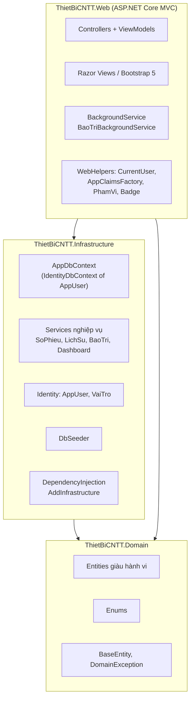

| Tầng | Trách nhiệm | Không được phép |
|---|---|---|
| Domain | Thực thể, enum, quy tắc nghiệp vụ & máy trạng thái (`DomainException`) | Tham chiếu EF Core, ASP.NET, I/O |
| Infrastructure | EF Core DbContext, cấu hình bảng, audit, Identity, service ứng dụng (truy vấn + điều phối), seed | Phụ thuộc MVC/View |
| Web | HTTP, xác thực cookie, phân quyền vai trò + phạm vi khoa, ViewModel, View, job nền, QR | Chứa quy tắc chuyển trạng thái (phải gọi phương thức Domain) |

> Ghi chú hiện trạng: tầng "Application" chưa tách dự án riêng; các service ứng dụng nằm trong `Infrastructure/Services/NghiepVuServices.cs`, một phần điều phối còn nằm trong controller (đồng bộ trạng thái TS, ghi bình luận hệ thống). Đề xuất GĐ2 tách `ThietBiCNTT.Application` (xem 3.3).

### 2.2. Sơ đồ thành phần

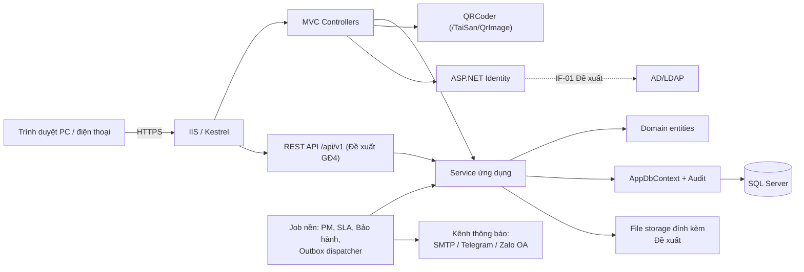

### 2.3. Sơ đồ triển khai

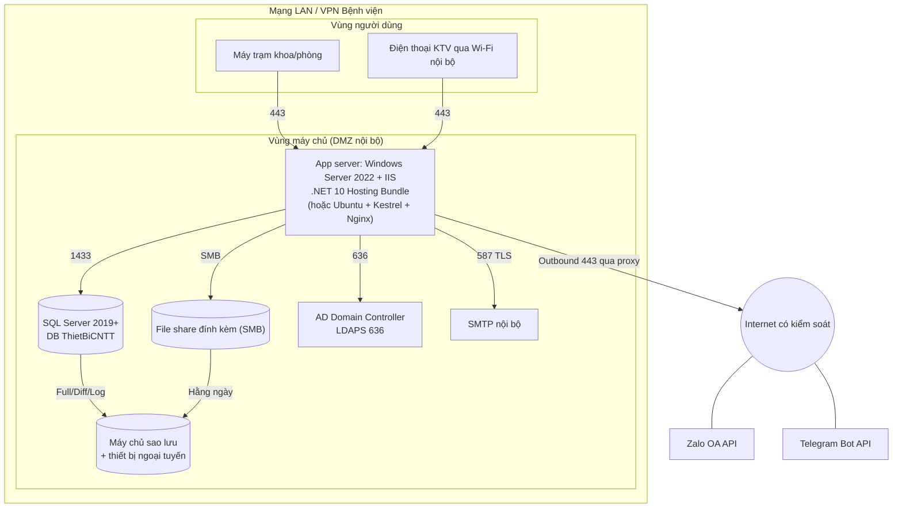

- CSDL không mở ra vùng người dùng (NFR-BM-10); chỉ app server kết nối cổng 1433.
- Outbound Internet chỉ mở tới endpoint Zalo OA/Telegram qua proxy (C-04).
- Một app server là đủ cho 300 người dùng đồng thời (NFR-HN-01). Khi chạy nhiều instance phải: dùng chung Data Protection key ring, chỉ một instance chạy job nền (cờ cấu hình hoặc khoá ứng dụng `sp_getapplock`).

### 2.4. Hướng tiếp cận di động

| Giai đoạn | Cách làm | Truy vết |
|---|---|---|
| GĐ1 [Đã có] | Giao diện responsive Bootstrap 5 (`meta viewport`, sidebar thu gọn `d-lg-none`), nút "Báo hỏng" luôn hiện trên topbar; QR mở bằng camera mặc định điện thoại | NFR-SD-02, NFR-SD-03 |
| GĐ2–GĐ3 [Đề xuất] | Màn hình mobile-first cho báo hỏng 3 bước, xử lý WO, PM, kiểm tra, kiểm kê; quét QR trong trình duyệt bằng thư viện JS (vd `html5-qrcode`) — không cần app | FR-WR-02, FR-PM-07, FR-KT-03, FR-KK-04 |
| GĐ4 [Đề xuất] | PWA: `manifest.webmanifest`, service worker (cache tĩnh + IndexedDB cho kiểm kê offline FR-KK-07), Web Push nội bộ; trang chủ theo vai trò (FR-HT-16) | NFR-SD-07 |
| Sau GĐ4 (tuỳ chọn) | Ứng dụng native (MAUI/Flutter) gọi REST API `/api/v1` khi có nhu cầu thực tế | SRS 1.6 |

### 2.5. Lớp REST API (Đề xuất GĐ4)

- Tiền tố phiên bản `/api/v1/...`, JSON, tài liệu OpenAPI (`Microsoft.AspNetCore.OpenApi` + Swagger UI chỉ bật trong LAN) — IF-09.
- Xác thực: header `X-Api-Key` (khoá lưu dạng băm SHA-256 trong bảng `ApiKeys`, gán phạm vi `scope` và danh sách IP), tuỳ chọn OAuth2 client credentials — FR-HT-17. Người dùng web vẫn dùng cookie; API dùng scheme xác thực riêng `ApiKey`.
- Nhóm endpoint dự kiến:

| Endpoint | Phương thức | Scope | Ghi chú |
|---|---|---|---|
| `/api/v1/tai-san` , `/api/v1/tai-san/{ma}` | GET | `taisan.read` | Phân trang `page`, `pageSize` ≤ 200 |
| `/api/v1/tai-san/{ma}/cau-hinh` | PUT | `cauhinh.write` | Agent gửi cấu hình (IF-07), sinh `LichSuTaiSan` loại CauHinh |
| `/api/v1/yeu-cau-sua-chua` | POST | `wr.create` | Tạo WR từ hệ thống ngoài, áp chống trùng FR-WR-05 |
| `/api/v1/phieu-sua-chua`, `/api/v1/ke-hoach-bao-tri` | GET | `wo.read` | |
| `/api/v1/kpi` | GET | `report.read` | Dữ liệu DashboardDto |
| `/api/v1/ghi-giam` | GET | `ketoan.read` | Danh sách TS ghi giảm cho kế toán (IF-08) |

- Mọi lời gọi ghi `NhatKyTichHops`; giới hạn tần suất bằng `Microsoft.AspNetCore.RateLimiting`; webhook (IF-10) ký HMAC-SHA256, gửi lại qua outbox.

---

## 3. THIẾT KẾ CHI TIẾT CÁC TẦNG

### 3.1. Tầng Domain

**Mẫu thiết kế: rich entity + máy trạng thái trong thực thể.**

- `BaseEntity` (Id `int`, `NgayTao`, `NguoiTao`, `NgayCapNhat`, `NguoiCapNhat`) cho thực thể gốc; bảng con/nhật ký (`CauHinh`, `LichSuTaiSan`, `ChiTiet*`, `BinhLuanPhieu`, `NhatKyHeThong`) không kế thừa.
- Mọi chuyển trạng thái đi qua phương thức của thực thể; vi phạm ném `DomainException` (controller bắt và hiển thị `TempData["err"]`). Controller **không gán trực tiếp** `TrangThai`.
- Thuộc tính tính toán đặt trong thực thể: `TaiSan.ConBaoHanh()`, `TaiSan.TuoiNam()`, `PhieuSuaChua.TongChiPhi`, `QuaHan()`, `ThoiGianDungMayGio`, `VatTu.DuoiTonToiThieu`.

| Thực thể | Phương thức | Điều kiện (trạng thái hợp lệ) | Kết quả / quy tắc | FR/BR |
|---|---|---|---|---|
| `PhieuSuaChua` | `TinhSla(uuTien, khoaTrongYeu)` (static) | — | Xem 5.1.3 | FR-WO-04 |
| | `TiepNhan(ktv, hinhThuc, now)` | Moi, DaTiepNhan | Bắt buộc KTV; đặt `NgayTiepNhan` (lần đầu) → DaTiepNhan | FR-WO-01, FR-WO-03 |
| | `BatDauXuLy(now)` | DaTiepNhan, ChoLinhKien, GuiHang | `NgayBatDau ??= now` → DangXuLy | FR-WO-05 |
| | `TamDung(lyDo)` | DaTiepNhan, DangXuLy | lyDo ∈ {ChoLinhKien, GuiHang} | FR-WO-05, FR-WO-10 |
| | `HoanThanh(nguyenNhan, bienPhap, gioCong, chiPhiThueNgoai, now)` | DaTiepNhan, DangXuLy, GuiHang | Bắt buộc `bienPhap`; đặt `NgayHoanThanh` → HoanThanh | FR-WO-08, BR-WO-03 (một phần) |
| | `NghiemThu(nguoi, danhGia, yKien, now)` | HoanThanh | → DaNghiemThu | FR-WO-12 |
| | `TraLai(yKien)` | HoanThanh | Xoá `NgayHoanThanh` → DangXuLy | FR-WO-12 |
| | `Huy(lyDo)` | Chưa HoanThanh/đóng | → DaHuy | FR-WO-01 (từ chối) |
| `VatTu` | `XuatKho(soLuong)` | soLuong > 0 và ≤ TonKho | Trừ tồn | FR-KHO-04, BR-KHO-01 |
| `KeHoachBaoTri` | `DenHan(homNay)`, `DayLichTiep()` | DangApDung | `NgayTiepTheo += ChuKyNgay` | FR-PM-01, FR-PM-05 |
| `PhieuDieuChuyen` | `GuiDuyet()` | Nhap, TuChoi | Có ≥1 TS; khoa đi ≠ khoa đến → ChoDuyet | FR-DC-01 |
| | `Duyet(nguoi, dongY, yKien, now)` | ChoDuyet | Từ chối bắt buộc ý kiến → DaDuyet / TuChoi | FR-DC-02, FR-DC-03 |
| | `BanGiao(now)` | DaDuyet | Mỗi TS: không DaThanhLy; gán `KhoaPhongId`, `NguoiSuDung`; TrongKho → DangSuDung → DaBanGiao | FR-DC-04, FR-DC-05 |
| `DeXuatThanhLy` | `GuiHoiDong()` | Nhap, TuChoi | Có ≥1 TS; TS → ChoThanhLy → ChoHoiDong | FR-TL-01 |
| | `DanhGia(hoiDong, ketLuan, dongY, now)` | ChoHoiDong | Đồng ý → DaDanhGia; không → TuChoi (TS ChoThanhLy → Hong) | FR-TL-03, FR-TL-04 |
| | `PheDuyet(soQD, ngayQD, hinhThuc)` | DaDanhGia | Bắt buộc số QĐ → DaPheDuyet | FR-TL-07 |
| | `HoanTat(giaTriThuHoi, now)` | DaPheDuyet | **Chặn nếu còn TS thuộc loại `CoLuuTruDuLieu` chưa `DaXoaDuLieu`**; TS → DaThanhLy → DaThanhLy | FR-TL-05, FR-TL-08, FR-TL-09, BR-TL-01 |
| `CauHinh` | `SoSanh(moi)` | — | Trả danh sách (trường, cũ, mới) trên 9 trường `CacTruong` | FR-CH-03 |

**Quy tắc mở rộng cho GĐ sau:** thực thể mới (WO mở rộng, PR/PO, kiểm kê, ngân sách…) tiếp tục mẫu trên; quy trình nhiều cấp duyệt dùng thực thể chung `BuocDuyet` với phương thức `DuyetBuoc()` trên gốc aggregate; thêm domain event (`SuKienMien`) để thông báo (3.6) thay vì gọi kênh trực tiếp trong controller.

### 3.2. Tầng Infrastructure

#### 3.2.1. Quy ước cấu hình EF Core (hiện trạng `AppDbContext.OnModelCreating`)

| Quy ước | Cài đặt hiện có |
|---|---|
| Xoá | Mọi FK mặc định `DeleteBehavior.Restrict` (tránh multiple cascade path SQL Server và đáp ứng BR-TS-03 "không xoá cứng"); chỉ cascade cho: `TaiSan→CauHinh`, `PhieuSuaChua→ChiTietVatTuSuaChua`, `PhieuSuaChua→BinhLuanPhieu`, `PhieuDieuChuyen→ChiTietDieuChuyen`, `DeXuatThanhLy→ChiTietThanhLy` |
| Decimal | Mọi `decimal` đặt precision 18 (scale 0 → `decimal(18,0)` VNĐ); ngoại lệ `VatTu.TonKho/TonToiThieu` và `ChiTietVatTuSuaChua.SoLuong` = `decimal(18,2)`, `PhieuSuaChua.GioCong` = `decimal(8,2)` |
| Enum | Lưu `int` (mặc định EF) |
| `DateOnly` | Ánh xạ `date`; `DateTime` → `datetime2` |
| Chuỗi | `[StringLength]` → `nvarchar(n)`; không có → `nvarchar(max)`; `[Required]` → NOT NULL |
| Chỉ mục duy nhất | `KhoaPhong.Ma`, `LoaiThietBi.Ma`, `VatTu.Ma`, `TaiSan.MaTaiSan`, `PhieuSuaChua.SoPhieu`, `PhieuDieuChuyen.SoPhieu`, `DeXuatThanhLy.SoPhieu` |
| Quan hệ tự tham chiếu | `ViTri.ChaId`, `TaiSan.TaiSanChaId` |
| 1–1 | `CauHinh` khoá chính = `TaiSanId` |

**Quy ước bổ sung cho bảng mới [Đề xuất]:** mỗi cấu hình đặt trong lớp `IEntityTypeConfiguration<T>` riêng (thư mục `Data/Configurations`), áp bằng `ApplyConfigurationsFromAssembly`; mọi bảng nghiệp vụ có `RowVersion`; bảng có xoá mềm dùng `IsDeleted` + global query filter.

#### 3.2.2. Audit log (FR-HT-07) [Đã có]

`SaveChangesAsync` ghi đè:

1. Duyệt `ChangeTracker`: thực thể `BaseEntity` Added → gán `NgayTao`, `NguoiTao ??= user`; Modified → `NgayCapNhat`, `NguoiCapNhat`. `user` lấy từ `ICurrentUser` (tên đăng nhập) hoặc `"system"` (job nền).
2. Với mỗi `BaseEntity` Added/Modified/Deleted tạo `NhatKyHeThong`: `HanhDong` = `Them`/`Sua`/`Xoa`, `DoiTuong` = tên lớp, `ChiTiet` = JSON `{Truong: {Cu, Moi}}` các trường đổi (bỏ qua `NgayCapNhat/NguoiCapNhat`).
3. Lưu lần 1; sau đó điền `DoiTuongId` cho bản ghi mới (Id chỉ có sau khi lưu) và lưu nhật ký ở lần 2.

Hạn chế & cải tiến đề xuất:

| Hạn chế hiện tại | Đề xuất |
|---|---|
| Hai lần `SaveChanges` không cùng transaction → có thể có dữ liệu mà thiếu log | Bọc trong `Database.BeginTransactionAsync()` hoặc chuyển sang `SaveChangesInterceptor` + `IDbContextTransaction` |
| Thực thể không kế thừa `BaseEntity` (`CauHinh`, `ChiTiet*`, `BinhLuanPhieu`) không được audit (cấu hình được ghi ở `LichSuTaiSans`) | Thêm marker interface `ICoAudit` |
| Không lưu IP, không log đăng nhập/xuất dữ liệu/xem dữ liệu nhạy cảm | Thêm cột `DiaChiIP`, `UserAgent`; ghi sự kiện `DangNhap`, `XuatDuLieu`, `XemKey` |
| Bảng log có thể bị sửa/xoá bởi tài khoản ứng dụng | `DENY UPDATE, DELETE` trên `NhatKyHeThongs` cho login ứng dụng (BR-HT-03); phân vùng theo năm |

#### 3.2.3. Migrations

- SQL Server: `Program.cs` gọi `Database.MigrateAsync()`; migrations nằm ở assembly `ThietBiCNTT.Infrastructure` (`MigrationsAssembly`). **Hiện chưa có thư mục `Migrations`** — phải tạo migration khởi tạo trước khi chạy SQL Server (lệnh ở 9.3).
- SQLite (demo): `EnsureCreatedAsync()` — không dùng migrations.
- Production: khuyến nghị sinh script idempotent (`dotnet ef migrations script --idempotent`) do DBA chạy, tắt tự migrate khi khởi động để tài khoản ứng dụng không cần quyền DDL (NFR-BM-10).

#### 3.2.4. Kiểm soát đồng thời [Đề xuất]

- Thêm `[Timestamp] public byte[] RowVersion` vào `BaseEntity` → cột `rowversion`; form sửa gửi kèm RowVersion ẩn; bắt `DbUpdateConcurrencyException` → thông báo "Dữ liệu đã bị người khác thay đổi, tải lại".
- Với SQLite demo cấu hình `IsConcurrencyToken()` thay cho `rowversion`.
- `SoPhieuService.TaoAsync` hiện đọc số lớn nhất rồi +1 (định dạng `{Tiền tố}-{yyMM}-{0001}`) → có thể trùng khi hai người tạo cùng lúc (chỉ mục duy nhất sẽ chặn bằng lỗi). Đề xuất dùng `SEQUENCE` SQL Server theo tiền tố hoặc bảng `BoDemSoPhieu` cập nhật bằng `UPDATE … OUTPUT` trong transaction; kèm retry 3 lần khi vi phạm unique.
- Tồn kho: `VatTu.XuatKho` cần RowVersion trên `VatTus` để không âm tồn khi xuất đồng thời (BR-KHO-01).

#### 3.2.5. Đăng ký DI (`DependencyInjection.AddInfrastructure`)

- `DatabaseProvider` = `SqlServer` (mặc định) hoặc `Sqlite`; `ConnectionStrings:DefaultConnection` bắt buộc.
- Identity `AddIdentity<AppUser, IdentityRole>` + EF stores + default token providers (chính sách ở mục 7.3).
- Service scoped: `SoPhieuService`, `LichSuService`, `BaoTriService`, `DashboardService`.

### 3.3. Service ứng dụng

| Service | Trạng thái | Chức năng | FR |
|---|---|---|---|
| `SoPhieuService` | [Đã có] | Sinh số phiếu `SC-`, `BT-` (phiếu sửa chữa/bảo trì), `DC-` (điều chuyển), `TL-` (thanh lý) theo tháng | BR-WO-01 (khác định dạng, xem Phụ lục A) |
| `LichSuService` | [Đã có] | `Ghi()` dòng thời gian TS; `CapNhatCauHinh()` so sánh 9 trường, ghi 1 dòng `LoaiSuKien.CauHinh` liệt kê `trường: 'cũ' → 'mới'` | FR-TS-11, FR-CH-03 |
| `BaoTriService` | [Đã có] | `SinhLenhDenHanAsync(homNay)` sinh lệnh PM (5.4) | FR-PM-05, BR-PM-01 |
| `DashboardService` | [Đã có] | `LayAsync()` trả `DashboardDto` (mục 8) | FR-BC-01, 04, 08, 09 |
| `PhieuSuaChuaService` | [Đề xuất] | Chuyển logic đang nằm trong `PhieuSuaChuaController` (chống trùng, đồng bộ trạng thái TS, bình luận hệ thống, xuất vật tư) vào service để dùng chung cho MVC + API + job | FR-WR-05, BR-WO-04 |
| `SlaService` | [Đề xuất] | Tính hạn theo bảng `ChinhSachSlas` + lịch làm việc `NgayNghis`, tạm dừng khi ChoLinhKien/GuiHang | FR-WO-04, FR-HT-06 |
| `ThongBaoService` | [Đề xuất] | Ghi `HopThuGuis` (outbox), áp `QuyTacCanhBaos` | FR-HT-08..11, 15 |
| `TepDinhKemService` | [Đề xuất] | Lưu file ngoài CSDL, kiểm tra loại/dung lượng | FR-TS-08, NFR-BM-04 |
| `DuyetService` | [Đề xuất] | Quy trình nhiều cấp dùng `BuocDuyets` cho DC/TL/PR/PO/Ngân sách | FR-DC-02, FR-MS-02, FR-NS-03, FR-HT-05 |
| `ImportTaiSanService` | [Đề xuất] | Import .xlsx (ClosedXML), xem trước, báo lỗi theo dòng | FR-TS-09 |
| `MaTaiSanService` | [Đề xuất] | Sinh mã theo `QuyTacDanhMas` | FR-TS-16, BR-TS-01 |

Đề xuất GĐ2 tách dự án `ThietBiCNTT.Application` (interface `IAppDbContext`, service, DTO); Infrastructure chỉ còn EF/Identity/kênh thông báo/file storage.

### 3.4. Tầng Web

#### 3.4.1. Pipeline (`Program.cs`)

`AddHttpContextAccessor` → `ICurrentUser = CurrentUser` → `AddInfrastructure` → `AppClaimsFactory` (thêm claim `HoTen`, `KhoaPhongId`) → cookie (`/Account/Login`, `/Account/AccessDenied`, hết hạn 10 giờ, sliding) → `AddControllersWithViews` với **`AuthorizeFilter` toàn cục** (mọi trang cần đăng nhập trừ `[AllowAnonymous]`) → `AddHostedService<BaoTriBackgroundService>`.

Khởi động: migrate/ensure-created → `DbSeeder.SeedAsync` (5 vai trò, danh mục mặc định 16 khoa/phòng — trong đó CC, HSTC, PTGM là khoa trọng yếu —, 11 loại thiết bị, 4 NCC, 8 vật tư, tài khoản `admin`; khi `SeedSampleData=true` thêm 5 tài khoản mẫu và 60 TS mẫu kèm phiếu sửa chữa).

Middleware: `UseExceptionHandler("/Home/Error")` + `UseHsts` (ngoài Development) → `UseHttpsRedirection` → `UseRouting` → `UseAuthentication` → `UseAuthorization` → `MapStaticAssets`. Route: `qr/{ma}` → `TaiSan/Qr`; `{controller=Home}/{action=Index}/{id?}`.

#### 3.4.2. Controller hiện có

| Controller | Action chính | Ghi chú |
|---|---|---|
| `AccountController` | Login (GET/POST), Logout (POST), AccessDenied | `lockoutOnFailure: true`, `LocalRedirect` chống open-redirect |
| `HomeController` | Index (dashboard), Error | |
| `TaiSanController` | Index, Export (CSV UTF-8 BOM), Details, Qr, QrImage, InTem, Create, Edit, Save | Lọc theo q (mã/tên/serial/người dùng/IP/hostname), khoa, loại, trạng thái, sắp hết BH 60 ngày; phân trang 25 |
| `PhieuSuaChuaController` | Index, Kanban, Create (GET/POST), Details, TiepNhan, BatDau, TamDung, HoanThanh, NghiemThu, TraLai, Huy, ThemVatTu, BinhLuan, InPhieu | Mọi thao tác trạng thái qua `ThucHien()` → gọi Domain, ghi bình luận hệ thống "A → B", đồng bộ trạng thái TS |
| `KeHoachBaoTriController` | Index (kèm lịch dự kiến 60 ngày), Create, Edit, Save, SinhLenh | |
| `DieuChuyenController` | Index, Create (GET/POST, `guiDuyet`), Details, InBienBan, GuiDuyet, Duyet, BanGiao | |
| `ThanhLyController` | Index, Create (gợi ý TS hỏng/quá tuổi), Details, InBienBan, CapNhatChiTiet, GuiHoiDong, DanhGia, PheDuyet, HoanTat | |
| `DanhMucController<T>` (abstract) → `KhoaPhongController`, `LoaiThietBiController`, `NhaCungCapController`, `VatTuController` | Index (tìm kiếm, tối đa 500), Create, Edit, Save; `VatTu.NhapKho` | View dùng chung `DanhMucIndex/DanhMucForm`; không có action xoá |
| `NhatKyController` | Index (lọc đối tượng, người; 50/trang) | |

#### 3.4.3. Phân quyền 2 lớp

1. **Vai trò** (`[Authorize(Roles=…)]` hoặc kiểm tra `User.LaCNTT()`/`LaDuyet()` trong action) — ma trận chi tiết mục 7.1.
2. **Phạm vi dữ liệu theo khoa** (BR-BC-01, NFR-BM-03): claim `KhoaPhongId`; `User.XemToanVien()` = QuanTri ∪ CanBoCNTT ∪ LanhDao. Người không xem toàn viện chỉ truy vấn được:
   - `TaiSan` có `KhoaPhongId = claim`;
   - `PhieuSuaChua` có `KhoaPhongId = claim`;
   - `PhieuDieuChuyen` có `TuKhoaPhongId` hoặc `DenKhoaPhongId = claim`.
   Bộ lọc đặt trong phương thức `PhamVi()`/`PhamViTaiSan()` của từng controller, áp cho cả danh sách, chi tiết và thao tác POST (trả 404 nếu ngoài phạm vi).

Đề xuất GĐ2: chuyển sang **policy-based** (`AddAuthorization(o => o.AddPolicy("TaiSan.Sua", …))`) với bảng quyền `Quyens`/`VaiTroQuyens` cho vai trò tuỳ biến (FR-HT-04) và `IAuthorizationHandler` kiểm tra phạm vi khoa theo resource.

#### 3.4.4. Chống giả mạo yêu cầu

Mọi action `[HttpPost]` có `[ValidateAntiForgeryToken]` (đã có trên toàn bộ POST hiện tại). Đề xuất bổ sung `AutoValidateAntiforgeryTokenAttribute` toàn cục để không bỏ sót ở controller mới; API `/api/v1` miễn trừ vì không dùng cookie.

#### 3.4.5. QR

- Ảnh QR: `GET /TaiSan/QrImage/{id}` dùng QRCoder (`PngByteQRCode`, ECC mức M, cache 86 400 giây) chứa URL `{scheme}://{host}/qr/{MaTaiSan}`.
- Đích quét: `GET /qr/{ma}` (`[AllowAnonymous]`) → chưa đăng nhập: chuyển tới đăng nhập với `returnUrl=/TaiSan/Details/{id}`; đã đăng nhập: chi tiết TS.
- Đề xuất GĐ2: trang rút gọn ẩn danh (MH-TS-05: tên, mã, khoa, trạng thái, nút Báo hỏng) theo FR-TS-06; cấu hình `PublicBaseUrl` để QR không phụ thuộc `Request.Host` khi đứng sau reverse proxy.

### 3.5. Job nền

| Job | Trạng thái | Lịch | Mô tả | FR/BR |
|---|---|---|---|---|
| `BaoTriBackgroundService` | [Đã có] | Chờ 20 giây sau khởi động, sau đó mỗi 6 giờ | Gọi `BaoTriService.SinhLenhDenHanAsync(hôm nay)`, log số lệnh sinh; lỗi được log, không dừng vòng lặp. Có thể chạy tay bằng nút "Sinh lệnh" (`POST /KeHoachBaoTri/SinhLenh`) | FR-PM-05 |
| Leo thang SLA | [Đề xuất] | 5 phút | Quét phiếu mở: ≥80% thời hạn → cấp 1 (KTV); quá hạn → cấp 2 (Trưởng phòng CNTT); quá 2× hoặc khoa trọng yếu quá hạn → cấp 3 (Lãnh đạo). Ghi `NhatKyLeoThangs`, chống gửi lặp theo (phiếu, cấp) | FR-WO-14, BR-WO-06 |
| Tự đóng nghiệm thu | [Đề xuất] | Hằng ngày 01:00 | Phiếu HoanThanh quá N ngày làm việc (mặc định 3) → DaNghiemThu, "Tự nghiệm thu" | FR-WO-13 |
| Cảnh báo hết hạn | [Đề xuất] | Hằng ngày 06:00 | Bảo hành, hợp đồng, bản quyền theo mốc 90/60/30/7 ngày | FR-HD-04, FR-CH-06 |
| Tồn tối thiểu → PR nháp | [Đề xuất] | Hằng ngày | FR-MS-04 | |
| Lượt kiểm tra bỏ lỡ / sinh lượt kiểm tra | [Đề xuất] | 15 phút | FR-KT-02, FR-KT-08 | |
| Đánh giá quy tắc cảnh báo | [Đề xuất] | 5 phút | FR-HT-15 | |
| Outbox dispatcher | [Đề xuất] | 30 giây | Gửi thông báo qua kênh, retry lũy thừa | NFR-KD-04 |

Thiết kế chung [Đề xuất]: lớp cơ sở `TacVuDinhKy` (BackgroundService) đọc lịch từ cấu hình, ghi `LichSuTacVus` (bắt đầu, kết thúc, kết quả, lỗi) để màn hình MH-HT-07 hiển thị và chạy lại (FR-HT-14); dùng `sp_getapplock` để chỉ một instance chạy. Có thể thay bằng Hangfire (SQL Server storage) nếu cần dashboard sẵn.

### 3.6. Thiết kế thông báo (outbox + kênh) [Đề xuất]

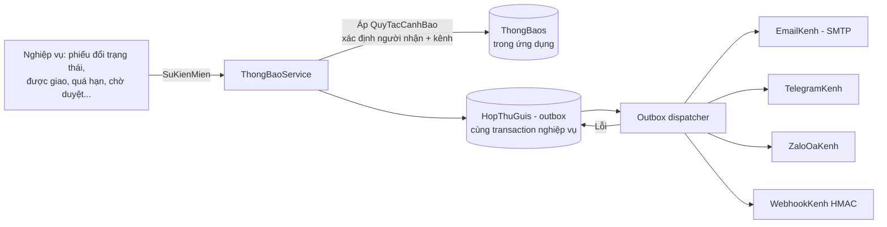

- Bản ghi outbox được thêm **trong cùng `SaveChanges`** với thay đổi nghiệp vụ → không mất thông báo, lỗi kênh ngoài không ảnh hưởng nghiệp vụ (NFR-KD-04).
- Interface `IKenhThongBao { string Ma; Task GuiAsync(HopThuGui m, CancellationToken ct); }` — mỗi kênh một lớp trong Infrastructure; token Zalo/Telegram lưu mã hoá bằng Data Protection (NFR-BM-05).
- Nội dung ra kênh ngoài chỉ gồm số phiếu, tên thiết bị, khoa, liên kết nội bộ (NFR-BM-06); mẫu nội dung cấu hình ở `MauThongBaos`.
- Chính sách retry: 1, 5, 15, 60 phút, tối đa 6 lần → `TrangThai = ThatBai`, cảnh báo Quản trị.
- Giờ yên lặng theo người dùng (FR-HT-11): dispatcher hoãn tới cuối khung giờ, trừ cấp leo thang 3.

---

## 4. THIẾT KẾ CƠ SỞ DỮ LIỆU

### 4.1. Tổng quan

- Hệ quản trị: SQL Server 2019+, collation khuyến nghị `Vietnamese_CI_AS` (tìm kiếm không phân biệt hoa thường).
- Schema mặc định `dbo`. Bảng Identity chuẩn: `AspNetUsers`, `AspNetRoles`, `AspNetUserRoles`, `AspNetUserClaims`, `AspNetUserLogins`, `AspNetUserTokens`, `AspNetRoleClaims`.
- Ký hiệu cột "Khoá/Index": **PK**, **FK→Bảng**, **UQ** (chỉ mục duy nhất), **IX** (chỉ mục thường). EF tự tạo IX cho mọi FK (không liệt kê lặp).
- Cột kiểm soát kế thừa từ `BaseEntity` (gọi tắt **[BE]**) gồm:

| Cột | Kiểu | Null | Khoá | Mô tả |
|---|---|---|---|---|
| Id | int IDENTITY | Không | PK | Khoá chính |
| NgayTao | datetime2 | Không | | Gán tự động khi thêm |
| NguoiTao | nvarchar(max) | Có | | Tên đăng nhập người tạo (đề xuất giới hạn nvarchar(100)) |
| NgayCapNhat | datetime2 | Có | | Gán tự động khi sửa |
| NguoiCapNhat | nvarchar(max) | Có | | |
| RowVersion | rowversion | Không | | **[Đề xuất]** chống ghi đè đồng thời |

### 4.2. Bảng hiện có — nhóm Danh mục & Hệ thống

**`KhoaPhongs`** — Khoa/phòng [BE]

| Cột | Kiểu | Null | Khoá/Index | Mô tả |
|---|---|---|---|---|
| Ma | nvarchar(20) | Không | UQ | Mã khoa/phòng |
| Ten | nvarchar(200) | Không | | Tên |
| TruongKhoa | nvarchar(100) | Có | | Họ tên trưởng khoa (văn bản) |
| DienThoai | nvarchar(20) | Có | | |
| LaKhoaTrongYeu | bit | Không | | Khoa trọng yếu → SLA rút ngắn (FR-VT-02) |
| DangHoatDong | bit | Không | | Mặc định 1 |

**`ViTris`** — Cây vị trí Toà nhà → Tầng → Phòng [BE]

| Cột | Kiểu | Null | Khoá/Index | Mô tả |
|---|---|---|---|---|
| Ten | nvarchar(200) | Không | | |
| Loai | int | Không | | `LoaiViTri`: 1 ToaNha, 2 Tang, 3 Phong |
| ChaId | int | Có | FK→ViTris | Nút cha |
| KhoaPhongId | int | Có | FK→KhoaPhongs | Khoa quản lý |

**`LoaiThietBis`** [BE]

| Cột | Kiểu | Null | Khoá/Index | Mô tả |
|---|---|---|---|---|
| Ma | nvarchar(20) | Không | UQ | Vd PC, LT, SV, PRN |
| Ten | nvarchar(200) | Không | | |
| Nhom | int | Không | | `NhomThietBi` 1..10 (MayTinhDeBan … Khac) |
| CoLuuTruDuLieu | bit | Không | | Bắt buộc xoá dữ liệu trước thanh lý (BR-TL-01) |
| TuoiThoNam | int | Không | | Tuổi đời khuyến nghị 1..50, mặc định 5 (FR-BC-09) |

**`NhaCungCaps`** [BE]

| Cột | Kiểu | Null | Khoá/Index | Mô tả |
|---|---|---|---|---|
| Ten | nvarchar(250) | Không | | |
| MaSoThue | nvarchar(20) | Có | | |
| DiaChi | nvarchar(500) | Có | | |
| DienThoai | nvarchar(20) | Có | | |
| Email | nvarchar(100) | Có | | |
| NguoiLienHe | nvarchar(100) | Có | | |
| LaDonViBaoHanh | bit | Không | | Hãng/trung tâm bảo hành |

**`VatTus`** — Vật tư/linh kiện, kho đơn (GĐ1) [BE]

| Cột | Kiểu | Null | Khoá/Index | Mô tả |
|---|---|---|---|---|
| Ma | nvarchar(30) | Không | UQ | |
| Ten | nvarchar(250) | Không | | |
| DonViTinh | nvarchar(20) | Không | | Mặc định "Cái" |
| TonKho | decimal(18,2) | Không | | Tồn hiện tại |
| TonToiThieu | decimal(18,2) | Không | | Ngưỡng cảnh báo (FR-KHO-07) |
| DonGia | decimal(18,0) | Không | | Đơn giá tham khảo, dùng khi xuất cho phiếu |

**`NhatKyHeThongs`** — Audit log (không kế thừa BE)

| Cột | Kiểu | Null | Khoá/Index | Mô tả |
|---|---|---|---|---|
| Id | bigint IDENTITY | Không | PK | |
| ThoiGian | datetime2 | Không | IX | |
| NguoiDung | nvarchar(100) | Có | | Tên đăng nhập hoặc "system" |
| HanhDong | nvarchar(20) | Không | | Them / Sua / Xoa |
| DoiTuong | nvarchar(100) | Không | | Tên lớp thực thể |
| DoiTuongId | nvarchar(50) | Có | | Id bản ghi |
| ChiTiet | nvarchar(max) | Có | | JSON `{Truong:{Cu,Moi}}` (chỉ khi Sửa) |

**`AspNetUsers`** — mở rộng `AppUser` (ngoài cột Identity chuẩn: Id nvarchar(450) PK, UserName, NormalizedUserName UQ, Email, PasswordHash, SecurityStamp, LockoutEnd, AccessFailedCount, …)

| Cột | Kiểu | Null | Khoá/Index | Mô tả |
|---|---|---|---|---|
| HoTen | nvarchar(max) | Không | | Họ tên hiển thị (claim `HoTen`) |
| KhoaPhongId | int | Có | FK→KhoaPhongs | Phạm vi dữ liệu (claim `KhoaPhongId`) |
| DangHoatDong | bit | Không | | Mặc định 1 (chưa được kiểm tra khi đăng nhập — xem Phụ lục A) |

`AspNetRoles` chứa 5 vai trò: `QuanTri`, `CanBoCNTT`, `TruongKhoa`, `LanhDao`, `NhanVien` (R-QT, R-CNTT, R-TK, R-LD, R-NV).

### 4.3. Bảng hiện có — nhóm Tài sản & Cấu hình

**`TaiSans`** [BE]

| Cột | Kiểu | Null | Khoá/Index | Mô tả |
|---|---|---|---|---|
| MaTaiSan | nvarchar(30) | Không | UQ | Mã TS, dùng trong QR |
| Ten | nvarchar(250) | Không | | |
| LoaiThietBiId | int | Không | FK→LoaiThietBis | |
| Hang | nvarchar(100) | Có | | Hãng (văn bản) |
| Model | nvarchar(100) | Có | | |
| SoSerial | nvarchar(100) | Có | IX | Chưa ràng buộc duy nhất (BR-TS-02 đề xuất UQ lọc `(Hang, SoSerial) WHERE SoSerial IS NOT NULL`) |
| NguonVon | int | Không | | `NguonVon` 1 NganSach … 5 Khac |
| NguyenGia | decimal(18,0) | Không | | VNĐ |
| NgayMua | date | Có | | |
| NgaySuDung | date | Có | | Mốc tính tuổi (ưu tiên hơn NgayMua) |
| NhaCungCapId | int | Có | FK→NhaCungCaps | |
| HanBaoHanh | date | Có | | |
| SoHopDong | nvarchar(50) | Có | | Số HĐ/hoá đơn (văn bản; GĐ2 thay bằng FK→HopDongs) |
| KhoaPhongId | int | Có | FK→KhoaPhongs; IX (KhoaPhongId, TrangThai) | Null = kho CNTT |
| ViTriId | int | Có | FK→ViTris | |
| NguoiSuDung | nvarchar(100) | Có | | |
| TaiSanChaId | int | Có | FK→TaiSans | Quan hệ cha–con (FR-TS-07) |
| TrangThai | int | Không | IX (cùng KhoaPhongId) | `TrangThaiTaiSan` 1 TrongKho, 2 DangSuDung, 3 DangSuaChua, 4 Hong, 5 ChoThanhLy, 6 DaThanhLy |
| ChiSoBoDem | bigint | Có | | Bộ đếm (số trang in…) — nền cho FR-PM-02 |
| GhiChu | nvarchar(1000) | Có | | |

**`CauHinhs`** — Cấu hình hiện tại, 1–1 với TaiSans (cascade)

| Cột | Kiểu | Null | Khoá/Index | Mô tả |
|---|---|---|---|---|
| TaiSanId | int | Không | PK, FK→TaiSans | |
| CPU | nvarchar(150) | Có | | |
| RAM | nvarchar(50) | Có | | |
| OCung | nvarchar(150) | Có | | |
| HeDieuHanh | nvarchar(100) | Có | | |
| BanQuyen | nvarchar(100) | Có | | Bản quyền HĐH/Office (văn bản; GĐ3 thay bằng phân hệ bản quyền) |
| DiaChiIP | nvarchar(45) | Có | IX | IPv4/IPv6; tra ngược IP (FR-CH-02) |
| DiaChiMAC | nvarchar(17) | Có | | |
| Hostname | nvarchar(63) | Có | | |
| PhanMem | nvarchar(500) | Có | | Danh sách phần mềm (văn bản) |
| NgayCapNhat | datetime2 | Có | | |

**`LichSuTaiSans`** — Dòng thời gian vòng đời (FR-TS-11)

| Cột | Kiểu | Null | Khoá/Index | Mô tả |
|---|---|---|---|---|
| Id | bigint IDENTITY | Không | PK | |
| TaiSanId | int | Không | FK→TaiSans; IX (TaiSanId, ThoiGian) | |
| ThoiGian | datetime2 | Không | | |
| LoaiSuKien | int | Không | | `LoaiSuKien` 1 TaoMoi, 2 CapNhat, 3 CauHinh, 4 SuaChua, 5 BaoTri, 6 DieuChuyen, 7 ThanhLy |
| NoiDung | nvarchar(1000) | Không | | |
| NguoiThucHien | nvarchar(100) | Có | | |

### 4.4. Bảng hiện có — nhóm Sửa chữa & Bảo trì

**`PhieuSuaChuas`** — WR + WO hợp nhất [BE]

| Cột | Kiểu | Null | Khoá/Index | Mô tả |
|---|---|---|---|---|
| SoPhieu | nvarchar(20) | Không | UQ | `SC-yyMM-0001` (sửa chữa) / `BT-yyMM-0001` (PM) |
| LoaiCongViec | int | Không | | 1 SuaChua (CM), 2 BaoTriDinhKy (PM) |
| TaiSanId | int | Không | FK→TaiSans | |
| KhoaPhongId | int | Có | FK→KhoaPhongs | Khoa yêu cầu (copy từ TS khi tạo) — dùng cho phạm vi |
| NguoiYeuCau | nvarchar(100) | Có | | |
| DienThoaiLienHe | nvarchar(20) | Có | | |
| MoTaSuCo | nvarchar(2000) | Không | | Không nhập dữ liệu người bệnh (NFR-BM-06) |
| UuTien | int | Không | | `MucDoUuTien` 1 Thap, 2 TrungBinh, 3 Cao, 4 KhanCap |
| TrangThai | int | Không | IX (TrangThai, HanXuLy) | `TrangThaiPhieuSuaChua` 1 Moi … 8 DaHuy |
| NgayYeuCau | datetime2 | Không | | Thời điểm báo |
| HanXuLy | datetime2 | Không | IX (cùng TrangThai) | Hạn SLA hoàn thành |
| NgayTiepNhan | datetime2 | Có | | |
| NgayBatDau | datetime2 | Có | | |
| NgayHoanThanh | datetime2 | Có | | |
| NgayNghiemThu | datetime2 | Có | | |
| KyThuatVien | nvarchar(100) | Có | | Tên đăng nhập KTV chính |
| HinhThucXuLy | int | Có | | 1 TuSua, 2 BaoHanh, 3 ThueNgoai |
| NhaCungCapId | int | Có | FK→NhaCungCaps | Đơn vị bảo hành/thuê ngoài |
| NguyenNhan | nvarchar(1000) | Có | | |
| BienPhapKhacPhuc | nvarchar(2000) | Có | | Bắt buộc khi hoàn thành |
| GioCong | decimal(8,2) | Không | | |
| ChiPhiThueNgoai | decimal(18,0) | Không | | |
| NguoiNghiemThu | nvarchar(100) | Có | | Họ tên |
| DanhGia | int | Có | | 1–5 sao |
| YKienNguoiDung | nvarchar(1000) | Có | | Ý kiến nghiệm thu / lý do trả lại / lý do huỷ |
| KeHoachBaoTriId | int | Có | FK→KeHoachBaoTris | Lệnh sinh từ PM |

**`ChiTietVatTuSuaChuas`** (cascade theo phiếu)

| Cột | Kiểu | Null | Khoá/Index | Mô tả |
|---|---|---|---|---|
| Id | int IDENTITY | Không | PK | |
| PhieuSuaChuaId | int | Không | FK→PhieuSuaChuas | |
| VatTuId | int | Không | FK→VatTus | |
| SoLuong | decimal(18,2) | Không | | |
| DonGia | decimal(18,0) | Không | | Chốt tại thời điểm xuất; ThanhTien = SoLuong × DonGia (tính, không lưu) |

**`BinhLuanPhieus`** (cascade theo phiếu) — FR-WO-19

| Cột | Kiểu | Null | Khoá/Index | Mô tả |
|---|---|---|---|---|
| Id | bigint IDENTITY | Không | PK | |
| PhieuSuaChuaId | int | Không | FK→PhieuSuaChuas | |
| ThoiGian | datetime2 | Không | | |
| NguoiViet | nvarchar(100) | Không | | |
| NoiDung | nvarchar(2000) | Không | | |
| LaHeThong | bit | Không | | Bình luận tự sinh khi đổi trạng thái/xuất kho |

**`KeHoachBaoTris`** [BE] — FR-PM-01

| Cột | Kiểu | Null | Khoá/Index | Mô tả |
|---|---|---|---|---|
| Ten | nvarchar(200) | Không | | |
| LoaiThietBiId | int | Có | FK→LoaiThietBis | Áp cho cả loại (TS đang sử dụng) |
| TaiSanId | int | Có | FK→TaiSans | Hoặc một TS cụ thể (ưu tiên) |
| ChuKyNgay | int | Không | | 1..3650, mặc định 180 |
| NgayTiepTheo | date | Không | | Ngày đến hạn kế tiếp |
| Checklist | nvarchar(4000) | Có | | Mỗi dòng một mục (GĐ2 tách bảng) |
| KyThuatVien | nvarchar(100) | Có | | KTV mặc định |
| DangApDung | bit | Không | | |

### 4.5. Bảng hiện có — nhóm Điều chuyển & Thanh lý

**`PhieuDieuChuyens`** [BE]

| Cột | Kiểu | Null | Khoá/Index | Mô tả |
|---|---|---|---|---|
| SoPhieu | nvarchar(20) | Không | UQ | `DC-yyMM-0001` |
| TuKhoaPhongId | int | Có | FK→KhoaPhongs | |
| DenKhoaPhongId | int | Không | FK→KhoaPhongs | |
| NguoiNhan | nvarchar(100) | Có | | |
| LyDo | nvarchar(1000) | Không | | |
| TrangThai | int | Không | | `TrangThaiDieuChuyen` 1 Nhap, 2 ChoDuyet, 3 DaDuyet, 4 TuChoi, 5 DaBanGiao |
| NguoiDuyet | nvarchar(100) | Có | | Họ tên người duyệt (một cấp) |
| NgayDuyet | datetime2 | Có | | |
| YKienDuyet | nvarchar(1000) | Có | | |
| NgayBanGiao | datetime2 | Có | | |

**`ChiTietDieuChuyens`** (cascade)

| Cột | Kiểu | Null | Khoá/Index | Mô tả |
|---|---|---|---|---|
| Id | int IDENTITY | Không | PK | |
| PhieuDieuChuyenId | int | Không | FK→PhieuDieuChuyens | |
| TaiSanId | int | Không | FK→TaiSans | |
| TinhTrang | nvarchar(500) | Có | | Tình trạng khi bàn giao |

**`DeXuatThanhLys`** [BE]

| Cột | Kiểu | Null | Khoá/Index | Mô tả |
|---|---|---|---|---|
| SoPhieu | nvarchar(20) | Không | UQ | `TL-yyMM-0001` |
| LyDo | nvarchar(1000) | Không | | |
| TrangThai | int | Không | | `TrangThaiThanhLy` 1 Nhap, 2 ChoHoiDong, 3 DaDanhGia, 4 DaPheDuyet, 5 DaThanhLy, 6 TuChoi |
| HoiDong | nvarchar(500) | Có | | Thành phần hội đồng (văn bản) |
| KetLuanHoiDong | nvarchar(2000) | Có | | |
| NgayDanhGia | datetime2 | Có | | |
| SoQuyetDinh | nvarchar(50) | Có | | |
| NgayQuyetDinh | date | Có | | |
| HinhThuc | int | Có | | `HinhThucThanhLy` 1 BanDauGia, 2 BanTrucTiep, 3 PhaDo, 4 DieuChuyenNgoai |
| GiaTriThuHoi | decimal(18,0) | Không | | |
| NgayHoanTat | datetime2 | Có | | |

**`ChiTietThanhLys`** (cascade)

| Cột | Kiểu | Null | Khoá/Index | Mô tả |
|---|---|---|---|---|
| Id | int IDENTITY | Không | PK | |
| DeXuatThanhLyId | int | Không | FK→DeXuatThanhLys | |
| TaiSanId | int | Không | FK→TaiSans | |
| TinhTrang | nvarchar(500) | Có | | Tình trạng kỹ thuật |
| GiaTriConLai | decimal(18,0) | Không | | |
| DaXoaDuLieu | bit | Không | | Bắt buộc =1 với loại `CoLuuTruDuLieu` trước khi hoàn tất |
| XacNhanXoaDuLieu | nvarchar(200) | Có | | "Phương pháp — người xác nhận dd/MM/yyyy HH:mm" (hệ thống tự nối) |

### 4.6. Sơ đồ ER — hiện trạng

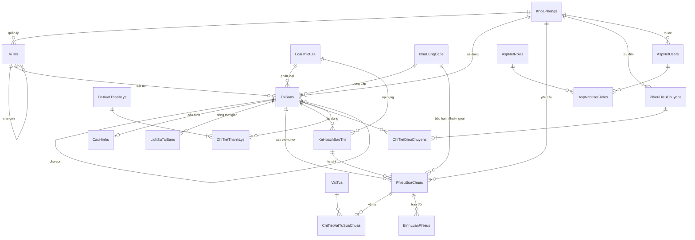

### 4.7. Bảng đề xuất cho các giai đoạn sau

Tất cả bảng dưới đây có nhãn **[Đề xuất]**, kế thừa [BE] + `RowVersion` trừ khi ghi khác. Chỉ liệt kê cột nghiệp vụ chính; FK đều `Restrict`.

#### 4.7.1. Mở rộng WR/WO, SLA, lịch làm việc (GĐ2 — FR-WR-06..09, FR-WO-06..23)

| Bảng | Cột chính (kiểu) | Ghi chú |
|---|---|---|
| `ChinhSachSlas` | UuTien int, LaKhoaTrongYeu bit, PhanHoiPhut int, HoanThanhPhut int, TheoGioLamViec bit, TamDungKhiCho bit | Thay hằng số trong `TinhSla`; UQ (UuTien, LaKhoaTrongYeu) |
| `NgayNghis` | Ngay date UQ, Ten nvarchar(100) | Lịch nghỉ lễ cho SLA giờ làm việc (FR-HT-06) |
| `PhanCongPhieus` | PhieuSuaChuaId FK, NguoiDungId nvarchar(450) FK→AspNetUsers, LaChinh bit | Nhiều KTV (FR-WO-03) |
| `GioCongKtvs` | PhieuSuaChuaId FK, NguoiDungId FK, BatDau datetime2, KetThuc datetime2, SoGio decimal(8,2) | FR-WO-06 |
| `MaLois` | Ma nvarchar(20) UQ, Ten nvarchar(200), Nhom int | Danh mục nguyên nhân (FR-WO-08); thêm `PhieuSuaChuas.MaLoiId` FK |
| `LichSuTrangThaiPhieus` | PhieuSuaChuaId FK IX, TuTrangThai int, DenTrangThai int, ThoiGian datetime2, NguoiThucHien nvarchar(100) | Đo SLA/downtime chính xác, tạm dừng đồng hồ |
| `NhatKyLeoThangs` | PhieuSuaChuaId FK, Cap tinyint, ThoiGian datetime2, NguoiNhan nvarchar(450) | UQ (PhieuSuaChuaId, Cap) — BR-WO-06 |
| `ThoiGianDungMays` | PhieuSuaChuaId FK, TaiSanId FK, BatDau datetime2, KetThuc datetime2 null | Sự cố diện rộng nhiều TS (FR-WO-23) |
| `ThietBiThayThes` | PhieuSuaChuaId FK, TaiSanTamId FK→TaiSans, NgayMuon, NgayTra null | FR-WO-11 |
| `HuongDanCongViecs` (+`BuocHuongDans`) | Ten, LoaiThietBiId FK null; Buoc: ThuTu int, NoiDung nvarchar(2000) | FR-WO-21 |
| Cột mới `PhieuSuaChuas` | HanPhanHoi datetime2, NgayPhanHoi datetime2, LaYeuCauTrung bit, PhieuGocId int FK→PhieuSuaChuas, ViTriId int null, LaNgungHoatDong bit, RowVersion | FR-WR-03, FR-WR-05, BR-WO-11, BR-WO-05 |
| Cột mới `BinhLuanPhieus` | LaNoiBo bit, NguoiDuocNhac nvarchar(500) | FR-WO-19, BR-WO-10 |

#### 4.7.2. PM đầy đủ (GĐ2 — FR-PM-02..15)

| Bảng | Cột chính | Ghi chú |
|---|---|---|
| `MauChecklists` (+`MucChecklists`) | Ten, LoaiThietBiId; Muc: ThuTu, NoiDung, KieuKetQua int (DatKhongDat/SoDo/GhiChu), BatBuoc bit, DonVi nvarchar(20) | FR-PM-04 |
| Cột mới `KeHoachBaoTris` | KieuChuKy int (Ngay/Tuan/Thang/Quy/Nam), HeSo int, NgayBatDau date, NgayKetThuc date null, NguongChiSo bigint null, DieuKienDenTruoc bit, SoNgaySinhTruoc int, TinhTuNgayHoanThanh bit, TrangThaiDuyet int, NguoiThamDinh, NguoiXetDuyet, MauChecklistId FK | FR-PM-01, 03, 11, BR-PM-05, BR-PM-06 |
| `DoiTuongKeHoachs` | KeHoachBaoTriId FK, TaiSanId/LoaiThietBiId/ViTriId null | Nhóm TS, vị trí |
| `ChiSoBoDems` | TaiSanId FK IX, ThoiGian, GiaTri bigint, Nguon int | FR-PM-02, MH-PM-05 |
| `KetQuaChecklists` | PhieuSuaChuaId FK, MucChecklistId FK, KetQua nvarchar(200), Dat bit null, PhieuPhatSinhId FK null | FR-PM-08, BR-PM-03 |
| `DuTruKeHoachs` | KeHoachBaoTriId FK, VatTuId FK, SoLuong, GioCong, ChiPhi | FR-PM-10, FR-PM-12 |

#### 4.7.3. Kiểm tra tài sản (GĐ2 — FR-KT-01..10)

| Bảng | Cột chính | Ghi chú |
|---|---|---|
| `MauPhieuKiemTras` | Ma, Ten, PhienBan int, LoaiThietBiId null, ViTriId null, DangDung bit | BR-KT-03: UQ (Ma, PhienBan) |
| `MucMauKiemTras` | MauPhieuKiemTraId FK, Nhom, ThuTu, NoiDung, Kieu int (DatKhongDat/SoDo/LuaChon/VanBan/Anh/ChuKy), DonVi, NguongMin decimal(18,4), NguongMax decimal(18,4), NguongNguyHiemMin/Max, BatBuoc bit, TaoYeuCauKhiBatThuong bit | FR-KT-01, FR-KT-05 |
| `LichKiemTras` | MauPhieuKiemTraId FK, KieuChuKy, HeSo, Ca nvarchar(20), DoiTuong (TaiSanId/ViTriId), NguoiThucHien, NgayBatDau, NgayKetThuc | FR-KT-02 |
| `LuotKiemTras` | LichKiemTraId FK null, MauPhieuKiemTraId FK, TaiSanId/ViTriId, HanThucHien datetime2, BatDau, KetThuc, NguoiThucHien, TrangThai int (ChoThucHien/HoanThanh/BoLo), CoBatThuong bit | IX (TrangThai, HanThucHien) |
| `KetQuaKiemTras` | LuotKiemTraId FK, MucMauKiemTraId FK, GiaTriSo decimal(18,4), GiaTriVanBan nvarchar(500), MucDo int (BinhThuong/CanhBao/NguyHiem), PhieuSuaChuaId FK null | FR-KT-07, BR-KT-04 |

#### 4.7.4. NCC – Hợp đồng – Bảo hành (GĐ2 — FR-HD-01..08)

| Bảng | Cột chính | Ghi chú |
|---|---|---|
| `HopDongs` | SoHopDong nvarchar(50) UQ, Loai int (MuaSam/BaoTri/ThueBao/BanQuyen/DichVu), NhaCungCapId FK, GiaTri decimal(18,0), NgayKy date, HieuLucTu date, HieuLucDen date IX, DieuKhoanSla nvarchar(2000), TrangThai int | BR-HD-03 |
| `HopDongTaiSans` | HopDongId FK, TaiSanId FK, HanBaoHanh date null, LoaiBaoHanh int | UQ (HopDongId, TaiSanId); thêm `TaiSans.HopDongId` FK |
| `PhieuGuiHangs` | SoPhieu UQ, PhieuSuaChuaId FK, TaiSanId FK, NhaCungCapId FK, NgayGui, PhuKien, NgayHenTra date, NgayTra null, KetQua int, ChiPhi, DaXuLyDuLieu bit NOT NULL, SerialMoi nvarchar(100) | BR-HD-01 (CHECK DaXuLyDuLieu=1 khi loại có lưu trữ — kiểm ở Domain), BR-HD-02 |
| `DanhGiaNhaCungCaps` | NhaCungCapId FK, Ky nvarchar(7), Diem decimal(4,2), NhanXet | FR-HD-08 |

#### 4.7.5. Bản quyền phần mềm & cấu hình phiên bản (GĐ3 — FR-CH-03..07)

| Bảng | Cột chính | Ghi chú |
|---|---|---|
| `PhanMems` | Ten, NhaPhatHanh, PhienBan, Loai int, LoaiBanQuyen int | FR-CH-04 |
| `BanQuyenPhanMems` | PhanMemId FK, SoLuong int, KeyMaHoa varbinary(max), HetHan date null IX, HopDongId FK null, NhaCungCapId FK null | Key mã hoá Data Protection/Always Encrypted (BR-CH-02) |
| `GanBanQuyens` | BanQuyenPhanMemId FK, TaiSanId FK null, NguoiDungId null, NgayGan, NgayThuHoi null | BR-CH-03, BR-CH-04 |
| `PhanMemCaiDats` | TaiSanId FK, PhanMemId FK, PhienBan, NgayPhatHien, Nguon int | FR-CH-07 |
| `PhienBanCauHinhs` | TaiSanId FK IX, PhienBan int, (các trường như CauHinhs), HieuLucTu, Nguon int (Tay/Agent), PhieuSuaChuaId FK null | Lưu lịch sử cấu hình có cấu trúc (FR-CH-03, FR-CH-09); `CauHinhs` giữ bản hiện hành |
| Ràng buộc mới `CauHinhs` | UQ lọc `Hostname`, `DiaChiIP` của TS đang sử dụng (kiểm ở service vì cần JOIN trạng thái) | BR-CH-01 |

#### 4.7.6. Kho & Mua sắm PR/PO (GĐ3 — FR-KHO-02..09, FR-MS-01..08)

| Bảng | Cột chính | Ghi chú |
|---|---|---|
| `Khos` | Ma UQ, Ten, Loai int (Chinh/ToaNha/ChoXuLy), ThuKho nvarchar(450) | FR-KHO-02, BR-KHO-04 |
| `TonKhoVatTus` | KhoId FK, VatTuId FK, SoLuong decimal(18,2), GiaBinhQuan decimal(18,2), RowVersion | PK (KhoId, VatTuId); thay `VatTus.TonKho` (giữ cột làm tổng, cập nhật trong service) |
| `PhieuKhos` | SoPhieu UQ, Loai int (Nhap/Xuat/Chuyen/DieuChinh/Huy), KhoId FK, KhoDenId FK null, PhieuSuaChuaId FK null, PhieuNhanHangId FK null, TrangThai int (Nhap/DaGhiSo), NgayGhiSo | BR-KHO-02 |
| `ChiTietPhieuKhos` | PhieuKhoId FK, VatTuId FK, SoLuong, DonGia, SoLo, Serial | FR-KHO-09 |
| `DeXuatMuaHangs` | SoPhieu UQ, KhoaPhongId FK, LyDo, CanCu int, PhieuSuaChuaId null, KhoanMucNganSachId FK, TongDuToan decimal(18,0), TrangThai int (Nhap/ChoDuyet/DaDuyet/DaLapDonMotPhan/DaLapDon/Dong/TuChoi), LaTuSinh bit | FR-MS-01, 03, 04 |
| `ChiTietDeXuatMuaHangs` | DeXuatMuaHangId FK, VatTuId FK null, MoTa nvarchar(500), SoLuong, DonGiaDuKien, SoLuongDaDat | BR-MS-02 |
| `DonMuaHangs` | SoPhieu UQ, NhaCungCapId FK, HopDongId FK null, NgayDat, HanGiao date IX, TrangThai int (Nhap/ChoDuyet/DaDat/NhanMotPhan/NhanDu/Dong/Huy), TongTien, Thue | FR-MS-05, 07 |
| `ChiTietDonMuaHangs` | DonMuaHangId FK, ChiTietDeXuatMuaHangId FK, SoLuong, DonGia, ThueSuat, BaoHanhThang int, SoLuongDaNhan | BR-MS-03 |
| `PhieuNhanHangs` (+`ChiTietNhanHangs`) | DonMuaHangId FK, NgayNhan, NguoiNhan, BienBan; Chi tiết: ChiTietDonMuaHangId FK, SoLuong, Serial, TaiSanTaoId FK null | FR-MS-06: sinh PhieuKho nhập hoặc TaiSans TrongKho |

#### 4.7.7. Ngân sách bảo trì (GĐ3 — FR-NS-01..07)

| Bảng | Cột chính | Ghi chú |
|---|---|---|
| `KhoanMucNganSachs` | Ma UQ, Ten, NguonVon int | FR-NS-01 |
| `DuToanNganSachs` | Nam int, PhienBan int, TrangThai int (Nhap/ChoDuyet/DaDuyet), UQ (Nam, PhienBan) | FR-NS-02, 03 |
| `ChiTietDuToans` | DuToanNganSachId FK, KhoanMucNganSachId FK, Thang tinyint, KhoaPhongId FK null, SoTien decimal(18,0) | Lưới tháng × khoản mục |
| `DieuChinhNganSachs` | DuToanNganSachId FK, KhoanMucNganSachId FK, Thang, SoTien (±), LyDo, TrangThai | BR-NS-03 |
| `GiaoDichNganSachs` | KhoanMucNganSachId FK, Nam, Thang, Loai int (CamKet/ThucChi/HuyCamKet), SoTien, NguonLoai nvarchar(30) (PR/PO/WO/HD/NhanHang), NguonId int | IX (KhoanMucNganSachId, Nam, Thang); BR-NS-02, BR-NS-04 |

#### 4.7.8. Điều chuyển & Thanh lý mở rộng (GĐ3 — FR-DC-02, 07; FR-TL-03, 05, 09)

| Bảng | Cột chính | Ghi chú |
|---|---|---|
| `BuocDuyets` | LoaiChungTu nvarchar(30), ChungTuId int, Cap tinyint, VaiTroDuyet nvarchar(50), NguoiDuyet nvarchar(450) null, DuyetThay bit, KetQua int (Cho/DongY/TuChoi/YeuCauBoSung), YKien, ThoiGian | IX (LoaiChungTu, ChungTuId); dùng chung DC/TL/PR/PO/NS (SRS 6.3) |
| `CauHinhQuyTrinhDuyets` | LoaiChungTu, Cap, VaiTro, NguongGiaTriTu, BoQuaNeuNoiBo bit | FR-HT-05 |
| `UyQuyenDuyets` | NguoiUyQuyen, NguoiDuocUyQuyen, TuNgay, DenNgay | BR-HT-04 |
| `ThanhVienHoiDongs` | DeXuatThanhLyId FK, HoTen, ChucVu, VaiTro int (ChuTich/ThuKy/ThanhVien), SoQuyetDinhThanhLap | FR-TL-03 (thay cột văn bản `HoiDong`) |
| `BienBanXoaDuLieus` | ChiTietThanhLyId FK null, PhieuGuiHangId FK null, LoaiThietBiLuuTru, SerialO nvarchar(100), PhuongPhap int (GhiDe/KhuTu/PhaHuy), CongCu, NguoiThucHien, NguoiChungKien, NgayThucHien, DaXacNhan bit | FR-TL-05, BM-07, BR-TL-01 |
| Cột mới `DeXuatThanhLys` | DaGhiGiam bit, NgayGhiGiam, NguoiGhiGiam, DonViTiepNhan | FR-TL-09, BR-TL-05 |
| Cột mới `PhieuDieuChuyens` | DenViTriId FK, LaRaNgoai bit, SoQuyetDinh, DonViNhanNgoai | FR-DC-07 |

#### 4.7.9. Kiểm kê (GĐ3 — FR-KK-01..11)

| Bảng | Cột chính | Ghi chú |
|---|---|---|
| `DotKiemKes` | Ten, Loai int, PhamVi (KhoaPhongId/ViTriId/LoaiThietBiId null), TuNgay, DenNgay, SoQuyetDinh, TrangThai int (Nhap/DangMo/DaKhoa) | |
| `SnapshotKiemKes` | DotKiemKeId FK, TaiSanId FK, KhoaPhongId, ViTriId, TrangThai | UQ (DotKiemKeId, TaiSanId) — FR-KK-02 |
| `KetQuaQuetKiemKes` | DotKiemKeId FK, TaiSanId FK null, ViTriThucTeId FK, TinhTrang int, NguoiQuet, ThoiGian, CanInLaiTem bit, LaThua bit, MoTaThua | UQ lọc (DotKiemKeId, TaiSanId) — BR-KK-01; offline sync dùng `MaThietBiQuet` + `IdCucBo` uniqueidentifier |
| `ChenhLechKiemKes` | DotKiemKeId FK, TaiSanId null, Loai int (Thieu/Thua/SaiViTri/SaiTinhTrang), DeXuatXuLy int, TrangThaiXuLy int, NguoiDuyet | FR-KK-09, 10, BR-KK-03 |

#### 4.7.10. Tài sản mở rộng: trường tuỳ chỉnh, đánh mã, đính kèm (GĐ1-còn lại/GĐ2 — FR-TS-08, 15, 16)

| Bảng | Cột chính | Ghi chú |
|---|---|---|
| `DinhNghiaTruongTuyChinhs` | LoaiThietBiId FK null (null = mọi loại), Ma nvarchar(50), Nhan nvarchar(200), Kieu int (VanBan/So/Ngay/DanhSach/CoKhong), LuaChon nvarchar(max) JSON, BatBuoc bit, ThuTu int, An bit | UQ (LoaiThietBiId, Ma); BR-TS-07 không xoá, chỉ ẩn |
| `GiaTriTruongTuyChinhs` | TaiSanId FK, DinhNghiaTruongTuyChinhId FK, GiaTriVanBan nvarchar(1000), GiaTriSo decimal(18,4), GiaTriNgay date | PK (TaiSanId, DinhNghiaId); IX (DinhNghiaId, GiaTriVanBan) cho lọc |
| `QuyTacDanhMas` | LoaiThietBiId FK null, Mau nvarchar(100) (vd `{LOAI}-{KHOA}-{YYYY}-{STT:5}`), BoDemHienTai int, ApDungTu date | FR-TS-16, BR-TS-01 |
| `TepDinhKems` | Id uniqueidentifier PK, LoaiDoiTuong nvarchar(30), DoiTuongId int, TenGoc nvarchar(260), DuongDanLuu nvarchar(400) (tên GUID), KieuMime nvarchar(100), KichThuoc bigint, BamSha256 char(64), LaNoiBo bit | IX (LoaiDoiTuong, DoiTuongId); tệp lưu ngoài CSDL (SRS 6.3) |
| `SoDoMatBangs` (+`DiemTrenSoDos`) | ViTriId FK, TepDinhKemId; Diem: TaiSanId FK, X decimal(6,3), Y decimal(6,3) | GĐ4, FR-VT-05 |

#### 4.7.11. Thông báo, cảnh báo, hệ thống, tích hợp (GĐ2–GĐ4 — FR-HT-08..17, IF-09/10)

| Bảng | Cột chính | Ghi chú |
|---|---|---|
| `ThongBaos` | Id bigint, NguoiNhanId nvarchar(450) FK IX, TieuDe nvarchar(200), NoiDung nvarchar(1000), DuongDan nvarchar(400), ThoiGian, DaDoc bit, NgayDoc | Chuông trong ứng dụng (FR-HT-08); IX (NguoiNhanId, DaDoc) |
| `HopThuGuis` (outbox) | Id bigint, Kenh nvarchar(20), NguoiNhan nvarchar(200), TieuDe, NoiDung nvarchar(max), TrangThai int (Cho/DangGui/DaGui/ThatBai), SoLanThu int, LanThuTiep datetime2 IX, LoiCuoi nvarchar(1000), KhoaChongLap nvarchar(100) UQ lọc | 3.6 |
| `CaiDatKenhNguoiDungs` | NguoiDungId FK, Kenh, DiaChi (email/chat id/Zalo user id mã hoá), Bat bit, GioYenLangTu time, GioYenLangDen time | FR-HT-10, FR-HT-11 |
| `MauThongBaos` | Ma UQ, Kenh, TieuDe, NoiDung (template `{SoPhieu}`…) | FR-HT-09 |
| `QuyTacCanhBaos` | Ten, DoiTuong int (TaiSan/WO/PM/KiemTra/Kho/HopDong/NganSach/PhieuDuyet), SuKien nvarchar(50), PhamViJson nvarchar(max), LapLaiPhut int null, HanhDong int (KhongCo/TaoYeuCau/NangUuTien), Bat bit, LaCaNhan bit, NguoiSoHuu null | FR-HT-15 |
| `DieuKienCanhBaos` | QuyTacCanhBaoId FK, Truong nvarchar(100), ToanTu nvarchar(10), GiaTri nvarchar(200), SoNgayTruocSau int null | |
| `NguoiNhanCanhBaos` | QuyTacCanhBaoId FK, Loai int (NguoiCuThe/VaiTro/NguoiPhuTrach/TruongKhoaCuaTS), GiaTri nvarchar(450), Kenh nvarchar(20) | |
| `ThamSoHeThongs` | Khoa nvarchar(100) PK, GiaTri nvarchar(max), MoTa | FR-HT-13 (ngưỡng hỏng lặp lại BR-WO-07, 50% nguyên giá BR-WO-08, N ngày tự đóng…) |
| `LichSuTacVus` | TenTacVu, BatDau, KetThuc, KetQua int, SoBanGhi int, Loi nvarchar(max) | FR-HT-14 |
| `ApiClients` / `ApiKeys` | Client: Ten, MoTa, Bat; Key: ApiClientId FK, TienTo char(8) IX, BamKhoa char(64), PhamVi nvarchar(500), DanhSachIP nvarchar(500), HetHan, ThuHoi bit | FR-HT-17 |
| `NhatKyTichHops` | Id bigint, ApiKeyId FK, ThoiGian IX, PhuongThuc, DuongDan, MaKetQua int, ThoiGianXuLyMs int, DiaChiIP | IF-09 |
| `DangKyWebhooks` | ApiClientId FK, SuKien nvarchar(50), Url nvarchar(400), BiMatMaHoa varbinary(256), Bat bit | IF-10 (gửi qua outbox) |
| `Quyens` / `VaiTroQuyens` | Ma nvarchar(100) (vd `TaiSan.Sua`), PhamVi int (ToanVien/Khoa/CuaToi) | FR-HT-04 vai trò tuỳ biến |
| `CauHinhGiaoDienMobiles` | VaiTro, TrangChu, MenuJson, TheDashboardJson | FR-HT-16 |

### 4.8. Sơ đồ ER — các phân hệ đề xuất

```mermaid
erDiagram
    TaiSans ||--o{ GiaTriTruongTuyChinhs : ""
    DinhNghiaTruongTuyChinhs ||--o{ GiaTriTruongTuyChinhs : ""
    LoaiThietBis ||--o{ DinhNghiaTruongTuyChinhs : ""
    NhaCungCaps ||--o{ HopDongs : ""
    HopDongs ||--o{ HopDongTaiSans : ""
    TaiSans ||--o{ HopDongTaiSans : ""
    PhieuSuaChuas ||--o{ PhieuGuiHangs : "gửi hãng"
    PhanMems ||--o{ BanQuyenPhanMems : ""
    BanQuyenPhanMems ||--o{ GanBanQuyens : ""
    TaiSans ||--o{ GanBanQuyens : ""
    MauPhieuKiemTras ||--|{ MucMauKiemTras : ""
    MauPhieuKiemTras ||--o{ LichKiemTras : ""
    LichKiemTras ||--o{ LuotKiemTras : "sinh"
    LuotKiemTras ||--|{ KetQuaKiemTras : ""
    KetQuaKiemTras ||--o| PhieuSuaChuas : "bất thường sinh"
    DeXuatMuaHangs ||--|{ ChiTietDeXuatMuaHangs : ""
    ChiTietDeXuatMuaHangs ||--o{ ChiTietDonMuaHangs : "lập đơn"
    DonMuaHangs ||--|{ ChiTietDonMuaHangs : ""
    DonMuaHangs ||--o{ PhieuNhanHangs : ""
    PhieuNhanHangs ||--o| PhieuKhos : "sinh phiếu nhập"
    Khos ||--o{ TonKhoVatTus : ""
    VatTus ||--o{ TonKhoVatTus : ""
    PhieuKhos ||--|{ ChiTietPhieuKhos : ""
    KhoanMucNganSachs ||--o{ ChiTietDuToans : ""
    DuToanNganSachs ||--|{ ChiTietDuToans : ""
    KhoanMucNganSachs ||--o{ GiaoDichNganSachs : "cam kết/thực chi"
    DotKiemKes ||--|{ SnapshotKiemKes : ""
    DotKiemKes ||--o{ KetQuaQuetKiemKes : ""
    DotKiemKes ||--o{ ChenhLechKiemKes : ""
    ChiTietThanhLys ||--o{ BienBanXoaDuLieus : ""
    DeXuatThanhLys ||--o{ ThanhVienHoiDongs : ""
    QuyTacCanhBaos ||--|{ DieuKienCanhBaos : ""
    QuyTacCanhBaos ||--|{ NguoiNhanCanhBaos : ""
    AspNetUsers ||--o{ ThongBaos : ""
    ApiClients ||--o{ ApiKeys : ""
    ApiKeys ||--o{ NhatKyTichHops : ""
```

### 4.9. Chiến lược chỉ mục

| Mục tiêu | Chỉ mục | Trạng thái |
|---|---|---|
| Tra cứu QR / mã | UQ `TaiSans.MaTaiSan` | [Đã có] |
| Danh sách TS theo khoa + trạng thái (phạm vi khoa) | IX `TaiSans(KhoaPhongId, TrangThai)` | [Đã có] |
| Tìm serial / IP | IX `TaiSans.SoSerial`, IX `CauHinhs.DiaChiIP` | [Đã có] |
| Hàng đợi/quá hạn SLA, dashboard | IX `PhieuSuaChuas(TrangThai, HanXuLy)` | [Đã có] |
| Timeline TS | IX `LichSuTaiSans(TaiSanId, ThoiGian)` | [Đã có] |
| Tra log theo thời gian | IX `NhatKyHeThongs.ThoiGian` | [Đã có] |
| Phiếu theo khoa (phạm vi) | IX `PhieuSuaChuas(KhoaPhongId, TrangThai) INCLUDE (HanXuLy, UuTien)` | [Đề xuất] |
| Chống trùng báo hỏng | IX `PhieuSuaChuas(TaiSanId, LoaiCongViec, TrangThai)` | [Đề xuất] |
| PM không sinh trùng | IX `PhieuSuaChuas(KeHoachBaoTriId, TaiSanId, TrangThai)` | [Đề xuất] |
| MTTR/SLA theo kỳ | IX `PhieuSuaChuas(NgayHoanThanh) INCLUDE (NgayYeuCau, HanXuLy, LoaiCongViec)` | [Đề xuất] |
| Cảnh báo bảo hành | IX `TaiSans(HanBaoHanh) WHERE TrangThai <> 6` (filtered) | [Đề xuất] |
| Tìm kiếm nhanh toàn văn (FR-TS-04) | Full-Text Index trên `TaiSans(Ten, MaTaiSan, SoSerial, NguoiSuDung)` khi > 50.000 TS (hiện dùng `LIKE '%q%'`, không tận dụng index) | [Đề xuất] |
| Log nhật ký | Phân vùng `NhatKyHeThongs` theo năm, nén trang (page compression) | [Đề xuất] |

Bảo trì chỉ mục: job SQL Agent hằng tuần (Chủ nhật 02:00) rebuild khi phân mảnh > 30%, reorganize 5–30%, cập nhật thống kê.

### 4.10. Lưu trữ dữ liệu & sao lưu

| Dữ liệu | Thời hạn lưu | Cách thực hiện |
|---|---|---|
| Hồ sơ TS, phiếu sửa chữa, điều chuyển | Vĩnh viễn trong vòng đời TS + tối thiểu 10 năm sau thanh lý | Không xoá cứng (Restrict FK; không có action xoá) |
| Hồ sơ thanh lý, biên bản xoá dữ liệu | Vĩnh viễn (BR-TL-03) | Chặn xoá ở tầng ứng dụng + `DENY DELETE` |
| Audit log `NhatKyHeThongs` | ≥ 5 năm (BR-HT-03) | Append-only, phân vùng năm; sau 5 năm chuyển sang DB lưu trữ `ThietBiCNTT_Archive` |
| Outbox đã gửi, thông báo đã đọc | 180 ngày | Job dọn hằng tuần |
| Nhật ký tích hợp API | 1 năm | Job dọn |
| Tệp đính kèm | Theo đối tượng gắn | Xoá mềm metadata; tệp vật lý giữ đến khi đối tượng hết hạn lưu |

Lịch sao lưu (NFR-SL-01..05):

| Loại | Tần suất | Giữ | Ghi chú |
|---|---|---|---|
| Full DB | Hằng ngày 23:00 | 30 bản ngày + 12 bản tháng | `BACKUP DATABASE … WITH COMPRESSION, CHECKSUM, ENCRYPTION (AES_256)` |
| Differential | Mỗi 6 giờ (05:00, 11:00, 17:00) | 7 ngày | |
| Transaction log | Mỗi 30 phút | 7 ngày | DB ở recovery model FULL → RPO ≤ 30 phút |
| Thư mục đính kèm | Hằng ngày 23:30 | 30 bản | robocopy/Veeam sang máy chủ sao lưu |
| Bản ngoại tuyến | Hằng tuần | 12 tuần | Thiết bị tách biệt (NFR-SL-03) |
| Diễn tập phục hồi | 6 tháng/lần | — | Phục hồi sang máy test, đo RTO ≤ 4 giờ (NFR-SL-04) |

---

## 5. THIẾT KẾ LUỒNG NGHIỆP VỤ

### 5.1. Báo hỏng → tiếp nhận/giao việc → xử lý → hoàn thành → nghiệm thu

#### 5.1.1. Sơ đồ tuần tự (hiện trạng GĐ1)

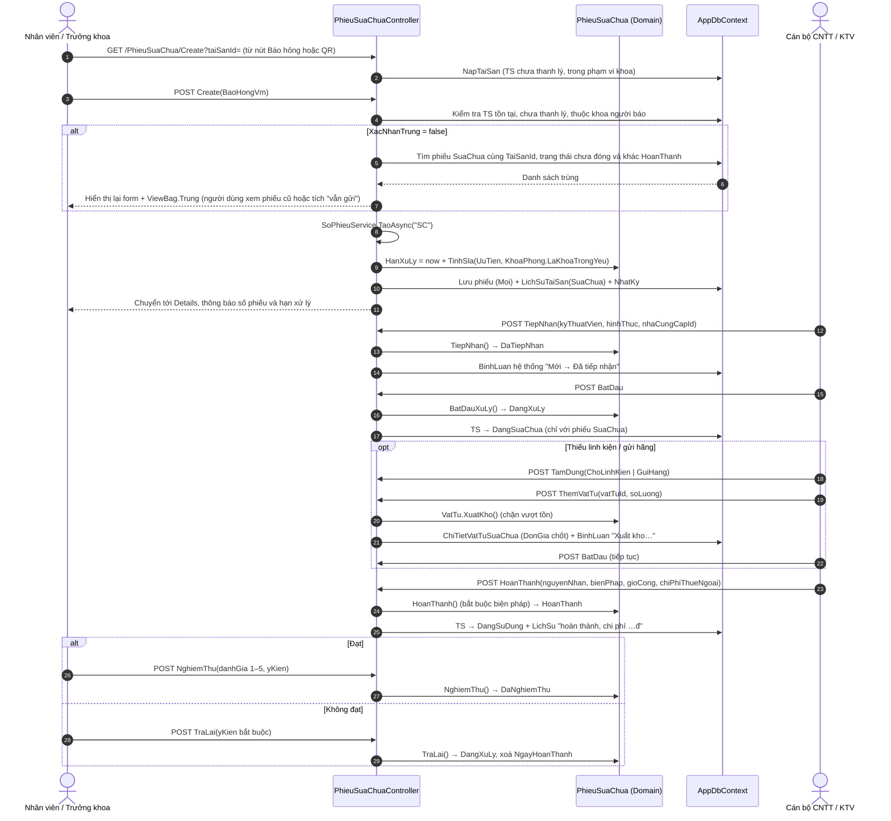

#### 5.1.2. Phát hiện trùng (FR-WR-05) — như cài đặt

Điều kiện trùng: `TaiSanId` giống, `LoaiCongViec = SuaChua`, `TrangThai ∉ {DaNghiemThu, DaHuy, HoanThanh}`. Khi có trùng, form hiển thị danh sách để người báo mở phiếu cũ (bổ sung bằng bình luận) hoặc tích `XacNhanTrung` để vẫn tạo mới.

Mở rộng GĐ2 [Đề xuất]: thêm cửa sổ N giờ (tham số `ChongTrung.SoGio`), trùng theo (ViTri + loại sự cố) cho sự cố không gắn TS (FR-WR-03); nút "Theo dõi cùng" tạo bản ghi người theo dõi thay vì phiếu mới; người tiếp nhận gộp phiếu → trạng thái "Đã gộp", `PhieuGocId` (BR-WO-11).

#### 5.1.3. Công thức SLA — đúng như `PhieuSuaChua.TinhSla`

```
gio = UuTien switch { KhanCap → 2, Cao → 8, TrungBinh → 24, Thap (mặc định) → 72 }
SLA = TimeSpan.FromHours( khoaTrongYeu ? Math.Max(1, gio / 2) : gio )   // gio / 2 là phép chia số nguyên
HanXuLy = NgayYeuCau (DateTime.Now lúc tạo) + SLA                      // giờ lịch, không trừ ngày nghỉ
```

| Ưu tiên | Khoa thường | Khoa trọng yếu (`LaKhoaTrongYeu`) |
|---|---|---|
| Khẩn cấp | 2 giờ | 1 giờ |
| Cao | 8 giờ | 4 giờ |
| Trung bình | 24 giờ | 12 giờ |
| Thấp | 72 giờ | 36 giờ |

- Lệnh PM tự sinh: `UuTien = Thap`, nhưng `HanXuLy = homNay + 7 ngày, 23:59:59.9999999` (không dùng `TinhSla`).
- `QuaHan(now)` = phiếu chưa đóng, khác `HoanThanh`, và `now > HanXuLy`.
- Chênh lệch so với bảng SLA SRS 4.3.2 (phản hồi 15 phút/1 giờ/4 giờ/1 ngày; hoàn thành 4 giờ/8 giờ làm việc/3 ngày/5 ngày làm việc; tự nâng ưu tiên BR-WO-02; tạm dừng khi chờ) → GĐ2 thay bằng `SlaService` + `ChinhSachSlas` (4.7.1). Trong khi chuyển đổi, giữ `TinhSla` làm giá trị mặc định khi bảng chưa cấu hình.

#### 5.1.4. Đồng bộ trạng thái tài sản (BR-WO-04) — như cài đặt

`DongBoTrangThaiTaiSan` chỉ chạy khi trạng thái phiếu thay đổi và TS không ở `DaThanhLy`/`ChoThanhLy`:

- Phiếu `DangXuLy`/`ChoLinhKien`/`GuiHang` **và** loại SuaChua → TS `DangSuaChua`.
- Phiếu `HoanThanh` (mọi loại) → TS `DangSuDung` + ghi lịch sử (`SuaChua` hoặc `BaoTri`).

#### 5.1.5. Máy trạng thái phiếu sửa chữa (hiện trạng)

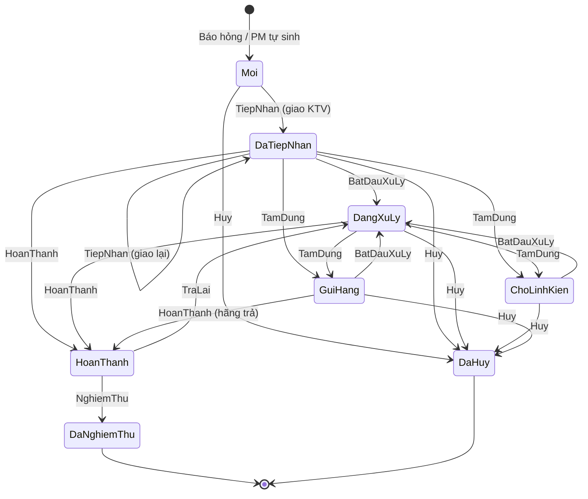

Ánh xạ sang trạng thái SRS 4.3.3: `DaTiepNhan` ≈ `DaGiao`; `GuiHang` ≈ `ChoHang`; `DaNghiemThu` ≈ `NghiemThuDong`; `DaHuy` ≈ `TuChoi`. GĐ2 bổ sung trạng thái `DaGop` (BR-WO-11) và thao tác tự đóng (FR-WO-13).

### 5.2. Điều chuyển có duyệt + bàn giao (FR-DC-01..06, 08)

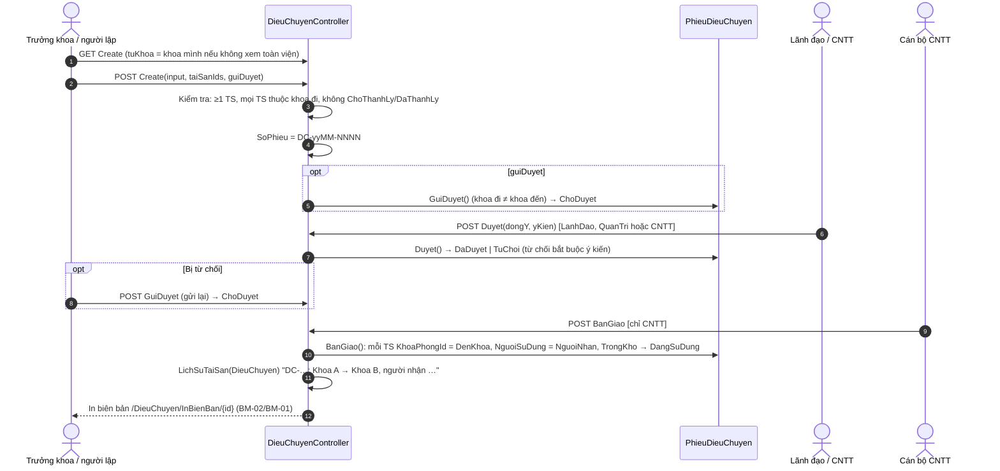

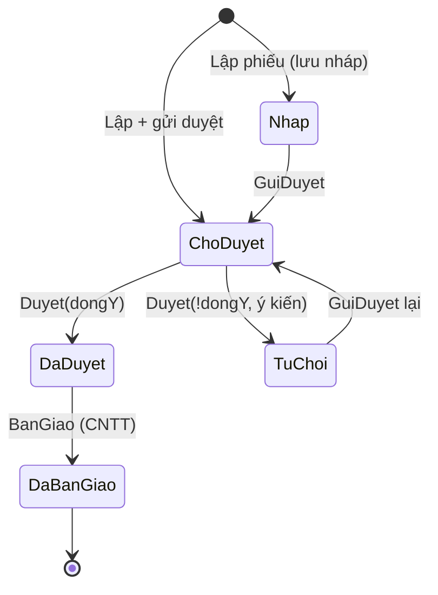

Mở rộng GĐ3 [Đề xuất] để đạt luồng SRS 4.7.2: thay một cấp `Duyet` bằng chuỗi `BuocDuyets` (Trưởng khoa giao → Trưởng khoa nhận → CNTT/VT-TTB thẩm định → Lãnh đạo, bỏ qua cấp theo ngưỡng); thêm trạng thái TS `DangDieuChuyen` khi DaDuyet (BR-DC-05); kiểm tra BR-DC-01 (một TS một phiếu hiệu lực), BR-DC-02 (không có WO mở / không trong đợt kiểm kê / thanh lý), BR-DC-03 (không tự duyệt phiếu mình lập); cập nhật `ViTriId` khi bàn giao; xác nhận điện tử hai bên (MH-DC-04).

### 5.3. Thanh lý có hội đồng, quyết định và bắt buộc xoá dữ liệu

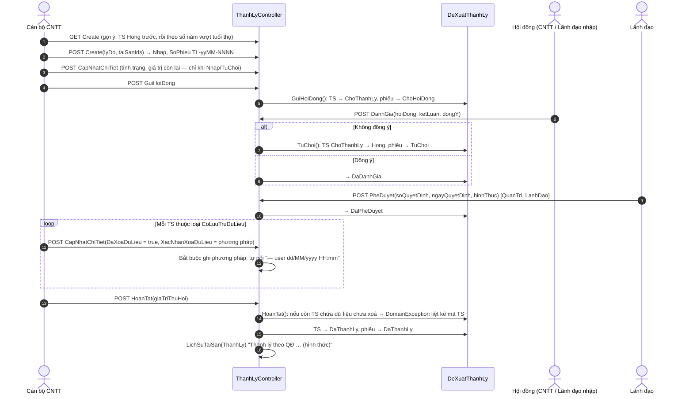

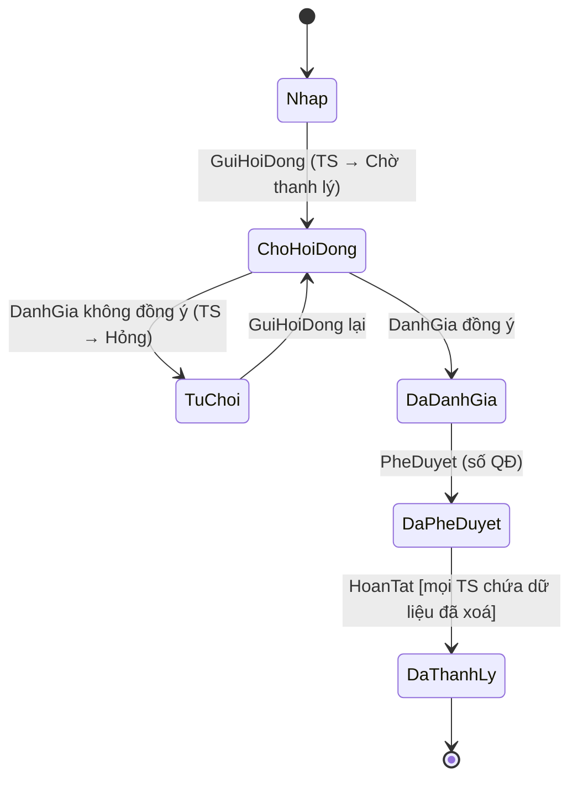

Ghi chú bảo mật dữ liệu người bệnh: điều kiện xoá dữ liệu được kiểm **trong Domain** (không thể vượt qua bằng giao diện). Theo BR-TL-01 điều kiện này cần kiểm **trước bước quyết định**; GĐ3 sẽ thêm bước `XoaDuLieu` giữa `DaDanhGia` và `ChoQuyetDinh`, thay cờ `DaXoaDuLieu` bằng bảng `BienBanXoaDuLieus` có người chứng kiến + ảnh (BM-07), thêm `DaGhiGiam` do TCKT xác nhận (BR-TL-05), tự thu hồi license và tắt kế hoạch PM (FR-TL-09).

### 5.4. Tự sinh lệnh bảo trì định kỳ (FR-PM-05)

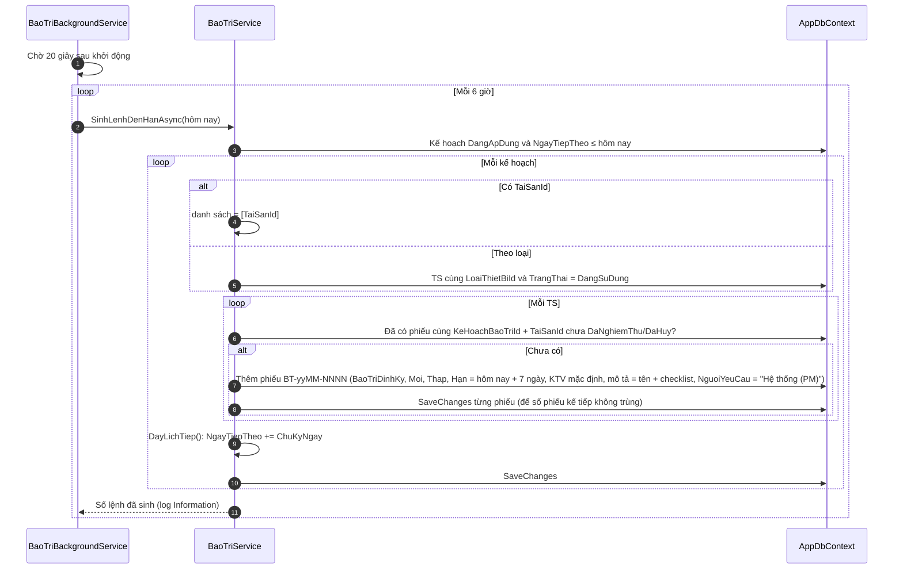

Đặc điểm cần lưu ý: lệnh sinh **đúng ngày đến hạn** (chưa có "trước N ngày"); nếu `NgayTiepTheo` lùi xa quá khứ, mỗi lượt chạy chỉ đẩy một chu kỳ (bù dần); khi bỏ qua vì còn lệnh mở vẫn đẩy lịch (chưa phát cảnh báo "PM quá hạn" như BR-PM-01). Kế hoạch theo một TS cụ thể không kiểm trạng thái TS (BR-PM-02). Các điểm này xử lý ở GĐ2 cùng với kế hoạch có thẩm định/xét duyệt.

---

## 6. THIẾT KẾ GIAO DIỆN

Bố cục chi tiết, màu sắc và luồng thao tác tham chiếu **Bộ mockup giao diện** (tài liệu tương tác riêng, REF-03). Mục này quy định cấu trúc, định danh màn hình, route, quyền và thành phần.

### 6.1. Sơ đồ trang / menu

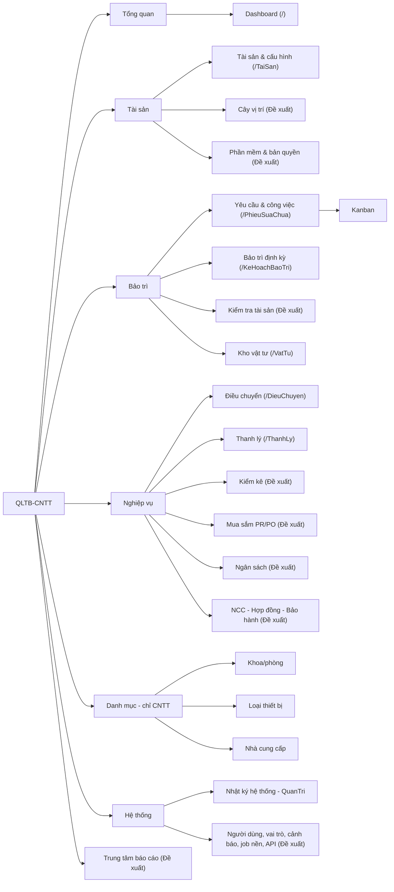

Hiện trạng `_Layout.cshtml`: nhóm Tổng quan, Tài sản, Bảo trì, Nghiệp vụ hiển thị cho mọi người dùng; nhóm Danh mục chỉ khi `User.LaCNTT()`; Nhật ký chỉ `QuanTri`. Đề xuất: ẩn mục không có quyền (Bảo trì định kỳ, Kho vật tư, Thanh lý đang hiện cả với Nhân viên/Trưởng khoa nhưng sẽ trả AccessDenied) — sinh menu từ cùng chính sách phân quyền.

### 6.2. Nguyên tắc bố cục

- **Sidebar trái** cố định (desktop), thu gọn thành nút ☰ trên màn hình < 992px (`d-lg-none`); ẩn khi in (`d-print-none`).
- **Topbar**: ô tìm kiếm nhanh TS (mã, serial, IP, hostname — gửi tới `/TaiSan?q=`, ẩn dưới 768px; đề xuất thêm nút kính lúp/quét QR trên mobile), **nút đỏ "Báo hỏng" luôn hiện** (`/PhieuSuaChua/Create`), tên người dùng, Đăng xuất. GĐ2 thêm chuông thông báo (FR-HT-08).
- Thông báo kết quả thao tác qua `TempData["ok"]`/`TempData["err"]` (alert Bootstrap).
- Badge trạng thái thống nhất màu theo `Badge.Mau()` (vd Đang sử dụng – xanh lá, Đang sửa chữa – vàng, Hỏng – đỏ, Khẩn cấp – đỏ).
- Danh sách: phân trang phía máy chủ 25 dòng (`PagedList`, `_Pager`), bộ lọc trên đầu; nhật ký 50 dòng.
- **Responsive cho điện thoại** (NFR-SD-02): báo hỏng, chi tiết phiếu (nghiệm thu), chi tiết TS qua QR, xác nhận bàn giao hiển thị 1 cột từ 360px; nút thao tác chính kích thước ≥ 44px.
- **Biểu mẫu in**: layout `_Print.cshtml` (Times New Roman 13pt, lề 15mm, bảng viền đen, khối chữ ký), `_HeaderBenhVien.cshtml` (quốc hiệu, tên đơn vị); nút In/Quay lại ẩn khi in. Áp dụng: phiếu sửa chữa (BM-05), biên bản điều chuyển/bàn giao (BM-02/BM-01), biên bản thanh lý (BM-03), tem QR (BM-11).
- Tiếng Việt Unicode, ngày `dd/MM/yyyy`, tiền `N0` + "đ".

### 6.3. Danh sách màn hình

Trạng thái view: các view `TaiSan/*`, `Home/Index`, `Account/*`, `NhatKy/Index`, danh mục dùng chung đã có; view của `PhieuSuaChua`, `KeHoachBaoTri`, `DieuChuyen`, `ThanhLy` đang được viết (controller đã hoàn chỉnh).

| ID | Tên màn hình | Route | Vai trò | Thành phần chính | Thao tác | Trạng thái |
|---|---|---|---|---|---|---|
| MH-HT-00 | Đăng nhập | `/Account/Login` | Ẩn danh | Form tên/mật khẩu, ghi nhớ | Đăng nhập (khoá 15 phút sau 5 lần sai) | [Đã có] |
| MH-BC-01/02 | Dashboard | `/` | Mọi người dùng đã đăng nhập | Thẻ KPI (tổng TS, nguyên giá, đang sửa, hỏng, chờ thanh lý, phiếu mở/quá hạn, MTTR, % SLA, PM đến hạn 7 ngày, sắp hết BH 60 ngày, vật tư dưới định mức, quá tuổi thọ); top 10 khoa; theo nhóm; biểu đồ 12 tháng; 8 phiếu mở ưu tiên cao | Nhấp thẻ → danh sách lọc | [Đã có] |
| MH-TS-01 | Danh sách tài sản | `/TaiSan?q=&khoa=&loai=&trangThai=&hetBaoHanh=&page=` | Tất cả (phạm vi khoa nếu không xem toàn viện) | Lưới, bộ lọc, phân trang, chọn nhiều | Xem, Thêm, Sửa (CNTT), Xuất CSV, In tem | [Đã có] |
| MH-TS-02 | Chi tiết tài sản | `/TaiSan/Details/{id}` | Như trên | Thông tin chung, cấu hình, TS cha/con, lịch sử 50 sự kiện, phiếu sửa chữa + chi phí, ảnh QR | Sửa, Nhân bản, Báo hỏng, In tem, Lập điều chuyển | [Đã có] |
| MH-TS-07 | Thêm/sửa tài sản | `/TaiSan/Create?copyFrom=`, `/TaiSan/Edit/{id}` | QuanTri, CanBoCNTT | Form TS + cấu hình + lý do thay đổi | Lưu (chặn đổi khoa trực tiếp → hướng dẫn lập phiếu điều chuyển) | [Đã có] |
| MH-TS-04 | In tem QR | `/TaiSan/InTem?ids=&khoa=` | Tất cả (phạm vi) | Lưới tem tối đa 300 | In | [Đã có] |
| MH-TS-05 | Trang QR | `/qr/{ma}` | Ẩn danh → đăng nhập | Hiện chuyển hướng tới MH-TS-02; GĐ2: trang rút gọn + nút Báo hỏng | | [Một phần] |
| MH-TS-03 | Import Excel | `/TaiSan/Import` | QuanTri, CanBoCNTT | Tải mẫu, upload, xem trước, lỗi theo dòng | | [Đề xuất] GĐ1-còn lại |
| MH-TS-06 | Trường tuỳ chỉnh & quy tắc mã | `/HeThong/TruongTuyChinh`, `/HeThong/QuyTacMa` | QuanTri | | | [Đề xuất] |
| MH-VT-01 | Cây vị trí | `/ViTri` | CNTT (sửa), tất cả (xem) | Treeview + TS theo nút | | [Đề xuất] (bảng đã có, chưa có controller) |
| MH-CH-02/03 | Bản quyền; Tra cứu IP/MAC | `/BanQuyen`, `/TaiSan?q=<ip>` | CNTT | | | [Đề xuất] / [Một phần] (tìm IP qua MH-TS-01) |
| MH-WR-01 | Báo hỏng | `/PhieuSuaChua/Create?taiSanId=` | Tất cả | Chọn TS (trong phạm vi), mô tả, ưu tiên, người báo, SĐT; cảnh báo trùng + ô "vẫn gửi" | Gửi | [Đã có] (view đang viết) |
| MH-WO-01 | Danh sách / hàng đợi | `/PhieuSuaChua?trangThai=&khoa=&loai=&cuaToi=&quaHan=&dangMo=` | Tất cả (phạm vi) | Lưới sắp theo ưu tiên ↓ rồi hạn ↑ | Lọc, mở chi tiết | [Đã có] |
| MH-WR-02 / MH-WO-07 | Yêu cầu của tôi / Việc của tôi | `/PhieuSuaChua?cuaToi=true` | Tất cả | Lọc `KyThuatVien = tôi` hoặc `NguoiTao = tôi`; GĐ2: 3 tab Tôi phụ trách / Tôi giao / Tôi liên quan | | [Một phần] |
| MH-WO-03 | Kanban | `/PhieuSuaChua/Kanban?cuaToi=` | Tất cả (phạm vi) | Cột theo trạng thái, tối đa 400 thẻ, gồm đã nghiệm thu 7 ngày | GĐ2: kéo thả gọi action tương ứng | [Đã có] |
| MH-WO-02 | Chi tiết phiếu | `/PhieuSuaChua/Details/{id}` | Tất cả (phạm vi) | Thông tin, đồng hồ SLA, TS + cấu hình, vật tư + chi phí, 5 phiếu gần nhất của TS, khung trao đổi `#trao-doi` | CNTT: Tiếp nhận/giao KTV, Bắt đầu, Tạm dừng, Thêm vật tư, Hoàn thành; người trong phạm vi: Bình luận, Nghiệm thu/Trả lại; người tạo/CNTT: Huỷ | [Đã có] |
| MH-WO-04 | Nghiệm thu | khối trong MH-WO-02 | Người trong phạm vi khoa | Sao 1–5, ý kiến | Đạt / Không đạt | [Đã có] |
| MH-WO-08 | In phiếu sửa chữa (BM-05) | `/PhieuSuaChua/InPhieu/{id}` | Tất cả (phạm vi) | Layout in | In | [Đã có] |
| MH-WO-05/06 | Lịch công việc; Timeline TS | `/PhieuSuaChua/Lich`, `/TaiSan/Timeline/{id}` | | | | [Đề xuất] GĐ2 |
| MH-PM-01/03 | Kế hoạch PM + lịch 60 ngày | `/KeHoachBaoTri` | QuanTri, CanBoCNTT, LanhDao (xem) | Danh sách kế hoạch, lịch dự kiến, số lệnh PM đang mở | Thêm/Sửa, "Sinh lệnh đến hạn" (CNTT) | [Đã có] |
| MH-PM-07 | Thêm/sửa kế hoạch | `/KeHoachBaoTri/Create`, `/Edit/{id}` | QuanTri, CanBoCNTT | Loại hoặc TS, chu kỳ ngày, ngày tiếp theo, checklist, KTV | Lưu | [Đã có] |
| MH-PM-02/04/05/06 | Mẫu checklist; Thực hiện PM mobile; Nhập chỉ số; Dự trù | | | | | [Đề xuất] GĐ2 |
| MH-KHO-01 | Vật tư | `/VatTu` | QuanTri, CanBoCNTT | Lưới, tồn, tồn tối thiểu | Thêm/Sửa, Nhập kho nhanh | [Đã có] |
| MH-KHO-02/03 | Phiếu nhập/xuất/chuyển; Thẻ kho | | | | | [Đề xuất] GĐ3 |
| MH-DC-01 | Danh sách điều chuyển | `/DieuChuyen?trangThai=` | Tất cả (khoa đi/đến) | 200 phiếu gần nhất | | [Đã có] |
| MH-DC-02 | Lập/chi tiết điều chuyển | `/DieuChuyen/Create?tuKhoa=&taiSanIds=`, `/DieuChuyen/Details/{id}` | Lập: tất cả (khoa mình); Duyệt: LanhDao, QuanTri, CanBoCNTT; Bàn giao: CNTT | Chọn TS theo khoa đi, khoa đến, người nhận, lý do | Lưu nháp, Gửi duyệt, Duyệt/Từ chối, Bàn giao | [Đã có] |
| MH-DC-05 | In biên bản | `/DieuChuyen/InBienBan/{id}` | Như trên | BM-02/BM-01 | In | [Đã có] |
| MH-DC-03/04 | Chờ tôi duyệt; Xác nhận bàn giao mobile | | | | | [Đề xuất] GĐ3 |
| MH-TL-01 | Danh sách thanh lý | `/ThanhLy?trangThai=` | QuanTri, CanBoCNTT, LanhDao | | | [Đã có] |
| MH-TL-02 | Lập/chi tiết hồ sơ thanh lý | `/ThanhLy/Create`, `/ThanhLy/Details/{id}` | Lập, cập nhật, gửi HĐ, hoàn tất: CNTT; Đánh giá: CNTT/LanhDao; Phê duyệt: QuanTri/LanhDao | Danh sách TS (gợi ý hỏng/quá tuổi), tình trạng, giá trị còn lại, xác nhận xoá dữ liệu, hội đồng, quyết định | | [Đã có] |
| MH-TL-04 | In biên bản thanh lý | `/ThanhLy/InBienBan/{id}` | Như trên | BM-03 | In | [Đã có] |
| MH-TL-03 | Ghi nhận xoá dữ liệu (mobile, ảnh) | | | | | [Đề xuất] GĐ3 |
| MH-HT-04 | Danh mục | `/KhoaPhong`, `/LoaiThietBi`, `/NhaCungCap` | QuanTri, CanBoCNTT | Lưới + tìm kiếm, form dùng chung | Thêm/Sửa | [Đã có] |
| MH-HT-06 | Nhật ký hệ thống | `/NhatKy?doiTuong=&nguoi=&page=` | QuanTri | | Lọc | [Đã có] |
| MH-HT-01/02/03/05/07/08/09 | Người dùng; Vai trò & quyền; Quy trình duyệt; Thông báo; Sao lưu & job nền; Quy tắc cảnh báo; Khoá API | `/HeThong/...` | QuanTri | | | [Đề xuất] (MH-HT-01 ưu tiên GĐ1-còn lại) |
| MH-KT-01..04 | Kiểm tra tài sản | `/KiemTra/...` | CNTT; TK xem khoa | | | [Đề xuất] GĐ2 |
| MH-HD-01..04 | NCC, hợp đồng, cảnh báo hết hạn, gửi hãng | `/HopDong/...`, `/GuiHang/...` | CNTT, LanhDao | | | [Đề xuất] GĐ2 |
| MH-MS-01..03 | PR, PO, nhận hàng | `/MuaSam/...` | CNTT, TK (PR khoa), LanhDao (duyệt) | | | [Đề xuất] GĐ3 |
| MH-NS-01..04 | Ngân sách | `/NganSach/...` | CNTT, LanhDao/TCKT | | | [Đề xuất] GĐ3 |
| MH-KK-01..04 | Kiểm kê | `/KiemKe/...` | CNTT, TK xác nhận | Màn quét camera toàn màn hình | | [Đề xuất] GĐ3 |
| MH-BC-03 | Trung tâm báo cáo | `/BaoCao` | Theo BR-BC-01 | Danh mục báo cáo + xuất Excel/PDF | | [Đề xuất] GĐ3 |

---

## 7. BẢO MẬT & PHÂN QUYỀN

### 7.1. Ma trận quyền theo controller/action (đúng như cài đặt)

Ký hiệu: ✔ = được phép; **K** = chỉ dữ liệu thuộc khoa mình (lọc `PhamVi`); – = bị chặn (403/AccessDenied hoặc thông báo lỗi). Cột "CNTT" = vai trò `CanBoCNTT`; `QuanTri` luôn có quyền như CNTT cộng các quyền riêng.

| Controller / Action | QuanTri | CanBoCNTT | LanhDao | TruongKhoa | NhanVien | Cơ chế |
|---|---|---|---|---|---|---|
| Account.* | Ẩn danh | | | | | `[AllowAnonymous]` |
| Home.Index (dashboard) | ✔ | ✔ | ✔ | ✔ (toàn viện) | ✔ (toàn viện) | Chỉ yêu cầu đăng nhập |
| TaiSan.Index/Details/Export/InTem | ✔ | ✔ | ✔ | K | K | `PhamViTaiSan()` |
| TaiSan.QrImage | ✔ | ✔ | ✔ | ✔ | ✔ | Không lọc phạm vi |
| TaiSan.Qr (`/qr/{ma}`) | Ẩn danh → đăng nhập | | | | | `[AllowAnonymous]` |
| TaiSan.Create/Edit/Save | ✔ | ✔ | – | – | – | `[Authorize(Roles=NhomCNTT)]` |
| PhieuSuaChua.Index/Kanban/Details/InPhieu/BinhLuan | ✔ | ✔ | ✔ | K | K | `PhamVi()` |
| PhieuSuaChua.Create (báo hỏng) | ✔ | ✔ | ✔ | K | K | Kiểm TS thuộc khoa |
| TiepNhan/BatDau/TamDung/HoanThanh | ✔ | ✔ | – | – | – | `User.LaCNTT()` trong `ThucHien` |
| ThemVatTu | ✔ | ✔ | – | – | – | `[Authorize(Roles=NhomCNTT)]` |
| NghiemThu/TraLai | ✔ | ✔ | ✔ | K | K | Mọi người trong phạm vi |
| Huy | ✔ | ✔ | Nếu là người tạo | K, nếu là người tạo | K, nếu là người tạo | Kiểm `NguoiTao` |
| KeHoachBaoTri.Index | ✔ | ✔ | ✔ | – | – | Class `[Authorize(Roles=NhomCNTT,LanhDao)]` |
| KeHoachBaoTri.Create/Edit/Save/SinhLenh | ✔ | ✔ | – | – | – | `NhomCNTT` |
| DieuChuyen.Index/Details/InBienBan/GuiDuyet | ✔ | ✔ | ✔ | K (khoa đi hoặc đến) | K | `PhamVi()` |
| DieuChuyen.Create | ✔ | ✔ | ✔ | K (khoa đi = khoa mình) | K | Forbid nếu khác khoa |
| DieuChuyen.Duyet | ✔ | ✔ | ✔ | – | – | `LaDuyet() || LaCNTT()` |
| DieuChuyen.BanGiao | ✔ | ✔ | – | – | – | `LaCNTT()` |
| ThanhLy.Index/Details/InBienBan/DanhGia | ✔ | ✔ | ✔ | – | – | Class `NhomCNTT,LanhDao` |
| ThanhLy.Create/CapNhatChiTiet/GuiHoiDong/HoanTat | ✔ | ✔ | – | – | – | `NhomCNTT` |
| ThanhLy.PheDuyet | ✔ | – | ✔ | – | – | `NhomDuyet` (QuanTri, LanhDao) |
| KhoaPhong/LoaiThietBi/NhaCungCap/VatTu (+NhapKho) | ✔ | ✔ | – | – | – | `NhomCNTT` |
| NhatKy.Index | ✔ | – | – | – | – | `QuanTri` |

Tách bạch nhiệm vụ đã có: người lập thanh lý (CNTT) không tự phê duyệt quyết định (chỉ QuanTri/LanhDao). Chưa có: chặn tự duyệt điều chuyển (BR-DC-03), giới hạn nghiệm thu cho người báo/Trưởng khoa (FR-WO-12), Nhân viên chỉ thấy dữ liệu "của mình" (O). Các điểm lệch so với SRS 4.11.3 liệt kê ở Phụ lục A.

### 7.2. Quy tắc phạm vi dữ liệu

1. Claim `KhoaPhongId` được nạp khi đăng nhập từ `AspNetUsers.KhoaPhongId` (`AppClaimsFactory`); đổi khoa người dùng có hiệu lực sau khi đăng nhập lại.
2. `XemToanVien()` = QuanTri ∪ CanBoCNTT ∪ LanhDao. Các vai trò khác chỉ thấy TS/phiếu có `KhoaPhongId` = claim; người dùng không gán khoa thấy tập rỗng (so sánh với null).
3. Phạm vi áp ở mọi truy vấn đọc và mọi POST thay đổi (tải bản ghi qua `PhamVi()` trước khi thao tác → 404 nếu ngoài phạm vi).
4. [Đề xuất] Áp phạm vi cho dashboard (BR-BC-01), `QrImage`, kế hoạch PM (TK xem khoa), và phạm vi "của tôi" cho Nhân viên; tập trung bằng `IAuthorizationHandler` + global query filter theo `ICurrentUser` để không phụ thuộc từng controller.

### 7.3. Chính sách mật khẩu, khoá tài khoản, phiên

| Mục | Cấu hình hiện tại | SRS | Ghi chú |
|---|---|---|---|
| Độ dài tối thiểu | 8 | 8 (NFR-BM-02) | |
| Chữ hoa / chữ thường / chữ số | Bắt buộc (mặc định Identity) | Bắt buộc | |
| Ký tự đặc biệt | Không bắt buộc (`RequireNonAlphanumeric=false`) | Không yêu cầu | |
| Khoá khi sai | 5 lần → khoá 15 phút (`lockoutOnFailure: true`) | 5 lần / 15 phút | |
| Email duy nhất | Không | — | |
| Băm mật khẩu | PBKDF2 mặc định ASP.NET Identity | | |
| Phiên cookie | 10 giờ, sliding expiration | 30 phút không thao tác (NFR-BM-08) | Đề xuất `ExpireTimeSpan = 30 phút` (tham số hoá) + `Cookie.SecurePolicy = Always`, `SameSite = Lax`, `HttpOnly` (mặc định) |
| Mật khẩu mặc định seed | `Abc@12345` cho mọi tài khoản seed | — | Bắt buộc đổi khi triển khai; đề xuất cờ "phải đổi mật khẩu lần đầu" |
| Tài khoản ngừng hoạt động | Cột `DangHoatDong` chưa được kiểm khi đăng nhập | BR-HT-02 | Đề xuất kiểm trong `Login` + `SecurityStampValidator` |
| 2FA, AD/LDAP | Chưa | FR-HT-03, IF-01 | GĐ4 |

### 7.4. Audit log

- Tự động ghi mọi thêm/sửa/xoá `BaseEntity` kèm giá trị trước/sau (3.2.2); xem tại MH-HT-06 (QuanTri).
- Lịch sử nghiệp vụ theo TS ở `LichSuTaiSans` (bao gồm từng trường cấu hình thay đổi) — bổ trợ cho audit.
- Bình luận hệ thống trong phiếu ghi mọi chuyển trạng thái và xuất kho (ai, khi nào).
- Bổ sung GĐ2: IP, đăng nhập/đăng xuất/thất bại, xuất dữ liệu (CSV), xem license key (BR-CH-02), append-only bằng quyền SQL.

### 7.5. Đối chiếu OWASP Top 10

| Rủi ro | Biện pháp hiện có | Bổ sung đề xuất |
|---|---|---|
| A01 Broken Access Control | `AuthorizeFilter` toàn cục, vai trò + phạm vi khoa, 404 ngoài phạm vi | Policy-based, kiểm tra phạm vi tập trung, test tự động theo ma trận 7.1 (AC-04) |
| A02 Cryptographic Failures | HTTPS redirect + HSTS (ngoài Development), băm mật khẩu Identity | Data Protection key ring lưu thư mục bảo vệ + mã hoá DPAPI; mã hoá license key/token; TLS cho SQL (`Encrypt=True`, bỏ `TrustServerCertificate` ở Production) |
| A03 Injection | EF Core tham số hoá, không SQL thô; Razor encode mặc định; `Badge.Html` dùng `HtmlEncode` | CSV export: chặn CSV/formula injection (tiền tố `'` cho giá trị bắt đầu `= + - @`) |
| A04 Insecure Design | Quy tắc nghiệp vụ ở Domain (không vượt qua bằng UI) | Unit test Domain ≥ 60% (NFR-BT-04) |
| A05 Security Misconfiguration | Trang lỗi chung ngoài Development | Header CSP, `X-Content-Type-Options`, `Referrer-Policy`; `AllowedHosts` cụ thể thay `*`; tắt Swagger ngoài LAN |
| A06 Vulnerable Components | Gói NuGet phiên bản cố định | `dotnet list package --vulnerable` trong CI |
| A07 Auth Failures | Lockout, chống open-redirect (`Url.IsLocalUrl` + `LocalRedirect`) | Rút ngắn phiên, 2FA cho QuanTri, kiểm `DangHoatDong` |
| A08 Integrity Failures | Anti-forgery trên mọi POST | `AutoValidateAntiforgeryToken` toàn cục; webhook ký HMAC |
| A09 Logging & Monitoring | Audit log nghiệp vụ, `ILogger` job nền | Serilog file/Seq, cảnh báo lỗi job, health check |
| A10 SSRF | Không gọi URL do người dùng nhập | Webhook: chỉ cho phép URL nội bộ đã duyệt |
| Upload tệp (NFR-BM-04) | Chưa có upload | Danh sách đuôi cho phép, kiểm magic bytes, giới hạn dung lượng, tên lưu GUID ngoài webroot, quét AV nếu có |

### 7.6. Dữ liệu người bệnh khi thanh lý / gửi hãng

- Hệ thống **không lưu dữ liệu người bệnh** (NFR-BM-06); mô tả sự cố cần có cảnh báo không nhập thông tin người bệnh (đặt chú thích dưới ô `MoTaSuCo`).
- Loại thiết bị có `CoLuuTruDuLieu = true` (seed: PC, LT, SV) **không thể hoàn tất thanh lý** khi chưa xác nhận xoá dữ liệu cho từng TS (`DeXuatThanhLy.HoanTat`). Mở rộng GĐ2–GĐ3: áp tương tự cho phiếu gửi hãng (BR-HD-01) và điều chuyển ra ngoài (NFR-BM-07); linh kiện lưu trữ tháo ra phải nhập kho "Chờ xử lý" (BR-KHO-04); biên bản BM-07 có người chứng kiến, serial ổ, ảnh bằng chứng.
- Khuyến nghị bổ sung cờ `CoLuuTruDuLieu` ở cấp TS (máy in có ổ cứng, thiết bị mạng lưu cấu hình) để ghi đè giá trị theo loại.

---

## 8. BÁO CÁO & KPI

### 8.1. Chỉ số đang tính trong `DashboardService.LayAsync()` [Đã có]

Tập TS gốc: `TaiSans` có `TrangThai ≠ DaThanhLy`. "Phiếu mở" = `TrangThai ∉ {DaNghiemThu, DaHuy, HoanThanh}`. Tập "đã xong 90 ngày" = phiếu `LoaiCongViec = SuaChua` có `NgayHoanThanh ≠ null` và `NgayHoanThanh ≥ now − 90 ngày`.

| Chỉ số | Công thức trong mã | FR |
|---|---|---|
| Tổng TS / Tổng nguyên giá | `COUNT`, `SUM(NguyenGia)` trên tập TS gốc | FR-BC-01 |
| Đếm theo trạng thái | Đang sử dụng, Đang sửa chữa, Hỏng, Chờ thanh lý | FR-BC-01 |
| Phiếu mở / quá hạn | `COUNT(phiếu mở)`; quá hạn: `HanXuLy < now` | FR-BC-01, FR-BC-02 |
| PM đến hạn | `COUNT(KeHoachBaoTri: DangApDung ∧ NgayTiepTheo ≤ hôm nay + 7)` | FR-BC-02 |
| **MTTR (giờ, 90 ngày)** | `AVG(NgayHoanThanh − NgayYeuCau)` (giờ) trên tập đã xong; `null` nếu rỗng | FR-BC-04 |
| **% đúng SLA (90 ngày)** | `100 × COUNT(NgayHoanThanh ≤ HanXuLy) / COUNT(tập đã xong)`; = 100 nếu rỗng | FR-BC-08 |
| Sắp hết bảo hành | `HanBaoHanh ∈ [hôm nay, hôm nay + 60 ngày]` | FR-HD-04 (một phần) |
| Vật tư dưới định mức | `TonKho ≤ TonToiThieu` | FR-KHO-07 |
| **Quá tuổi thọ** | `(NgaySuDung ?? NgayMua) + LoaiThietBi.TuoiThoNam năm ≤ hôm nay` (tính trong bộ nhớ) | FR-BC-09 |
| TS theo khoa | Top 10 khoa theo số lượng, kèm tổng nguyên giá; khoa null hiển thị "(Kho CNTT)" | FR-BC-01 |
| TS theo nhóm | `GROUP BY LoaiThietBi.Nhom` | FR-BC-09 |
| Sửa chữa theo tháng (12 tháng) | Theo tháng của `NgayYeuCau`: số phiếu (mọi loại) và chi phí `ChiPhiThueNgoai + Σ(SoLuong × DonGia)` | FR-BC-06 (một phần) |
| Phiếu cần chú ý | 8 phiếu chưa DaNghiemThu/DaHuy, sắp `UuTien ↓`, `HanXuLy ↑` | FR-BC-02 |

Chỉ số theo bản ghi (thuộc tính Domain):

- **Downtime một phiếu**: `ThoiGianDungMayGio = NgayHoanThanh − NgayYeuCau` (giờ) — đúng định nghĩa BR-WO-05 (từ lúc báo đến khi hoàn thành).
- **Tổng chi phí phiếu**: `TongChiPhi = Σ(SoLuong × DonGia vật tư) + ChiPhiThueNgoai`.
- **Tuổi TS**: `TuoiNam = (hôm nay − (NgaySuDung ?? NgayMua)) / 365.25` (làm tròn xuống).

### 8.2. Lưu ý về định nghĩa

- MTTR hiện dùng mốc **NgayYeuCau** (thực chất là thời gian từ báo đến hoàn thành, trùng với downtime). SRS 4.10.2 định nghĩa MTTR từ **thời điểm bắt đầu xử lý** (`NgayBatDau`). Đề xuất: giữ chỉ số hiện tại với nhãn "Thời gian khắc phục trung bình (từ lúc báo)", bổ sung MTTR chuẩn = `AVG(NgayHoanThanh − NgayBatDau)` (tuỳ chọn trừ thời gian ChoLinhKien/GuiHang lấy từ `LichSuTrangThaiPhieus`).
- % SLA hiện chỉ xét phiếu đã hoàn thành; phiếu đang mở đã quá hạn chưa bị tính "trễ" → đề xuất mẫu số = phiếu đến hạn trong kỳ (hoàn thành hoặc quá hạn), tách phản hồi/hoàn thành (FR-BC-08).
- Dashboard chưa lọc theo khoa của người xem (BR-BC-01) và tính trực tiếp (độ trễ 0); khi dữ liệu lớn có thể dùng bảng tổng hợp làm mới 15 phút (BR-BC-02).

### 8.3. KPI bổ sung [Đề xuất GĐ3–GĐ4]

| KPI | Công thức | Nguồn dữ liệu |
|---|---|---|
| Downtime kỳ | `Σ min(KetThuc, cuối kỳ) − max(BatDau, đầu kỳ)` của các khoảng dừng máy | `ThoiGianDungMays` hoặc phiếu CM `LaNgungHoatDong` |
| Tỷ lệ khả dụng | `(Thời gian kỳ − Downtime) / Thời gian kỳ × 100%` theo TS/khoa trọng yếu | |
| MTBF | `(Thời gian vận hành kỳ − Downtime) / Số sự cố CM` | |
| Tỷ lệ PM/CM | `Σ giờ công PM / Σ giờ công CM` | `GioCong` hoặc `GioCongKtvs` |
| Tuân thủ PM | `PM hoàn thành đúng hạn (± dung sai) / PM đến hạn × 100%` | BR-PM-04 |
| **TCO** | `NguyenGia + Σ TongChiPhi(phiếu CM) + Σ TongChiPhi(phiếu PM) + Σ phân bổ HĐ bảo trì (giá trị HĐ × số ngày hiệu lực trong kỳ / tổng số ngày / số TS thuộc HĐ)` | `TaiSans`, `PhieuSuaChuas`, `ChiTietVatTuSuaChuas`, `HopDongTaiSans` |
| Hỏng lặp lại | `COUNT(phiếu CM của TS trong 90 ngày) ≥ 3` | BR-WO-07 |
| Chi phí vượt ngưỡng | `Σ chi phí sửa chữa lũy kế > 50% NguyenGia` | BR-WO-08 |
| Ngân sách | `Còn lại = Dự toán sau điều chỉnh − Cam kết chưa thực hiện − Thực chi`; `% sử dụng = (Cam kết + Thực chi)/Dự toán` | BR-NS-02 |

Báo cáo xuất ghi thời điểm và người trích xuất (BR-BC-03). Xuất hiện tại là CSV UTF-8 có BOM (mở được bằng Excel); GĐ3 chuyển sang .xlsx (ClosedXML) và PDF (QuestPDF) theo IF-05, IF-06.

---

## 9. TRIỂN KHAI & VẬN HÀNH

### 9.1. Môi trường

| Môi trường | Mục đích | CSDL | Cấu hình | Dữ liệu |
|---|---|---|---|---|
| Dev | Lập trình viên | SQL Server LocalDB/Developer (mặc định `appsettings.json`) | `ASPNETCORE_ENVIRONMENT=Development` → `appsettings.Development.json` (`SeedSampleData=true`) | Dữ liệu mẫu |
| Demo | Trình diễn nhanh không cần SQL Server | SQLite file `thietbicntt-demo.db` (`EnsureCreated`) | `ASPNETCORE_ENVIRONMENT=Demo` → `appsettings.Demo.json` (`DatabaseProvider=Sqlite`, `SeedSampleData=true`) | 60 TS mẫu + 6 tài khoản |
| Test/UAT | Kiểm thử chấp nhận, kiểm thử tải 50.000 TS (AC-03) | SQL Server riêng | `Staging` | Bản sao đã ẩn danh của Prod / dữ liệu mô phỏng |
| Prod | Vận hành | SQL Server 2019+ | `Production`; chuỗi kết nối qua biến môi trường | Dữ liệu thật, `SeedSampleData=false` |

### 9.2. Khoá cấu hình

| Khoá | Mặc định | Ý nghĩa |
|---|---|---|
| `DatabaseProvider` | `SqlServer` | `SqlServer` (migrate) hoặc `Sqlite` (ensure-created) |
| `ConnectionStrings:DefaultConnection` | `Server=localhost;Database=ThietBiCNTT;Trusted_Connection=True;TrustServerCertificate=True;MultipleActiveResultSets=true` | Bắt buộc; thiếu sẽ ném lỗi khi khởi động |
| `SeedSampleData` | `false` (Prod), `true` (Dev/Demo) | Tạo tài khoản & dữ liệu mẫu |
| `Logging:LogLevel:*` | Default `Information`, `Microsoft.AspNetCore` và `EF Database.Command` `Warning` | |
| `AllowedHosts` | `*` | Đề xuất đặt tên miền nội bộ, vd `qltb.benhvien.local` |
| [Đề xuất] `PublicBaseUrl` | | URL dùng in QR |
| [Đề xuất] `BaoTri:ChuKyGio`, `BackgroundJobs:Enabled` | 6, true | Lịch job; tắt job trên instance phụ |
| [Đề xuất] `Smtp:*`, `Telegram:*`, `ZaloOa:*`, `TepDinhKem:ThuMuc`, `TepDinhKem:DungLuongToiDaMB` | | Lưu bí mật qua biến môi trường/User Secrets, không commit |

Trên IIS đặt bí mật bằng biến môi trường trong `web.config` (`<environmentVariable name="ConnectionStrings__DefaultConnection" …/>`) hoặc biến hệ thống của app pool; Dev dùng `dotnet user-secrets` (dự án Web đã có `UserSecretsId`).

### 9.3. Lệnh migration (EF Core)

Startup project là `ThietBiCNTT.Web` (có `Microsoft.EntityFrameworkCore.Design/Tools`), migrations nằm ở `ThietBiCNTT.Infrastructure`:

```bash
# Cài công cụ (một lần)
dotnet tool install --global dotnet-ef

# Tạo migration khởi tạo (bắt buộc trước lần chạy SQL Server đầu tiên — hiện chưa có)
dotnet ef migrations add KhoiTao -p src/ThietBiCNTT.Infrastructure -s src/ThietBiCNTT.Web -o Data/Migrations

# Áp vào CSDL Dev
dotnet ef database update -p src/ThietBiCNTT.Infrastructure -s src/ThietBiCNTT.Web

# Sinh script idempotent cho Test/Prod (DBA chạy)
dotnet ef migrations script --idempotent -p src/ThietBiCNTT.Infrastructure -s src/ThietBiCNTT.Web -o deploy/migrate.sql

# Chạy demo SQLite
ASPNETCORE_ENVIRONMENT=Demo dotnet run --project src/ThietBiCNTT.Web
```

Lưu ý: không dùng SQLite cho việc tạo migration SQL Server; nếu cần migration riêng cho SQLite phải tách assembly. Ứng dụng tự `MigrateAsync()` khi khởi động — ở Prod khuyến nghị tắt (cờ cấu hình đề xuất `Database:TuDongMigrate=false`) và áp script do DBA.

### 9.4. Triển khai Windows Server + IIS

1. Cài **ASP.NET Core 10 Hosting Bundle** trên máy chủ ứng dụng; khởi động lại IIS (`iisreset`).
2. Build: `dotnet publish src/ThietBiCNTT.Web -c Release -o C:\inetpub\qltb` (framework-dependent, win-x64).
3. Tạo **Application Pool** `QLTB`: .NET CLR = *No Managed Code*, Managed pipeline = Integrated, Identity = tài khoản dịch vụ miền (vd `BV\svc-qltb`) nếu dùng `Trusted_Connection`.
4. **Giữ job nền chạy liên tục**: App pool `Start Mode = AlwaysRunning`, `Idle Time-out = 0`, tắt recycle định kỳ giờ cao điểm (đặt 03:00); Site `Preload Enabled = True` (cài *Application Initialization*). Không có các thiết lập này, `BaoTriBackgroundService` sẽ dừng khi pool idle.
5. Tạo Site `qltb.benhvien.local`, binding HTTPS 443 với chứng chỉ CA nội bộ; binding 80 chỉ để chuyển hướng.
6. `web.config`: `hostingModel="inprocess"`, biến `ASPNETCORE_ENVIRONMENT=Production`, `ConnectionStrings__DefaultConnection`; bật `stdoutLogEnabled` chỉ khi chẩn đoán.
7. Data Protection: cấp quyền ghi thư mục key (vd `D:\qltb-keys`) và cấu hình `PersistKeysToFileSystem` + `ProtectKeysWithDpapi` [đề xuất bổ sung mã] để cookie không mất hiệu lực khi recycle.
8. SQL Server: tạo login ứng dụng với quyền `db_datareader`, `db_datawriter`, `EXECUTE`; quyền DDL chỉ cấp tạm khi migrate; `DENY UPDATE, DELETE ON NhatKyHeThongs`.
9. Áp script migration → khởi động site → đăng nhập `admin`, **đổi mật khẩu mặc định ngay**.
10. Kiểm tra sau triển khai: đăng nhập, tạo TS, quét QR từ điện thoại (đúng tên miền), tạo/hoàn thành phiếu, xem nhật ký có bản ghi.

Phương án Linux/Kestrel: `dotnet publish -r linux-x64`; chạy bằng `systemd` (`Restart=always`, `User=qltb`); Nginx reverse proxy TLS → `http://127.0.0.1:5000`; **bắt buộc thêm `UseForwardedHeaders`** (X-Forwarded-Proto/For) để HTTPS redirect, IP trong log và URL QR đúng; SQL Server trên Windows/Linux kết nối bằng SQL login + `Encrypt=True`.

### 9.5. Sao lưu

Theo bảng mục 4.10: SQL Server Agent jobs (Full 23:00, Diff mỗi 6 giờ, Log mỗi 30 phút), sao lưu thư mục đính kèm 23:30, sao chép sang máy chủ sao lưu và thiết bị ngoại tuyến hằng tuần, mã hoá bản sao lưu, `RESTORE VERIFYONLY` hằng ngày, diễn tập phục hồi 6 tháng/lần. Màn hình MH-HT-07 (đề xuất) đọc `msdb.dbo.backupset` để hiển thị lịch sử sao lưu (FR-HT-12).

### 9.6. Ghi log

- Hiện tại: `ILogger` mặc định (console/Event Log khi chạy IIS); job PM log số lệnh sinh và lỗi; EF command ở mức Warning.
- Đề xuất: Serilog — file cuộn ngày (`D:\qltb-logs\qltb-.log`, giữ 90 ngày), Windows Event Log cho mức Error; tuỳ chọn Seq nội bộ; enrich `UserName`, `RequestId`, IP; không ghi dữ liệu nhạy cảm (mật khẩu, key, nội dung mô tả sự cố ở mức Debug).

### 9.7. Giám sát

| Hạng mục | Cách làm |
|---|---|
| Health check | [Đề xuất] `app.MapHealthChecks("/health")` với `AddDbContextCheck<AppDbContext>()` + kiểm tra thư mục đính kèm; giám sát bằng Zabbix/PRTG hiện có của BV (NFR-KD-03) |
| Job nền | Bảng `LichSuTacVus` + cảnh báo Quản trị khi lỗi liên tiếp hoặc không chạy > 2 chu kỳ |
| Outbox | Cảnh báo khi số tin `ThatBai` > 0 hoặc tồn > 100 |
| SQL Server | Dung lượng log, thời gian sao lưu cuối, chỉ mục phân mảnh |
| Hiệu năng | Thời gian phản hồi P95 ≤ 2 giây (NFR-HN-02) qua log request; cảnh báo truy vấn > 1 giây |
| Chứng chỉ TLS | Nhắc gia hạn trước 30 ngày |

---

## 10. KẾ HOẠCH MỞ RỘNG THEO GIAI ĐOẠN & RỦI RO KỸ THUẬT

### 10.1. Lộ trình kỹ thuật (bám SRS mục 8)

| Giai đoạn | Hạng mục kỹ thuật | Bảng/thành phần mới | FR chính |
|---|---|---|---|
| **GĐ1 – hoàn thiện** | Viết view còn thiếu (PhieuSuaChua, KeHoachBaoTri, DieuChuyen, ThanhLy); tạo migration `KhoiTao`; màn hình người dùng (MH-HT-01); cây vị trí; trang QR rút gọn; import Excel; trường tuỳ chỉnh & quy tắc mã; RowVersion; audit trong transaction; sửa phạm vi dashboard; rút ngắn phiên; kiểm `DangHoatDong` | `DinhNghiaTruongTuyChinhs`, `GiaTriTruongTuyChinhs`, `QuyTacDanhMas`, `TepDinhKems` | FR-TS-05/06/08/09/15/16, FR-HT-01, FR-VT-01, FR-HT-12 |
| **GĐ2 – Vận hành** | Tách `Application`; `SlaService` + `ChinhSachSlas`; leo thang 3 cấp; tự đóng; Việc của tôi 3 nhóm; lịch, timeline; bình luận nội bộ/@; giờ công, mã lỗi; PM đầy đủ (chỉ số, checklist, thẩm định/xét duyệt); Kiểm tra tài sản; NCC–HĐ–BH, gửi hãng; outbox + email + Telegram; quy tắc cảnh báo; policy-based authorization | 4.7.1–4.7.4, 4.7.11 (thông báo, cảnh báo, tác vụ) | FR-WR-06..09, FR-WO-06..23, FR-PM-02..15, FR-KT-01..10, FR-HD-01..08, FR-HT-08..11, 14, 15 |
| **GĐ3 – Quản trị vòng đời & tài chính** | Quy trình duyệt nhiều cấp `BuocDuyets` cho DC/TL/PR/PO/NS; điều chuyển ra ngoài; hội đồng & biên bản xoá dữ liệu có cấu trúc, ghi giảm TCKT; kiểm kê QR; nhiều kho, PR/PO, nhận hàng; ngân sách; bản quyền phần mềm & phiên bản cấu hình; KPI MTBF/downtime/PM-CM; xuất .xlsx/PDF | 4.7.5–4.7.9 | FR-DC-02, 07; FR-TL-02, 10; FR-KK; FR-KHO; FR-MS; FR-NS; FR-CH-04..07; FR-BC-03, 05, 07, 10, 11 |
| **GĐ4 – Nâng cao & tích hợp** | REST API `/api/v1` + OpenAPI + khoá API; webhook; agent cấu hình; sơ đồ mặt bằng; PWA + giao diện mobile theo vai trò; Zalo OA; AD/LDAP + 2FA; TCO, báo cáo tuỳ biến, gửi báo cáo định kỳ; kiểm kê offline | `ApiClients`, `ApiKeys`, `NhatKyTichHops`, `DangKyWebhooks`, `SoDoMatBangs`, `CauHinhGiaoDienMobiles` | IF-07..10, FR-HT-16/17, FR-CH-08/09, FR-VT-05, FR-BC-06/12/13, FR-KK-07, FR-HT-02/03 |

Nguyên tắc chuyển đổi dữ liệu khi mở rộng: thêm bảng/cột theo hướng **bổ sung** (nullable hoặc có default); di chuyển dữ liệu văn bản cũ sang bảng cấu trúc bằng migration có `Sql()` (vd `HoiDong` → `ThanhVienHoiDongs`, `Checklist` → `MucChecklists`, `SoHopDong` → `HopDongs`, `VatTus.TonKho` → `TonKhoVatTus` kho chính); giữ cột cũ một giai đoạn rồi mới xoá.

### 10.2. Danh mục rủi ro kỹ thuật

| Mã | Rủi ro | Mức | Biện pháp |
|---|---|---|---|
| RK-01 | Chưa có migration; `MigrateAsync` trên SQL Server trống sẽ không tạo bảng và seed lỗi | Cao | Tạo migration `KhoiTao` ngay, thêm vào CI kiểm tra `dotnet ef migrations has-pending-model-changes` |
| RK-02 | Job nền dừng khi IIS app pool idle/recycle → không sinh PM, không leo thang | Cao | AlwaysRunning + Preload (9.4), giám sát `LichSuTacVus`; cân nhắc Hangfire/Windows Service riêng |
| RK-03 | Trùng số phiếu khi tạo đồng thời (`SoPhieuService` đọc max + 1) | Trung bình | SEQUENCE/bộ đếm khoá hàng + retry (3.2.4) |
| RK-04 | Ghi đè dữ liệu đồng thời, tồn kho âm do race condition | Trung bình | RowVersion; kiểm tồn trong transaction |
| RK-05 | Audit log không cùng transaction, thiếu IP/sự kiện đăng nhập | Trung bình | 3.2.2 |
| RK-06 | Phân quyền phân tán trong từng controller → dễ sót khi thêm chức năng; dashboard chưa lọc khoa | Cao | Policy-based + test ma trận quyền tự động |
| RK-07 | URL QR dựa vào `Request.Host` → sai tên miền sau reverse proxy/đổi tên máy chủ, tem đã in không dùng được | Cao | `PublicBaseUrl` cố định, ForwardedHeaders; chốt tên miền trước khi in tem hàng loạt |
| RK-08 | Thời gian lưu `DateTime.Now` (giờ máy chủ) → sai lệch khi đổi múi giờ/so sánh với hệ thống khác | Thấp | Chuẩn hoá `DateTimeOffset`/UTC khi mở API (GĐ4); đồng bộ NTP |
| RK-09 | Tìm kiếm `LIKE '%q%'` chậm khi > 50.000 TS (NFR-HN-02) | Trung bình | Full-Text Index, kiểm thử tải sớm ở GĐ2 |
| RK-10 | Dashboard tính trực tiếp, gồm phép tính trong bộ nhớ trên toàn bộ TS (quá tuổi thọ) | Trung bình | Đẩy tính toán xuống SQL / bảng tổng hợp 15 phút |
| RK-11 | Khác biệt hành vi SQLite (demo) và SQL Server (collation, `DateOnly`, so sánh chuỗi) gây lỗi chỉ xuất hiện ở Prod | Trung bình | UAT trên SQL Server; integration test với SQL Server container |
| RK-12 | Lộ bí mật (mật khẩu seed, chuỗi kết nối, token kênh) | Cao | Đổi mật khẩu seed, biến môi trường/DPAPI, bắt buộc đổi mật khẩu lần đầu |
| RK-13 | Kênh ngoài (Zalo/Telegram) cần outbound Internet – xung đột chính sách mạng BV | Trung bình | Proxy outbound có danh sách trắng; email nội bộ làm kênh dự phòng |
| RK-14 | Chuyển đổi mô hình dữ liệu văn bản (hội đồng, checklist, bản quyền, phần mềm) sang bảng cấu trúc làm mất dữ liệu | Trung bình | Migration có bước chuyển dữ liệu + đối soát số lượng trước/sau |
| RK-15 | Nhân lực nhỏ, mã nguồn một khối lớn dần | Trung bình | Tách dự án Application, quy ước module theo thư mục phân hệ, unit test Domain ≥ 60% |

---

## PHỤ LỤC A – ĐỐI CHIẾU SRS ↔ MÃ NGUỒN (CÁC ĐIỂM LỆCH)

| # | Nội dung | SRS v1.1 | Mã nguồn GĐ1 | Đề xuất xử lý |
|---|---|---|---|---|
| A-01 | Trạng thái TS | 9 trạng thái (thêm Đang gửi hãng, Đang điều chuyển, Mất, Ngừng theo dõi) | 6 trạng thái; có `Hong` (SRS không có) | Bổ sung enum GĐ2; cập nhật SRS ghi nhận `Hong` |
| A-02 | Trạng thái WO | Moi, DaGiao, DangXuLy, ChoLinhKien, ChoHang, HoanThanh, TuChoi, NghiemThuDong | Moi, DaTiepNhan, DangXuLy, ChoLinhKien, GuiHang, HoanThanh, DaNghiemThu, DaHuy | Ánh xạ ở 5.1.5; thêm `DaGop` |
| A-03 | Mã phiếu | `WO-yyMM-#####` | `SC-yyMM-0001` / `BT-yyMM-0001` (4 chữ số) | Thống nhất với nghiệp vụ; nếu giữ mã code cần cập nhật BR-WO-01 |
| A-04 | Mã TS | Tự sinh `PC-2026-00123`, khoá sau in tem | Nhập tay (seed `PC-0001`), CNTT sửa được | FR-TS-16 + chặn sửa sau in tem |
| A-05 | URL QR | `/ts/{mã}`; trang rút gọn công khai | `/qr/{ma}`, yêu cầu đăng nhập | Cập nhật SRS hoặc thêm route alias; làm MH-TS-05 |
| A-06 | SLA | Bảng phản hồi + hoàn thành, giờ làm việc, tạm dừng khi chờ; trọng yếu tự nâng ưu tiên ≥ Cao | Một hạn hoàn thành 2/8/24/72 giờ lịch, chia đôi cho khoa trọng yếu; người báo tự chọn ưu tiên; không tạm dừng | `SlaService` GĐ2 |
| A-07 | Điều kiện hoàn thành (BR-WO-03) | Bắt buộc nguyên nhân, biện pháp, giờ công | Chỉ bắt buộc biện pháp | Bổ sung kiểm tra Domain |
| A-08 | BR-WO-04 khi đóng | TS trở về trạng thái trước đó | TS luôn về `DangSuDung` khi Hoàn thành | Lưu trạng thái trước khi mở phiếu |
| A-09 | Nghiệm thu (FR-WO-12) | Người báo / Trưởng khoa | Bất kỳ ai trong phạm vi khoa (kể cả KTV) | Giới hạn theo `NguoiTao` hoặc vai trò TK |
| A-10 | Chống trùng (FR-WR-05) | Cửa sổ N giờ, cùng phòng + loại sự cố, "Theo dõi cùng", gộp | Cùng TS, phiếu SuaChua đang mở; chỉ cảnh báo | Mở rộng GĐ2 |
| A-11 | Bình luận | Nội bộ/công khai, @nhắc tên, khoá sửa 15 phút | Chỉ nội dung + cờ hệ thống | Cột `LaNoiBo`, `NguoiDuocNhac` |
| A-12 | Điều chuyển (FR-DC-02, BR-DC-01..05) | Nhiều cấp, Trưởng khoa duyệt cấp khoa, trạng thái TS Đang điều chuyển, chặn TS có WO mở/trùng phiếu, chặn tự duyệt | Một cấp; người duyệt là LanhDao/QuanTri/CanBoCNTT (Trưởng khoa không duyệt được); không chặn trùng phiếu, WO mở; không đổi `ViTriId` | `BuocDuyets` GĐ3 (SRS ghi [Đã có] FR-DC-01..06 là chưa đủ) |
| A-13 | Thanh lý (BR-TL-01, BR-TL-05, FR-TL-03) | Kiểm xoá dữ liệu trước "Chờ quyết định"; TCKT xác nhận ghi giảm; hội đồng có cấu trúc | Kiểm xoá dữ liệu khi Hoàn tất (sau quyết định); không có bước ghi giảm TCKT; hội đồng là văn bản; không thu hồi license/đóng PM | GĐ3 (4.7.8) |
| A-14 | PM (FR-PM-05, BR-PM-01/02) | Sinh trước N ngày, cảnh báo PM quá hạn, không sinh cho TS thanh lý/ngừng theo dõi | Sinh đúng ngày đến hạn; khi còn lệnh mở thì bỏ qua và vẫn đẩy lịch; kế hoạch theo TS không kiểm trạng thái | GĐ2 |
| A-15 | Kho (FR-KHO-04) | Giá xuất bình quân gia quyền, phiếu xuất có số | Xuất theo `DonGia` hiện tại của vật tư, không có phiếu xuất riêng (ghi trong chi tiết phiếu sửa chữa); nhập kho nhanh không chứng từ | GĐ3 |
| A-16 | Phân quyền Trưởng khoa/Lãnh đạo | TK xem PM khoa, đề xuất thanh lý; LĐ xem kho; VT-TTB/TCKT sửa nguyên giá/nguồn vốn (BR-TS-06) | TK không vào được Kế hoạch PM, Thanh lý; LĐ không xem Kho; chỉ CNTT sửa TS (kể cả nguyên giá, trạng thái — trái BR-TS-05/06) | Policy-based GĐ2 |
| A-17 | Dashboard (BR-BC-01, ma trận 4.11.3) | Nhân viên không xem báo cáo; Trưởng khoa chỉ khoa mình | Mọi người dùng thấy dashboard toàn viện | Lọc theo khoa, ẩn với Nhân viên |
| A-18 | MTTR | Từ thời điểm bắt đầu xử lý | Từ thời điểm báo (`NgayYeuCau`) | 8.2 |
| A-19 | Phiên làm việc (NFR-BM-08) | 30 phút không thao tác | 10 giờ sliding | Đổi cấu hình |
| A-20 | Quản lý người dùng (FR-HT-01) | SRS 8.1 ghi phân quyền 5 vai trò [Đã có] | Có 5 vai trò seed nhưng chưa có màn hình quản lý người dùng/gán vai trò; `DangHoatDong` chưa kiểm khi đăng nhập | Ưu tiên GĐ1-còn lại |
| A-21 | Cây vị trí (FR-VT-01..04) | Danh mục dùng chung [Đã có] | Có bảng `ViTris`, chưa có controller/màn hình; SRS cây BV → Tòa → Tầng → Khoa → Phòng, mã có 3 cấp Toà nhà/Tầng/Phòng | Thêm `ViTriController` |
| A-22 | Xuất Excel (FR-TS-10) | Excel/PDF | CSV UTF-8 | ClosedXML GĐ3 |
| A-23 | Audit (FR-HT-07) | Gồm đăng nhập, xuất dữ liệu, IP, xem dữ liệu nhạy cảm | Chỉ thêm/sửa/xoá thực thể `BaseEntity` | 3.2.2 |
| A-24 | Xoá mềm & RowVersion (SRS 6.3) | `IsDeleted`, `RowVersion` mọi bảng | Không có; dùng Restrict + không có action xoá; `KhoaPhong.DangHoatDong`, `KeHoachBaoTri.DangApDung` thay cho xoá mềm | 3.2.4 |
| A-25 | Tên thực thể (SRS 6.1) | Tên tiếng Anh (`Asset`, `WorkOrder`, `Department`…) | Tên tiếng Việt không dấu (`TaiSan`, `PhieuSuaChua`, `KhoaPhong`); WR và WO gộp một bảng | Tài liệu này là chuẩn đặt tên; đề nghị SRS ghi chú ánh xạ |

*Hết tài liệu.*
