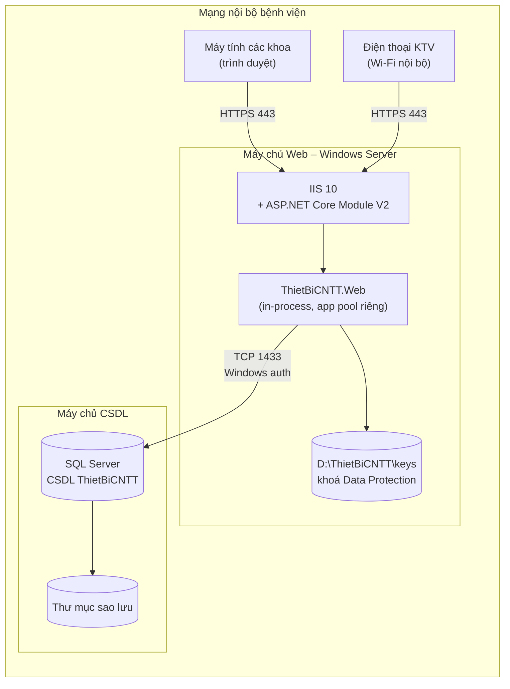

# HƯỚNG DẪN TRIỂN KHAI TRÊN IIS
## Hệ thống Quản lý Trang thiết bị CNTT – Bệnh viện

| | |
|---|---|
| Phiên bản tài liệu | 1.1 – 21/11/2026 (điền sẵn thông số BTH) |
| Đối tượng | Cán bộ Phòng CNTT / quản trị máy chủ, DBA |
| Công nghệ | ASP.NET Core (.NET 10) · SQL Server · IIS 10 trên Windows Server |
| Gói kèm theo | Thư mục `deploy/` trong mã nguồn: `publish.ps1`, `caidat-iis.ps1`, `capnhat.ps1`, `appsettings.Production.mau.json`, `sql/01..04` |

---

## 0. Thông số triển khai BTH (đã chốt)

| Thông số | Giá trị |
|---|---|
| Tên miền | **`thietbi.bth.org.vn`** |
| Mô hình | **1 máy**: IIS + SQL Server trên cùng máy chủ |
| Kết nối CSDL | Windows Authentication bằng danh tính app pool **`IIS AppPool\ThietBiCNTT`** (không lưu mật khẩu CSDL trong file) |
| CSDL | `ThietBiCNTT` trên `localhost` · collation `Vietnamese_CI_AS` |
| Thư mục | `D:\ThietBiCNTT\{app, keys, logs, backup, sql}` |
| Quyền CSDL ban đầu | `db_owner` (ứng dụng tự tạo bảng) → hạ quyền sau khi ổn định (mục 5.1) |

Các giá trị trên **đã điền sẵn** trong `caidat-iis.ps1`, `appsettings.Production.mau.json` và `sql\01-tao-csdl.sql`. Link trong mã QR tự lấy `https://thietbi.bth.org.vn` (khoá `App:DiaChiTruyCap`).

**Tóm tắt các lệnh cài đặt** (PowerShell *Run as Administrator* trên máy chủ, trong thư mục giải nén gói cài đặt):

```powershell
# 1. Đã cài: IIS, .NET 10 Hosting Bundle (mục 3.2), SQL Server + sqlcmd; múi giờ:
tzutil /s "SE Asia Standard Time"

# 2. Tạo CSDL + quyền cho app pool (giá trị BTH đã điền sẵn trong script)
sqlcmd -S localhost -E -i sql\01-tao-csdl.sql

# 3. Cài website. Chưa có chứng chỉ → cài HTTP trước, rồi lấy chứng chỉ Let's Encrypt theo docs/ChungChiHTTPS.md:
powershell -ExecutionPolicy Bypass -File .\caidat-iis.ps1
#    Đã có chứng chỉ (.pfx đã import):
powershell -ExecutionPolicy Bypass -File .\caidat-iis.ps1 -CertThumbprint <THUMBPRINT>
#    (thử nghiệm chưa có chứng chỉ: bỏ -CertThumbprint)

# 4. Điền mật khẩu admin ban đầu: mở D:\ThietBiCNTT\app\appsettings.Production.json, sửa "Seed:AdminPassword", rồi:
Restart-WebAppPool ThietBiCNTT

# 5. Sao lưu hằng ngày (mục 6.2) + DNS nội bộ thietbi.bth.org.vn → IP máy chủ (mục 5.4)
```

Sau đó đăng nhập `https://thietbi.bth.org.vn` bằng `admin`, đổi mật khẩu, xoá `Seed:AdminPassword`, rồi đi theo **checklist mục 7**.

## Mục lục
1. [Mô hình triển khai](#1-mô-hình-triển-khai)
2. [Yêu cầu hệ thống & thông tin cần chuẩn bị](#2-yêu-cầu-hệ-thống--thông-tin-cần-chuẩn-bị)
3. [Chuẩn bị máy chủ](#3-chuẩn-bị-máy-chủ)
4. [Đóng gói phần mềm](#4-đóng-gói-phần-mềm)
5. [Cài đặt](#5-cài-đặt)
6. [Cấu hình sau cài đặt & vận hành](#6-cấu-hình-sau-cài-đặt--vận-hành)
7. [Checklist nghiệm thu triển khai](#7-checklist-nghiệm-thu-triển-khai)
8. [Cập nhật phiên bản & khôi phục](#8-cập-nhật-phiên-bản--khôi-phục)
9. [Giám sát & nhật ký](#9-giám-sát--nhật-ký)
10. [Xử lý sự cố thường gặp](#10-xử-lý-sự-cố-thường-gặp)
11. [Khuyến nghị bảo mật](#11-khuyến-nghị-bảo-mật)
- [Phụ lục A – Cài đặt IIS thủ công (không dùng script)](#phụ-lục-a--cài-đặt-iis-thủ-công-không-dùng-script)
- [Phụ lục B – Danh mục cấu hình](#phụ-lục-b--danh-mục-cấu-hình)

---

## 1. Mô hình triển khai



- **Mô hình 1 máy** (khuyến nghị cho quy mô < 5.000 thiết bị): IIS và SQL Server cùng một máy chủ. Đơn giản, dùng danh tính app pool để kết nối CSDL.
- **Mô hình 2 máy**: SQL Server dùng chung của bệnh viện. Dùng tài khoản máy (`DOMAIN\WEBSRV$`) hoặc tài khoản dịch vụ domain, hoặc tài khoản SQL (xem 5.1).
- Ứng dụng chạy **in-process** trong IIS; có **job nền** (sinh lệnh bảo trì định kỳ, tự nghiệm thu) nên app pool phải ở chế độ **AlwaysRunning** (script đã cấu hình).

---

## 2. Yêu cầu hệ thống & thông tin cần chuẩn bị

### 2.1. Phần cứng / phần mềm

| Thành phần | Tối thiểu | Khuyến nghị |
|---|---|---|
| Hệ điều hành | Windows Server 2019 | Windows Server 2022 / 2025 |
| CPU / RAM máy web | 2 vCPU / 4 GB | 4 vCPU / 8 GB |
| Ổ đĩa | 20 GB trống | Ổ D: riêng cho ứng dụng + sao lưu |
| IIS | 10.0 (có Application Initialization) | — |
| .NET | **ASP.NET Core Runtime 10.0 – Hosting Bundle** | Bản vá mới nhất dòng 10.0.x |
| SQL Server | 2019 Express (giới hạn 10 GB/CSDL) | 2022 Standard (có SQL Agent) |
| Trình duyệt người dùng | Chrome / Edge / Firefox bản hiện hành | — |
| Điện thoại | Android 10+ / iOS 15+, trình duyệt mặc định | — |

> Không cần cài .NET SDK trên máy chủ. Gói publish là *framework-dependent* (dùng runtime của Hosting Bundle).

### 2.2. Thông tin cần chuẩn bị trước

| Thông tin | Ví dụ | Dùng ở |
|---|---|---|
| Tên miền nội bộ | `thietbi.bth.org.vn` | DNS, binding IIS, tham số `DonVi.DiaChiTruyCap` (link trong mã QR) |
| IP tĩnh máy web | `10.10.1.20` | Bản ghi DNS A |
| Chứng chỉ HTTPS | do CA nội bộ / AD CS cấp cho tên miền trên | Binding 443 |
| Máy chủ SQL + tên instance | `localhost` hoặc `SQLSRV01\SQL2022` | Chuỗi kết nối |
| Tài khoản kết nối CSDL | danh tính app pool / tài khoản dịch vụ / tài khoản SQL | Mục 5.1 |
| Mật khẩu admin ban đầu | ≥ 8 ký tự, có hoa, thường, số | `Seed:AdminPassword` |
| Danh sách khoa/phòng, người dùng | file Excel | Nhập sau khi cài (mục 6) |

---

## 3. Chuẩn bị máy chủ

### 3.1. Bật IIS
Script `caidat-iis.ps1` tự bật các tính năng cần thiết. Nếu làm tay (Server Manager → *Add Roles and Features* → *Web Server (IIS)*), chọn tối thiểu:
- Common HTTP Features: Default Document, HTTP Errors, Static Content
- Health and Diagnostics: HTTP Logging
- Performance: Static Content Compression, Dynamic Content Compression
- Security: Request Filtering
- **Application Development: Application Initialization**
- Management Tools: IIS Management Console, IIS Management Scripts and Tools

### 3.2. Cài .NET 10 Hosting Bundle
1. Tải **ASP.NET Core Runtime 10.0.x – Windows – Hosting Bundle** tại trang chính thức `https://dotnet.microsoft.com/download/dotnet/10.0`.
2. **Cài sau khi đã bật IIS** (nếu cài trước, chạy lại bộ cài và chọn *Repair*).
3. Khởi động lại IIS:
   ```powershell
   net stop was /y
   net start w3svc
   ```
4. Kiểm tra: IIS Manager → máy chủ → *Modules* có **AspNetCoreModuleV2**; hoặc
   ```powershell
   dotnet --list-runtimes    # phải có Microsoft.AspNetCore.App 10.0.x
   ```

### 3.3. SQL Server
- Cài SQL Server (Express/Standard), bật **TCP/IP** (SQL Server Configuration Manager) nếu SQL ở máy khác, mở cổng 1433 trên tường lửa máy SQL **chỉ cho IP máy web**.
- Cài **sqlcmd** trên máy web (đi kèm SSMS hoặc gói *Microsoft Command Line Utilities*) để chạy script sao lưu khi cập nhật.

### 3.4. Múi giờ & đồng bộ thời gian
SLA, hạn xử lý, lịch bảo trì tính theo **giờ máy chủ**. Đặt múi giờ Việt Nam và đồng bộ NTP với domain controller:
```powershell
tzutil /s "SE Asia Standard Time"
w32tm /query /status
```

---

## 4. Đóng gói phần mềm

Thực hiện trên **máy phát triển** (có .NET 10 SDK), tại thư mục gốc mã nguồn:

```powershell
powershell -ExecutionPolicy Bypass -File deploy\publish.ps1
```

Script sẽ: chạy unit test → `dotnet publish -c Release -r win-x64 --self-contained false` → loại bỏ cấu hình dev/demo → xuất `migration-idempotent.sql` → nén thành `out\ThietBiCNTT_<ngày-giờ>.zip` gồm:

```
ThietBiCNTT_20261121_1030\
├─ app\                              ← bản cài ứng dụng (~38 MB)
├─ sql\01-tao-csdl.sql  02-sao-luu.sql  03-ha-quyen.sql  04-khoi-phuc.sql
├─ migration-idempotent.sql          ← cho DBA nếu không để ứng dụng tự migrate
├─ appsettings.Production.mau.json
├─ caidat-iis.ps1
└─ capnhat.ps1
```

<details><summary>Làm thủ công (không dùng script)</summary>

```powershell
dotnet test tests\ThietBiCNTT.Tests -c Release
dotnet publish src\ThietBiCNTT.Web -c Release -r win-x64 --self-contained false -o out\app
dotnet tool install --global dotnet-ef
dotnet ef migrations script --idempotent -p src\ThietBiCNTT.Infrastructure -o out\migration-idempotent.sql
```
</details>

Chép file `.zip` sang máy chủ web và giải nén, ví dụ `C:\Setup\ThietBiCNTT_20261121_1030\`.

---

## 5. Cài đặt

### 5.1. Tạo CSDL và tài khoản ứng dụng (DBA / quản trị SQL)

Mở `sql\01-tao-csdl.sql`, sửa 3 biến đầu file rồi chạy bằng tài khoản sysadmin:

```powershell
sqlcmd -S localhost -E -i sql\01-tao-csdl.sql
```

| Trường hợp | `DanhTinhApp` | Chuỗi kết nối (`appsettings.Production.json`) |
|---|---|---|
| **A** – SQL cùng máy web | `IIS AppPool\ThietBiCNTT` | `Server=localhost;Database=ThietBiCNTT;Trusted_Connection=True;TrustServerCertificate=True;MultipleActiveResultSets=true` |
| **A'** – SQL khác máy, cùng domain | `BTH\WEBSRV01$` (tài khoản máy web) hoặc tài khoản dịch vụ `BTH\svc_thietbi` (khi đó chạy `caidat-iis.ps1 -PoolUser ... -PoolPassword ...`) | `Server=SQLSRV01;Database=ThietBiCNTT;Trusted_Connection=True;TrustServerCertificate=True;MultipleActiveResultSets=true` |
| **B** – Tài khoản SQL | `thietbi_app` (bỏ chú thích khối *Cách B* trong script) | `Server=SQLSRV01;Database=ThietBiCNTT;User Id=thietbi_app;Password=...;TrustServerCertificate=True;MultipleActiveResultSets=true` |

**Quyền CSDL** — chọn một trong hai chế độ:

| Chế độ | Biến `QuyenCaoKhiCai` | `Database:AutoMigrate` | Khi cập nhật phiên bản |
|---|---|---|---|
| Ứng dụng tự tạo/nâng cấp bảng (đơn giản) | `1` (db_owner) | `true` | Không cần làm gì thêm |
| DBA kiểm soát thay đổi CSDL (an toàn hơn) | `0` (chỉ đọc/ghi) | `false` | DBA chạy `migration-idempotent.sql` của gói mới **trước** khi chép ứng dụng |

> Có thể bắt đầu với chế độ 1 để cài nhanh, sau khi ổn định chạy `sql\03-ha-quyen.sql` và đổi `AutoMigrate` thành `false`.

> `TrustServerCertificate=True` phù hợp SQL nội bộ dùng chứng chỉ tự ký. Nếu SQL Server có chứng chỉ do CA nội bộ cấp, bỏ tham số này để kiểm tra chứng chỉ đầy đủ.

### 5.2. Cài website trên IIS

PowerShell **Run as Administrator**, trong thư mục giải nén:

```powershell
# Chỉ HTTP (thử nghiệm):
powershell -ExecutionPolicy Bypass -File .\caidat-iis.ps1      # -HostName mặc định thietbi.bth.org.vn

# Có HTTPS (khuyến nghị) — lấy thumbprint: Get-ChildItem Cert:\LocalMachine\My
powershell -ExecutionPolicy Bypass -File .\caidat-iis.ps1 -CertThumbprint 3A5F...C21

# SQL khác máy, chạy app pool bằng tài khoản dịch vụ domain:
powershell -ExecutionPolicy Bypass -File .\caidat-iis.ps1 -HostName thietbi.bth.org.vn -PoolUser "BTH\svc_thietbi" -PoolPassword "..."
```

Script thực hiện:

| Bước | Nội dung |
|---|---|
| Thư mục | `D:\ThietBiCNTT\app` (ứng dụng), `keys` (khoá mã hoá cookie), `logs`, `backup`, `sql` |
| App pool `ThietBiCNTT` | .NET CLR: **No Managed Code** · Integrated · **Start mode: AlwaysRunning** · Idle timeout: **0** · Load user profile: **True** · Recycle định kỳ: **tắt**, recycle cố định **02:00** |
| Website `ThietBiCNTT` | Binding `http://<HostName>:80` (+ `https://<HostName>:443` nếu có chứng chỉ, bật SNI) · **Preload enabled** · tắt Directory Browsing |
| Phân quyền | App pool: đọc `app`, sửa `keys` và `logs`; file `appsettings.Production.json` chỉ Administrators/SYSTEM/app pool đọc được |

Đổi thư mục gốc bằng tham số `-Root E:\ThietBiCNTT` nếu máy chủ không có ổ D:. Cài thủ công: xem [Phụ lục A](#phụ-lục-a--cài-đặt-iis-thủ-công-không-dùng-script).

### 5.3. Cấu hình `appsettings.Production.json`

Lần đầu, script tạo file này từ mẫu tại `D:\ThietBiCNTT\app\appsettings.Production.json`. **Mở bằng Notepad (Run as Administrator) và sửa:**

```json
{
  "DatabaseProvider": "SqlServer",
  "ConnectionStrings": {
    "DefaultConnection": "Server=localhost;Database=ThietBiCNTT;Trusted_Connection=True;TrustServerCertificate=True;MultipleActiveResultSets=true"
  },
  "Database": { "AutoMigrate": true },
  "DataProtection": { "KeysPath": "D:\\ThietBiCNTT\\keys" },
  "Seed": { "AdminPassword": "MatKhau@BanDau2026" },
  "SeedSampleData": false
}
```

| Khoá | Bắt buộc | Ý nghĩa |
|---|---|---|
| `ConnectionStrings:DefaultConnection` | ✔ | Chuỗi kết nối theo bảng ở 5.1 |
| `DataProtection:KeysPath` | ✔ | Thư mục lưu khoá mã hoá cookie. **Thiếu → người dùng bị đăng xuất mỗi lần recycle app pool** |
| `Seed:AdminPassword` | ✔ lần đầu | Mật khẩu tài khoản `admin` khi tạo lần đầu. **Xoá giá trị sau khi đã đăng nhập & đổi mật khẩu** |
| `Database:AutoMigrate` | | `true` (mặc định) tự áp migration khi khởi động; `false` nếu DBA chạy script |
| `SeedSampleData` | | Luôn `false` trên máy chủ thật (chỉ dùng cho bản demo) |

> Trong JSON, dấu `\` phải viết thành `\\`. Sai cú pháp JSON → ứng dụng không khởi động (lỗi 500.30, xem mục 10).

Sau khi sửa: `Restart-WebAppPool ThietBiCNTT`.

### 5.4. DNS, tường lửa, HTTPS
- **Tường lửa Windows** máy web: chỉ mở 80/443 cho dải mạng nội bộ:
  ```powershell
  New-NetFirewallRule -DisplayName "ThietBiCNTT HTTPS" -Direction Inbound -Protocol TCP -LocalPort 443 -RemoteAddress 10.0.0.0/8 -Action Allow
  New-NetFirewallRule -DisplayName "ThietBiCNTT HTTP"  -Direction Inbound -Protocol TCP -LocalPort 80  -RemoteAddress 10.0.0.0/8 -Action Allow
  ```
- **HTTPS**: khi đã có binding 443, ứng dụng tự chuyển hướng HTTP → HTTPS và bật HSTS.
  **BTH chưa có chứng chỉ → làm theo [ChungChiHTTPS.md](ChungChiHTTPS.md)** (Let's Encrypt miễn phí, tự gia hạn, máy chủ không cần mở ra Internet).
  `thietbi.bth.org.vn` là **tên miền thật** (thuộc `bth.org.vn`), nên nên dùng **chứng chỉ công khai** — mọi máy tính, điện thoại đều tin cậy sẵn, không phải cài thêm chứng chỉ:
  | Cách | Khi nào dùng | Ghi chú |
  |---|---|---|
  | **Chứng chỉ wildcard `*.bth.org.vn`** bệnh viện đã mua (nếu có) | Có sẵn | Import file `.pfx` vào *Local Computer → Personal*, lấy thumbprint |
  | Chứng chỉ thương mại cho `thietbi.bth.org.vn` | Không có wildcard | Mua 1 năm/lần, nhớ gia hạn |
  | Let's Encrypt miễn phí qua **win-acme**, xác thực **DNS-01** | Máy chủ không mở ra Internet | Cần quyền tạo bản ghi TXT `_acme-challenge.thietbi` trên DNS công khai của `bth.org.vn`; win-acme tự gia hạn 60 ngày/lần và cập nhật binding IIS |
  | Chứng chỉ CA nội bộ (AD CS) | Chỉ dùng trong domain | Điện thoại / máy ngoài domain phải cài chứng chỉ CA gốc |

  Lấy thumbprint sau khi import: `Get-ChildItem Cert:\LocalMachine\My | Where-Object Subject -like "*bth.org.vn*" | Format-List Subject, Thumbprint, NotAfter`.
- **DNS**: tên miền chỉ cần phân giải **trong mạng nội bộ** (split-DNS): tạo bản ghi A `thietbi.bth.org.vn → <IP máy chủ>` trên DNS nội bộ của bệnh viện. **Không** cần (và không nên) tạo bản ghi trên DNS công khai trỏ vào máy chủ, trừ khi có chủ trương cho truy cập từ Internet.
- Không công bố ứng dụng ra Internet. Nếu cần truy cập từ xa: dùng VPN của bệnh viện.

### 5.5. Khởi động lần đầu
1. Mở `https://thietbi.bth.org.vn` – lần đầu mất 10–30 giây (tạo bảng, dữ liệu danh mục, tham số).
2. Đăng nhập `admin` / mật khẩu `Seed:AdminPassword`.
3. Bấm tên tài khoản ở góc phải → **Đổi mật khẩu**.
4. Xoá giá trị `Seed:AdminPassword` trong `appsettings.Production.json`.

---

## 6. Cấu hình sau cài đặt & vận hành

### 6.1. Thiết lập ban đầu trên giao diện (tài khoản admin)

| # | Màn hình | Việc cần làm |
|---|---|---|
| 1 | **Quản trị → Tham số hệ thống → Thông tin đơn vị** | Nhập *Cơ quan chủ quản*, *Tên bệnh viện* (in trên biên bản, tem QR). Kiểm tra **Địa chỉ truy cập hệ thống** = `https://thietbi.bth.org.vn` (tự điền từ cấu hình) |
| 2 | Tham số → **SLA sửa chữa** | Rà soát số giờ theo mức ưu tiên, giờ hành chính, ngày làm việc; xem bảng ví dụ tính hạn |
| 3 | Tham số → **Ngày nghỉ** | Khai báo ngày lễ, Tết của năm |
| 4b | Tham số → **Thông báo** | Bật email (máy chủ SMTP, email gửi đi) / Telegram (chat ID nhóm CNTT); người nhận leo thang cấp 2; giờ bản tin hằng ngày. Kiểm tra bằng **Quản trị → Hàng đợi gửi → Gửi thử** |
| 4 | Tham số → Nghiệm thu / Điều chuyển / Bảo mật | Số ngày tự nghiệm thu, ngưỡng giá trị cần Lãnh đạo duyệt, thời gian phiên |
| 5 | **Danh mục → Khoa/phòng** | Rà soát danh sách khoa có sẵn; đánh dấu **khoa trọng yếu** (Cấp cứu, HSTC, Phòng mổ…) |
| 6 | Danh mục → Loại thiết bị, Nhà cung cấp, Kho vật tư | Bổ sung theo thực tế; đánh dấu loại thiết bị **có lưu trữ dữ liệu** (bắt buộc tháo ổ khi thanh lý) |
| 7 | **Quản trị → Người dùng** | Tạo tài khoản KTV (vai trò *Cán bộ CNTT*), Trưởng khoa, Lãnh đạo, Nhân viên; gán đúng khoa/phòng |
| 8 | Tài sản | Nhập hồ sơ tài sản, in tem QR dán lên thiết bị |
| 9 | Bảo trì định kỳ | Lập kế hoạch PM (vệ sinh máy tính, máy in, UPS…) |

### 6.2. Sao lưu tự động hằng ngày

`sql\02-sao-luu.sql` dùng được cả SQL Express (không cần SQL Agent). Tạo tác vụ Windows Task Scheduler lúc 01:30 và tác vụ dọn file sao lưu cũ hơn 30 ngày:

```powershell
schtasks /Create /TN "ThietBiCNTT\SaoLuuCSDL" /SC DAILY /ST 01:30 /RU SYSTEM /RL HIGHEST ^
  /TR "sqlcmd -S localhost -E -b -i D:\ThietBiCNTT\sql\02-sao-luu.sql -o D:\ThietBiCNTT\logs\saoluu.log"

schtasks /Create /TN "ThietBiCNTT\DonSaoLuuCu" /SC DAILY /ST 03:00 /RU SYSTEM ^
  /TR "forfiles /p D:\ThietBiCNTT\backup /m *.bak /d -30 /c \"cmd /c del @path\""
```

> - Tài khoản chạy tác vụ (SYSTEM = `NT AUTHORITY\SYSTEM`) cần quyền sao lưu trên SQL Server: `ALTER SERVER ROLE [sysadmin]` **hoặc** tạo login cho `NT AUTHORITY\SYSTEM` với role `db_backupoperator` trong CSDL ThietBiCNTT. Tài khoản dịch vụ SQL Server cần quyền ghi vào thư mục `backup`.
> - SQL Express không hỗ trợ `COMPRESSION` → xoá từ khoá này trong script nếu báo lỗi.
> - **Chép bản sao lưu sang máy/NAS khác** (quy tắc 3-2-1). Bản sao lưu nằm trên cùng máy chủ không bảo vệ được khi hỏng ổ đĩa.
> - **Diễn tập khôi phục** mỗi quý trên máy thử nghiệm bằng `sql\04-khoi-phuc.sql`.
> - Sao lưu cả thư mục `D:\ThietBiCNTT\keys`, `D:\ThietBiCNTT\dinhkem` (ảnh/tệp đính kèm) và file `appsettings.Production.json`.

Phiên bản SQL Standard: có thể dùng SQL Agent Job / Maintenance Plan thay cho Task Scheduler; nên bổ sung sao lưu **transaction log** mỗi 30 phút (CSDL đã đặt `RECOVERY FULL`).

### 6.3. Job nền của ứng dụng
Ứng dụng tự chạy (theo tham số `BaoTri.ChuKyQuetGio`, mặc định 6 giờ): sinh lệnh bảo trì định kỳ đến hạn; tự nghiệm thu phiếu quá hạn phản hồi. Điều kiện: app pool **AlwaysRunning** + site **Preload enabled** (đã cấu hình ở 5.2). Kiểm tra: trang *Bảo trì định kỳ* có lệnh mới khi kế hoạch đến hạn, hoặc bấm *Sinh lệnh đến hạn ngay*.

---

## 7. Checklist nghiệm thu triển khai

| # | Kiểm tra | Cách kiểm tra | Đạt |
|---|---|---|---|
| 1 | Trang đăng nhập hiển thị đủ giao diện (màu, biểu tượng) | Mở `https://<tên miền>` | ☐ |
| 2 | Đăng nhập admin, đổi mật khẩu thành công; đã xoá `Seed:AdminPassword` | | ☐ |
| 3 | HTTP tự chuyển sang HTTPS, ổ khoá trình duyệt không cảnh báo | Mở `http://<tên miền>` | ☐ |
| 4 | Không bị đăng xuất sau recycle | Đăng nhập → `Restart-WebAppPool ThietBiCNTT` → tải lại trang | ☐ |
| 5 | Thư mục `keys` có file `key-*.xml` | | ☐ |
| 6 | Tạo tài sản, in tem QR; quét QR bằng điện thoại mở đúng hồ sơ | | ☐ |
| 7 | Luồng báo hỏng → giao việc → hoàn thành → nghiệm thu (đúng người) | Dùng 3 tài khoản: nhân viên, KTV, trưởng khoa | ☐ |
| 8 | Hạn SLA đúng giờ hành chính / 24-7 khoa trọng yếu | So với bảng ví dụ ở *Tham số → SLA* | ☐ |
| 9 | Điều chuyển duyệt đủ cấp, bàn giao cập nhật khoa mới | | ☐ |
| 10 | In biên bản (phiếu sửa chữa, bàn giao, kiểm định thanh lý) đúng tên bệnh viện | | ☐ |
| 11 | Tác vụ sao lưu chạy, có file `.bak`, `RESTORE VERIFYONLY` OK | Xem `logs\saoluu.log` | ☐ |
| 12 | Giờ hệ thống đúng múi giờ Việt Nam | Tạo phiếu, xem thời điểm báo | ☐ |
| 13 | Tường lửa chỉ mở 80/443 cho mạng nội bộ; SQL 1433 không mở ra ngoài | | ☐ |
| 14 | Tài khoản nhân viên chỉ thấy tài sản / phiếu của khoa mình | | ☐ |

---

## 8. Cập nhật phiên bản & khôi phục

### 8.1. Cập nhật
1. Đóng gói bản mới (mục 4), chép & giải nén lên máy chủ.
2. Nếu chế độ DBA kiểm soát (`AutoMigrate=false`): DBA chạy `migration-idempotent.sql` của gói mới.
3. PowerShell **Run as Administrator** trong thư mục gói mới:
   ```powershell
   powershell -ExecutionPolicy Bypass -File .\capnhat.ps1
   # SQL ở máy khác: -SqlServer SQLSRV01   |   đã tự sao lưu: -BoQuaSaoLuuCsdl
   ```
   Script: sao lưu CSDL (COPY_ONLY) → đặt `app_offline.htm` (người dùng thấy trang "Hệ thống đang được nâng cấp") → nén bản đang chạy vào `backup\app_<giờ>.zip` → chép bản mới (**giữ nguyên** `appsettings.Production.json`) → mở lại.
4. Chạy lại các mục 1, 7 của checklist.

Nên cập nhật ngoài giờ cao điểm (sau 17:00) và thông báo trước cho các khoa.

### 8.2. Khôi phục khi bản mới lỗi
```powershell
Stop-WebAppPool ThietBiCNTT
Expand-Archive D:\ThietBiCNTT\backup\app_<giờ>.zip -DestinationPath D:\ThietBiCNTT\app -Force
# Nếu bản mới đã đổi cấu trúc CSDL: khôi phục file .bak "truoc-capnhat" bằng sql\04-khoi-phuc.sql
Start-WebAppPool ThietBiCNTT
```

### 8.3. Vá runtime .NET
Cài **Hosting Bundle** bản 10.0.x mới hằng tháng (theo Patch Tuesday), sau đó `iisreset`. Không cần đóng gói lại ứng dụng.

---

## 9. Giám sát & nhật ký

| Nguồn | Vị trí | Nội dung |
|---|---|---|
| Event Viewer | *Windows Logs → Application*, nguồn `IIS AspNetCore Module V2` và `.NET Runtime` | Lỗi khởi động, cảnh báo của ứng dụng (mức Warning trở lên) |
| stdout log (bật tạm khi gỡ lỗi) | `D:\ThietBiCNTT\app\logs\stdout_*.log` | Toàn bộ log console |
| IIS log | `C:\inetpub\logs\LogFiles\W3SVC<id>` | Truy cập, mã HTTP, thời gian phản hồi |
| Nhật ký hệ thống (trong ứng dụng) | *Quản trị → Nhật ký hệ thống* | Ai thêm/sửa/xoá gì, khi nào; thay đổi tham số, người dùng |
| Sao lưu | `D:\ThietBiCNTT\logs\saoluu.log` | Kết quả sao lưu hằng ngày |

**Bật stdout log tạm thời** (khi lỗi 500.30): sửa `D:\ThietBiCNTT\app\web.config`, đặt `stdoutLogEnabled="true"`, tạo thư mục `app\logs` và cấp quyền ghi cho app pool, tải lại trang, đọc file log, **tắt lại sau khi xong** (file log không tự xoá).

Giám sát đơn giản: dùng công cụ giám sát sẵn có của bệnh viện (Zabbix/PRTG…) kiểm tra HTTP `https://<tên miền>/Account/Login` trả mã 200 mỗi 5 phút, dung lượng ổ D:, dịch vụ `W3SVC` và `MSSQLSERVER`.

---

## 10. Xử lý sự cố thường gặp

| Hiện tượng | Nguyên nhân thường gặp | Cách xử lý |
|---|---|---|
| **HTTP 500.19** (0x8007000d) | Chưa cài Hosting Bundle hoặc cài trước khi bật IIS | Cài/Repair .NET 10 Hosting Bundle → `net stop was /y` → `net start w3svc` |
| **HTTP 500.30** – ANCM In-Process Start Failure | Lỗi khi khởi động: sai JSON trong `appsettings.Production.json`, không kết nối được SQL, thiếu quyền thư mục `keys` | Xem Event Viewer / bật stdout log (mục 9). Kiểm tra JSON (dấu `\\`, dấu phẩy) |
| **HTTP 500.31** – Failed to locate .NET runtime | Thiếu runtime ASP.NET Core 10 | Cài Hosting Bundle đúng dòng 10.0 |
| **HTTP 503** Service Unavailable | App pool bị dừng (lỗi lặp lại → Rapid-Fail Protection) | IIS Manager → Application Pools → Start; xem Event Viewer để tìm nguyên nhân gốc |
| Log báo `Login failed for user 'IIS APPPOOL\ThietBiCNTT'` | Chưa tạo login/user SQL cho danh tính app pool, hoặc SQL khác máy (danh tính app pool không đi qua mạng) | Chạy lại `01-tao-csdl.sql` đúng `DanhTinhApp`; SQL khác máy → dùng tài khoản máy `DOMAIN\WEBSRV$`, tài khoản dịch vụ, hoặc tài khoản SQL (5.1) |
| `A network-related or instance-specific error` | Sai tên máy/instance SQL, TCP/IP chưa bật, tường lửa chặn 1433 | Kiểm tra bằng `sqlcmd -S <server> -E -Q "select 1"` từ máy web |
| `CREATE TABLE permission denied` khi khởi động | `AutoMigrate=true` nhưng tài khoản chỉ có quyền đọc/ghi | Cấp tạm `db_owner` hoặc đặt `AutoMigrate=false` và cho DBA chạy `migration-idempotent.sql` |
| Người dùng **bị đăng xuất** sau mỗi lần recycle / khởi động lại | Chưa cấu hình `DataProtection:KeysPath` hoặc app pool không có quyền ghi thư mục `keys` | Cấu hình đúng mục 5.3, cấp quyền Modify cho `IIS AppPool\ThietBiCNTT` |
| Trang hiển thị **không có màu / thiếu biểu tượng** | Chép thiếu thư mục `app\wwwroot` hoặc các file `*.staticwebassets.endpoints.json` khi cập nhật | Chép lại **toàn bộ** thư mục `app` của gói (file tĩnh do ứng dụng phục vụ, không phụ thuộc cấu hình MIME của IIS) |
| Mã QR mở sai địa chỉ (localhost, IP) | Chưa đặt tham số *Địa chỉ truy cập hệ thống* | Tham số hệ thống → Thông tin đơn vị → `DonVi.DiaChiTruyCap` |
| Không tự sinh lệnh bảo trì định kỳ | App pool không AlwaysRunning / site không Preload; hoặc thiếu tính năng Application Initialization | Kiểm tra mục 5.2, cài tính năng *Application Initialization* |
| Giờ báo hỏng / hạn SLA lệch 7 giờ | Máy chủ để múi giờ UTC | `tzutil /s "SE Asia Standard Time"` rồi `iisreset` |
| Tài khoản bị khoá sau nhiều lần nhập sai | Chính sách khoá 5 lần sai / 15 phút | Chờ 15 phút, hoặc admin đặt lại mật khẩu ở *Người dùng* |
| Quên mật khẩu admin (không còn admin nào khác) | — | Tạm đặt `Seed:AdminPassword` không có tác dụng với tài khoản đã tồn tại. Liên hệ đội phát triển để chạy lệnh đặt lại mật khẩu trực tiếp trên CSDL |

---

## 11. Khuyến nghị bảo mật

- **Chỉ dùng trong mạng nội bộ**; truy cập từ xa qua VPN. Bật **HTTPS** cho mọi môi trường thật.
- Đổi mật khẩu `admin` ngay lần đầu; mỗi người dùng một tài khoản riêng, **không dùng chung tài khoản**; khoá tài khoản khi nhân viên nghỉ việc/chuyển công tác (*Người dùng → bỏ chọn Đang hoạt động* — phiên đang mở bị đăng xuất trong 1 phút).
- Giữ thời gian phiên ngắn cho tài khoản khoa (máy dùng chung) — tham số `BaoMat.PhienKhoaPhut`, không cho "ghi nhớ đăng nhập".
- File `appsettings.Production.json` chỉ Administrators/SYSTEM/app pool đọc được (script đã phân quyền). Ưu tiên **Windows Authentication** tới SQL để không lưu mật khẩu trong file.
- Sau khi ổn định: hạ quyền tài khoản ứng dụng trên CSDL (`sql\03-ha-quyen.sql`, `AutoMigrate=false`).
- Cập nhật Windows, SQL Server, .NET Hosting Bundle định kỳ hằng tháng.
- Gỡ *Default Web Site* nếu không dùng; không bật Directory Browsing (script đã tắt).
- Thực hiện đúng quy trình **tháo ổ cứng trước khi thanh lý** (QĐ-03) — thiết bị có thể chứa dữ liệu người bệnh.
- Định kỳ xem *Nhật ký hệ thống* để phát hiện thao tác bất thường.

---

## Phụ lục A – Cài đặt IIS thủ công (không dùng script)

1. Tạo thư mục `D:\ThietBiCNTT\app`, `keys`, `logs`, `backup`; chép nội dung thư mục `app` của gói vào `D:\ThietBiCNTT\app`.
2. **IIS Manager → Application Pools → Add Application Pool**
   - Name: `ThietBiCNTT` · .NET CLR version: **No Managed Code** · Managed pipeline: **Integrated**
   - *Advanced Settings*: **Start Mode = AlwaysRunning** · **Idle Time-out (minutes) = 0** · **Load User Profile = True** · Recycling → **Regular Time Interval = 0**, **Specific Times = 02:00**
3. **Sites → Add Website**
   - Site name `ThietBiCNTT` · Application pool `ThietBiCNTT` · Physical path `D:\ThietBiCNTT\app`
   - Binding: `https`, port 443, Host name `thietbi.bth.org.vn`, **Require Server Name Indication**, chọn chứng chỉ (thêm binding `http` 80 nếu cần chuyển hướng)
   - Site → *Advanced Settings* → **Preload Enabled = True**
4. Phân quyền (cmd Administrator):
   ```cmd
   icacls D:\ThietBiCNTT\app  /grant "IIS AppPool\ThietBiCNTT:(OI)(CI)RX" /T
   icacls D:\ThietBiCNTT\keys /grant "IIS AppPool\ThietBiCNTT:(OI)(CI)M" /T
   icacls D:\ThietBiCNTT\logs /grant "IIS AppPool\ThietBiCNTT:(OI)(CI)M" /T
   ```
5. Tạo `D:\ThietBiCNTT\app\appsettings.Production.json` từ file mẫu (mục 5.3).
6. Khởi động app pool và site, truy cập kiểm tra.

`web.config` do bước publish sinh ra (không cần sửa, trừ khi bật stdout log):
```xml
<aspNetCore processPath=".\ThietBiCNTT.Web.exe" stdoutLogEnabled="false"
            stdoutLogFile=".\logs\stdout" hostingModel="inprocess" />
```

---

## Phụ lục B – Danh mục cấu hình

**Cấu hình kỹ thuật** (file `appsettings.Production.json`, cần khởi động lại app pool khi đổi):

| Khoá | Mặc định | Ghi chú |
|---|---|---|
| `DatabaseProvider` | `SqlServer` | `Sqlite` chỉ dùng cho bản demo |
| `ConnectionStrings:DefaultConnection` | — | Xem 5.1 |
| `Database:AutoMigrate` | `true` | Tự áp migration khi khởi động |
| `DataProtection:KeysPath` | (trống) | **Bắt buộc trên IIS** |
| `Seed:AdminPassword` | (trống) | Chỉ dùng khi tạo `admin` lần đầu |
| `DinhKem:Path` | `App_Data\dinhkem` cạnh ứng dụng | Thư mục lưu ảnh/tệp đính kèm. Trên IIS đặt `D:\ThietBiCNTT\dinhkem` (script đã tạo & cấp quyền ghi) |
| `ThongBao:SmtpPassword` | (trống) | Mật khẩu tài khoản SMTP gửi email thông báo |
| `ThongBao:TelegramBotToken` | (trống) | Token bot Telegram (tạo bằng @BotFather). Máy chủ cần ra được `api.telegram.org:443` |
| `App:DiaChiTruyCap` | (trống) | BTH: `https://thietbi.bth.org.vn`. Ghi vào tham số `DonVi.DiaChiTruyCap` khi tham số còn trống (link mã QR) |
| `SeedSampleData` | `false` | Không bật trên máy chủ thật |
| `Logging:LogLevel:*` | Information/Warning | Mức log |

Biến môi trường tương đương (dùng `__` thay `:`), ví dụ `ConnectionStrings__DefaultConnection`, có thể đặt ở IIS Manager → site → *Configuration Editor* → `system.webServer/aspNetCore/environmentVariables`.

**Tham số nghiệp vụ** (SLA, ngưỡng duyệt, phiên đăng nhập, thông tin đơn vị…) chỉnh trên giao diện *Quản trị → Tham số hệ thống*, có hiệu lực ngay — danh sách đầy đủ trong [QuyetDinhNghiepVu.md](QuyetDinhNghiepVu.md#danh-mục-tham-số-hệ-thống-quản-trị--tham-số-hệ-thống).

**Cấu trúc thư mục trên máy chủ**

```
D:\ThietBiCNTT\
├─ app\        ứng dụng (+ appsettings.Production.json, web.config)
├─ keys\       khoá Data Protection — SAO LƯU cùng CSDL
├─ dinhkem\    ảnh / tệp đính kèm (DinhKem:Path) — SAO LƯU cùng CSDL
├─ logs\       saoluu.log, stdout (khi bật)
├─ backup\     *.bak, app_<giờ>.zip
└─ sql\        script sao lưu / khôi phục
```
